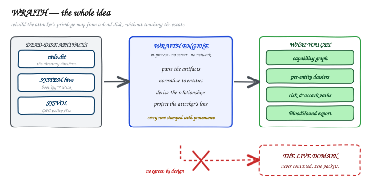
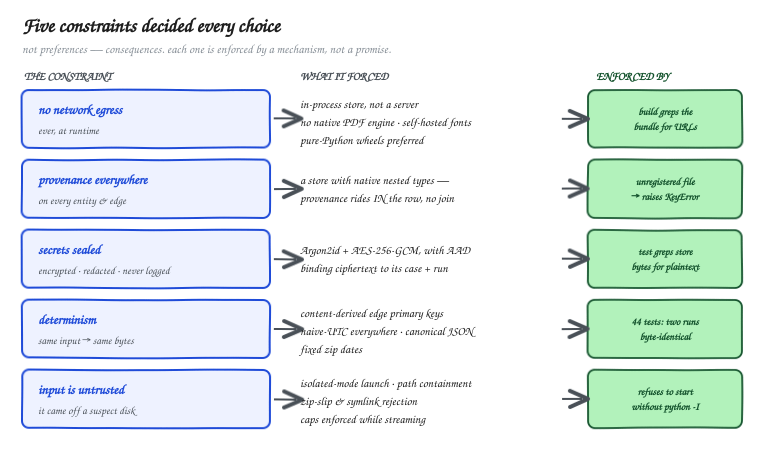
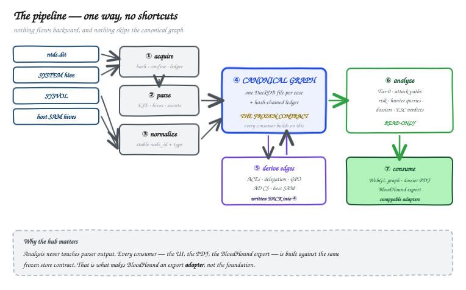
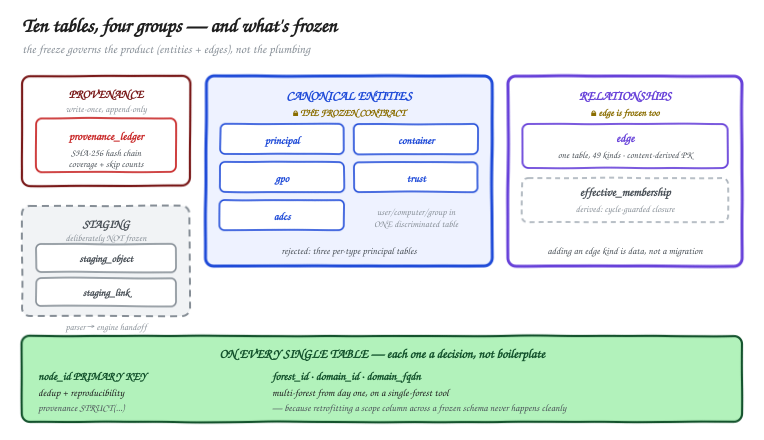
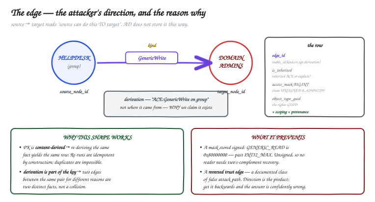
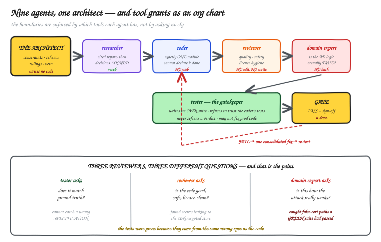
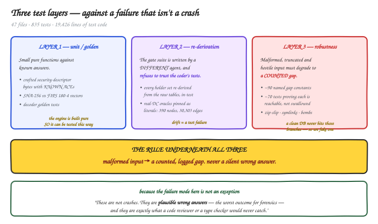
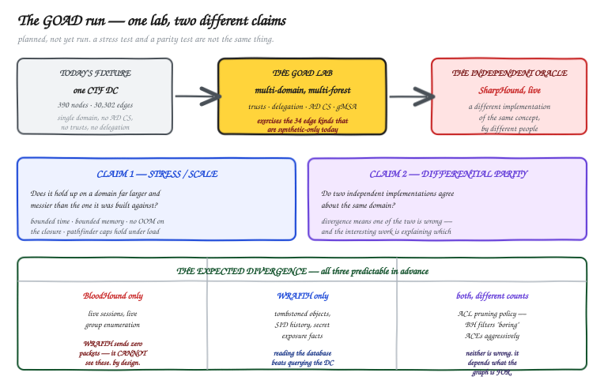

# Building WRAITH — engineering an offline Active Directory relationship engine

*How five constraints decided every technical choice in a dead-disk AD forensics tool — and how a team of specialised AI agents built it under a single human architect.*

<!-- more -->

**~40-minute read · For engineers, architects, and tool builders.**

*Prerequisites: none specific. Familiarity with Active Directory helps for Parts 2 and 4; everything else is general systems engineering.*

> **Companion post:** *Know what the attacker knows* — the same tool from the hunter's side: why context evaluation is the hunt, and a walkthrough on real evidence. This post is the machine room. That one is the reason it exists.

---

## What this is

WRAITH ingests the forensic artifacts of a domain controller — `ntds.dit`, the `SYSTEM` registry hive, `SYSVOL` — entirely offline, and reconstructs the attacker's privilege map: a capability graph, per-entity dossiers, attack paths to Tier-0, and a forensic provenance trail for every claim it makes. It sends zero packets to any target, ever.



That last sentence is not a feature. It is the constraint that determined the storage engine, the dependency list, the font loading strategy, and the way the process launches. This post is written top-down: the whole idea, then the constraints, then the flow, then every piece of the flow broken open — because that is the honest order in which the decisions actually fell out.

Three things make it worth writing about as engineering rather than as a security tool:

1. **The constraints are unusually hard and unusually explicit**, and they propagate further than you would expect. "No network egress" ends up dictating which PDF library you cannot use.
2. **The failure mode is not a crash.** It is a *plausible wrong answer* — a false attack path that sends a responder down the wrong road. Designing against that is a different engineering problem from designing against exceptions.
3. **It was built by a team of specialised agents under one human architect**, with a documented decision record for every module. I wrote the constraints, the architecture, and the rulings; I did not type the implementation. That is a build methodology worth examining, including where it failed.

---

## Table of contents

1. **Five constraints that decided everything** *(~7 min)* — the spine. Every later choice is a consequence of one of these.
2. **The whole flow** *(~12 min)* — the seven-stage pipeline, then each stage broken open:
   1. Acquisition — the trust boundary
   2. Reading `ntds.dit` — the riskiest dependency, behind an adapter
   3. Security descriptors — parse with a library, interpret with your own code
   4. Secrets — delegate the crypto chain, isolate the result
   5. Registry hives — the choice to add nothing
   6. GPO and SYSVOL — zero new dependencies, by construction
   7. Normalization · 2.8 Membership closure · 2.9 The edge engine
   8. AD CS and host SAM · 2.11 The API and the web tier
3. **The data layer** *(~5 min)* — why DuckDB, the ten-table schema, the relationship model.
4. **Graph analysis** *(~4 min)* — networkx over the edge table, and the projection bug worth describing.
5. **Every choice, with its rejection** *(~5 min)* — the full table, plus the small decisions and the specific wrong answer each one prevents.
6. **How it was built** *(~8 min)* — nine agents, tool grants as an org chart, three reviewers asking three different questions, and where the method failed.
7. **Testing** *(~5 min)* — three layers, ~90 counted gaps, and the gate.
8. **The GOAD run** *(~6 min)* — a stress test and a parity test, and why they are not the same claim.
9. **What I would do differently** *(~2 min)*
10. **References and further reading**

---

## Part 1 — Five constraints that decided everything

Most "technology choices" posts are a list of preferences. This one is a list of consequences, because five non-negotiables were fixed before any code existed, and almost every subsequent decision was forced by them.



### Constraint 1 — The offline guarantee

No component may initiate network egress at runtime. Build-time fetches must be vendored for air-gapped shipping.

**What it forced:**

- **An in-process database, not a server.** A database daemon with a listening socket contradicts the central claim of the product. This alone eliminated Neo4j as the primary store.
- **No HTML-to-PDF engine with native dependencies.** WeasyPrint was evaluated and rejected: cairo/pango fight air-gapped vendoring. PDF output is instead browser print-to-PDF of the same dossier the UI already renders — one layout, not two.
- **Self-hosted fonts.** The UI bundles Inter and JetBrains Mono via `@fontsource` rather than fetching from Google Fonts, because the offline guarantee extends into the browser tier.
- **A build-time enforcement script.** `ui/web/scripts/check-offline.mjs` greps the built bundle for `http(s)://` and fails the build if a runtime URL slips in. The guarantee is tested, not promised.
- **Pure-Python wheels, strongly preferred.** Every dependency must vendor cleanly with no native toolchain. This rejected `libesedb`, `PyNaCl`, and `rustworkx` — each a perfectly good library, each a compiled dependency.

### Constraint 2 — Provenance everywhere

Every entity, edge, and finding carries `{source file, image SHA-256, source object id, directory timestamp, ingest run id}`, attached at creation.

**What it forced:** the choice of a store with **native nested types**. Provenance rides *inside* every row as a `STRUCT` rather than living in a join table:

```sql
provenance STRUCT(
    source_file         VARCHAR,
    image_sha256        VARCHAR,
    source_object_id    VARCHAR,
    directory_timestamp TIMESTAMP,
    ingest_run_id       UUID
)
```

It also forced a fail-fast rule in code. The ingest-run object's `provenance_for()` raises `KeyError` if a source file was never registered — *a fact must not be producible without its provenance.* You cannot write an unprovenanced row by accident; the attempt raises.

### Constraint 3 — Secrets encrypted, redacted, never logged in plaintext

**What it forced:** a separate, ciphertext-only secret store (`wraith/secrets/store.py`) distinct from the analytics store, and a specific crypto shape:

- **Argon2id** (`argon2-cffi`) derives the key-encryption key from the operator passphrase — memory-hard, current standard for passphrase→key. `cryptography`'s scrypt is the fallback.
- **AES-256-GCM** encrypts each secret, with **associated data binding the ciphertext to its case and run**, so a record cannot be transplanted between cases.
- **Fernet was rejected**: AES-128-CBC + HMAC with no associated-data channel. We need AES-256 and AAD binding, so the raw AEAD primitive is correct and the convenience recipe is not.

### Constraint 4 — Determinism

Identical inputs produce identical outputs.

**What it forced** — and this is the one that reaches deepest into the code:

- Every canonical timestamp is stored as **naive UTC**, converted at the normalizer boundary, so rows are byte-deterministic and timezone-unambiguous.
- Every edge's primary key is `stable_id(kind, source, target, derivation)` — a content-derived id. Re-deriving an identical fact produces an identical row. Determinism is enforced by the schema, not by discipline.
- The export is byte-identical **including the zip archive**: ACEs sorted `(PrincipalSID, RightName, IsInherited)`, edges read `ORDER BY (kind, source, target, is_inherited, edge_id)`, canonical JSON, and `ZipInfo` with a fixed date and `create_system=3` so the bytes match across platforms. The export is also independent of `ingest_run_id` — two runs of the same evidence produce the same bundle.

There is one deliberate exception, and it is a test: AES-GCM ciphertext **must** differ on every encryption (fresh nonce) while the decrypted plaintext stays stable. Determinism is a property of outputs, not of ciphertext — and a test asserts exactly that, so nobody "fixes" the nonce to make a determinism test pass.

### Constraint 5 — Untrusted input

Artifacts are untrusted. Validate paths, run least-privilege, never execute anything from an artifact directory.

**What it forced:** the launch mode. WRAITH refuses to start unless it is launched with `python -I` (isolated mode), which drops the script directory and user site-packages from `sys.path`. The reason is concrete: an evidence directory containing a planted `json.py` would otherwise be imported by `import json`. Try to start it the ordinary way and it stops:

```
ERROR: WRAITH must be launched with 'python -I -m wraith' (isolated mode) so
artifact directories cannot shadow stdlib imports. Pass --allow-unisolated to
override (development only).
```

It also forced a whole robustness surface on the upload path: zip-slip rejection, symlink and hardlink members skipped and counted, zip-bomb member caps, magic-byte sniffing, oversize rejection while streaming, and path containment checks — 24 dedicated tests on that layer alone.

### The sixth rule, which is really the first

Underneath those five sits the rule that shaped the dependency list:

> **Correctness-critical formats are delegated, never hand-rolled.**

The ESE database layout, the security-descriptor binary format, and the secret-decryption chain are each delegated to a maintained library. A subtle bug in any of them produces a plausible wrong answer, which is the worst possible outcome for a forensics tool. The corollary — and the line that matters for licence hygiene — is:

> **Public facts are reusable; foreign source code is not.**

Rights-GUIDs, UAC flags, well-known SIDs, `[MS-*]` constants: reuse freely. Implementation code from other projects: never. More on how that nearly went wrong in Part 6.

---

## Part 2 — The whole flow

The spine is seven stages — **acquire → parse → normalize → store → derive edges → analyze → consume** — and it has one rule:

> Nothing flows backward, and nothing skips the canonical graph.

That is what makes every consumer a swappable adapter. The BloodHound export, the React UI, the PDF dossier and the attack-path engine are all built against the same frozen store contract, which is why BloodHound is an export target rather than the foundation. Edges are written *back into* the store before analysis reads it, so analysis never touches parser output.

Before breaking pieces open, here is the entire pipeline on one screen. Everything downstream of "normalize" operates on typed canonical entities, never on raw parser output.



```
  evidence dir ──▶ acquisition ──▶ ESE reader ──▶ structural parse ──┐
                   (validate,      (dissect,      (schema maps,      │
                    SHA-256,        swappable       SD join, links)   │
                    ledger)         adapter)                          │
                                                                      ▼
   SYSTEM hive ──▶ bootkey ──▶ PEK ──▶ secret decryption ──▶ [encrypted store]
                                                                      │
                                                                      ▼
                                              normalizer ──▶ canonical entities
                                                                      │
                                              ┌───────────────────────┤
                                              ▼                       ▼
                                   membership closure          edge engine
                                   (transitive MemberOf)    (ACE → capability)
                                              │                       │
   SYSVOL ──▶ GPO parse ──────────────────────┼───────────────────────▶│
   SAM hives ──▶ C-blob parse ────────────────┼───────────────────────▶│
   AD CS objects ──▶ topology + ESC ──────────┴───────────────────────▶│
                                                                      ▼
                                                            canonical graph
                                                                      │
                                           ┌──────────────────────────┼──────────────┐
                                           ▼                          ▼              ▼
                                   projection + API            networkx paths   BloodHound
                                   (read-only, 127.0.0.1)      (Tier-0 reach)     export
                                           │
                                           ▼
                                   React SPA · sigma WebGL graph
```

Now each stage, with the problem it exists to solve.

### 2.1 Acquisition — the trust boundary

**Problem:** the input is attacker-adjacent data from an unknown source, and every later claim must be traceable to a specific byte-exact artifact.

Each artifact is hashed (streaming SHA-256, bounded memory), registered in a **write-once provenance ledger**, and confined to a per-case workspace directory.

Three small decisions here matter more than they look:

- **Archives are hashed twice** — the container before extraction, and each extracted file after. The reasoning: *never let decompression silently change what "the artifact" means.*
- **Artifacts are copied in by default**, producing a self-contained evidence package, with reference-by-path offered for multi-gigabyte inputs.
- **The client-supplied filename is discarded.** An uploaded file's name is derived from a validated artifact `kind` plus a sanitised host label. Accepting a multipart filename from an untrusted client is how you get a path-traversal write.

Upload size caps are enforced **while streaming**, not after buffering — 10 GiB for `ntds.dit`, 256 MiB for a hive, 2 GiB for a SYSVOL zip, each returning a 413 mid-stream. A multi-gigabyte upload must never be loaded into memory to be measured.

A note on the manifest format, because this is a forensics tool and the standards question is real. The run manifest is **WRAITH-native JSON, one file per run** rather than one mutated file, borrowing BagIt's checksum-manifest discipline with field names deliberately mappable onto CASE/UCO. **Rejected:** literal BagIt (borrow the pattern, not the layout), CASE/UCO (heavyweight for a v1), and DFXML (older, XML, superseded by CASE). An append-only set of per-run manifests is also just better evidence than a single file that gets rewritten. The ledger's primary key is `(ingest_run_id, source_file)` — one row per artifact per run — and it carries `tool_versions`, `parameters`, `coverage_counts`, and `skip_counts`.

It also carries a **SHA-256 hash chain** (`prev_entry_hash` → `entry_hash`) for tamper evidence. That was not in the original design: a domain-expert review asked for tamper-evident custody records, which would have added columns to an already-frozen table. It was deferred as an explicit schema v1.1 proposal, documented honestly as a known integrity boundary, and landed later. The sequence matters — the frozen schema was not quietly edited.

### 2.2 Reading `ntds.dit` — the riskiest dependency, behind an adapter

**Problem:** `ntds.dit` is an **ESE** database ("JET Blue") — the same engine behind Exchange and the registry. Parsing it means B-tree traversal, page layout, long-value chains, and tagged columns, correct enough to be trusted in a report.

**Chosen:** `dissect.database` (Fox-IT), the maintained successor to the archived `dissect.esedb`.

**Rejected:** hand-rolling a reader (violates the delegation rule outright); `libesedb`/`pyesedb` (a C library whose toolchain fights air-gapped wheel vendoring, and which splits the reader across licence families).

The interesting part is the hedge. The single riskiest dependency sits behind a thin adapter at `wraith/parsing/ese_backend.py`, so swapping back to `dissect.esedb` is a one-file change rather than a rewrite. The adapter is independently gated, with a vendored non-AD ESE sample as its fixture and a README that states plainly what that fixture **can** validate (reader streaming, every JET column type, absent-column counting, the CleanShutdown path) and what it **cannot** (the DirtyShutdown recovery path, any NTDS semantics).

One pin looks alarming and is worth explaining because it is a real engineering trade: `dissect.util==3.25.dev9`. `dissect.database==1.1` requires `dissect.util>=3.24.dev1,<4`, and the stable `util` line tops out below that. The `.dev` pin is unavoidable on the maintained backend. It is accepted *because* the policy is to pin exactly and vendor the exact wheel — the "dev" label describes upstream's versioning, not instability in a frozen resolve.

**A limitation stated rather than hidden:** the design promised automatic ESE transaction-log *replay*. That is not achievable offline on Linux without Windows' `esentutl`. Research surfaced this and the promise was downgraded to **detect → warn → degrade**, which is what shipped. The real test DC is in a DirtyShutdown state, so this is not hypothetical.

### 2.3 Security descriptors — parse with a library, interpret with your own code

**Problem:** `nTSecurityDescriptor` is a packed binary `[MS-DTYP]` structure, and the entire capability graph depends on reading it correctly.

**Chosen:** `impacket.ldaptypes` for *parsing* — the de-facto reference parser in the Python security ecosystem.

The interpretation — which ACE means which capability — is original WRAITH code. That line is deliberate and it is where the licence rule bites. More in Part 6.

### 2.4 Secrets — delegate the crypto chain, isolate the result

**Problem:** recovering hashes requires boot key (from the `SYSTEM` hive) → PEK → per-object decryption: a multi-step chain with format-exact crypto where a subtle error yields plausible garbage.

Delegated to Impacket's well-exercised `secretsdump` path, with `pycryptodomex` supplying primitives. Two implementation details worth copying:

- Impacket is imported **lazily inside functions**, not at module top, and wrapped in fully-typed WRAITH code — so the `mypy --strict` gate holds despite Impacket shipping no type stubs.
- Recovered material never lands in plaintext anywhere. It goes straight into the encrypted store.

That second point was nearly violated, and it is one of the best arguments in this post for separating code review from behavioural testing. A review found that secret columns — including latent cleartext LAPS passwords and PEK-encrypted hashes — were being persisted into the **unencrypted** canonical store via the staging table's raw attribute map. The normalizer was working perfectly; it was correctly normalising. Behavioural tests were green. Only an audit axis specifically asking *"can a secret reach plaintext storage?"* catches that. The fix was a `SECRET_ATTRIBUTE_DENYLIST`, with a regression test that proves the stripping is non-vacuous.

### 2.5 Registry hives — the choice to add nothing

**Problem:** three separate things need registry hives — the boot key from `SYSTEM`, the AD CS certificate-binding configuration, and local group membership from member-host `SAM` hives.

**Chosen:** Impacket's `winregistry` — the dependency that was *already* present for the secret-decryption chain.

**Rejected — `regipy`**, which was the researcher's own recommendation. The ruling overrode it for one reason: *no new dependency.* Reusing a library already in the import closure for a second purpose is strictly better than adding a third-party package that does the same job slightly more pleasantly. **Also rejected — `dissect.regf`**, on licensing.

This is a small decision and it is the one I would point to as most characteristic. Every dependency is a supply-chain surface, a licence to audit, and a wheel to vendor for air-gapped shipping. The best dependency decision is usually the one you don't make.

### 2.6 GPO and SYSVOL — zero new dependencies, by construction

**Problem:** three different file formats inside SYSVOL — `GptTmpl.inf`, `Groups.xml`, and the binary `Registry.pol`.

**Chosen:** the standard library, entirely.

- `GptTmpl.inf` → `configparser`, with case-preserving keys and UTF-16LE-BOM detection.
- `Groups.xml` → stdlib `xml.etree.ElementTree`, chosen *specifically* because it is safe against the entity-expansion attack class. This is parsing attacker-adjacent XML; the parser choice is a security decision, not a convenience one.
- `Registry.pol` → a WRAITH-native, bounds-checked parser, because the format is simple enough that delegation buys nothing and a 150-line checked parser is auditable.

**`lxml` was never used.** The whole GPO tier adds no dependency at all.

Three more small decisions in this layer, each of which is the kind of thing that separates a tool that works on your lab from one that works on evidence:

- **Every SYSVOL file is capped at 8 MiB** — real policy files are a few kilobytes — and oversize is a counted gap. But a *genuinely empty* file returns empty bytes and is explicitly **not** a gap, so "unreadable" is never silently conflated with "legitimately empty."
- **Precedence is modelled on Windows, not invented.** When `GptTmpl.inf` restricted-groups and a GPP `Groups.xml` target the same local group, restricted-groups wins and the superseded push is counted. Mirroring how Windows actually resolves the conflict is the only defensible answer.
- **Local groups are never resolved by name.** Matching is by full alias SID, then by the trailing RID of `S-1-5-32-<RID>`. A bare group-name token is *not* guessed at, because there is no reliable offline name→RID map — it becomes a counted `member_name_unresolved`. Refusing to guess is the whole design.

### 2.7 Normalization — where raw objects become typed entities

**Problem:** the parser emits raw rows keyed by internal database identifiers. Everything downstream needs stable, typed, SID-keyed entities with consistent scoping.

The normalizer produces the canonical entity tables and, critically, decides what each object *is*. Its counted-gap taxonomy is the honest record of what it could not classify: `no_identity`, `unclassified`, `not_modeled`, `orphan_parent`, `missing_samaccountname`, `deleted_recoverable`, `deleted_recycled`, `gplink_unresolved`, `gplink_disabled`, `link_unresolved_endpoint`.

### 2.8 Membership closure — a cheap table that buys O(1) answers

**Problem:** "who is effectively in Domain Admins?" is a transitive question over a cyclic graph, asked constantly.

The direct `MemberOf` edges are materialised into a reflexive-free transitive closure keyed by `node_id`, not by SID:

```sql
CREATE TABLE effective_membership (
    member_node_id VARCHAR NOT NULL,
    group_node_id  VARCHAR NOT NULL,
    forest_id      VARCHAR NOT NULL,
    domain_id      VARCHAR,
    PRIMARY KEY (member_node_id, group_node_id)
)
```

Two design notes. The closure is **cycle-guarded** — AD group membership can and does contain cycles. And it is keyed by `node_id` deliberately, so a future authentication-event join can map a subject to all its effective groups with no re-architecture. This is building room for the future without building the future.

On the real test DC: 39 direct membership edges (25 from the link table, 11 synthesised from primary-group, 3 from special identities) expand to 70 effective pairs.

### 2.9 The edge engine — the heart

**Problem:** turn ACEs, UAC flags, trust attributes, and delegation settings into an attacker-direction capability graph, and be able to say *why* every edge exists.

This is the module where everything else is justified. It is deliberately built as small, pure, independently-testable functions — the ACE classifier, the mask merger, the holder-set resolvers — precisely so they can be tested as pure functions against crafted bytes.

Some classification rules that are easy to get wrong and are each pinned by a test:

- **`GenericAll` dominates and suppresses sub-rights.** If a principal has full control, emitting six narrower edges as well is noise, not information.
- **Masks merge by OR-ing unsigned bits.** `access_mask` is stored as `BIGINT` holding a *clean unsigned* 32-bit value (0..4294967295), not a signed two's-complement reinterpretation. Bit 31 round-trips unsigned, with a test that says so.
- **Deny ACEs, inherit-only ACEs, and noise trustees are skipped — and counted.** On the real DC: 52 deny ACEs skipped, 5,180 inherit-only, 3,850 noise trustees, 695 unmapped object types, 1 SD parse error, 13 unresolved `Contains` parents. Those numbers are asserted *exactly* by a test, so a drifting gap count fails the build.

### 2.10 AD CS and host SAM — the artifact-dependent tiers

Which edges WRAITH can produce is determined by which artifacts it is given, not by a gap in its logic. SYSVOL yields GPO-derived rights; SAM hives yield local-administrator relationships; AD CS objects yield certificate topology and escalation paths.

One result here is worth more than it looks: on the real DC, SYSVOL parsing produced **zero** AdminTo and zero privilege edges. That is a *true negative*, verified by root cause — there is no `[Group Membership]` section and no `Groups.xml` anywhere in those three GPOs. A live SharpHound run would also produce zero. Confirming parity on a negative result is a real validation, and distinguishing "nothing there" from "we failed to look" is exactly the discipline the rest of this post is about.

### 2.11 The API and the web tier

A **read-only** FastAPI application over the canonical store, with Uvicorn bound to `127.0.0.1` only.

**Frontend: a recorded reversal.** The original plan was HTMX + Alpine, chosen to minimise offline build tooling. It was reversed to React + TypeScript + Vite, for a stated reason:

- A living, draggable WebGL attack graph with panels that stay synchronised to the selection is a genuine component-state problem. HTMX's server-fragment model fights it.
- The original motivation for HTMX — minimal tooling — is satisfied anyway, because a single `vite build` vendors every asset and the offline-check script verifies it.

**Graph rendering: `sigma` (WebGL) over `graphology`.** Rejected: Cytoscape.js, whose canvas/SVG rendering does not scale to real-domain node counts; and D3-force, which is a layout primitive rather than a renderer and would mean building the WebGL layer by hand.

**Export bundling: `fflate`, client-side.** The export is zipped in the browser so the operator downloads a bundle without the server writing export artifacts to disk.

---

## Part 3 — The data layer

### Why DuckDB

Framed as constraint → consequence rather than as a preference:

| Constraint | Consequence |
|---|---|
| No network egress, no server | **In-process.** The store is a library and a file, not a daemon. This is the decisive reason. |
| Wide analytical scans (score every principal, aggregate every edge) | **Columnar.** The right query profile for the workload. |
| Behavioural baselining is on the roadmap | **Parquet-ready.** An escape hatch to high-volume event data without re-architecting. |
| Provenance on every row | **Native `LIST` / `STRUCT` / `LIST(STRUCT)`.** Provenance rides in-row; no join table. |
| Per-case isolation and deletability | **One embedded file per case workspace.** Deleting a case is one tree removal; the analysis is one hashable artifact. |
| Permissive licence only | **MIT.** |

**Rejected — SQLite:** a row store, slower on wide analytical scans, with no native columnar/Parquet path for the multi-forest future. It offers the same "just a file" simplicity with the wrong query profile. The original design spec named both DuckDB *and* SQLite; the ambiguity was resolved by dropping SQLite entirely.

**Rejected — Neo4j as the primary store:** GPL-class licence *and* a running server. That breaks the licence rule and the server-free posture simultaneously. Neo4j survives only as an optional BloodHound reference lane in a separate container, communicating over Bolt — a separate process, never an import. The licence shaped the architecture.

### The schema — ten tables in four groups



**Provenance (1):** `provenance_ledger` — write-once, append-only, hash-chained.

**Canonical entities (5) — the frozen contract:** `principal` (User/Computer/Group in one discriminated table), `container` (OU/Container/Domain), `gpo`, `trust`, `adcs` (CertTemplate/EnterpriseCA).

**Staging (2) — deliberately outside the freeze:** `staging_object` (the lossless raw attribute map plus the raw security descriptor as a `BLOB`) and `staging_link` (raw link-table rows with endpoints resolved to node ids). This is the parser-to-edge-engine handoff. Keeping it outside the frozen contract means the handoff can evolve without a schema version bump — the freeze governs the *product* (entities and edges), not the plumbing.

**Relationships (2):** `edge` (frozen) and `effective_membership` (derived).

Three things appear on every table, each a decision rather than boilerplate:

```sql
node_id   VARCHAR PRIMARY KEY           -- dedup + reproducibility
forest_id VARCHAR NOT NULL,             -- the scoping block:
domain_id VARCHAR, domain_fqdn VARCHAR  -- multi-forest from day one
provenance STRUCT(...)                  -- provenance, in-row
```

The scoping block is on every table from the first module, on a single-forest tool, because retrofitting a scope column across a frozen schema later is the kind of migration that never happens cleanly.

### The relationship model



```sql
CREATE TABLE edge (
    edge_id          VARCHAR PRIMARY KEY,  -- stable_id(kind, source, target, derivation)
    kind             VARCHAR NOT NULL,
    source_node_id   VARCHAR NOT NULL,
    target_node_id   VARCHAR NOT NULL,
    is_inherited     BOOLEAN,              -- inherited ACE vs explicit
    derivation       VARCHAR,              -- WHY this edge exists
    access_mask      BIGINT,               -- clean unsigned 32-bit; ACL-derived only
    object_type_guid VARCHAR,              -- the rights GUID, for object-specific ACEs
    confidence       VARCHAR,
    ...scoping + provenance
)
```

Four design points an engineer will ask about:

1. **The direction is the attacker's.** `source → target` reads "source can do this *to* target". Active Directory does not store relationships this way; the graph is a reframing, not a dump. Getting direction wrong on a trust edge is a documented class of false attack path.
2. **`edge_id` is content-derived.** `stable_id(kind, source, target, derivation)`, where the id function is order-sensitive and uses a unit separator specifically to prevent concatenation collisions. Re-derive the same fact, get the same primary key — so re-runs are idempotent by construction and duplicate rows are structurally impossible.
3. **`derivation` is provenance for the *inference*.** The provenance struct answers "which artifact did this come from?" `derivation` answers "why do you claim this edge exists?" Those are different questions, and a responder will ask the second one. It is also part of the primary key, so two edges between the same pair for different reasons are distinct facts rather than a collision.
4. **One table for every edge kind.** Adding a kind is data, not a migration.

### What the graph actually looks like

On the real test DC (`c137.local`, from the public *Stolen Szechuan Sauce* CTF image — public training data, which is why it can be named here): **390 nodes, 30,302 edges, 15 distinct edge kinds.**

| Edges | Kind | | Edges | Kind |
|---:|---|---|---:|---|
| 6,459 | GenericWrite | | 39 | MemberOf |
| 6,455 | WriteDacl | | 20 | GetChanges |
| 6,455 | WriteOwner | | 15 | GetChangesAll |
| 6,440 | AllExtendedRights | | 13 | GetChangesInFilteredSet |
| 3,714 | Owns | | 4 | WriteSPN |
| 369 | Contains | | 3 | DCSync |
| 312 | AddAllowedToAct | | 2 | GPLink · WriteAccountRestrictions |

Fifteen kinds appear on this domain; the glossaried vocabulary is **49**. Which ones you get is decided by which artifacts you were handed, not by a gap in the engine.

Be honest about that shape, because a careful reader will spot it immediately: **roughly 29,500 of 30,302 edges are ACL-derived.** That is DACL expansion — every meaningful ACE on every object becomes an edge. 390 nodes producing 30,000 relationships is not a bug, but it does mean a raw relationship dump is close to useless to a human. The value is entirely in the projection layer on top, which brings us to the most instructive bug in the project.

---

## Part 4 — Graph analysis, and a bug worth describing

### Pathfinding: networkx over the edge table

Attack-path queries run in **networkx**, built in-process from the edge table. SQL stores and scans; a graph library traverses. Nobody pretends SQL is a traversal engine.

**Rejected — Neo4j/Cypher for pathing:** the same GPL-plus-server objection. **Rejected — rustworkx:** faster, but a compiled dependency; at current graph sizes networkx is adequate and keeps the stack pure-Python. The pathfinder is wrapped so the algorithm layer is replaceable, and that swap is noted as a future option rather than pretended away.

The path engine **bounds work, not just output** — a crafted request with `max_hops=9999, max_paths=99999` is capped rather than hanging or exhausting memory. That was a review finding on a read-only API: read-only is not the same as safe.

### The projection bug

The graph has two distinct node spaces: the **canonical** nodes (principals, containers, GPOs, AD CS objects) and the **raw object space**, which includes every normalised object whether or not it is a modelled entity.

Edges can legitimately terminate on a raw object. If you drill into a node, you want those endpoints resolved — otherwise its relationships appear to dangle. So endpoint resolution materialised raw nodes into the returned slice.

That was correct for drill-in and wrong for everything else. Browse views and hunt queries inherited the same resolution, and a seeded, Tier-0-filtered slice came back with **3,450 nodes, of which 3,440 were raw structural leaves.** The signal was buried under its own substrate. Worse, it broke an accounting invariant the API guarantees — `returned <= total_matched` — because materialised endpoints inflated the returned count without being counted as matched.

The fix took three stages, and the order is the point:

1. **Narrow the candidate pool** to canonical nodes.
2. **Fix the accounting** so materialised endpoints fold into `total_matched`, restoring `returned <= total_matched` and `truncated == (returned < total_matched)`.
3. **Guard materialisation to drill-in only** — `materialize_base = bool(seeds) and expand_base_endpoints and not tier0_only and not kind_filter` — and pass the flag explicitly from every caller.

Stage 2 is the one worth dwelling on. The accounting invariant was being violated, and the tempting fix was to relax the assertion. The correct fix was to make the accounting true. A test that fails because reality is wrong is a test doing its job.

Verified live after the fix: default graph **0** raw nodes, `tier0_only` **0**, kind-filtered **0**, unconstrained **0** — and drill-in still resolves **1,702**, exactly as intended. The invariant holds in all four.

---

## Part 5 — Every choice, with its rejection

The complete record, because "we chose X" is worth nothing without "instead of Y, for reason Z".

| Area | Chosen | Rejected | Why |
|---|---|---|---|
| Language | Python 3.12 | A "faster" language | The correctness-critical work is already solved in Python by dissect and Impacket. Rewriting it means re-deriving format details someone else already gets right. |
| Registry hives | Impacket `winregistry` | `regipy` *(the researcher's own recommendation, overruled)*; `dissect.regf` | No new dependency — reuse the library already present for secret decryption. `dissect.regf` rejected on licensing. |
| GPO `.inf` | stdlib `configparser` | — | Case-preserving keys, UTF-16LE-BOM detection. No dependency. |
| GPO XML | stdlib `ElementTree` | `lxml` | Safe against the entity-expansion class. Parsing attacker-adjacent XML makes this a security choice. |
| `Registry.pol` | WRAITH-native bounds-checked parser | A library | The format is simple enough that delegation buys nothing; 150 auditable lines beats a dependency. |
| Principal storage | One discriminated `principal` table | Three per-type tables | Simpler to query and to join. |
| Launch | `python -I` isolated | Ordinary launch | An artifact directory must never shadow a stdlib module. Enforced at the entry point. |
| ESE reader | `dissect.database` 1.1, behind an adapter | Hand-rolled; `libesedb`/`pyesedb` | Delegation rule; C toolchain fights air-gapped vendoring; one licence family. |
| Security descriptors | `impacket.ldaptypes` | Hand-rolled | De-facto reference parser. Interpretation is original code. |
| Secret decryption | Impacket `secretsdump` path | Re-deriving the chain | Format-exact crypto; a subtle bug yields plausible garbage. |
| KDF | Argon2id (`argon2-cffi`) | — | Memory-hard; current standard. scrypt as fallback. |
| Encryption | AES-256-GCM (`cryptography`) | Fernet; PyNaCl | Fernet is AES-128-CBC with no AAD channel; PyNaCl adds a native dependency `cryptography` already covers. |
| Store | DuckDB 2.0.0 | SQLite; Neo4j | Row-store query profile and no Parquet path; GPL + server. |
| Pathfinding | networkx 3.7 | Neo4j/Cypher; rustworkx | GPL + server; compiled dependency. |
| API | FastAPI 0.162 + Uvicorn | — | Typed models matching the pydantic data shapes; first-class WebSocket for ingest progress; binds `127.0.0.1`. |
| Frontend | React 18.3.1 + TS + Vite | HTMX + Alpine *(reversed)* | A draggable WebGL graph with synchronised panels is a component-state problem; Vite still vendors everything offline. |
| Graph render | sigma 3.0.2 (WebGL) + graphology | Cytoscape.js; D3-force | Canvas/SVG does not scale to real node counts; D3-force is a layout, not a renderer. |
| Fonts | `@fontsource` self-hosted | Google Fonts / any CDN | The offline guarantee extends into the browser. |
| Export zip | `fflate`, client-side | Server-side zip | The server never writes export artifacts to disk. |
| Export format | Native SharpHound JSON | OpenGraph *(spec corrected)* | OpenGraph cannot let BloodHound compose AD CS and DCSync edges — the stated goal. The design spec was wrong and was corrected. |
| PDF | Browser print-to-PDF | WeasyPrint | Native cairo/pango fights air-gapped shipping, and would duplicate the React dossier layout. |
| CLI | Typer | — | MIT, typed, minimal. |
| Data shapes | pydantic 2.14.1 | Loose dicts | `SecretStr`/`SecretBytes` give redaction by construction. |
| Lint/type | ruff (`E,F,I,B,UP,ANN,S`), black, `mypy --strict` | — | `S` for security rules, `ANN` for annotations. |

Two licence notes recorded so a future audit is not misled: `cryptography` is dual-licensed Apache-2.0 **or** BSD-3-Clause, and `impacket` is **not** BSD-2 as commonly assumed — it ships under Fortra's "Apache modified" licence. Both permissive and import-safe; both recorded inline in `pyproject.toml`.

One more note on dropping SQLite: no capability was actually lost, because DuckDB can `ATTACH` and read SQLite files directly. Removing an option costs nothing when the remaining option subsumes it.

### The small decisions

"Architecture" is mostly a pile of small rulings. These are the ones I would defend in a review, because each prevents a specific, nameable wrong answer.

| Decision | Value | The wrong answer it prevents |
|---|---|---|
| Hash-input separator | ASCII unit separator `\x1f` | Concatenation collision. `stable_id("A","BC")` must not equal `stable_id("AB","C")`, and `\x1f` cannot occur in realistic SID/GUID/DN content. |
| Canonical JSON | `sort_keys=True, ensure_ascii=False, separators=(",",":")`, LF newlines | Key-order churn making two identical results compare unequal. |
| `access_mask` storage | `BIGINT`, clean unsigned 0‥4294967295 | `GENERIC_READ` is `0x80000000`, which exceeds `INT32_MAX`. Stored unsigned so no reader ever needs a two's-complement recovery step — and so nobody mistakes a negative mask for a flag. |
| Timestamp type | naive-UTC `TIMESTAMP` everywhere | Timezone-ambiguous rows that are not byte-deterministic. |
| **FILETIME vs. seconds-since-1601** | A separate `decode_filetime()` for `pwdLastSet`, `lastLogonTimestamp`, `accountExpires`, `lastLogon`, `badPasswordTime` | Reusing the general NTDS timestamp decoder would place these **~10⁷× too close to 1601 — wrong by centuries.** A date that is wrong by centuries is obvious; one that is wrong by a plausible-looking amount is the real danger. |
| **Classification order** | Most-derived `objectClass`, tie-broken by `sAMAccountType`; **Computer tested before User** | In AD, `computer` is a subclass of `user`. Test in the wrong order and *every computer in the domain misfiles as a user* — a silent, total corruption of the node space. |
| Zip determinism | Fixed `ZipInfo.date_time`, `create_system=3` | Archive bytes varying with wall-clock, breaking byte-identical export. |
| SYSVOL file cap | 8 MiB, oversize counted — but genuinely empty returns empty bytes and is **not** a gap | Conflating "unreadable" with "legitimately empty". |
| Upload caps | 10 GiB ntds / 256 MiB hive / 2 GiB SYSVOL zip, enforced while streaming | Loading a multi-gigabyte upload into memory in order to reject it. |
| Upload filename | Client filename discarded; derived from validated `kind` + sanitised host label | Path traversal via an attacker-chosen multipart filename. |
| `mypy` scoping | Untyped third-party imports scoped-ignored **at the import boundary only** | A blanket ignore that silently untypes every wrapper around the library. |
| `ruff` waivers | `S101/S105/S106` in tests; `S608` in one API module | Both documented with reasons. The `S608` suppression is a *documented false positive* — the f-string fragments are code-controlled constants with every user value bound as a parameter — not a waiver of SQL-injection discipline. The distinction is the whole point of writing it down. |

Two from the frontend, included because they are measured rather than asserted:

- **Theme is set before mount.** Driving it with a class toggled by JavaScript *after* mount guarantees a flash of the wrong theme.
- **An opacity-based contrast approach was replaced after measurement:** `muted-foreground/60` computes to roughly **3.0:1** and `/50` to **2.5:1** — both fail WCAG AA. Dark surfaces use a proper stack (base → raised → overlay) in cool blue-charcoal rather than one flat near-black, which is what vendor SOC tooling actually does.

---

## Part 6 — How it was built: a team of agents, one architect

This is the part of the project I find most interesting as engineering, and the part where I have to be most careful not to overclaim.

I did not write the implementation. I wrote the constraints, locked the architecture and the schema, ruled on every question escalated to me, and held veto over everything. The code was written by a team of nine specialised agents, each with an explicit mandate, explicit boundaries, and — the detail that makes it work — **deliberately restricted tools**.



### Tool grants as an org chart

This is the design idea I would most like other people to steal.

| Agent | Role | Tools |
|---|---|---|
| researcher | Turns open questions into cited, decision-ready reports | Read, Grep, **WebSearch, WebFetch**, Write |
| coder | Implements exactly one module | Read, Grep, Edit, Write, Bash |
| tester | The gatekeeper; writes and runs the suite; PASS/FAIL | Read, Grep, Edit, Write, Bash |
| reviewer | Code quality, safety, licence hygiene | Read, Grep, Bash — **no Edit, no Write** |
| domain expert | Is the AD/attack reasoning correct? | Read, Grep, WebSearch, Write — **no Bash** |

Three consequences fall straight out of the tool grants rather than out of instructions:

- **The reviewer cannot change the code it reviews.** It has no `Edit` and no `Write`. It reports findings; the coder fixes them. A reviewer that can silently fix what it finds is not a reviewer.
- **The coder and tester have no web access at all.** Sourcing runs exclusively through the researcher. That is the offline guarantee expressed as an organisational boundary — the agents writing runtime code cannot reach the network even at design time, so they cannot casually introduce a dependency that assumes one.
- **The domain expert has no `Bash`.** It cannot run the tests. It must reason about correctness from primary sources — `[MS-ADTS]`, `[MS-DRSR]`, `[MS-GPOL]`, the rights-GUID definitions — rather than being reassured by a green suite. Which turns out to matter enormously.

### The rhythm

> **Research → lock decisions → build ONE module → test it fully → gate → next module.**

With one rule enforced in three separate documents: **nothing downstream is built on an un-gated module.** The coder is barred from declaring a module finished; the tester is barred from accepting the coder's word for it.

As built, the pipeline is seven stages, not five — code review and domain-expert review sit between implementation and the test gate:

```
research → lock → build ONE module → code review (quality · safety · licence)
         → domain review (is the AD logic true?) → test gate
         → PASS: next module    FAIL: one consolidated fix → re-test
```

The gating is deliberately **lean**: one review round and one consolidated fix pass per module, representative-sample validation rather than exhaustive loops. Unbounded review cycles are their own failure mode.

### Three reviewers, three different questions

The separation looks redundant until you see what each one catches. Each definition explicitly disclaims the other two's jurisdiction:

| Role | Asks | Never judges |
|---|---|---|
| **tester** | Does it match ground truth? | Code style; forensic meaning |
| **reviewer** | Is the code good, safe, licence-clean? | Forensic correctness |
| **domain expert** | Is this actually how the attack works? | Code style |

And here is the case that justifies the whole structure.

On the AD CS escalation module, **the tester PASSED.** The tests were green. The implementation matched the locked specification exactly.

**The specification was wrong.** It flagged every certificate *enrollee* as vulnerable to ESC9. Only the domain expert — reasoning from real attack mechanics rather than from the spec the tests were derived from — caught that ESC9, ESC13, and ESC3 were emitting **false certificate attack paths**. Three false-positive generators were corrected, and the locked research specification itself was amended.

Read that again, because it is the load-bearing argument: *the tests were green because they were derived from the same wrong specification as the code.* Behavioural testing cannot catch a specification error. Code review cannot either — the code was clean. Only an independent semantic check against primary sources can. Review and tests alone would have shipped a certificate engine that misleads operators.

### What the process caught

Across 19 gate records, the final verdict is PASS in all 19 — but **17 of the 19 record an adverse verdict earlier in the pipeline** that forced a fix first. Only membership and NTDS-secrets passed every stage first time. Tally: 2 outright tester FAILs, 11 reviewer CHANGES-REQUESTED, 7 domain-expert ISSUES.

A sample, because the specifics are the evidence:

- **A silent drop found independently by both reviewer and tester.** A malformed DER certificate in an NTAuth store discarded its parse-error count — no edge, no counted gap. A silent wrong answer. Fixed, and locked by a regression test written as a strict-xfail so it demonstrably failed against the old code.
- **A false path manufactured by a structural edge.** A rule that drops structural `Contains`/`GPLink` edges *into* a Tier-0 group was being applied only when the query target *was* the Tier-0 set. For other query shapes the rule resolved empty, so a container that merely *contains* Domain Admins manufactured a false path to it. The reviewer had passed this module outright. The fix is instructive: the rule was relocated into **graph construction** as an invariant, so it cannot be forgotten at a call site.
- **Five truth defects that made the tool report less.** `AddSelf` was missing from the add-member right set — a principal with `AddSelf` on a privileged group self-elevates to Tier-0, and it was invisible to the one query meant to catch it. Protected Users was being treated as a privileged group when it is a *defensive* one, inflating "all privileged" and hiding Protected-Users shadow admins. Three more queries were over-broad. Net effect on the real DC: `reset-password 12→4`, `WriteSPN 14→5`, `shadow-credentials 13→4`, `admincount-orphans 10→0`. **Four of five corrections deleted false positives from the operator's screen.** A tool that revises its findings downward is a tool worth trusting.
- **A tester-versus-reviewer disagreement, adjudicated and recorded.** An unreadable SAM value left a machine SID null, which silently disabled a local-versus-domain filter, leaking a host's local accounts as false domain-wide administrator nodes. The tester called it fail-safe behaviour. It was ruled a real false-node leak — fabricating graph nodes silently is never fail-safe. The disagreement and the ruling are both in the gate record.

### The licence catch that changed the architecture

The original design specification instructed the team to *"extract the GUID→edge table from SharpHound source verbatim."*

The researcher refused, and the reasoning is worth quoting as a model of the distinction:

> SharpHound is **GPL-3.0**. The rights-GUIDs themselves are **public, uncopyrightable Microsoft facts** and are free to reuse. Copying GPL source code — the implementation, the data structures, the code layout — into an otherwise-permissive Python package would GPL-contaminate it. Interpret "verbatim" as *reproduce the factual GUID→edge mapping, re-expressed in original code*: transcribe the table of facts, write the mapper from scratch.

That distinction — facts are reusable, implementations are not — then recurs as an architectural force. Neo4j is GPL-3.0, so it only ever runs as a separate container over Bolt, never linked. And `ldap3` is LGPL-3.0, which was adjudicated and recorded: unmodified, pip-imported, separable, and in fact a *dead* dependency never loaded on the offline path, because WRAITH never speaks LDAP.

### The paper trail

25 research decision records, 15 module briefs, 19 gate records, 18 handbook chapters — 11,895 lines of decision documentation. A research record carries its own status line that progresses from "for owner sign-off" to "research-locked", a candidate-comparison table with licences, an explicit confidence marker on each recommendation, a closing *"decisions this unblocks"* line, and — importantly — a *"choices I'm unsure of, please rule"* section where the researcher declines to decide.

Locked decisions are **amended in place, dated and attributed**, never quietly re-litigated. A gate record encodes its whole pipeline history in the verdict line, not just the outcome: *"PASS (research-locked + reviewer + tester FAIL → fixed → re-verified)"*.

### Where the method failed

Three honest failures, because a methodology post that only reports success is marketing.

**The logo.** Four separate attempts at a brand mark were rejected. A fourth agent exists only because two earlier ones failed, and its own definition states the conclusion plainly: LLM-authored, hand-plotted SVG mascot illustration has a low ceiling and tends to read as amateur regardless of layering. The honest path is a designer or an image generator — outside this toolchain. The process's response to repeated failure was to **change the specialist and admit the ceiling**, not to retry the same specialist a third time. Specialisation does not create capability that the medium does not have.

**The counted-gap blind spot.** The single most-repeated class of finding across every module is a degraded branch that failed to count its gap. It appears in the AD CS module, the GPO module, the export module. The documentation names it: *"the principle most often enforced in review, and the one most often missed by new code."* A rule stated once in a project file is not a rule that holds; it has to be in every task brief and audited in every review.

**Two internal contradictions in the agent definitions.** The reviewer's definition instructs it to write findings to a directory — while granting it no `Write` tool. That directory does not exist, and its findings survive only as summaries inside the gate records. Written well enough to be convincing, inconsistent enough not to work. Worth stating because it is exactly the failure mode of generated specifications.

---

## Part 7 — Testing

> These are not crashes. They are **plausible wrong answers** — the worst outcome for forensics — and they are exactly what a code reviewer or a type checker would never catch.

That sentence is the testing strategy's reason for existing. **47 test files, 835 tests, 19,426 lines of test code.**



### Layer 1 — unit / golden

Small, pure functions against known-answer fixtures. The edge engine, ACE classifier, membership builders and decoders are small and pure *precisely so* they can be tested this way: crafted `SR_SECURITY_DESCRIPTOR` bytes with known ACEs, SHA-256 against FIPS 180-4 vectors, decoder golden tests.

### Layer 2 — reference / independent re-derivation

The structural trick here: **gate suites are written by a different agent than the implementation, and explicitly refuse to trust the coder's own tests.** From a gate suite's own docstring:

> This is the AUTHORITATIVE gate; it does NOT trust the coder's sanity suite. It re-derives every pure invariant on hand-built inputs.

Twelve modules carry both a coder sanity suite and a tester gate suite. For hunter queries, every "who can X" holder set is re-derived straight from the edge and principal tables inside the test and compared to the query result exactly. Real-DC oracles are pinned as literal constants — `390` nodes, `30,303` edges, `3` DCSync holders, `10` Tier-0 principals — so drift is a test failure.

The export's parity check is an accounting identity rather than a diff: **30,303 edges read → 4,931 exported → 25,372 dropped → 0 unmapped**, with `exported + Σdropped == total` asserted per edge kind and globally, plus an assertion tripwire inside the export builder itself.

### Layer 3 — property / robustness

Malformed, truncated and hostile inputs must degrade to **counted gaps** — never crash, never silently mislead.

This is where the architecture's central discipline lives:

> **Malformed input → a counted, logged gap. Never a silent wrong answer.**

Two counters funnel through a single sink, and both are serialised into the provenance ledger per artifact, so gaps become durable forensic record rather than log noise. There are roughly **90 named gap constants** across eight namespaces — `ntds.*`, `normalizer.*`, `edges.*`, `gpo.*`, `adcs.*`, `hostsam.*` and others — and about **70 tests** asserting that each is reachable rather than swallowed. Because a cleanly-parsing real database never reaches those branches, the dedicated gap tests drive a hand-built fake backend specifically to force them.

The discipline extends to the operator-facing layer. A hunt that matches nothing reports a calm **"0 found"** *with its gap reason*, which is distinguishable from "this capability was not available". An undecidable AD CS escalation is reported **undecidable, not safe** — four escalation classes that are structurally undecidable from these artifacts have **no emit path at all** and can only be counted.

### Determinism

44 determinism and idempotence tests across 29 of the 47 files. The pattern is two independent full runs compared byte-for-byte: the whole edge computation, the membership closure, the normalizer, the export *including its zip archive*, all 56 hunter queries, the graph slices, and the dossier summaries.

### The gate

A module is not done because its tests pass. It is done on a written PASS verdict plus my sign-off. A gate document records the verdict, every stage's result, what was built, the observed real-DC facts, the counted-gap taxonomy, the findings fixed that cycle, and the honest validation status. The documentation puts it well:

> The gate records are the project's memory of why a module is trusted — and, crucially, the forensic fixes found in review, so the record of what nearly went wrong is preserved alongside what shipped.

---

## Part 8 — The GOAD run: stress test and parity test

Everything in Part 7 validates the tool against **one** domain controller: a single-domain CTF image with no AD CS, no trusts, no delegation and no gMSA. 390 nodes. That fixture shaped what got validated, and it is the single biggest limitation in the project.

The next validation step is a run against **GOAD** — Game of Active Directory, a deliberately vulnerable multi-domain, multi-forest lab — with SharpHound collecting live from the same environment as an independent oracle. It is planned and **not yet run**, so nothing in this post claims it. But it is worth describing in detail, because it is designed to answer two *different* questions that are routinely conflated.



### Claim 1 — the stress test

Does the engine hold up on a domain far larger and messier than the one it was built against?

GOAD is a genuine scale and complexity step up, not a bigger copy of the same thing. It brings multiple domains, a forest trust, constrained and resource-based delegation, gMSA accounts, a certificate authority, and the nested-group sprawl that makes real domains hard. Concretely, what gets stressed:

- **The ACL expansion.** 390 nodes already produce ~29,500 ACL-derived edges. The relationship between object count and edge count is not linear, because it is driven by how many meaningful ACEs sit on each object. A multi-domain estate is the first honest test of where that curve goes, and of whether the edge table and its deterministic primary keys stay comfortable.
- **The membership closure.** A cycle-guarded transitive closure over deeply nested, cross-domain groups is where a naive implementation either explodes combinatorially or quietly truncates. The closure is materialised, so this directly tests both its build time and its size.
- **Pathfinding under load.** The path engine bounds *work*, not just output, specifically so a hostile or careless request cannot hang it. Those caps have been tested against 30,000 edges. GOAD tests them against a graph where the interesting paths are genuinely long and cross a trust boundary.
- **The multi-forest scoping block.** Every table has carried `forest_id`, `domain_id` and `domain_fqdn` since the first module, on a single-forest tool, specifically so this day would not require a migration. GOAD is the first run that actually exercises that decision — and the first chance for it to be proven wrong.
- **The 34 edge kinds that are synthetic-only today.** Trusts, delegation, gMSA and LAPS reads, SID history, and the entire AD CS surface have never seen a real artifact. GOAD has all of them. This is the run that moves a third of the vocabulary out of synthetic-only — or exposes it.

The measurements that matter are the boring ones: wall-clock per pass, peak memory on the closure and the edge build, store size, and whether determinism still holds — two full runs, byte-identical — at ten or a hundred times the current graph size.

### Claim 2 — the differential parity test

Do two independent implementations agree about the same domain?

This is the stronger claim, and it is a different kind of test entirely. Today's "parity" is **structural self-validation** against WRAITH's own independently re-derived counts — a deliberate substitution, documented as such, because no public SharpHound baseline exists for the CTF DC. Self-validation catches drift. It cannot catch a shared misconception, because there is only one implementation in the loop.

SharpHound collecting live from GOAD is a second implementation of the same concept, written by different people from the same public specifications. WRAITH reading that domain's `ntds.dit` offline should produce the same relationship set. Where the two disagree, one of them is wrong — and finding out which is the entire value.

This is the same logic as the AD CS failure in Part 6, applied one level up. There, a green test suite was green *because the tests and the code were derived from the same wrong specification.* An independent oracle is the only thing that breaks that circularity. Self-validation has exactly the same blind spot, and GOAD is how it gets closed.

### The expected divergence — predicted in advance

Writing down what you expect to differ *before* running the comparison is what separates a test from a fishing trip. All three buckets are predictable now:

| | What | Why |
|---|---|---|
| **BloodHound-only** | Live sessions; live group enumeration | WRAITH sends zero packets. It *structurally cannot* see who is logged in where. A design limit, not a defect — and the honest reason a dead-disk tool complements live collection rather than replacing it. |
| **WRAITH-only** | Tombstoned objects, SID history, secret-exposure facts | Reading the database directly returns things a live LDAP query does not. Deleted-but-recoverable objects are invisible to live collection and sitting in plain sight in `ntds.dit`. |
| **Both, different counts** | ACL pruning policy | BloodHound filters "uninteresting" ACEs aggressively; WRAITH retains more and counts what it drops. Neither is wrong — it depends what the graph is *for*. A hunter wants fewer, sharper edges; a forensic record wants completeness with its exclusions counted. |

A fourth bucket is the one that would actually matter: **both tools claim an edge, but in opposite directions, or between different endpoints.** That is the bucket with no innocent explanation, and it is what the run is really hunting for.

The acceptance bar is set in the tester's own mandate — **Tier-1 edge parity ≥ 98%** — with every item in the remaining 2% required to land in a named bucket above, with a reason. An unexplained divergence is a defect in one of the two tools, and it is not permitted to stay unexplained.

### What is already tested as load, today

Separately from GOAD, and so the distinction stays clean: the API already asserts bounded work. Slice and path endpoints are tested for bounded time and bounded memory against the real 30,000-edge store, and the pathfinder caps work rather than output, so a request crafted with `max_hops=9999, max_paths=99999` is capped rather than hanging or exhausting memory. Those are load claims and they are tested. They are **not** parity claims, and presenting them as parity would be exactly the conflation this section exists to avoid.

### What is validated on real data, and what is not

This is published deliberately, because a responder needs to know which findings rest on real validation:

**Validated against the real DC:** group membership and its transitive closure; the full ACL right set (`GenericAll`, `GenericWrite`, `WriteDacl`, `WriteOwner`, `Owns`, `AllExtendedRights`, `ForceChangePassword`, `AddMember`, `AddSelf`); `Contains`; `GPLink`; `WriteSPN`; `AddKeyCredentialLink`; the DCSync holder set; unconstrained-delegation flags; GPO privilege-rights parsing.

**Synthetic-only — implemented, tested only against crafted fixtures:** the entire AD CS surface (topology and every ESC class), RBCD and constrained delegation, gMSA and LAPS password reads, SID history, forest trusts, GPO local-group derived admin rights, and member-host AdminTo emission.

The AD CS caveat is worth stating in full because it is the largest: **AD CS findings are unvalidated until a CA artifact is ingested and a parity gate is run against it.** The test DC has no usable AD CS. The code is built, reviewed, domain-validated and synthetically tested — and it has never seen a real certificate authority. In the API, deferred queries carry `supported=false` and `data_confidence="synthetic-only"` in the response itself, so the honesty reaches the operator rather than stopping at the documentation.

### Four more limits

- **There is no CI.** The project file lists GitHub Actions; it does not exist. Gates are run locally. The suite is written to be CI-safe — real-data tests are skip-guarded so they run without evidence — but the pipeline is aspirational.
- **No property-based testing library.** Layer 3 is property-*asserting*: hand-enumerated adversarial inputs plus asserted invariants. It is not generative fuzzing, and calling it that would be false.
- **The 835-test run executed on Python 3.14**, not the declared 3.12 target, because 3.12 is not installed in the build environment. A true 3.12 run belongs in the CI that does not yet exist.
- **Single fixture.** Every "validated" claim rests on *one* public training DC. One real domain is infinitely better than zero and a long way from a population.

---

## What I would do differently

**Commit history.** The entire project — 25 research records, 19 gates, the full implementation — lives in essentially one commit. The decision trail is excellent and the *version* trail is absent. Those are not substitutes for each other, and I had the wrong one.

**CI from module one.** Not for the automation, but because the absence of CI is why the suite runs on the wrong Python version and why "it passes locally" is doing more work than it should.

**The counted-gap rule enforced mechanically.** It is the most-violated rule in the project. A lint rule or a type-level construct that makes an uncounted degraded branch *unrepresentable* would have been worth more than restating the rule in every brief.

**A second real fixture, earlier.** One DC shaped what got validated. The GOAD run in Part 8 should have happened at module five, not after the UI shipped — a domain with AD CS, delegation and trusts would have moved a third of the edge vocabulary out of synthetic-only long before now, and would have caught the AD CS specification error without needing a domain expert to reason it out from first principles.

---

## Closing

The through-line, if there is one: **in forensics the dangerous bug is not the crash, it is the confident wrong answer.** Nearly every engineering decision in this project follows from taking that seriously — in-process storage so there is no server to contradict the offline claim, content-derived primary keys so re-derivation is idempotent, provenance in every row so every claim is traceable, counted gaps so a degraded branch announces itself, and three independent reviewers because tests derived from a wrong specification pass.

That last one is the finding I did not expect when I started. A green test suite tells you the code matches the specification. It tells you nothing at all about whether the specification is true.

---

## References and further reading

Licences are noted where they affected a decision, because licence hygiene is a running theme of this post rather than an afterthought.

**The reference implementation — studied for its concepts, never for its code**
- **BloodHound CE / SharpHound** (SpecterOps) — the reference for the edge model, the attacker-lens graph, and the rights-GUID→edge logic: [github.com/SpecterOps/BloodHound](https://github.com/SpecterOps/BloodHound) · **GPL-3.0**, which is precisely why only the public facts were reused and the mapper written from scratch.
- **Certified Pre-Owned** — Will Schroeder & Lee Christensen (SpecterOps), the foundational AD CS escalation research behind the ESC classes: [specterops.io](https://specterops.io/)
- **Certipy** — Oliver Lyak, the de-facto AD CS tooling reference: [github.com/ly4k/Certipy](https://github.com/ly4k/Certipy)
- **ANSSI ADCP** — Active Directory control-path analysis, a separate lineage of the same idea: [github.com/ANSSI-FR/AD-control-paths](https://github.com/ANSSI-FR/AD-control-paths)

**Primary specifications — the public facts the edge mapper is built on**
- `[MS-ADTS]` Active Directory Technical Specification · `[MS-DTYP]` Windows Data Types (the security-descriptor and ACE binary format) · `[MS-DRSR]` Directory Replication Service (the DCSync rights) · `[MS-GPOL]` Group Policy Protocol · `[MS-ADSC]` AD Schema Classes · `[MS-CRTD]` Certificate Templates — all at [learn.microsoft.com/openspecs](https://learn.microsoft.com/en-us/openspecs/windows_protocols/)
- **MITRE ATT&CK** — [attack.mitre.org](https://attack.mitre.org/), in particular [T1003.006 DCSync](https://attack.mitre.org/techniques/T1003/006/), [T1484.001 Group Policy Modification](https://attack.mitre.org/techniques/T1484/001/), and [T1649 Steal or Forge Authentication Certificates](https://attack.mitre.org/techniques/T1649/)

**Libraries the correctness-critical work is delegated to**
- **dissect** (Fox-IT) — `dissect.database` for the ESE reader: [github.com/fox-it/dissect](https://github.com/fox-it/dissect) · Apache-2.0
- **Impacket** (Fortra) — `ldaptypes` for security-descriptor parsing, the `secretsdump` chain for PEK decryption, `winregistry` for hives: [github.com/fortra/impacket](https://github.com/fortra/impacket) · "Apache modified", *not* BSD-2 as commonly assumed
- **DuckDB** — [duckdb.org](https://duckdb.org/) · MIT
- **networkx** — [networkx.org](https://networkx.org/) · BSD-3-Clause
- **cryptography** / **argon2-cffi** — AES-256-GCM and Argon2id: [cryptography.io](https://cryptography.io/) · [github.com/hynek/argon2-cffi](https://github.com/hynek/argon2-cffi)
- **sigma.js** + **graphology** — the WebGL renderer and its graph model: [sigmajs.org](https://www.sigmajs.org/) · [graphology.github.io](https://graphology.github.io/)
- **FastAPI** — [fastapi.tiangolo.com](https://fastapi.tiangolo.com/)

**Standards referenced by specific decisions**
- **RFC 9106** — Argon2 memory-hard key derivation: [datatracker.ietf.org/doc/html/rfc9106](https://datatracker.ietf.org/doc/html/rfc9106)
- **FIPS 180-4** — the SHA-256 vectors the determinism tests assert against: [csrc.nist.gov](https://csrc.nist.gov/publications/detail/fips/180/4/final)
- **RFC 8493 (BagIt)** — the checksum-manifest discipline the run manifest borrows: [datatracker.ietf.org/doc/html/rfc8493](https://datatracker.ietf.org/doc/html/rfc8493)
- **CASE / UCO** — the forensic exchange ontology the manifest field names are kept mappable onto: [caseontology.org](https://caseontology.org/)
- **WCAG 2.1** — the AA contrast ratios the dark theme was measured against: [w3.org/WAI/WCAG21](https://www.w3.org/WAI/WCAG21/quickref/)

**Test data and lab environments**
- **Stolen Szechuan Sauce** (DFIR Madness) — the public training DC image used as the real-data fixture throughout: [dfirmadness.com](https://dfirmadness.com/)
- **GOAD — Game of Active Directory** (Orange Cyberdefense) — the multi-domain lab for the Part 8 stress and parity run: [github.com/Orange-Cyberdefense/GOAD](https://github.com/Orange-Cyberdefense/GOAD)
- **BadBlood** — AD object population for scale testing: [github.com/davidprowe/BadBlood](https://github.com/davidprowe/BadBlood)

---

*WRAITH operates on lawfully-held artifacts for authorized penetration testing and incident response. Test data throughout is the public Stolen Szechuan Sauce CTF image (DFIR Madness). No client evidence appears in the repository or in this post.*
