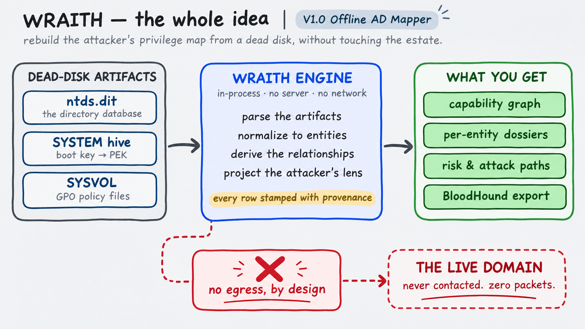
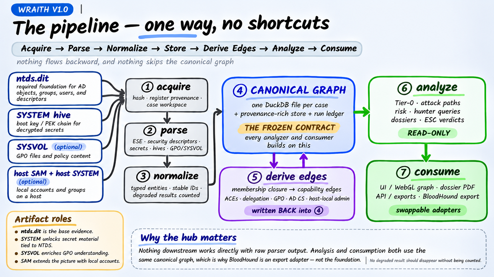
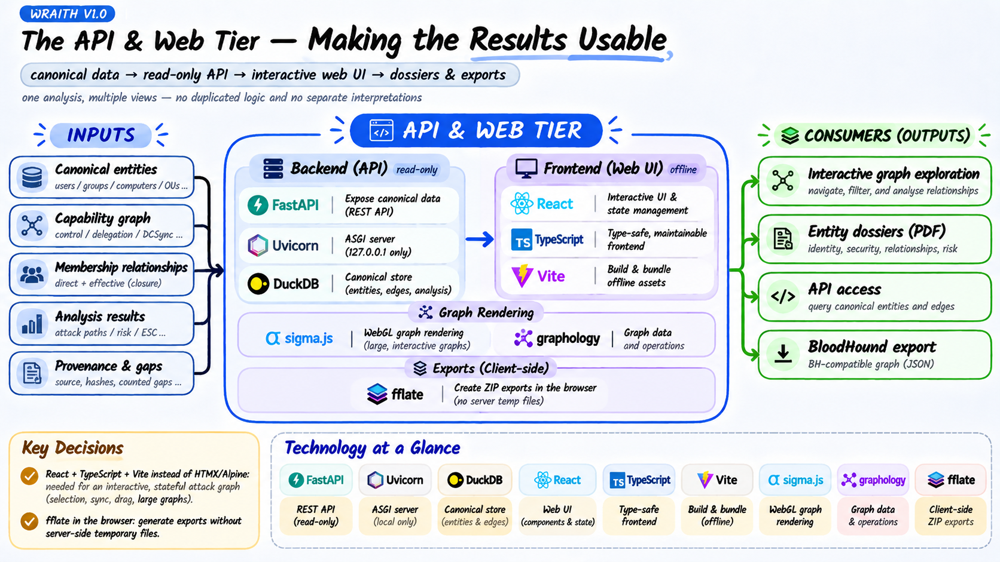
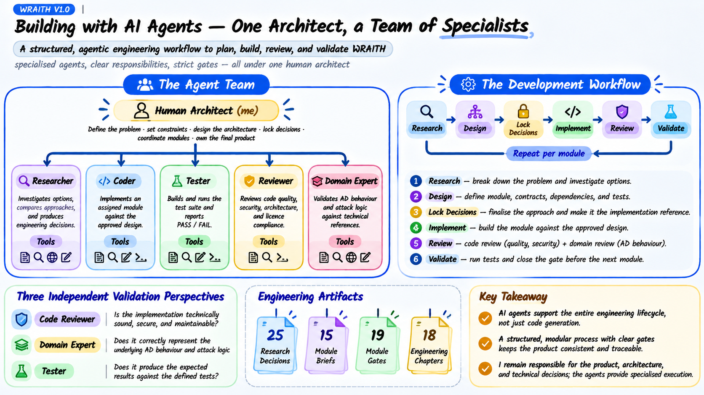
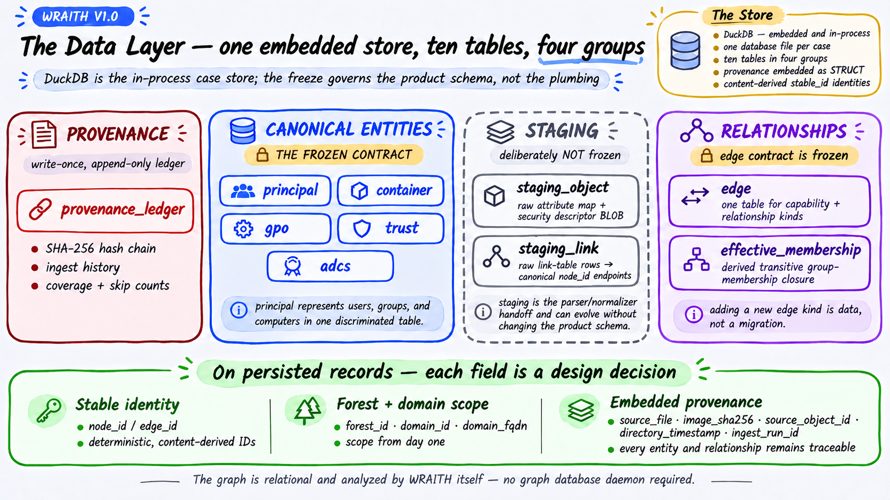
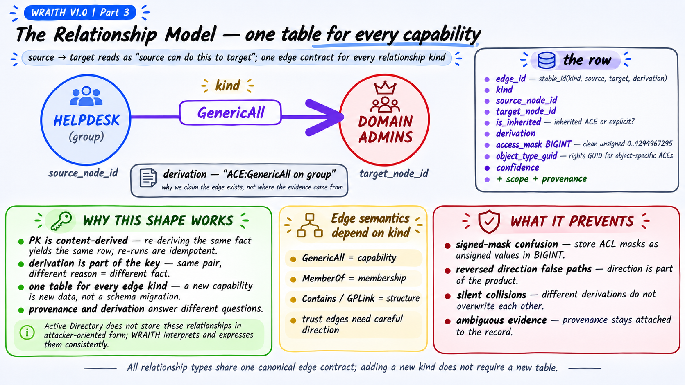
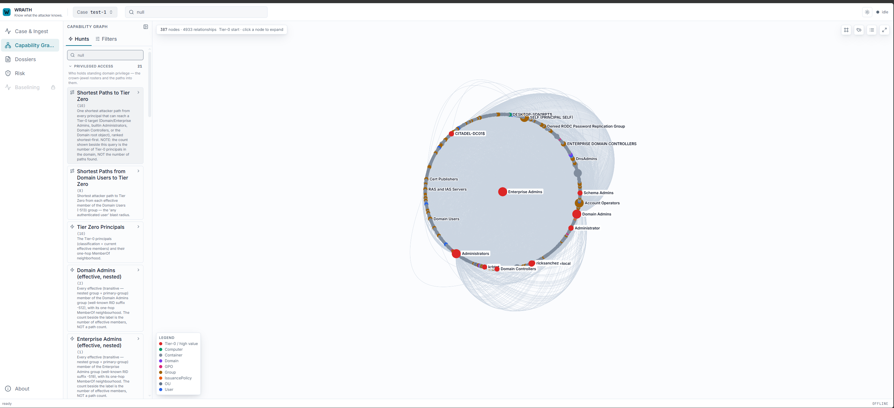
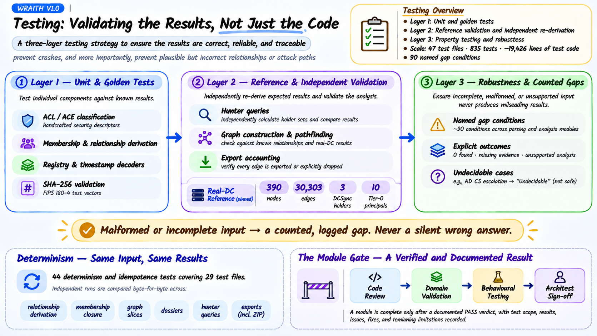

# WRAITH V1.0 Engineering — Offline Active Directory Relationship Engine

*How I approached building the first version of WRAITH around Active Directory relationship analysis, as part of a broader vision for understanding and baselining environments through different data sources — including network telemetry, endpoint telemetry, and other security signals — and how a team of specialised AI agents built it under a single human architect.*

<!-- more -->

!!! abstract "At a Glance"
    - **What it is:** WRAITH is being developed as a broader approach to understanding environments - INSPIRED BY blloddhound the great tool of AD mapping, identifying weaknesses, and establishing behavioural and structural baselines. Version 1.0 focuses on offline Active Directory relationship analysis for dead-disk forensics. It helps threat hunters understand relationships and weaknesses within an environment, develop investigation hypotheses, and explore potential attack paths. It also supports penetration-testing teams during time-constrained engagements, working alongside the hunting team to identify potential entry points and prioritise the most effective paths to explore.

    - **Future direction:** Extend environment baselining through different approaches and data sources, including network telemetry, endpoint telemetry, and other security signals, using anomaly detection techniques to identify deviations and suspicious activity.

    - **Inputs (V1.0):** `ntds.dit` · `SYSTEM` registry hive · `SYSVOL` · Local SAM (along with that host's `SYSTEM` hive) · AD CS objects stored in the Configuration partition of `ntds.dit`, including Enterprise CA, Root CA, and NTAuthStore objects. Everything is processed offline; nothing communicates with the target environment.

    - **Outputs:** Capability graph · per-entity dossiers · attack paths to Tier-0 · forensic provenance for every claim.

    - **Read time:** ~75 minutes

    - **Audience:** Threat hunters, penetration testers, engineers, architects, and tool builders.

    - **Prerequisites:** None specific. Familiarity with Active Directory helps with Parts 1 and 4.

??? abstract "Table of Contents — 7 Parts"

    1. **The Whole Flow** *(~40 min)*

        - **1.1** Acquisition — The Trust Boundary
        - **1.2** Reading `ntds.dit` — The Riskiest Dependency
        - **1.3** Security Descriptors — Parsing Is Not Interpretation
        - **1.4** Secrets — Delegate the Crypto Chain, Isolate the Result
        - **1.5** Registry Hives — Reusing What We Already Have
        - **1.6** GPO and SYSVOL — Parsing Policy Files Without Adding Dependencies
        - **1.7** Normalization — Turning Raw Objects into Canonical Entities
        - **1.8** Membership Closure — Resolving Nested Group Membership
        - **1.9** The Edge Engine — Turning Active Directory Facts into Relationships and Capabilities
        - **1.10** Host Context — Member SAM and Enterprise CA Configuration
        - **1.11** Handling Multiple DCs for One Domain and Multiple DCs for Different Domains
        - **1.12** The API and Web Tier — Making the Results Usable

    2. **Building with AI Agents: One Architect, a Team of Specialists** *(~4 min)*
    3. **The Data Layer** *(~8 min)*

        - **3.1** Why DuckDB?
        - **3.2** The Schema — Ten Tables in Four Groups
        - **3.3** The Relationship Model — One Table for Every Capability
        - **3.4** What the Graph Actually Looks Like

    4. **Graph Analysis and Threat-Hunter Queries** *(~4 min)*

        - **4.1** Pathfinding — NetworkX over the Edge Table
        - **4.2** Graph Projection — Keeping the Results Relevant
        - **4.3** Threat-Hunter Analysis — Predefined Investigative Queries
        - **4.4** Keeping Graph and Hunting Results Reliable

    5. **Testing: Validating the Results, Not Just the Code** *(~2 min)*
    6. **GOAD: From Offline Reconstruction to Realistic Hunting Scenarios** *(~2 min)*
    7. **Engineering Choices and Why We Made Them** *(~5 min)*

        - **7.1** Parsing and Evidence Processing
        - **7.2** Storage and Data Model
        - **7.3** Security and Cryptography
        - **7.4** Graph, API and Frontend
        - **7.5** Export and Reporting
        - **7.6** Development and Quality Gates
        - **7.7** Small Engineering Decisions That Prevent Incorrect Results

    - **Closing**
    - **References and Further Reading**


---

## What This Is

WRAITH V1.0 turns Active Directory forensic evidence into a structured picture of how the environment is connected and what those relationships make possible. The graph provides the bigger picture, while per-entity dossiers allow the hunter to investigate individual objects, understand their security posture, and see who can control them and what they can control. Attack paths connect these relationships into potential routes towards Tier-0, giving the hunter more context to develop and investigate hypotheses. Every conclusion is backed by its source, with incomplete or unsupported results reported rather than silently ignored.

<figure markdown>
  [{ loading=lazy }](wraith-diagrams/01-the-whole-idea.png){ title="Open the full-resolution diagram" }
  <figcaption markdown="span">**The whole idea** — rebuild the attacker's privilege map from a dead disk, without touching the estate.</figcaption>
</figure>

The interesting part is how these two perspectives meet. From the engineering side, every component and technical decision needs to serve a specific functionality. From the hunting side, those decisions determine how accurately the system represents the environment and how useful that representation becomes during an investigation. This post follows that journey from the overall architecture down to the individual components, explaining not just what was built, but why.

Three things make this project worth exploring from both perspectives:

1. **Functionality-driven engineering decisions.** How the requirements shaped the architecture, component selection, and implementation, rather than choosing technologies first and finding a use for them later.
2. **Engineering for useful hunting context.** How individual relationships become meaningful capabilities and attack paths, while maintaining traceability and accounting for incomplete evidence.
3. **A team of specialised AI agents under one human architect.** I led the architecture, research, technical decisions, and reviews, while specialised agents handled implementation and testing. The development methodology is worth examining, including what worked, what failed, and what I learned from it.

---

## Part 1 — The Whole Flow

!!! abstract "The Pipeline at a Glance"
    - **Main flow:** Acquisition → Parsing → Normalization → Storage → Relationship Derivation → Analysis → Consumption
    - **Parsing:** ESE database · Security descriptors · Secrets · Registry hives · GPO/SYSVOL
    - **Relationship derivation:** Membership closure → ACL-based edges → Attribute-based edges
    - **Riskiest dependency:** The `ntds.dit` ESE reader, isolated behind a replaceable adapter.
    - **Core idea:** Parsing gives us the facts. The edge engine connects those facts and turns them into attacker capabilities.

The idea is to have a clear direction for how data moves through WRAITH. Each stage solves a specific problem and prepares the data for the next one.

The overall flow is:

**Acquire → Parse → Normalize → Store → Derive Relationships → Analyze → Consume**

I wanted to keep the different components independent from the original file formats. For example, the attack-path engine shouldn't need to understand how an ESE database works, and the UI shouldn't implement its own interpretation of Active Directory permissions.

Instead, everything works against the same canonical representation:

- Parsers extract information from the different forensic artifacts.
- The normalizer converts raw records into typed entities with stable identities.
- The canonical store holds those entities, attributes, and provenance.
- Membership processing resolves direct and nested group membership.
- The edge engine connects permissions and attributes to derive attacker capabilities.
- The analysis layer uses the resulting graph to identify potential attack paths and investigate individual entities.
- Different consumers expose the same information through the UI, API, dossiers, and exports.

There is an important distinction here: **parsing does not produce the complete attack graph.** It gives us the facts needed to build it. We still need to resolve identities, connect objects, understand permissions, and derive what those relationships actually allow an attacker to do.

This is why the edge engine is such an important part of WRAITH. It is where information from different artifacts starts working together.

<figure markdown>
  [{ loading=lazy }](wraith-diagrams/03-the-pipeline.png){ title="Open the full-resolution diagram" }
  <figcaption markdown="span">**The pipeline** — one way, no shortcuts. Nothing flows backward, and nothing skips the canonical graph.</figcaption>
</figure>

Let's break down each stage, the problem it solves, the decisions behind its implementation, and what it contributes to the next stage.

---

### 1.1 Acquisition — The Trust Boundary

!!! question "The Problem"
    Before analysing anything, we need to establish exactly what evidence we received, preserve its identity, and make sure that every later finding can be traced back to the original artifact.

**Input:**

- `ntds.dit`
- `SYSTEM` registry hive
- `SYSVOL` archive
- Local `SAM` and its corresponding host's `SYSTEM` hive

**Approach:**

Each artifact goes through a controlled acquisition process:

- **SHA-256 hashing:** Files are hashed using streaming reads to keep memory usage bounded.
- **Provenance registration:** Each artifact is registered in a write-once provenance ledger.
- **Case isolation:** Evidence is stored inside a dedicated per-case workspace.
- **Evidence preservation:** Artifacts are copied by default to create a self-contained evidence package. Reference-by-path is available for multi-gigabyte inputs.

A few implementation decisions are worth highlighting:

- **Archives are hashed twice:** First the original archive, then every extracted file. This lets us identify both the original evidence and the individual files extracted from it.
- **Client filenames are discarded:** The stored filename is generated from a validated artifact `kind` and a sanitized host label. We don't trust filenames supplied through uploads because they can introduce path-traversal writes.
- **Upload limits are enforced while streaming**, not after buffering:
    - `ntds.dit`: 10 GiB
    - Registry hives: 256 MiB
    - SYSVOL ZIP: 2 GiB

A multi-gigabyte upload should never need to be loaded entirely into memory just to measure its size.

**The run manifest**

Each ingest run has its own WRAITH-native JSON manifest, borrowing BagIt's checksum-manifest discipline while keeping field names mappable to CASE/UCO.

The ledger uses `(ingest_run_id, source_file)` as its primary key and records:

- `tool_versions`
- `parameters`
- `coverage_counts`
- `skip_counts`

A SHA-256 hash chain (`prev_entry_hash` → `entry_hash`) was also requested during domain-expert review to provide tamper-evident custody records.

This wasn't part of the original frozen schema. It was documented as a V1.1 proposal rather than silently changing the existing contract, and was implemented later.

**Output and handoff:**

- Case-scoped evidence workspace.
- Hashed and registered artifacts.
- Provenance records.
- Ingest-run manifests.

These become the inputs to the parsing layer. From this point onward, every extracted fact can be associated with the artifact it came from.

---

### 1.2 Reading `ntds.dit` — The Riskiest Dependency

!!! question "The Problem"
    `ntds.dit` is an ESE database (JET Blue). Reading it correctly involves B-tree traversal, page layouts, long-value chains, and tagged columns.

A small parsing mistake here can affect everything built on top of it.

**Input:** The acquired `ntds.dit` file.

**Approach:**

The selected backend is `dissect.database` (Fox-IT), the maintained successor to the archived `dissect.esedb`.

Alternatives considered:

- **Hand-writing an ESE reader:** Rejected because it introduces too much correctness-critical complexity.
- **`libesedb` / `pyesedb`:** Rejected because the C-based toolchain complicates air-gapped wheel vendoring and introduces additional licensing considerations.

**Engineering decision — Isolate the dependency**

The reader sits behind a thin adapter:

`wraith/parsing/ese_backend.py`

This means replacing the backend can be a one-file change rather than a rewrite of the entire parsing pipeline.

**Validation:**

The adapter has independent tests using a vendored, non-AD ESE sample.

That fixture validates:

- Reader streaming.
- JET column types.
- Missing-column handling.
- The CleanShutdown path.

But it cannot validate:

- DirtyShutdown recovery.
- NTDS-specific semantics.

One dependency pin also deserves explanation: `dissect.util==3.25.dev9`.

`dissect.database==1.1` requires `dissect.util>=3.24.dev1,<4`, while the stable util releases don't satisfy that requirement. The development-version pin is therefore necessary. We pin and vendor the exact resolved wheel rather than relying on an unpinned dependency.

**A limitation we had to acknowledge**

The original design included automatic ESE transaction-log replay. Research showed that this isn't achievable offline on Linux without Windows' `esentutl`.

The implemented behaviour is therefore:

**Detect → Warn → Degrade**

This is particularly relevant because the real test DC is in a DirtyShutdown state. Rather than claiming recovery functionality we couldn't guarantee, we report the limitation.

**Output and handoff:**

Raw NTDS records and extracted database values, ready for interpretation by the subsequent parsing components.

At this point, we have extracted database information, but we haven't yet established what the objects can control.

---

### 1.3 Security Descriptors — Parsing Is Not Interpretation

!!! question "The Problem"
    `nTSecurityDescriptor` is a packed binary `[MS-DTYP]` structure. It contains the access-control information needed to understand who can control an object.

The challenge is that reading the binary structure and understanding what its permissions mean are two different problems.

**Input:** Binary `nTSecurityDescriptor` values extracted from NTDS.

**Approach:**

Use `impacket.ldaptypes` to parse the binary structures.

The responsibilities are deliberately separated:

- **Impacket:** Reads the security descriptor and exposes its ACE structures.
- **WRAITH:** Classifies those ACEs and determines which capabilities they represent.

For example, reading an ACE isn't enough. We need to determine whether it represents `GenericAll`, `WriteDacl`, `AddMember`, or another capability, and which principal actually holds that capability.

**Engineering decision:**

Delegate the complicated binary parsing, but keep the security interpretation and capability derivation under WRAITH's control.

This avoids reinventing a correctness-critical format without making the security logic dependent on another project's implementation.

**Output and handoff:**

Structured security descriptors containing their owner, group, DACL, and ACE information.

These are associated with their corresponding objects during normalization and later consumed by the ACL derivation pass of the edge engine.

**Important distinction:** At this stage, we have parsed permissions, not yet derived the complete attacker capabilities.

---

### 1.4 Secrets — Delegate the Crypto Chain, Isolate the Result

!!! question "The Problem"
    The DC `SYSTEM` hive has two different jobs in WRAITH:

1. It provides the cryptographic material needed to recover protected credentials from `ntds.dit`.
2. It contains registry configuration that helps us assess the DC's certificate-mapping security posture.

These are two separate analysis paths, and both contribute to WRAITH.

**Input:**

- `ntds.dit`
- DC `SYSTEM` registry hive.

#### A. Credential Recovery — From Boot Key to Protected Secrets

**Approach:**

The SYSTEM hive provides the Boot Key, which is used to decrypt the PEK list stored in `ntds.dit`. The recovered PEK is then used to decrypt protected directory attributes.

```text
SYSTEM hive
    ↓
Boot Key
    ↓
Decrypt NTDS PEK list
    ↓
PEK
    ↓
Decrypt protected NTDS attributes
    ↓
Recover credential material
```

Rather than implementing this cryptographic chain ourselves, WRAITH delegates the recovery logic to Impacket's `secretsdump` implementation, with `pycryptodomex` providing the cryptographic primitives.

This gives us more than the current NT hash of an account. Depending on what is present in the evidence and which extraction options are enabled, the recovered material includes:

- **NT / LM hashes:** Current password hashes.
- **Password history:** Previous hashes, useful when investigating password reuse.
- **Kerberos keys:** Keys stored in `supplementalCredentials`.
- **Reversible-encryption passwords:** Cleartext password material where reversible encryption was enabled and stored.
- **Domain trust keys:** Current and previous inter-domain trust secrets from `trustAuthIncoming` and `trustAuthOutgoing`.

**Out of scope — Other directory secrets**

Not every secret stored in Active Directory follows the NTDS Boot Key → PEK recovery chain. Some require separate extraction and decryption mechanisms that are not part of WRAITH V1.

Examples include:

- **LAPS:** Legacy and Windows LAPS local-administrator passwords, particularly encrypted Windows LAPS values.
- **gMSA:** Managed service-account passwords derived through the KDS/GKDI mechanism.
- **DPAPI backup keys:** Domain-level backup keys used to recover DPAPI-protected material.

These are deliberately outside the current credential-recovery scope. WRAITH V1 focuses on the credential material supported by its NTDS extraction pipeline rather than claiming coverage of every secret available in Active Directory.

The distinction matters: WRAITH should only report these additional passwords or keys as recovered when the relevant extraction and decryption logic is actually supported and the required evidence is available.

**Engineering decision — Protect the recovered material**

Recovered credentials must never enter the unencrypted analytical database or application logs.

WRAITH uses a separate ciphertext-only store (`wraith/secrets/`):

- Argon2id derives the encryption key from the investigator's passphrase.
- AES-256-GCM encrypts each secret.
- Associated data binds the encrypted record to its case and ingest run.
- Dossiers expose only a redacted reference indicating that secret material is present.
- Revealing the actual material requires an explicit CLI operation.

WRAITH recovers credentials; it does not crack them or expose them by default.

**Validation — A problem discovered during review**

One review caught a serious issue: secret attributes, including latent cleartext LAPS passwords and PEK-encrypted hashes, were reaching the unencrypted canonical store through the staging table's raw attribute map.

The normalizer was working correctly, and behavioural tests were green.

The problem was that the tests weren't specifically checking whether sensitive attributes could reach plaintext storage.

The fix was a `SECRET_ATTRIBUTE_DENYLIST`, backed by a regression test proving that those attributes are actually stripped before entering the canonical store.

This is why we need to test the security properties of the data flow, not just whether the extraction works.

#### B. Certificate Posture — The Same Hive, a Different Purpose

The second job of the SYSTEM hive is to read the DC's certificate-mapping configuration.

**Input:** Registry values from the DC `SYSTEM` hive.

Two settings are particularly relevant:

| Registry value | Location | What it controls |
|---|---|---|
| `StrongCertificateBindingEnforcement` | `SYSTEM\CurrentControlSet\Services\Kdc` | Kerberos certificate-to-account strong mapping enforcement |
| `CertificateMappingMethods` | `SYSTEM\CurrentControlSet\Control\SecurityProviders\SCHANNEL` | Schannel client-certificate mapping methods |

These settings are not secrets. They describe the security posture of certificate-based authentication.

**Why this matters for hunting**

Certificate escalation is not determined by certificate templates alone. We also need to understand how the DC maps an issued certificate back to an Active Directory account.

For example:

- **ESC9:** A certificate template is configured to omit the SID security extension (`CT_FLAG_NO_SECURITY_EXTENSION`). Whether this can be abused depends on the certificate's other properties and the authentication path's mapping behaviour.
- **ESC10:** Weak certificate-mapping configurations can allow alternative identity mapping, including UPN-based mapping under the relevant conditions.

There is an important version-dependent detail here: Microsoft stopped supporting `StrongCertificateBindingEnforcement` as a configurable override after the September 9, 2025 security update. Therefore, WRAITH must consider the DC's update state rather than treating an old registry value as proof that weak Kerberos mapping is still active.

`CertificateMappingMethods` is a separate Schannel setting and needs to be evaluated independently. For example, the UPN mapping bit (`0x4`) represents a weak mapping method.

**How WRAITH uses this information**

The registry values are combined with the AD CS information already extracted from `ntds.dit`:

- Certificate-template configuration.
- Enrollment permissions.
- Published templates.
- Relevant certificate EKUs and security-extension settings.
- DC certificate-mapping posture.

This allows WRAITH to assess the relevant ESC9/ESC10 conditions and represent supported findings in the capability graph.

If the SYSTEM hive is missing, the certificate-mapping assessment is marked **Undecidable**, rather than assuming the environment is either vulnerable or secure.

**Output and handoff:**

The SYSTEM hive contributes to two different outputs:

1. **Credential intelligence:** Recovered secret material is encrypted in the separate secrets store. Entity dossiers contain redacted references, never plaintext credentials.
2. **Certificate security posture:** Registry configuration is associated with the DC and used alongside AD CS relationships to assess potential certificate-based escalation paths.

Both outputs are available to the analysis layer, but they remain separate: one contains sensitive credential material, while the other contains security-configuration evidence.


---

### 1.5 Registry Hives — Reusing What We Already Have

!!! question "The Problem"
    Registry hives are required for several different parts of WRAITH. We need the boot key for secrets recovery, certificate-binding configuration for AD CS analysis, and local group membership from member-host SAM hives.

**Input:**

- Domain-controller `SYSTEM` hive.
- Member-host `SAM` hives and their corresponding `SYSTEM` hives.

**Approach:**

Reuse Impacket's `winregistry`, which was already present for the secrets recovery chain.

**Engineering decisions:**

Two alternatives were considered:

- **`regipy`:** Recommended during research, but rejected because it would introduce another dependency for functionality already covered by Impacket.
- **`dissect.regf`:** Rejected on licensing grounds.

Every additional dependency introduces another package to audit, a licence to review, and a wheel to vendor for air-gapped shipping.

Sometimes the best dependency is the one you don't add.

**Output and handoff:**

Registry information required for:

- Boot-key recovery.
- AD CS certificate-binding analysis.
- Local group membership resolution.

These results become additional facts that can be connected to directory objects and host entities later.

---

### 1.6 GPO and SYSVOL — Parsing Policy Files Without Adding Dependencies

!!! question "The Problem"
    Active Directory relationships aren't all stored in `ntds.dit`. Group Policy Objects (GPOs) can introduce additional security information through their configuration files inside SYSVOL.

For example, a GPO can define local group membership, add users to local administrators, or configure other security-related settings.

We therefore need to extract these configurations and connect them to the corresponding GPOs, directory objects, and hosts.

**Input:** Acquired SYSVOL files, organized by GPO folders.

The main formats we need to handle are:

- `GptTmpl.inf`
- `Groups.xml`
- `Registry.pol`

**Approach — Discover first, then use dedicated parsers**

The implementation is split into a discovery layer and three format-specific parsers.

`sysvol.py` discovers the relevant files inside each GPO folder and handles filesystem interaction.

This gives WRAITH another source of security information beyond `ntds.dit`. For example, SYSVOL may reveal local group modifications, privilege assignments, and policy configurations that would otherwise be missed when analysing directory objects alone.

However, these configurations can also be misleading if interpreted without their application context. A GPO may be linked to an OU but not actually apply to a particular computer because of security filtering, WMI filters, or inheritance rules. WRAITH therefore extracts the configured settings and derives candidate relationships, rather than claiming that every configuration is effectively applied.

There is also an input-security consideration: SYSVOL comes from the investigated environment, which may be compromised. Its contents must be treated as untrusted input, whether they are legitimate policy files or attacker-modified artifacts.

The discovery layer therefore applies several safeguards:

- **Case-insensitive path resolution:** Real SYSVOL files don't always follow consistent casing, so paths are resolved without assuming a particular case.
- **Path containment:** Every resolved file must remain inside its GPO policy folder. Directory traversal (`..`) and symlink escapes are rejected.
- **Read-only processing:** Files are read as bytes only. Nothing from SYSVOL is executed.

Each format is then passed to its dedicated parser:

| File | Parser | Purpose |
|---|---|---|
| `GptTmpl.inf` | `inf_parser.py` | Extract security policy and Restricted Groups configuration |
| `Registry.pol` | `preg_parser.py` | Parse the binary PReg format and extract registry policy settings |
| `Groups.xml` | `gpp_parser.py` | Extract Group Policy Preferences and local group membership settings |

**Engineering decisions:**

I wanted to avoid introducing dependencies for relatively small, well-defined formats.

- **`GptTmpl.inf`:** Uses `configparser`, with case-preserving keys and UTF-16LE BOM detection.
- **`Groups.xml`:** Uses the standard-library `xml.etree.ElementTree` parser. This avoids introducing `lxml` and keeps XML processing dependency-free.
- **`Registry.pol`:** Uses a WRAITH-native, bounds-checked parser. The binary format is small enough to implement and audit without another library.

The entire GPO tier adds **zero new dependencies**.

!!! tip "The Load-Bearing Step — Who Does This GPO Hit?"
    A GPO on disk means nothing until you know which computers it applies to. WRAITH does
    not re-parse `gPLink` or recompute containment. It reuses the `Contains` and `GPLink`
    edges already emitted from `ntds.dit`, via `scope.py`:

    > GPO → linked OU/domain containers → transitive `Contains*` closure → every Computer
    > in that closure = the affected set.

    So the directory topology (from `ntds.dit`) and the policy content (from SYSVOL) are
    joined here. **One authoritative topology, no second source of truth.**

**Handling incomplete or ambiguous data**

There are three additional rules that matter:

- **File limits:** Every SYSVOL file is capped at 8 MiB. Oversized files become counted gaps. A genuinely empty file is valid and must not be confused with an unreadable file.
- **Windows precedence:** When Restricted Groups in `GptTmpl.inf` conflicts with a GPP `Groups.xml` definition targeting the same local group, Restricted Groups wins and the superseded setting is counted.
- **SID-based resolution:** Local groups are resolved using their full alias SID, then by the trailing RID of `S-1-5-32-<RID>`. We never guess from a bare group name because there is no reliable offline name-to-RID mapping. Unresolved names become a counted `gpo.member_name_unresolved` gap.

#### The Important Limitation — Parsing a GPO Is Not Calculating Its Effective Policy

This is where the offline nature of WRAITH creates an important distinction.

A live Windows environment evaluates Group Policy through Resultant Set of Policy (RSoP). It considers the target machine, user, security filtering, WMI filters, inheritance, and link precedence.

WRAITH works from acquired forensic artifacts. It cannot replay all these conditions against a live target.

Instead, it emits the SharpHound-parity **union of non-disabled GPO links**. This gives the hunter a broader view of potential policy relationships, but it does not prove that every linked GPO actually applies to every computer shown.

There are two different types of limitations.

**A. Offline RSoP limitations — Potential overstatement**

Because WRAITH cannot evaluate the complete live policy-processing context, some GPO relationships may appear even when the policy would not actually apply to a particular principal or computer.

| Limitation | What WRAITH cannot determine |
|---|---|
| Security filtering | Whether the target principal's token satisfies the GPO's `Apply Group Policy` permissions |
| WMI filters | Whether the target machine satisfies the GPO's WMI query, such as an OS-version condition |
| Block inheritance | Whether an OU's `gpOptions=1` prevents inherited GPOs from applying |
| Link precedence / order | Which GPO wins when multiple policies configure conflicting settings |
| Enforcement | Whether an enforced link overrides normal inheritance and precedence rules |

One thing WRAITH can determine statically is whether a GPO link is disabled.

The disabled bit (`0x1`) in `gPLink` is readable from the acquired directory data, so disabled links are dropped and counted upstream.

**B. Parsing and resolution limitations — Potential understatement**

There are also configurations that WRAITH cannot currently resolve or model. In these cases, a genuine relationship may be missed.

These limitations are explicitly counted rather than silently ignored.

- **Members specified by name:** A Restricted Groups or GPP entry such as `CORP\helpdesk` cannot always be resolved offline. WRAITH records `gpo.member_name_unresolved` and does not emit the corresponding edge.

- **Unparsed setting types:** WRAITH currently parses:
  - `GptTmpl.inf`: `[Privilege Rights]`, `[Group Membership]`, and `[Registry Values]`.
  - GPP `Groups.xml`: Supported local group configuration.

  Other access-granting mechanisms, such as GPP scheduled tasks, services running under particular principals, and other GPP item types, are not converted into capability edges.

- **Site-scoped GPO links:** Affected computers are resolved through the `Contains` closure. Site membership is not represented as a containment edge, so a GPO linked at site scope may resolve to zero computers. This is recorded as `gpo.scope_computer_unresolved`.

- **Foreign-domain and nested group members:** A flat relationship is emitted to the group node and relies on membership closure for expansion. However, foreign principals that resolve to stub nodes cannot have their memberships expanded with the current single-DC evidence model. Consequently, paths crossing domain-trust boundaries may be understated.

- **Untracked local groups:** Only the modeled local groups are converted into capability edges:
  - Administrators (`544`)
  - RDP (`555`)
  - DCOM (`562`)
  - PSRemote (`580`)

  A `[Group Membership]` setting targeting another local group is not currently represented as a capability edge.

**C. Correctly handled cases — Not false negatives**

A few behaviours need clarification because they can otherwise be mistaken for missing relationships:

- **GPP `cpassword`:** A recovered reversible password is credential material, not a graph relationship. It is routed to the encrypted secrets store and exposed as a redacted finding in the relevant dossier. It can still be important during hunting, but it is represented through findings and secrets rather than as a graph edge.

- **Restricted Groups precedence:** When Restricted Groups conflicts with a GPP definition targeting the same local group, Restricted Groups wins. The superseded setting is counted. This can overstate policy relationships, but it is deliberate.

- **GPP REMOVE:** REMOVE operations are ignored in the current implementation. This can preserve relationships that a REMOVE operation would otherwise eliminate, contributing to the conservative overstatement of policy relationships.

#### Confidence and Output

Because WRAITH cannot calculate the complete live RSoP, every GPO edge is stamped:

`confidence="inferred"`

This is intentional. A GPO relationship is a candidate relationship to investigate, not proof that the corresponding policy was effectively applied to a particular machine or principal.

All parsing and resolution limitations are surfaced through counted gaps and the **GPO coverage card**.

**Output and handoff:**

The parsing stage produces:

- Extracted GPO security settings.
- Local group membership information.
- Registry policy settings.
- GPO-related facts and relationships.
- Counted gaps for incomplete, unsupported, or unresolved configurations.
- Inferred GPO relationships with their confidence metadata.

These results are associated with their originating GPO and later connected to the corresponding directory and host entities during normalization and relationship derivation.

The important distinction is that **parsing a GPO gives us its configured facts, not automatically the effective permissions or attack paths.**

WRAITH deliberately provides a broader view of potential policy relationships for hunting, while exposing the limitations that prevent it from claiming those relationships are effective grants.

The hunter can then use the GPO coverage information and underlying evidence to decide which relationships need validation against the actual environment.

At this point, we have extracted information from different sources. The next stage is to bring everything into a common structure so these facts can be connected reliably.

---

### 1.7 Normalization — Turning Raw Objects into Canonical Entities

!!! question "The Problem"
    The different parsers produce raw records according to their own formats, often identified by internal database IDs.

The rest of WRAITH needs consistent entities with stable identities and correct domain/forest scoping.

For example, a user or computer should not be represented differently depending on which parser produced its information.

**Input:**

- Raw NTDS records.
- Parsed security descriptors and ACE information.
- Registry-derived information.
- GPO/SYSVOL settings.
- Other parsed artifact records.

**Approach:**

The normalizer converts raw records into canonical entity tables.

It also determines what each object actually represents.

This is more than field mapping. We need to resolve identities, associate objects with their domains and forests, and determine whether the available information is sufficient to classify them.

Each entity receives a stable `node_id`, its normalized attributes, and the associated security information needed by subsequent stages.

**Engineering decision — Count what cannot be resolved**

The normalizer uses a counted-gap taxonomy to record anything it cannot confidently classify.

Some examples include:

- `no_identity`
- `unclassified`
- `not_modeled`
- `orphan_parent`
- `missing_samaccountname`
- `deleted_recoverable`
- `deleted_recycled`
- `gplink_unresolved`
- `gplink_disabled`
- `link_unresolved_endpoint`

I wanted to avoid silently dropping objects or inventing relationships when the available information wasn't sufficient.

**Validation:**

The normalizer records why an object could not be resolved or classified. These categories also make it possible to inspect coverage and identify where information was lost.

**Output and handoff:**

Typed canonical entities containing:

- Stable `node_id`.
- Consistent domain and forest scoping.
- Normalized attributes.
- Security descriptors.
- Associated provenance.
- Counted gaps for unresolved or unsupported cases.

These entities are persisted in the canonical store.

**This is the important handoff:** We now have the objects and their associated facts in a common structure. We know which users, groups, computers, OUs, GPOs, CAs, and trusts exist, but we haven't yet derived the complete set of capabilities between them.

In other words, we have the nouns. The next stages establish the relationships and verbs.

---

### 1.8 Membership Closure — Resolving Nested Group Membership

!!! question "The Problem"
    Consider the question: *Who is effectively a member of Domain Admins?*

Looking only at direct `MemberOf` relationships isn't enough. Active Directory supports nested groups, so we need to follow membership transitively.

For example:

```text
User A → Helpdesk → IT Admins → Domain Admins
```

User A is effectively a member of Domain Admins, even though there is no direct membership relationship.

There is another challenge: Active Directory allows group-membership cycles. A naive traversal could keep following the same groups indefinitely.

**Input:**

- Direct membership information extracted from the `ntds.dit` link table.
- Account records required to reconstruct implicit memberships that aren't stored as ordinary link-table entries.

**Approach — Build direct memberships, then calculate the closure**

Everything is implemented in `membership.py`.

WRAITH builds `MemberOf` edges from three sources before calculating the transitive closure.

**1. Real membership links**

`build_link_memberof_edges()` reads the `member` / `memberOf` link table.

It uses `is_live_link()` to retain only live memberships and exclude deleted or deactivated links, including memberships retained through AD replication or Recycle Bin processing.

The direction is:

`member → group`

**2. Primary-group synthesis**

Not all group memberships appear in the ordinary link table.

Active Directory stores an account's primary group separately through `primaryGroupID`.

`build_primary_group_edges()` reconstructs these relationships by resolving the RID against the corresponding group.

For example, `primaryGroupID = 513` identifies Domain Users.

The resulting edge uses:

`derivation="SYNTH:primarygroup"`

**3. Special identities**

Some security identities are implicit in Windows authentication rather than ordinary directory membership records.

`build_special_identity_edges()` materializes the following synthetic relationships:

```text
Domain Users / Domain Computers
              ↓
      Authenticated Users
              ↓
          Everyone
```

These are modeled relationships for analysis, not ordinary membership links extracted from the NTDS link table.

They use:

`derivation="SYNTH:specialidentity"`

#### Calculating the Transitive Closure

After collecting the three sources, WRAITH calculates effective membership using `compute_effective_membership()`.

It uses a **cycle-guarded BFS** (Breadth-First Search):

- Start with each member's direct groups.
- Follow the membership relationships to discover nested groups.
- Keep track of visited nodes to avoid revisiting groups.
- Continue until no additional memberships can be discovered.

The results are written once to a dedicated `effective_membership` table through `_write_effective()`.

```sql
CREATE TABLE effective_membership (
    member_node_id VARCHAR NOT NULL,
    group_node_id  VARCHAR NOT NULL,
    forest_id      VARCHAR NOT NULL,
    domain_id      VARCHAR,
    PRIMARY KEY (member_node_id, group_node_id)
);
```

Each row represents one effective membership relationship between a member and a group.

#### Engineering Decisions

Two decisions matter here:

- **Cycle protection:** Membership closure uses a visited set, ensuring that even cyclic group relationships terminate safely.
- **Node-based identity:** The table uses `node_id`, not SID (`EffectiveMembership` in `edges/models.py`). This keeps relationships tied to canonical entities and forest context, while also supporting future authentication-event joins where a subject can be mapped directly to its effective groups.
#### Output and Handoff

The membership component produces:

- Direct `MemberOf` edges.
- Synthesized primary-group relationships.
- Synthetic special-identity relationships.
- Cycle-guarded transitive `effective_membership` pairs.

The important implementation decision is that the closure is calculated **once and reused by everything downstream**, rather than being independently recalculated by each component.

Consumers include:

- **Edge engine:** Uses effective membership when determining which principals benefit from permissions.
- **AD CS / ESC analyzer:** `_load_effective_membership()` reuses the existing closure instead of expanding memberships again.
- **Entity dossiers:** Exposes effective memberships through `effective_members_of`.
- **Tier-0 classification:** Uses membership closure to identify effective members of privileged groups, not just their direct members.

The separation is important:

**Membership closure answers: Who effectively belongs to which groups?**

**The edge engine answers: What can those principals control?**

For example, if Helpdesk is nested inside another group that holds `GenericAll` over Domain Admins, the closure allows WRAITH to identify Helpdesk members as effective beneficiaries of that permission.

Without this step, the edge engine could identify the permission correctly but miss the users who can actually benefit from it.

That's why membership closure runs before relationship derivation: it provides the group context needed to build more complete attack paths.

---

### 1.9 The Edge Engine — Turning Active Directory Facts into Relationships and Capabilities

!!! question "The Problem"
    This is where the different pieces of evidence finally come together.

After parsing and normalization, we have the Active Directory objects represented as canonical nodes:

- Users, groups, and computers.
- OUs, containers, and GPOs.
- Certificate authorities and templates.
- Domains and trusts.

Each node has a stable `node_id`, its attributes, and associated security information.

But having the objects doesn't tell us how they relate to each other or what those relationships allow someone to do.

For example, knowing that a Helpdesk group exists and that Domain Admins exists tells us nothing about whether Helpdesk can control Domain Admins.

**We now need to build the relationships between those objects.**

#### First, Understand the Different Sources of Relationships

There isn't just one source of relationships in Active Directory. Some come from permissions, others from attributes and configuration, and some simply describe the directory structure.

**1. Security descriptors, DACLs, SACLs, and ACEs**

A security descriptor contains the security information associated with an object, including its owner, primary group, and access-control information.

It can contain two ACLs:

- **DACL (Discretionary Access Control List):** Determines which users or groups are allowed or denied specific operations on an object.
- **SACL (System Access Control List):** Defines which access attempts should generate audit records. It is about monitoring access, not granting permissions.

Each ACL contains ACEs (Access Control Entries).

An ACE identifies:

- The trustee (user, group, or other security principal), using its SID.
- The access rights through an access mask.
- Whether the entry allows, denies, or audits access.
- Inheritance flags and, for object-specific ACEs, additional GUIDs.

For WRAITH's capability derivation, the main source is the **DACL and its permission ACEs**. SACL audit entries should not be interpreted as attacker-control relationships.

#### Pass 1 — Slice 5A: ACL-Based Derivation

**Input:** Normalized objects and their security descriptors.

The ACL engine (`acl.py`) processes the DACLs and translates their ACEs into attacker-meaningful relationships.

The process is:

1. Read the security descriptor associated with the object.
2. Parse its ACEs using `impacket.ldaptypes`.
3. Resolve the trustee SID using the `NodeResolver`.
4. Classify the permission using the rights-GUID map (`guid_map.py`).
5. Convert the permission into a capability edge.
6. Attach provenance and generate a deterministic edge ID.

The important part is translating low-level Windows permissions into something a threat hunter can understand.

| Raw permission | Resulting edge | Meaning from an attacker perspective |
|---|---|---|
| Full control | `GenericAll` | Can completely control the object |
| Write-DACL | `WriteDacl` | Can modify permissions and potentially grant itself control |
| Write-Owner | `WriteOwner` | Can seize ownership |
| `ForceChangePassword` | `ForceChangePassword` | Can reset the account's password |
| `GetChanges` + `GetChangesAll` | `DCSync` | Can replicate directory secrets |

Each permission becomes an edge:

**Source = principal holding the right → Target = object being controlled.**

For example:

`Helpdesk ──GenericAll──▶ Domain Admins`

This is much more useful than simply recording that the Helpdesk SID appears in an ACE on the Domain Admins object.

For object-specific ACEs, the GUID mapping is particularly important. The engine needs to distinguish between a general permission and a right targeting a specific property, extended right, or child-object type.

#### Pass 2 — Slice 5B: Attribute and Configuration-Based Derivation

Not every relationship comes from an object's ordinary DACL.

Other relationships are derived from attributes, security-descriptor-valued attributes, and configuration stored across Active Directory objects.

The derivation component (`derivations.py`) handles these relationships.

Here are the main concepts:

**Delegation and Kerberos**

Kerberos delegation allows a service to access other services on behalf of a user. This is useful for multi-tier applications, but misconfigured delegation can give an attacker control over privileged identities without knowing their passwords.

The dangerous part is the **S4U (Service-for-User) extensions**. They allow a service to request Kerberos tickets on behalf of users. When delegation is improperly configured, an attacker controlling that service identity may abuse S4U2Self and S4U2Proxy to impersonate privileged users to other services.

There are three configurations worth identifying:

| Type | Attacker opportunity | How WRAITH identifies it |
|---|---|---|
| **Unconstrained delegation** | A compromised server may capture privileged users' TGTs when they authenticate to it, potentially allowing domain-wide compromise. | Flags accounts and computers configured for unconstrained delegation. |
| **Constrained delegation** | A compromised service account can abuse S4U to impersonate users to specifically allowed backend services. | Reads `msDS-AllowedToDelegateTo` and derives delegation relationships to the configured services. |
| **RBCD** | An attacker with sufficient write permissions over a target computer may modify its delegation configuration, add an account they control, and impersonate users to that resource. | Reads `msDS-AllowedToActOnBehalfOfOtherIdentity`, resolves the permitted principals, and derives relationships to the target resource. |

The distinction between the two constrained delegation models is important:

- **Traditional constrained delegation:** The source account specifies which services it can delegate to.
- **Resource-Based Constrained Delegation (RBCD):** The target resource specifies which accounts are allowed to delegate to it.

RBCD is particularly interesting from a hunting perspective because it can combine with other relationships. For example, an attacker may have `GenericWrite` or another sufficient write permission over a computer object, modify its RBCD configuration, and establish a new delegation path.

**How this helps hunting:**

WRAITH extracts these configurations from the acquired directory evidence and represents them as node flags or graph relationships. Combined with ACL-derived permissions and membership closure, the graph can expose paths where an attacker could configure delegation or abuse an existing configuration to reach privileged services.

**Credential access**

| Concept | What it represents | WRAITH representation |
|---|---|---|
| `ReadGMSAPassword` | A principal is authorized to retrieve a gMSA's managed password | Relationship |
| Kerberoastable | An account has an SPN and can be targeted for Kerberoasting | Node flag |

For gMSAs, the relevant authorization information is stored in `msDS-GroupMSAMembership`. The engine needs to identify which principals are allowed to retrieve the managed password.

For Kerberoasting, the presence of an SPN identifies an account that may be targeted. This does not mean its password can necessarily be cracked; that depends on the password strength and encryption used.

**Identity and directory structure**

| Concept | What it represents | WRAITH representation |
|---|---|---|
| `SIDHistory` | Historical SIDs associated with an account, potentially retaining access to resources through those identities | Relationship |
| `Contains` | Parent-child relationships between domains, OUs, containers, and objects | Structural edge |
| `GPLink` | A GPO linked to a domain, site, or OU | Structural edge |
| Trusts | Relationships between domains or forests, including direction and trust configuration | Trust edge |

A few distinctions matter here:

- **SIDHistory:** If an account carries a privileged historical SID and that SID is honoured during authorization, it may inherit access associated with that SID. SID filtering and trust boundaries matter, so the presence of `SIDHistory` alone does not prove privilege escalation.
- **Contains:** Describes where an object sits in the directory hierarchy. It provides structural context, not attacker control.
- **GPLink:** Connects a GPO to the directory container where its policy is linked. Whether the settings actually apply also depends on inheritance, enforcement, link order, and policy filtering.
- **Trusts:** Describe cross-domain or cross-forest relationships. A trust does not automatically mean one domain controls another; direction, transitivity, SID filtering, and authentication restrictions matter.

These structural relationships are useful for understanding the environment, but they must not be treated as permission edges when constructing attack paths.

**AD CS relationships**

AD CS requires a combination of certificate-template permissions and CA configuration.

| Relationship | Meaning |
|---|---|
| `Enroll` | A principal is allowed to request certificates from a template |
| `AutoEnroll` | A principal is allowed to automatically enroll against a template |
| `PublishedTo` | A certificate template is published by a particular CA |

There is an important implementation distinction:

- Enrollment permissions come from the certificate template's security descriptor.
- `PublishedTo` comes from the CA's published-template configuration.

Together with the template's other properties, these relationships provide the foundation for identifying potential certificate-based escalation paths, including ESC scenarios.

**The important idea:** These relationships may have different sources, but they must eventually follow the same canonical edge contract.

#### How the Two Passes Connect

I deliberately kept both derivation passes behind shared infrastructure:

- **One `NodeResolver`:** Resolves SIDs and other identities into canonical `node_id` values.
- **One edge buffer:** Collects relationships produced by both passes before persistence.
- **One provenance mechanism:** Attaches the evidence behind every relationship.
- **One deterministic edge-ID mechanism:** Deduplicates and identifies relationships consistently.

This means ACL-based and attribute-based derivations use the same output structure even though their inputs are different.

#### Reusing the Membership Closure (M4)

As discussed in Section 2.8, identifying direct group memberships isn't enough. We need the effective membership information to understand which users can benefit from permissions assigned to a group.

This is particularly important when deriving attack paths. An ACL may grant `GenericAll` to a group rather than directly to an individual user.

The edge engine therefore reuses the `effective_membership` table produced by `membership.py`, instead of recalculating nested memberships during relationship derivation.

The flow is as an expmlae :

onsider a scenario where a group has permissions over a privileged object, and other users belong to that group.

#### A Worked Example — From Active Directory Objects to an Attack Path

Let's take a simple scenario: **Helpdesk has `GenericAll` permissions over Domain Admins, and several users belong to Helpdesk.**

How does WRAITH connect these pieces of information and turn them into a potential attack path?

The process brings together the previous stages:

1. **Parsing (M2):** Extracts the relevant Active Directory objects, their attributes, and security descriptors from `ntds.dit`.

2. **Normalization (M3):** Converts the extracted records into canonical entities, assigning each object a stable `node_id` and associating its security information.

3. **Membership closure (M4):** Resolves direct and nested group memberships to identify which users effectively belong to Helpdesk.

4. **Relationship derivation (M5):** Analyses the Domain Admins DACL, identifies the ACE granting `GenericAll` to Helpdesk, and also derives other relationships from relevant attributes and configurations.

5. **Identity resolution:** Maps the Helpdesk SID and Domain Admins SID referenced in the permission to their corresponding canonical nodes.

6. **Edge creation:** Creates the relationship between the two objects:

   `Helpdesk ──GenericAll──▶ Domain Admins`

   The edge includes its derivation source, provenance, and deterministic `edge_id`.

7. **Analysis:** The pathfinder combines the permission relationship with the membership information to identify users who can potentially reach Domain Admins through Helpdesk.

The resulting path looks like this:

```text
User A
   │
   │ MemberOf
   ▼
Helpdesk
   │
   │ GenericAll
   ▼
Domain Admins
```

**No single parser produces the attack path.** It emerges from connecting evidence across the different stages and interpreting those relationships from an attacker's perspective.

#### The Guarantees Baked into the Engine

Four rules are shared across both derivation passes:

- **Mint-on-miss:** If an edge references a SID with no corresponding object, such as a foreign or deleted principal, the resolver creates a stub node instead of silently dropping the relationship.
- **Deduplication and determinism:** Every edge is keyed by `stable_id(kind, source, target, derivation)`, deduplicated, and sorted.
- **Provenance on every edge:** Source file, image hash, source object ID, and timestamp are attached when the edge is created.
- **Counted gaps:** Malformed ACEs, security descriptors, unresolved endpoints, and unsupported derivations are counted and logged.

One important boundary: the current implementation skips and counts deny ACEs rather than emitting them as capability edges. Therefore, a derived edge should be understood as a recognized capability relationship, not automatically as a complete Windows effective-access calculation. Deny semantics, inheritance, and other access-check conditions must be considered when validating a real path.

#### The One Idea to Take Away

The engine's real job isn't to copy Active Directory facts. It's to **connect those facts and re-express them as relationships and capabilities**.

Not every edge means the same thing:

- Permission edges describe what a principal can control.
- Delegation and identity relationships describe potential impersonation or credential paths.
- Structural edges describe how the directory is organized.
- Node flags identify properties that may make an account or computer interesting to investigate.

Keeping those distinctions is essential. Otherwise, a graph can show connections that look like attack paths but don't actually represent attacker capabilities.

Everything downstream — AD CS escalation analysis, GPO relationships, host-admin relationships, pathfinding, and the graph UI — depends on getting this translation right.


---

### 1.10 Host Context — Member SAM and Enterprise CA Configuration

!!! question "The Problem"
    So far, most of the relationships we've derived come from Active Directory objects, their permissions, attributes, and GPO configurations.

But there are two additional sources of information that can change how we understand the environment:

- **Member-host SAM:** Shows which domain principals are members of local privileged groups on individual machines.
- **Enterprise CA host registry:** Provides CA-specific security and configuration information, together with the machine-wide DCOM restrictions that affect remote CA management.

Without these artifacts, we may identify a vulnerable directory configuration but miss who can administer the actual machine or certification authority.

**Input:**

- Member-host `SAM` and its corresponding `SYSTEM` hive.
- Enterprise CA host `SYSTEM` and `SOFTWARE` hives.
- Existing AD principals and Enterprise CA objects extracted from `ntds.dit`, used to resolve identities and correlate the host with its CA.

#### A. Member-Host SAM — Finding Local Privileges per Machine

**Approach:**

The SAM database stores the local accounts and groups of a Windows machine. Unlike domain accounts, these local identities belong to the individual host.

However, local groups can also contain domain users and groups through their SIDs.

This is particularly important for groups such as:

| Local group | RID | WRAITH relationship | Security meaning |
|---|---:|---|---|
| Administrators | 544 | `AdminTo` | Local administrative access |
| Remote Desktop Users | 555 | `CanRDP` | Remote Desktop access |
| Distributed COM Users | 562 | `ExecuteDCOM` | Distributed COM access |
| Remote Management Users | 580 | `CanPSRemote` | PowerShell remoting access |

The SAM parser extracts the local group membership information, including the alias membership data stored in its binary C-blob structures.

The corresponding host `SYSTEM` hive provides the machine-specific registry context and Boot Key material where protected SAM data needs to be decoded.

**The important part is connecting local membership to domain identities.**

For example, suppose the domain group `Helpdesk` is included in the local Administrators group on `FILE01`.

WRAITH needs to:

1. Extract the local Administrators membership from the host's SAM.
2. Identify the Helpdesk SID in that membership.
3. Resolve it against the canonical domain principals extracted from `ntds.dit`.
4. Associate the resulting relationship with the specific computer.

The result is:

`Helpdesk ──AdminTo──▶ FILE01`

The existing membership closure can then identify which domain users effectively belong to Helpdesk.

This gives us **host-specific local privilege relationships**, rather than relying only on permissions or GPO configurations that suggest which machines should receive administrative access.

#### B. Enterprise CA Host — Understanding Who Can Control the CA

The AD CS directory objects and certificate-template relationships were covered earlier. Here, the additional question is what we can learn from the actual Enterprise CA host.

An Enterprise CA is particularly sensitive because it issues certificates that can be trusted for authentication across the environment.

The CA host's `SYSTEM` and `SOFTWARE` hives provide two different pieces of context.

**1. SYSTEM — CA security and configuration**

The CA service stores its configuration under:

```text
HKLM\SYSTEM\CurrentControlSet\Services\CertSvc\Configuration\<CAName>
```

One particularly important value is:

`Security`

This is a binary security descriptor containing the CA's access-control information.

After parsing it, we can identify the principals assigned CA roles, including:

| CA permission | Access mask | Security impact |
|---|---:|---|
| `ManageCA` | `0x1` | Can administer the CA and modify its configuration |
| `ManageCertificates` | `0x2` | Can manage certificate requests, including approving pending requests |
| Auditor | `0x4` | Can manage CA auditing |
| Operator | `0x8` | CA operational and backup-related permissions |
| Read | `0x100` | Can read CA configuration |
| Enroll | `0x200` | Can request certificates from the CA |

Two permissions are particularly important for hunting:

- **ManageCA:** A principal with this permission may change CA configuration and potentially introduce dangerous issuance settings.
- **ManageCertificates:** A principal with this permission may approve pending certificate requests, potentially bypassing manager approval requirements.

The same hive can also expose CA-wide configuration, including policy-module settings such as `EditFlags` and extension-handling configuration. These can be relevant to CA-wide certificate issuance weaknesses, such as ESC6 and ESC16, where the corresponding conditions are present.

One implementation detail matters when reading an offline hive: `CurrentControlSet` must be resolved through `SYSTEM\Select\Current` to identify the active `ControlSet00X`. We cannot assume that the live registry alias exists in the acquired hive.

**2. SOFTWARE — Remote CA management through DCOM**

The CA security descriptor tells us who has permission to perform CA operations. But there is another question: what restrictions apply to accessing and activating COM services remotely on the CA host?

For that, we need the `SOFTWARE` hive.

The relevant machine-wide configuration is under:

```text
HKLM\SOFTWARE\Microsoft\Ole
```

Important values include:

- `EnableDCOM`
- `MachineAccessRestriction`
- `MachineLaunchRestriction`
- `DefaultAccessPermission`
- `DefaultLaunchPermission`

These settings control machine-wide COM/DCOM access, launch, and activation restrictions.

This matters because remote CA administration uses COM/DCOM interfaces, including `ICertAdminD2`.

The distinction is important:

- The CA `Security` descriptor determines which principals are authorized for CA operations.
- The DCOM restrictions determine which principals can access or activate COM services on the machine.

DCOM permission alone does not grant `ManageCA` or `ManageCertificates`. Both layers need to be considered when investigating remote CA management exposure.

#### How These Two Sources Work Together

Consider an Enterprise CA hosted on `CA01`.

We may find:

- `PKI Operators` has `ManageCertificates` on the CA.
- Another domain group has local Administrators membership on `CA01`.
- The SOFTWARE hive contains machine-wide DCOM restrictions affecting remote management.

These are different security relationships:

- CA management permissions describe who can administer certificate operations.
- Local Administrators membership describes who can administer the host itself.
- DCOM configuration describes restrictions on remote COM access.

Combining them gives the hunter a much better picture of the CA's management surface than looking at certificate templates alone.

**Engineering consideration — Artifact coverage matters**

These findings depend on having the correct host evidence.

- Missing a member-host SAM does not mean that the machine has no domain administrators.
- Missing the CA `SYSTEM` hive means we cannot establish its CA-specific registry security configuration from that source.
- Missing the CA `SOFTWARE` hive means its machine-wide DCOM posture remains unknown.
- A registry snapshot does not prove that the CA service was running, that its RPC/DCOM endpoint was reachable, or that a particular operation was successfully executed.

We must distinguish missing evidence from a genuine negative result.

**Output and handoff:**

These additional artifacts contribute:

- Host-specific `AdminTo`, `CanRDP`, `ExecuteDCOM`, and `CanPSRemote` relationships from local group membership.
- CA management relationships, including `ManageCA` and `ManageCertificates`, where the CA security descriptor is available and successfully parsed.
- CA-specific configuration findings.
- Machine-wide DCOM access and activation restrictions.
- Provenance and coverage information for each acquired host artifact.

These results are associated with the corresponding canonical computer and Enterprise CA entities and added to the same graph.

The important distinction is that **the directory tells us what principals can control through AD relationships, while host-level evidence adds what those principals can control on the actual machines and certification authority.**

This closes an important gap between understanding directory-level permissions and understanding the wider infrastructure an attacker could potentially compromise.


---

### 1.11 Handling Multiple DCs for One Domain and Multiple DCs for Different Domains

!!! question "The Problem"
    Every pass up to this point assumed a single Domain Controller: one `ntds.dit`, one directory, one scope. Real engagements are rarely that tidy. An incident responder is often handed several DCs — replicas of the same domain, DCs from different domains in one forest, or evidence that spans multiple forests joined by trusts.

That raises three genuinely different questions:

1. **Multiple DCs, same domain.** Two DCs are replicas of the same directory, so the same user, group, and computer appear in both. If we create a separate node for every observation we fracture the graph; if we blindly overwrite one copy with the other we destroy the very disagreement an investigator needs to see.
2. **Multiple domains, same forest.** The same account name — `Administrator`, `DnsAdmins`, `Domain Admins` — exists in every domain. Identity resolution must never attach a relationship to the wrong domain's principal.
3. **Multiple forests.** A SID or name collision across a forest boundary must never cause two unrelated objects to be treated as one, and a trust that attackers cannot actually traverse must never become a false attack path.

The design goal is a single consistent graph across all available evidence, without ever losing the distinction between directory scope — where an entity belongs — and evidence source — which DC we happened to see it on.

!!! tip "A Domain Controller Is a Vantage Point, Not a Scope"
    The forest and domain are the scope. The two are not the same thing, and the model keeps them separate.

**Input:**

- One or more `ntds.dit` files (each with its `SYSTEM` hive for secret decryption), tagged by the operator with the DC it came from and, where known, its domain.
- The canonical model already carries what this needs: the deterministic `node_id` / `edge_id` identity, the `forest_id` / `domain_id` / `domain_fqdn` scope fields on every table, and the embedded provenance `STRUCT` plus the separate provenance ledger (covered in 3.2). This section is about how the ingestion and identity-resolution layers use those fields to reconcile overlapping snapshots — not merge them blindly.

A short recap of the three ingredients that make reconciliation possible:

- **Stable identity.** `node_id` is derived from the object itself, so the same directory object seen on two DCs resolves to the same node — which is exactly what lets us recognise a replica instead of duplicating it.
- **Scope, not source.** `forest_id` (never null), `domain_id`, and `domain_fqdn` bind an entity to where it belongs, independent of which DC reported it.
- **Provenance per observation.** `source_file`, `image_sha256`, `source_object_id`, `directory_timestamp`, and `ingest_run_id` travel with every record, so "we stored this once" never means "we forgot the second DC also saw it."

#### A. Per-Source First — Each DC Stands on Its Own Before Anything Is Combined

The default is not to merge. Each ingested source is fully viewable on its own: its own coverage, its own graph, its own gaps. A per-source registry records every source that was ingested, and per-source observation rows record, for each object, which source saw it and with what directory timestamp.

The N-source ingestion loop walks the provided DCs one at a time. For each source it runs the ordinary single-DC pipeline into that source's own store, then appends the rows into the shared case store. Entity rows dedupe on `node_id` — a replica seen twice is physically stored once — while the per-source observation rows are always retained.

This ordering is deliberate. Before WRAITH offers any combined view, the operator can confirm that each DC's evidence holds up independently and see exactly what each one did and did not contain. A tool that silently fuses sources asks the investigator to trust a reconciliation they never saw happen; per-source-first refuses to do that.

#### B. Reconciling Replicas — Merge Is an Explicit, Opt-In Operation

Folding two replicas of the same domain together is the genuinely dangerous step, precisely because two DCs are supposed to agree — which means the security-relevant facts live exactly where they do not. So merge is an operator-initiated action, never an ingest-time default.

When the operator chooses to fold two or more sources, WRAITH does not pick a winner and discard the rest. It writes a divergence ledger — an explicit record of every place the sources disagree — and resolves each disagreement through a transparent ladder instead of silently.

The ledger captures the forensically important shapes:

| Divergence | What it means | How WRAITH handles it |
|---|---|---|
| Object deleted on one DC | Tombstoned on A, still live on B | Surfaced as present-live, counted, never silently dropped |
| Divergent membership | An edge exists on one DC only | Kept as a union, attributed to the source(s) that had it — never fabricated, never dropped |
| Un-replicated secret | The two DCs hold different credential material | Recorded as `{present, differs}` only — never picked, never shown in plaintext |
| Candidate lingering object | Live on a strict subset of DCs | Surfaced for the hunter, counted, never dropped |

**The per-attribute resolution ladder:**

1. **Replication metadata (per attribute).** Active Directory stamps every attribute with a replication version in `replPropertyMetaData`. That version counter is monotonic per write and immune to clock skew, so it — not wall-clock time — is the primary "which copy is newer" signal.
2. **Object-level `whenChanged`.** When per-attribute metadata is unavailable, the blunter object-level timestamp is used, and the fact that we fell back is counted.
3. **Safer reading.** When neither can decide, WRAITH presents the safer value — the one that keeps a principal enabled, privileged, or protected (for example, honouring a "not delegated" protection rather than silently presenting the more permissive copy) — and flags the attribute as unresolved. A tie is never silently resolved.

!!! warning "One Subtlety Matters More Than It Looks"
    A tie at tier 1 drops straight to tier 3, not tier 2. Breaking a per-attribute tie with the object's overall `whenChanged` would adjudicate one attribute's dispute using an unrelated attribute's write time — the wrong evidence. Secrets are never run through the ladder at all: they are kept per-source and only ever reported as present-and-differing.

Finally, the merge does not rewrite the typed canonical columns. It records the resolved reading in the ledger, and a read-time overlay presents it — so the original per-source values stay intact and auditable underneath. Reconciliation is a lens, not a demolition.

#### C. Cross-Domain and Cross-Forest Relationships

Within a forest, and across a trust, a principal in one domain can hold rights over objects in another. WRAITH derives these cross-scope relationships from the directory itself:

- **Trusts.** A trust becomes an edge in the attack direction — from the trusted domain toward the trusting one — tagged same-forest or cross-forest, with the trust type inferred from the partner's FQDN where the raw record is terse.
- **Foreign security principals.** When a domain references a principal from another domain, it stores a Foreign Security Principal stub — a bare SID. WRAITH resolves that stub to the real principal when the owning domain has also been ingested, and otherwise keeps it as an explicit foreign-identity stub. A stale or orphaned foreign SID is itself a hunting signal, not something to guess away.
- **SID history.** `sIDHistory` links a migrated identity to the principal it used to be, bridging domains after a migration.

!!! danger "One Hard Rule Governs Cross-Forest Edges"
    A cross-forest trust is not traversable by default. SID filtering normally blocks privilege from crossing a forest boundary, so walking such a trust would invent attack paths that do not exist. WRAITH suppresses that traversal unless there is positive evidence the boundary is actually permeable — and it counts the suppression rather than hiding it.

**Engineering consideration — Reconcile, don't assume, and be honest about what is not yet wired**

- Missing one DC from a set does not mean the objects it held are absent — only that we did not see them from that vantage point. Missing evidence and a genuine negative result are never conflated.
- The per-attribute "newest-wins" tier and secret-divergence detection are built end-to-end but depend on a metadata/secret provider being armed. Until it is, those tiers degrade to counted, dormant gaps rather than guessing. The `replPropertyMetaData` decoder exists and is validated against its byte layout; it is simply not yet fed live in the default path.
- The combined behaviours — the four divergence shapes, trust-direction round-tripping, foreign-principal typing, replication-metadata byte parity — are validated synthetically today and remain to be confirmed against a real multi-DC capture (a GOAD or Samba lab). This is stated plainly rather than implied to be field-proven.
- Declaring a multi-DC or multi-domain case is allowed even while merge is disabled, so an operator can work per-source immediately and opt into reconciliation deliberately.

**Output and handoff:**

The multi-source layer contributes:

- A single consistent graph across all ingested DCs, with replicas recognised by `node_id` and every per-source observation retained.
- A per-source view for each DC — its own coverage, graph, and gaps — available before anything is combined.
- An opt-in merge that produces a divergence ledger (deleted-on-one-DC, divergent membership, un-replicated secrets, candidate lingering objects), resolved through a transparent per-attribute ladder, with secrets never picked and never shown.
- Cross-domain trust, foreign-identity, and `HasSIDHistory` relationships, with cross-forest trusts held non-traversable by default.
- Provenance and coverage information for every source and every reconciliation decision.

The important distinction is that the single-DC passes tell us what one vantage point saw, while **the multi-source layer reconciles several vantage points into one graph without ever erasing where each fact came from — or where the DCs disagreed.**

That is what closes the gap between analysing one Domain Controller and reasoning about a domain, a forest, or an entire multi-forest estate from whatever evidence happens to be available.

---

### 1.12 The API and Web Tier — Making the Results Usable

!!! question "The Problem"
    After building the canonical entities, membership relationships, and capability graph, we need to make the results accessible to the operator.

The challenge is to provide different ways to explore and consume the findings without duplicating the analysis logic or allowing different parts of the application to develop their own interpretation of the evidence.

The API and frontend should consume the results produced by the analysis engine, not independently reconstruct them.

**The Full Stack:**

<figure markdown>
  [{ loading=lazy }](wraith-diagrams/API_Web_Tier.png){ title="Open the full-resolution diagram" }
  <figcaption markdown="span">**The API and web tier** — canonical data → read-only API → interactive web UI → dossiers and exports. One analysis, multiple views, no duplicated logic.</figcaption>
</figure>

**Input:**

- Canonical entities.
- Capability graph and relationships.
- Direct and effective group memberships.
- Analysis results and risk findings.
- Provenance and counted-gap information.

**Approach — Backend: FastAPI + Uvicorn**

A read-only FastAPI application exposes the canonical store through HTTP API endpoints.

The API provides access to the existing entities, relationships, memberships, and analysis results. It does not independently recalculate permissions or reconstruct attack paths.

Uvicorn runs the FastAPI application as an ASGI server and is bound to `127.0.0.1` only.

This is deliberate: WRAITH is an offline forensic tool, so the API should remain accessible locally without unnecessarily exposing its interface to the surrounding network.

The distinction is straightforward:

- **FastAPI:** Defines the API endpoints and their behaviour.
- **Uvicorn:** Receives HTTP requests and runs the application.

**Engineering decision — Frontend: A recorded reversal**

The original plan was HTMX + Alpine, mainly to minimise frontend tooling and simplify offline deployment.

I later reversed that decision in favour of React + TypeScript + Vite.

The reason was the attack graph and the amount of shared state required by the interface.

For example, when an analyst selects a user called John, several things need to happen together:

- Highlight John in the attack graph.
- Display his entity dossier.
- Update the relationship panel.
- Preserve the current graph position and zoom.
- Allow the analyst to continue selecting and exploring other entities without losing the current state.

HTMX can handle server-driven interactions and update individual HTML fragments, while Alpine provides lightweight local reactivity. However, coordinating all these interactions through server-returned fragments becomes increasingly complicated.

React provides a more natural component-based architecture for this requirement. The selected entity can be maintained as shared application state, allowing the graph, dossier, and relationship panels to remain synchronised.

The remaining technologies have separate responsibilities:

- **React:** Builds the interface and manages component state.
- **TypeScript:** Adds static typing to the frontend data structures, helping maintain consistent entity and relationship contracts.
- **Vite:** Provides the development server and produces the production frontend build.

The original offline requirement was also addressed. A single `vite build` packages the frontend dependencies into local production assets, while the offline-check script verifies that the application does not introduce unintended external runtime dependencies.

Vite does not guarantee offline operation by itself; the build and offline validation work together.

**Graph rendering — Graphology + Sigma.js + WebGL**

The graph introduces another important distinction: storing graph data and rendering it visually are two different responsibilities.

The selected stack is:

- **Graphology:** Maintains the frontend graph representation, including nodes, edges, and their attributes.
- **Sigma.js:** Reads the Graphology graph and renders its nodes and relationships.
- **WebGL:** Provides the GPU-accelerated rendering layer used by Sigma.

Graphology allows the frontend to manipulate and explore the graph, while Sigma handles its visual representation and interactions such as zooming, panning, and node selection.

Importantly, Graphology is not another forensic analysis engine. It does not independently decide whether a principal has `GenericAll`, `WriteDacl`, or effective membership in a privileged group. The backend remains the source of truth.

**Engineering decisions — Why not the alternatives?**

- **Cytoscape.js:** A capable graph visualisation and analysis library. Sigma was selected because its WebGL rendering approach better matched the expected scale of real-domain graphs. This is an architectural choice, not a claim that Cytoscape cannot handle large graphs.
- **D3-force:** A force-directed layout simulation rather than a complete graph renderer. It calculates node positions and could complement Sigma, but using it alone would still require another rendering layer.

The distinction matters: Graphology represents the graph, layout algorithms determine node positions, and Sigma renders the result.

**Dossiers and exports:**

The API exposes entity-level dossiers containing:

- Identity and relevant attributes.
- Security posture and configuration flags.
- Inbound and outbound relationships.
- Direct and effective group memberships.
- Risk information.
- Provenance and counted gaps.

These dossiers are assembled from the canonical information already produced by the analysis pipeline.

The consumption layer also provides two different export paths:

- **PDF dossiers:** Produce a human-readable representation of the entity findings using the browser's print-to-PDF functionality.
- **ZIP exports:** `fflate` handles ZIP creation directly in the browser. The API provides the required structured data, and the browser packages the export files without requiring the server to write temporary ZIP artifacts to disk.

`fflate` is responsible for ZIP packaging, not PDF generation.

WRAITH also supports **BloodHound-compatible exports**. The export layer maps the canonical entities and capability relationships into the format expected by BloodHound, allowing analysts to use WRAITH's findings within an established security-analysis ecosystem.

This is an export and interoperability layer, not a replacement for WRAITH's internal analysis engine.

**Validation and output:**

The consumption layer provides:

- Interactive attack-graph exploration.
- Entity selection and synchronised dossiers.
- Relationship inspection.
- Read-only API access to the canonical data.
- PDF dossier generation.
- ZIP export bundles.
- BloodHound-compatible exports.

The important validation principle is that all these consumers must describe the same underlying environment.

A relationship should not appear in the graph but disappear from the dossier, or have a different interpretation in an exported file, simply because each consumer implemented its own logic.

The API exposes the canonical results, and each consumer presents or exports them without independently redefining their meaning.

---

**Putting the entire pipeline together**

Each stage contributes something specific to the final result:

- **Acquisition:** Establishes the evidence and its provenance.
- **Parsing:** Extracts facts from the different forensic formats.
- **Normalization:** Converts extracted objects into consistent canonical entities with stable identities.
- **Membership closure:** Resolves direct and nested group memberships.
- **The edge engine:** Interprets permissions and attributes as attacker-direction capabilities.
- **AD CS and Host SAM processing:** Extends the graph with certificate-related and host-level security relationships derived from additional artifacts.
- **The API and Web tier:** Makes the resulting information accessible for investigation, visualisation, and export.

The most important handoff is between normalization, membership closure, and the edge engine.

We start with individual objects and their attributes. We then resolve which principals effectively belong to which groups. Finally, we interpret permissions and configuration to determine what each principal can control and which security relationships exist.

The AD CS and Host SAM processing extends this picture beyond directory ACLs, while the API and frontend make the resulting relationships usable by the operator.

**That is what turns a collection of Active Directory records and forensic artifacts into a capability graph that a threat hunter can actually investigate, validate, and use to develop attack hypotheses.**

---

## Part 2 — Building with AI Agents: One Architect, a Team of Specialists

One of the things I enjoy most about engineering is breaking down complex problems, understanding how their components work, identifying what can be improved, and then turning those ideas into working products.

AI agents have made this process particularly interesting. Instead of using AI simply to generate code, I use specialised agents throughout the engineering lifecycle: researching unfamiliar concepts, evaluating implementation approaches, designing modules, writing code, reviewing decisions, and validating the final behaviour.

For WRAITH, I organised the development around **nine specialised agents under one human architect**.

My responsibility was to define the problem, establish the constraints, design the architecture and data contracts, make the final technical decisions, and coordinate how the different modules fit together. The agents handled specialised parts of the implementation, each with a defined role and restricted tool access.

<figure markdown>
  [{ loading=lazy }](wraith-diagrams/06-the-agent-team.png){ title="Open the full-resolution diagram" }
  <figcaption markdown="span">**Building with AI agents** — one architect, a team of specialists. Clear responsibilities and strict gates, all under one human architect.</figcaption>
</figure>

### The Agent Structure — Different Responsibilities, Different Access

I wanted the agents to work as an engineering team rather than as interchangeable coding assistants. Each role has a specific responsibility and only the tools needed to perform it.

| Agent | Responsibility | Main tools |
|---|---|---|
| Researcher | Investigates technical questions, compares implementations, and produces cited engineering decisions. | Read, Grep, WebSearch, WebFetch, Write |
| Coder | Implements one assigned module against the approved design. | Read, Grep, Edit, Write, Bash |
| Tester | Builds and runs the test suite and reports PASS/FAIL. | Read, Grep, Edit, Write, Bash |
| Reviewer | Reviews code quality, security, architecture, and licence compliance. | Read, Grep, Bash — no code editing |
| Domain Expert | Validates Active Directory behaviour and attack logic against technical references. | Read, Grep, WebSearch, Write — no Bash |

The separation is intentional:

- The **researcher** investigates and recommends; final architectural decisions remain with me.
- The **coder** implements the approved design rather than independently changing the architecture.
- The **reviewer** examines the implementation without modifying it.
- The **domain expert** checks the actual AD and attack semantics against primary references such as `[MS-ADTS]`, `[MS-DRSR]`, and `[MS-GPOL]`.
- The **tester** validates the implementation through executable tests.

This gives each agent a clear responsibility and makes the handoff between them explicit.

### The Development Workflow

The development process follows a repeatable cycle:

**Research → Design → Lock decisions → Implement → Review → Validate → Next module**

Each module goes through the same stages before the next module starts.

**1. Research and problem decomposition**

I start by breaking the product requirements into smaller engineering problems.

The researcher investigates the relevant formats, protocols, libraries, implementation alternatives, and technical references. The output is a decision-ready document rather than simply a collection of links.

Each research record includes:

- The problem and technical requirements.
- Available implementation approaches and their trade-offs.
- Dependency and licence considerations.
- Recommended implementation.
- Open questions that require my decision.

**2. Architecture and decision locking**

I review the research, resolve the open questions, and decide how the module should fit into the existing architecture.

This includes defining:

- Module responsibilities and boundaries.
- Input and output contracts.
- Database interactions.
- Dependencies and interfaces with other modules.
- Required tests and validation criteria.

Once the design is approved, it becomes the implementation reference for the coder.

**3. Implementation — one module at a time**

The coder receives the approved design and implements one module.

I keep the development incremental: each module must integrate with the existing contracts rather than introduce a separate interpretation of the data or architecture.

**4. Independent reviews**

After implementation, the module goes through two different reviews:

- **Code review:** checks implementation quality, security, maintainability, and dependency usage.
- **Domain review:** checks whether the implemented logic actually represents the intended Active Directory behaviour and attack mechanics.

**5. Testing and gate closure**

The tester runs the module's test suite and validates its expected behaviour.

The module advances only after the required reviews and tests are complete. If changes are requested, the findings are consolidated, addressed, and verified before the gate closes.

The rule is simple: **nothing downstream is built on an un-gated module.**

### Three Independent Validation Perspectives

I deliberately separated validation into three responsibilities because they answer different engineering questions.

| Validation | Main question |
|---|---|
| Code reviewer | Is the implementation technically sound, secure, and maintainable? |
| Domain expert | Does the implementation correctly represent the underlying AD behaviour and attack logic? |
| Tester | Does the implementation produce the expected results against the defined test cases? |

Together, these provide three different views of the same implementation: software engineering, security-domain correctness, and observable behaviour.

### Keeping the Engineering Decisions Traceable

I also wanted the development process itself to be documented, not just the resulting code.

The project maintains:

- 25 research decision records.
- 15 module briefs.
- 19 module gate records.
- 18 engineering handbook chapters.

These documents connect the original requirements to the implementation decisions, reviews, and validation results.

When a decision changes, the original record is amended with its reasoning and history rather than silently replacing the previous decision.

### What I Take from This Approach

For me, the interesting part of using AI agents is not simply how quickly they can implement a feature. It is how they can support the entire engineering process.

I can start with a complex problem, break it into manageable parts, investigate different approaches, evaluate the trade-offs, and coordinate specialised agents to implement and validate each part.

**I remain responsible for the product, architecture, and technical decisions; the agents provide specialised execution across the engineering workflow.**

This is the approach I used to build WRAITH: not one large request to generate an application, but a structured development process where every module has a defined problem, an approved design, an implementation, and a validation gate.

---

## Part 3 — The Data Layer

The previous stages extracted and interpreted information from different forensic artifacts. We now need a common structure to store these results and make them available to the analysis engine and the rest of the application.

The challenge is not simply storing Active Directory objects. We need to preserve their identities, relationships, scope, and evidence origins while ensuring that processing the same evidence does not introduce duplicate or inconsistent records.

This is where the data model becomes important. It defines how WRAITH represents the environment, how derived relationships are identified, and how every result can be traced back to the evidence that produced it.

!!! info "The Store"
    - **Engine:** DuckDB — embedded and in-process, with no database server or listening socket.
    - **Schema:** Ten tables organised into four groups.
    - **Provenance:** Native `STRUCT` fields embedded in records, rather than relying on separate provenance joins.
    - **Identity:** Content-derived `stable_id` values for deterministic entity and relationship identification.
    - **Isolation:** One embedded database file per case workspace.

---

### 3.1 Why DuckDB?

The database choice followed the requirements of the analysis pipeline rather than personal preference.

| Requirement | Engineering decision |
|---|---|
| No network egress or database server | **In-process storage.** The database runs inside the application rather than introducing a separate service. |
| Wide analytical scans | **Columnar storage.** Better aligned with scanning principals, aggregating relationships, and analysing large datasets. |
| Behavioural baselining roadmap | **Parquet support.** Provides a path towards handling higher-volume telemetry without redesigning the storage architecture. |
| Provenance on every record | **Native `LIST` / `STRUCT` / `LIST(STRUCT)`.** Provenance travels with the record instead of requiring additional join tables. |
| Per-case isolation | **One embedded file per case workspace.** Each investigation has an independent database and can be managed or deleted separately. |
| Permissive licensing | **MIT.** Fits the project's licensing requirements. |

**Alternatives considered:**

- **SQLite:** It offers the same simplicity of file-based storage, but its row-oriented design is less aligned with our analytical workload. It also lacks DuckDB's integrated columnar and Parquet-oriented approach, which is important for the future telemetry direction. The original design specification mentioned both DuckDB and SQLite; I resolved that ambiguity by keeping DuckDB as the only analytical store.

- **Neo4j:** Using it as the primary database would introduce two problems: a separate running server and licensing considerations. Both conflict with the offline and dependency requirements. Neo4j therefore remains optional as a separate BloodHound reference environment, communicating over Bolt. It is a separate process, never an imported dependency of WRAITH.

The important decision was to keep the primary analytical store embedded and independent of external services. The graph is represented through relational tables and analysed by WRAITH itself; it does not require a graph database daemon.

DuckDB supports the storage and query requirements, but it is not the component that guarantees the entire application remains offline. That guarantee is enforced across the application through the separate offline checks described earlier.

---

### 3.2 The Schema — Ten Tables in Four Groups

<figure markdown>
  [{ loading=lazy }](wraith-diagrams/04-the-schema.png){ title="Open the full-resolution diagram" }
  <figcaption markdown="span">**The data layer** — one embedded store, ten tables, four groups. The freeze governs the product schema, not the plumbing.</figcaption>
</figure>

I divided the schema into four groups based on their responsibilities.

**1. Provenance — 1 table**

`provenance_ledger`

A write-once, append-only, hash-chained ledger that records the evidence and ingestion history.

This provides an audit trail for the acquired artifacts and ingestion process.

**2. Canonical entities — 5 tables**

These tables represent the objects WRAITH understands and exposes to the rest of the application.

- `principal`: Users, computers, and groups, represented through a discriminated entity model.
- `container`: Organizational Units, containers, and domains.
- `gpo`: Group Policy Objects.
- `trust`: Domain and forest trust relationships.
- `adcs`: Certificate templates and Enterprise Certification Authorities.

These are the canonical entities. Their identities and contracts should remain stable for downstream consumers.

**3. Staging — 2 tables**

These tables provide the handoff between parsing, normalization, and relationship derivation.

- `staging_object`: Preserves the raw attribute map and security descriptor as a `BLOB`.
- `staging_link`: Holds the raw directory link-table information, with its endpoints resolved to canonical node IDs.

Why keep these separate?

The parser and normalizer need to preserve information that may not immediately be required by the canonical entity model. The edge engine can then use this information to derive relationships without forcing every intermediate parsing detail into the product schema.

Keeping staging outside the frozen contract also allows the internal handoff to evolve without requiring a schema version change every time the parsing pipeline changes.

The freeze governs the product entities and relationships, not every intermediate representation.

**4. Relationships — 2 tables**

- `edge`: The canonical capability and relationship table.
- `effective_membership`: The derived transitive group-membership table produced by the membership closure stage.

These tables connect the entities and provide the information consumed by the analysis engine, API, and graph visualisation.

#### Common Fields and Scope

There are three design decisions worth highlighting.

**Stable identity**

Entities and relationships use deterministic identifiers rather than relying on generated IDs that change between runs.

For example:

- `node_id` identifies a canonical entity.
- `edge_id` identifies a derived relationship.

**Forest and domain scope**

Every table carries the relevant scope information:

```sql
node_id     VARCHAR PRIMARY KEY,
forest_id   VARCHAR NOT NULL,
domain_id   VARCHAR,
domain_fqdn VARCHAR
```

These fields are becoming particularly important as I extend WRAITH to handle multiple Domain Controllers within the same domain, as well as multiple domains and forests.

The distinction is that **a Domain Controller is a source of directory evidence, while the forest and domain define the scope in which an entity belongs.**

For example:

- **Multiple DCs, same domain:** Different DCs may contain replicas of the same directory objects. We need to recognise these as the same logical entities rather than creating duplicate nodes for every DC, while retaining the provenance of each observation.
- **Multiple domains, same forest:** Entities must remain associated with their respective domains. The same account names or identifiers should not result in relationships being connected to the wrong domain.
- **Multiple forests:** We need another level of isolation so that entities from different forests cannot accidentally be treated as the same objects or connected through incorrect identity resolution.

This is where `forest_id`, `domain_id`, and `domain_fqdn` become important. They establish the directory scope used when identifying entities and resolving relationship endpoints.

At the same time, provenance preserves where each observation came from, including the source artifact, image hash, object ID, and ingestion run. This becomes particularly important when different DCs provide overlapping or inconsistent snapshots that need to be reconciled rather than blindly merged.

The goal is to build a consistent graph across the available evidence without losing the distinction between directory scope and evidence source. These fields provide the foundation for that model, while the ingestion and identity-resolution layers handle replica reconciliation and cross-domain relationships.

**Provenance**

Every persisted entity and relationship carries its provenance through a native `STRUCT`, rather than requiring the application to retrieve its source through a separate join.

The provenance includes:

- `source_file`
- `image_sha256`
- `source_object_id`
- `directory_timestamp`
- `ingest_run_id`

This keeps the origin of an entity or relationship attached to the record itself.

The provenance ledger provides the separate audit history, while the embedded provenance allows each record to remain independently traceable.

---

### 3.3 The Relationship Model — One Table for Every Capability

<figure markdown>
  [{ loading=lazy }](wraith-diagrams/05-the-edge-model.png){ title="Open the full-resolution diagram" }
  <figcaption markdown="span">**The relationship model** — all relationship types share one canonical edge contract; adding a new kind does not require a new table.</figcaption>
</figure>

The most important part of the data model is the `edge` table.

Remember that the previous stages extracted objects, resolved memberships, and derived relationships from ACLs and other directory attributes.

All these relationships need to follow one common contract.

Instead of creating a separate table for every permission or relationship type, WRAITH stores them in one edge table.

```sql
CREATE TABLE edge (
    edge_id          VARCHAR PRIMARY KEY,
    kind             VARCHAR NOT NULL,
    source_node_id   VARCHAR NOT NULL,
    target_node_id   VARCHAR NOT NULL,
    is_inherited     BOOLEAN,
    derivation       VARCHAR,
    access_mask      BIGINT,
    object_type_guid VARCHAR,
    confidence       VARCHAR,
    ... -- scope and provenance
);
```

A few fields deserve more explanation:

- `kind`: The relationship being represented, such as `GenericAll`, `WriteDacl`, `MemberOf`, or `DCSync`.
- `source_node_id` / `target_node_id`: The two canonical entities connected by the relationship.
- `is_inherited`: Distinguishes inherited permissions from explicit ones where applicable.
- `derivation`: Explains why the relationship exists, such as `ACE:GenericAll` or an attribute-based derivation.
- `access_mask`: Stores the normalized unsigned 32-bit permission mask in a `BIGINT` field for ACL-derived relationships.
- `object_type_guid`: Preserves the rights GUID for object-specific ACEs.
- `confidence`: Records the confidence classification associated with the derived relationship.

There are four design decisions worth highlighting.

**1. The direction follows the attacker's perspective.**

For capability relationships, the direction is:

`source → target`

Meaning: the source principal has the capability represented by the edge over the target object.

Active Directory does not store all these relationships in this attacker-oriented form. WRAITH interprets the underlying permissions and attributes and expresses them consistently.

Not every edge represents a permission, though. For example, `MemberOf`, `Contains`, and `GPLink` represent membership or directory structure. Their meaning is defined by their relationship kind.

Getting the direction and semantics wrong is particularly dangerous for trust relationships because it can manufacture misleading attack paths.

**2. Edge IDs are content-derived.**

Every edge receives its identity through:

`stable_id(kind, source, target, derivation)`

The function is order-sensitive and uses a unit separator to prevent concatenation collisions.

For example, deriving the same `GenericAll` relationship from the same source and target produces the same `edge_id`.

This gives us two important properties:

- Reprocessing the same evidence does not generate new identities for existing relationships.
- The primary key prevents the same derived fact from being inserted twice.

Determinism is therefore enforced by the data model, not left to individual modules to remember.

**3. Derivation and provenance answer different questions.**

This distinction is important when investigating a relationship.

- **Provenance:** Which artifact and source object support this record?
- **Derivation:** Why did WRAITH interpret that information as this particular capability?

For example, an edge may originate from a security descriptor in `ntds.dit`, while its derivation is `ACE:GenericAll`.

Both pieces of information are needed. The source establishes the evidence; the derivation explains the interpretation.

`derivation` is also part of the edge identity, so two relationships between the same entities but derived for different reasons remain distinguishable.

**4. One table for every edge kind.**

Adding a new relationship type does not require creating another database table or changing the schema.

A new capability is represented by a new `kind` value, following the same edge contract.

This keeps the model extensible as new AD relationships and artifact sources are introduced.

---

### 3.4 What the Graph Actually Looks Like

To understand the resulting data model, let's look at the output from the test DC, `c137.local`, based on the public *Stolen Szechuan Sauce* CTF image.

<figure markdown>
  [{ loading=lazy }](wraith-diagrams/ShauzenSauce_Graph.png){ title="Open the full-resolution diagram" }
  <figcaption markdown="span">**The capability graph in the UI** — the Stolen Szechuan Sauce domain controller, Tier-0 highlighted, with the hunter queries alongside it.</figcaption>
</figure>


The resulting graph contains:

- **390 nodes**
- **30,302 edges**
- **15 distinct edge kinds**

The distribution looks like this:

| Edges | Kind | Edges | Kind |
|---:|---|---:|---|
| 6,459 | `GenericWrite` | 39 | `MemberOf` |
| 6,455 | `WriteDacl` | 20 | `GetChanges` |
| 6,455 | `WriteOwner` | 15 | `GetChangesAll` |
| 6,440 | `AllExtendedRights` | 13 | `GetChangesInFilteredSet` |
| 3,714 | `Owns` | 4 | `WriteSPN` |
| 369 | `Contains` | 3 | `DCSync` |
| 312 | `AddAllowedToAct` | 2 | `GPLink` |
|  |  | 2 | `WriteAccountRestrictions` |

Fifteen kinds appear in this domain, while WRAITH's documented relationship vocabulary contains **49 kinds**.

Which ones appear depends on the actual environment and the evidence available for analysis. Not seeing a particular edge kind does not automatically mean that the corresponding derivation is missing from the engine.

#### What Do These Numbers Tell Us?

One thing becomes obvious when looking at the distribution: **the graph is heavily dominated by ACL and security-descriptor-derived relationships.**

Approximately 29,500 of the 30,302 edges belong to this category.

This is expected because WRAITH expands recognized permissions across directory objects. A single object can have several ACEs, and each recognized capability becomes a separate relationship. Ownership information also contributes security-descriptor-derived relationships.

So, having 390 nodes and more than 30,000 relationships is not necessarily a problem with the data model. It reflects the amount of permission information represented in the directory.

However, it introduces another problem.

**A graph containing 30,000 relationships is not automatically useful to a threat hunter.**

A raw relationship dump is difficult to investigate manually. The operator needs to understand:

- Which relationships represent actual control capabilities?
- Which principals can reach privileged objects through nested memberships?
- Which paths lead to Tier-0?
- Which findings are supported by sufficient evidence?
- Which relationships are structural rather than actual privilege-escalation capabilities?

This is why the complete graph and the graph presented to the operator serve different purposes.

The data layer preserves the relationships and their evidence. The analysis and projection layers determine how to organise and present that information without losing its underlying meaning.

The next engineering challenge is therefore not simply rendering more nodes and edges. It is deciding **which relationships should be visible together, which paths are meaningful, and how to prevent structural relationships from manufacturing plausible but incorrect attack paths.**

That brings us to one of the most instructive problems in the project.

---

## Part 4 — Graph Analysis and Threat-Hunter Queries

After deriving the relationships, we need to make them useful for investigation.

The graph answers: **How can an attacker move from one entity to another, and which paths lead to privileged targets?**

The hunting library answers a different question: **Which entities have dangerous capabilities or configurations that deserve further investigation?**

Both operate on the same canonical entities and relationship data.

!!! info "The Analysis Layer"
    - **Graph engine:** NetworkX, built in-process from the DuckDB edge table.
    - **Pathfinding:** Bounded traversal towards targets such as Tier-0.
    - **Hunting library:** 56 predefined queries across eight investigative categories.
    - **Validation:** Graph projection checks, behavioural tests, deterministic results, and independent verification of important findings.

---

### 4.1 Pathfinding — NetworkX over the Edge Table

!!! question "The Problem"
    Individual relationships don't necessarily explain the complete attack path. We need to combine them to understand how an attacker could move between entities.

For example:

`User → MemberOf → Group → GenericAll → Domain Admins`

**Approach:**

WRAITH builds an in-memory graph from the canonical edge table using NetworkX.

The responsibilities are separated:

- **DuckDB:** Stores and filters entities and relationships.
- **NetworkX:** Handles graph construction and traversal.
- **Pathfinder:** Calculates the paths and returns the results to the API.

I chose NetworkX because it provides the graph operations we need without introducing another database server or compiled dependency.

Neo4j was rejected for the same server and licensing concerns discussed in the data layer. `rustworkx` was also considered, but its compiled dependency wasn't justified by the current graph size.

The pathfinder also enforces `max_hops` and `max_paths` limits. This is important because a read-only API can still trigger expensive graph computations if traversal is not bounded.

**Output:**

Candidate attack paths showing the starting entity, intermediate relationships, and privileged target. These paths can then be explored through the graph interface and supporting entity dossiers.

---

### 4.2 Graph Projection — Keeping the Results Relevant

One issue we encountered was related to how raw directory objects were materialised during graph projection.

These objects were useful when expanding an entity's relationships, but they were also appearing in general graph views, including Tier-0 and hunting views.

One projection returned 3,450 nodes, of which 3,440 were raw structural objects.

The fix was to separate canonical graph candidates from additional endpoints required for entity drill-in, and restrict endpoint materialisation to the operations that actually need it.

After the correction:

- Default and filtered graph views no longer returned unwanted raw nodes.
- Entity drill-in continued resolving 1,702 endpoints.
- API result-count invariants remained valid.

This highlighted an important point: **having valid edges does not automatically mean that the resulting graph is useful or correctly represented.**

Graph construction, projection, filtering, and endpoint resolution need to be tested together. Otherwise, the application can return technically valid data in a way that misleads the analyst.

---

### 4.3 Threat-Hunter Analysis — Predefined Investigative Queries

Pathfinding explains how relationships connect, but hunters also need to identify specific weaknesses without manually exploring the entire graph.

For this, I added a predefined threat-hunting query library on top of the existing relationship engine.

The current library contains **56 queries across eight categories**:

| Category | Queries | Investigation focus |
|---|---:|---|
| Privileged Access | 21 | Privileged group membership and paths to Tier-0 |
| Dangerous ACLs | 6 | Principals capable of modifying or controlling privileged objects |
| Shadow Admins | 2 | Hidden control over privileged entities |
| Credential Exposure | 10 | Kerberoasting, AS-REP roasting, DCSync and credential-related weaknesses |
| Delegation | 5 | Unconstrained, constrained and resource-based delegation |
| Stale / Risk | 4 | Disabled privileged accounts and leftover administrative privileges |
| Topology | 5 | Domain trusts, domain controllers and administrative relationships |
| AD CS | 3 | Certificate enrollment, PKI topology and potential ESC paths |

A few examples of what these queries identify:

- **Shortest Paths to Tier-0:** Finds principals that can reach privileged targets and the shortest available route.
- **Controllers of Tier-0:** Identifies principals with permissions that could allow them to take control of privileged objects.
- **Shadow Admins:** Finds principals with control over Tier-0 that are not themselves members of privileged groups.
- **Can Reset Other Accounts' Passwords:** Identifies principals with password-reset capabilities over accounts.
- **Can Configure RBCD:** Finds principals capable of modifying the delegation configuration of another resource.
- **Kerberoastable Users:** Identifies enabled accounts advertising SPNs that may expose their credentials to offline cracking.

**Implementation:**

These are not separate graph engines. The queries reuse the existing edge table, membership closure, and pathfinding functions.

This keeps the interpretation consistent: a relationship identified by a hunting query is the same relationship available for inspection in the graph.

The query results also distinguish between supported findings and areas where the required evidence is not yet available. For example, AD CS queries remain marked as synthetic-only in V1 until real CA evidence is integrated. An unavailable data source should not be interpreted as a clean result.

**Validation:**

The query library went through behavioural testing and independent verification against the underlying edge data.

The final test gate passed 65 tests, including verification of corrected privileged-holder sets.

This matters because a query can execute successfully and still produce an incorrect security conclusion. The important part is validating the actual principals and relationships returned, not just checking that the function runs.

---

### 4.4 Keeping Graph and Hunting Results Reliable

Both components depend on the correctness of the relationship engine, but they introduce additional logic of their own.

A change in graph projection can hide or introduce misleading endpoints. A change in query classification can incorrectly include or exclude privileged principals.

For that reason, graph functions and hunting queries need continuous testing and refinement as the relationship model and artifact coverage evolve.

The objective is to ensure that:

- A displayed path is supported by the underlying relationships.
- A hunting result identifies the correct principals and capabilities.
- Missing evidence is not interpreted as evidence of absence.
- Graph views remain relevant rather than being overwhelmed by structural objects.
- Repeated analysis produces consistent results.

**The distinction is straightforward:**

- **Graph analysis** shows how an attacker could move through the environment.
- **Threat-hunting queries** help identify where to start investigating.

Together, they allow a hunter to move from identifying a potentially dangerous entity to understanding its relationships, tracing possible attack paths, and examining the evidence behind each finding.

---

## Part 5 — Testing: Validating the Results, Not Just the Code

For WRAITH, a crash is not the only failure we need to prevent. A more dangerous outcome is a **plausible but incorrect relationship or attack path** that misleads a threat hunter.

The testing strategy therefore focuses on three layers:

!!! info "Testing Overview"
    - **Layer 1:** Unit and golden tests.
    - **Layer 2:** Reference validation and independent re-derivation.
    - **Layer 3:** Property testing and robustness.
    - **Scale:** 47 test files, 835 tests, approximately 19,426 lines of test code, and 90 named gap conditions.

<figure markdown>
  [{ loading=lazy }](wraith-diagrams/07-the-test-layers.png){ title="Open the full-resolution diagram" }
  <figcaption markdown="span">**Testing** — validating the results, not just the code. Malformed or incomplete input becomes a counted, logged gap, never a silent wrong answer.</figcaption>
</figure>

### 1. Unit and Golden Tests

Test individual components against known results.

Examples include:

- ACL and ACE classification using handcrafted security descriptors.
- Membership and relationship derivation.
- Registry and timestamp decoders.
- SHA-256 validation against FIPS 180-4 test vectors.

The objective is to validate each component independently before relying on it in the complete pipeline.

### 2. Reference and Independent Validation

Passing unit tests does not necessarily mean that the resulting attack paths are correct.

I therefore separated the implementation tests from the authoritative gate tests. The tester independently re-derives expected results rather than relying on the coder's own test cases.

This also applies to the graph and hunting modules:

- Hunter queries independently calculate expected holder sets from the principal and edge tables, then compare them with the query results.
- Graph construction and pathfinding are checked against known relationships and real-DC results.
- Export accounting verifies that every edge is either exported or explicitly accounted for as dropped.

For example, the real test DC has pinned reference values, including **390 nodes, 30,303 edges, 3 DCSync holders, and 10 Tier-0 principals**. Unexpected changes require investigation rather than being automatically accepted.

### 3. Robustness and Counted Gaps

Forensic artifacts can be incomplete, malformed, or unsupported. These cases must not silently disappear or produce misleading results.

The central rule is:

**Malformed or incomplete input → a counted, logged gap. Never a silent wrong answer.**

WRAITH maintains approximately 90 named gap conditions across its parsing and analysis modules, with dedicated tests exercising these paths.

This also applies to the hunting interface:

- A query returning no matches reports `0 found`.
- Missing evidence is distinguishable from a genuine negative result.
- Unsupported analysis is identified explicitly.
- An undecidable AD CS escalation is reported as `Undecidable`, not as safe.

The objective is to make the coverage and limitations of every result visible to the investigator.

### Determinism

The same evidence should produce the same analytical results.

We have 44 determinism and idempotence tests covering 29 test files. Independent runs are compared byte-for-byte across relationship derivation, membership closure, graph slices, dossiers, hunter queries, and exports, including ZIP archives.

### The Module Gate

A module is not complete simply because its tests pass.

It requires a documented PASS verdict covering implementation review, domain validation, and behavioural testing, followed by my sign-off.

The gate record preserves what was tested, the observed results, issues discovered, fixes applied, and the remaining validation limitations.

**The important point is that graph construction, attack-path analysis, and hunting queries are not one-time implementations. They need continuous validation as the data model and detection logic evolve.**

---

## Part 6 — GOAD: From Offline Reconstruction to Realistic Hunting Scenarios

The initial results from [The Stolen Szechuan Sauce](https://dfirmadness.com/the-stolen-szechuan-sauce/) full-disk image were very promising. WRAITH successfully reconstructed the directory relationships and generated the expected capability graph, with no major issues requiring changes within the tested scope.

The next step is to move towards more comprehensive validation using [GOAD — Game of Active Directory](https://orange-cyberdefense.github.io/GOAD/), a deliberately vulnerable Active Directory lab that provides more complex domain configurations and attack scenarios.

I want to focus on four areas:

1. **Offline vs. live validation:** Compare the information reconstructed from acquired forensic artifacts against the actual lab configuration. This helps identify missing relationships, incorrect assumptions, and limitations introduced by offline evidence collection.

2. **Multi-DC and multi-domain coverage:** Validate how WRAITH handles multiple domain controllers, domains, and forests, including identity resolution, trust relationships, and cross-domain attack paths.

3. **Independent graph validation:** WRAITH can export its reconstructed data in a BloodHound-compatible format. I want to load these exports directly into [BloodHound](https://bloodhound.specterops.io/) and inspect the results independently of WRAITH's own graph visualization and analysis interface. This gives us another way to validate the exported relationships and how they are interpreted by an established graph-analysis platform.

4. **Hunting context:** Evaluate how the reconstructed graph and hunting queries help identify privilege exposure, potential attack paths, and investigation hypotheses that can guide deeper behavioural hunting.

I will keep updating this section with actual test results, identified caveats, and the improvements made throughout the validation process. Community feedback and additional test scenarios will also be important in expanding the coverage.

**The objective is to establish how accurately we can reconstruct an environment from its forensic artifacts, validate the resulting relationships independently, and understand how useful that information becomes during an investigation.**

---

**In the next part, I will move from the engineering perspective to the actual threat-hunting workflow: how a threat hunter or detection engineer can use WRAITH to understand what an attacker could potentially exploit, build stronger investigation hypotheses, and use that context to guide behavioural hunting across endpoint and network telemetry.**

The graph helps us understand the environment and its potential attack paths. The hunting layer helps us use that knowledge to investigate abnormal behaviour and find evidence of what an attacker might actually be doing.

---

**In the next part, I will move from the engineering side to the hunting workflow: how to use WRAITH as a threat hunter or detection engineer, build investigation hypotheses from the reconstructed environment, identify potential attack paths, and use that context to guide deeper behavioural hunting for abnormal activity.**

The graph helps us understand what an attacker could potentially do. The next step is using that understanding to investigate what an attacker might actually be doing.


---

## Part 7 — Engineering Choices and Why We Made Them

The architecture was not built around choosing the most popular technology for each component. Every choice had to fit the same four constraints: offline execution, evidence integrity, reproducibility, and reliable analysis.

The following are the main decisions, including the alternatives we considered and why they were rejected.

---

### 7.1 Parsing and Evidence Processing

| Area | Chosen | Alternative considered | Reason |
|---|---|---|---|
| Language | Python 3.12 | Rewriting in a faster language | The correctness-critical formats are already supported by established Python libraries. Reimplementing them would introduce unnecessary parsing risk. |
| ESE reader | `dissect.database` 1.1, behind an adapter | Hand-written parser, `libesedb` / `pyesedb` | Delegating ESE parsing avoids reimplementing a complex binary format. The C toolchain also complicates air-gapped packaging. |
| Registry hives | Impacket `winregistry` | `regipy`, `dissect.regf` | Reuses an existing dependency already required by the credential-recovery pipeline. |
| Security descriptors | `impacket.ldaptypes` | Hand-written binary parser | ACE and security-descriptor parsing is delegated; WRAITH implements its own permission interpretation and edge derivation. |
| Secret recovery | Impacket `secretsdump` | Reimplementing the decryption chain | Avoids introducing errors into the Boot Key → PEK → per-object decryption process. |
| GPO `.inf` | Standard-library `configparser` | Additional parser dependency | Supports case-preserving keys and UTF-16LE BOM detection without another dependency. |
| GPO XML | Standard-library `ElementTree` | `lxml` | Keeps XML processing dependency-free and avoids introducing an unnecessary parser dependency for untrusted artifacts. |
| `Registry.pol` | WRAITH-native bounds-checked parser | External library | The format is sufficiently small to implement and audit directly. |
| Launch isolation | `python -I` | Ordinary Python launch | Prevents files inside the evidence directory from shadowing standard-library modules. |

---

### 7.2 Storage and Data Model

| Area | Chosen | Alternative considered | Reason |
|---|---|---|---|
| Analytical store | DuckDB 2.0.0 | SQLite | DuckDB provides a columnar analytical workload, native `LIST` / `STRUCT` types, and a Parquet path for future high-volume data. |
| Graph storage | Single `edge` table | Separate table per relationship type | Adding a relationship kind becomes a data change rather than a schema migration. |
| Principal model | One discriminated `principal` table | Separate User, Computer and Group tables | Simplifies queries and joins across principal types. |
| Provenance | Native `STRUCT` in each row | Separate provenance join table | Keeps the origin of each fact attached to the fact itself. |
| Identity | Content-derived `stable_id` | Random identifiers | Re-deriving the same entity or relationship produces the same identity. |
| Scope | `forest_id`, `domain_id`, `domain_fqdn` across tables | Adding scope when multi-domain support arrives | Supports multiple DCs, domains and forests without redesigning the frozen data model. |

**Why not Neo4j as the primary store?**

Neo4j introduces a separate running server and licensing considerations that conflict with the original architecture.

It remains an optional reference environment for BloodHound comparisons, running separately rather than being imported into WRAITH.

**Why remove SQLite completely?**

DuckDB can attach and read SQLite databases directly. Keeping two analytical storage implementations would introduce additional complexity without providing a capability that DuckDB cannot already cover.

---

### 7.3 Security and Cryptography

| Area | Chosen | Alternative considered | Reason |
|---|---|---|---|
| Key derivation | Argon2id (`argon2-cffi`) | Faster password-based derivation | Memory-hard derivation increases the cost of offline passphrase guessing. Scrypt is the fallback. |
| Encryption | AES-256-GCM (`cryptography`) | Fernet, PyNaCl | AES-GCM provides authenticated encryption and the AAD channel needed to bind secrets to their case and run. |
| Secret handling | Separate ciphertext-only store | Storing credentials in the analytical database | Keeps recovered credential material separate from ordinary analytical data. |
| Data validation | Pydantic 2.14.1 | Loose dictionaries | Typed models provide validation, while `SecretStr` and `SecretBytes` support redaction by construction. |

Two licensing details are recorded explicitly:

- `cryptography` is dual-licensed Apache-2.0 or BSD-3-Clause.
- Impacket uses Fortra's modified Apache licence, not BSD-2 as commonly assumed.

Both are recorded in `pyproject.toml` rather than leaving dependency licensing as an undocumented assumption.

---

### 7.4 Graph, API and Frontend

| Area | Chosen | Alternative considered | Reason |
|---|---|---|---|
| Pathfinding | NetworkX 3.7 | Neo4j/Cypher, `rustworkx` | Keeps graph traversal in-process and avoids an additional server or compiled dependency. |
| API | FastAPI 0.162 + Uvicorn | — | Typed API models, Pydantic integration, and WebSocket support for ingest progress. Bound to `127.0.0.1`. |
| Frontend | React 18.3.1 + TypeScript + Vite | HTMX + Alpine (original choice, later reversed) | Interactive graph selection, draggable nodes and synchronised panels require coordinated component state. |
| Graph rendering | Sigma 3.0.2 + Graphology | Cytoscape.js, D3-force | WebGL rendering is better aligned with the graph sizes targeted by WRAITH. D3-force is a layout engine, not a complete graph renderer. |
| Fonts | Self-hosted `@fontsource` | Google Fonts / CDN | Keeps the browser interface independent of external network requests. |

The frontend decision is worth highlighting. HTMX + Alpine was initially selected to minimise frontend tooling. Once the graph interaction requirements became clearer, React was a better fit.

Vite builds and vendors the frontend assets locally, while the offline build check verifies that runtime external URLs are not introduced.

---

### 7.5 Export and Reporting

| Area | Chosen | Alternative considered | Reason |
|---|---|---|---|
| ZIP generation | `fflate`, client-side | Server-side ZIP generation | Avoids temporary export artifacts being written to the server filesystem. |
| Graph export | Native SharpHound JSON | OpenGraph (original specification) | OpenGraph could not represent the AD CS and DCSync edge composition required by the intended BloodHound workflow. |
| PDF | Browser print-to-PDF | WeasyPrint | Reuses the dossier already rendered by React instead of maintaining a second layout engine. |
| CLI | Typer | — | Minimal, typed CLI with an MIT licence. |

The export format decision also required correcting the original design specification. The objective was not simply to export graph data, but to preserve the relationships needed for BloodHound to interpret the resulting attack paths.

---

### 7.6 Development and Quality Gates

| Area | Chosen | Purpose |
|---|---|---|
| Linting | Ruff (`E,F,I,B,UP,ANN,S`) | Style, import, annotation and security checks. |
| Formatting | Black | Consistent formatting. |
| Type checking | `mypy --strict` | Catch incorrect interfaces and untyped application logic. |
| Testing | Unit, integration and behavioural tests | Validate parsing, derivation, API behaviour and analytical results. |

Third-party imports without type stubs are scoped-ignored at the import boundary only. This prevents missing annotations in external libraries from weakening type checking across WRAITH's own wrappers.

---

### 7.7 Small Engineering Decisions That Prevent Incorrect Results

Some of the most important decisions were not about selecting a library. They were about handling small details correctly.

| Decision | Implementation | What it prevents |
|---|---|---|
| Stable ID separation | ASCII unit separator `\x1f` in hash inputs | Concatenation collisions, e.g. `("A","BC")` vs `("AB","C")`. |
| Canonical JSON | `sort_keys=True`, `ensure_ascii=False`, `separators=(",",":")`, LF newlines | Different serializations of identical data. |
| Access masks | `BIGINT`, storing unsigned values `0–4294967295` | Signed 32-bit overflow. For example, `GENERIC_READ` is `0x80000000`. |
| Timestamps | Naive UTC `TIMESTAMP` | Inconsistent timezone interpretation across records. |
| Windows FILETIME | Dedicated `decode_filetime()` | Incorrect conversion of `pwdLastSet`, `lastLogonTimestamp`, `accountExpires`, `lastLogon` and `badPasswordTime`. |
| Object classification | Most-derived `objectClass`, tie-broken by `sAMAccountType`; Computer checked before User | Computers being incorrectly classified as users because `computer` inherits from `user`. |
| ZIP determinism | Fixed `ZipInfo.date_time` and `create_system=3` | Archive differences caused by timestamps and platform metadata. |
| SYSVOL file limits | 8 MiB per file; oversized files become counted gaps | Excessive memory consumption while parsing policy files. Empty files remain valid. |
| Upload limits | 10 GiB NTDS, 256 MiB hive, 2 GiB SYSVOL ZIP, enforced while streaming | Loading oversized uploads entirely into memory before rejecting them. |
| Upload filenames | Derived from validated `kind` and sanitised host label | Path traversal through attacker-controlled multipart filenames. |
| Type-checking waivers | Third-party ignores scoped to imports | Untyped external dependencies weakening application-level type checking. |
| SQL security waivers | Documented `S608` suppression for code-controlled SQL fragments | Blanket exceptions that could hide actual SQL injection vulnerabilities. |

**Two additional frontend decisions were based on measurement rather than preference:**

- **Theme initialisation:** The theme is set before React mounts to avoid flashing the wrong theme during initial rendering.
- **Contrast:** The original opacity-based muted text approach was replaced after measurement. `muted-foreground/60` provided approximately 3.0:1 contrast, while `/50` provided approximately 2.5:1. Both fall below WCAG AA requirements for normal text.

Dark surfaces therefore use a defined base → raised → overlay hierarchy rather than relying on opacity variations over one background.

---

The main principle behind these decisions is that **each dependency and implementation choice needs a reason that fits the problem WRAITH is solving.**

Where a format is complex and correctness-critical, we delegate parsing. Where the format is small and well-defined, we implement and test it ourselves. Where data needs to be analysed, we select storage and graph components that fit the workload without compromising the offline architecture.

The result is not just a collection of technologies. It is an implementation where the storage model, parsers, graph engine, and application layer follow the same engineering constraints.

---

## Closing

The main idea behind WRAITH is that **producing results is not enough; we need to understand how those results were derived and how reliable they are.**

Every engineering decision contributes to that goal: preserving evidence provenance, making relationship derivation reproducible, keeping sensitive material isolated, exposing incomplete analysis through counted gaps, and independently validating the graph and hunting queries.

But there is another important aspect: the graph is not the end goal. It gives us the context to understand the environment, identify potential attack paths, and build stronger hypotheses for behavioural hunting.

The next step is to continue validating this approach against more complex Active Directory environments, compare offline reconstruction with live configurations, and explore how hunters and detection engineers can use this context in their investigations.

!!! quote "One Important Lesson"
    A green test suite tells you that the implementation matches the expected results.

    Independent validation tells you whether those expectations actually represent how the environment works.

**That distinction is what I want to keep applying throughout WRAITH's development.**

---

## References and Further Reading

Every source behind this post is collected here, grouped by what it was used for.
Licences are noted where they actually affected a decision, because licence hygiene is a
running theme of this post rather than an afterthought.

=== "Reference Implementation"
    Studied for its concepts, never for its code.

    - **BloodHound CE / SharpHound** (SpecterOps) — the reference for the edge model, the attacker-lens graph, and the rights-GUID→edge logic: [github.com/SpecterOps/BloodHound](https://github.com/SpecterOps/BloodHound) · **GPL-3.0**, which is precisely why only the public facts were reused and the mapper written from scratch.
    - **BloodHound documentation** — [bloodhound.specterops.io](https://bloodhound.specterops.io/)
    - **BloodHound 1.3 — The ACL Attack Path Update** — the attacker perspective behind ACL-based relationships: [specterops.io](https://specterops.io/blog/2017/05/15/bloodhound-1-3-the-acl-attack-path-update/)
    - **BloodHound 1.5 — The Container Update** — containment as a first-class relationship: [specterops.io](https://specterops.io/blog/2018/03/28/bloodhound-1-5-the-container-update/)
    - **Introducing BloodHound 3.0** — [specterops.io](https://specterops.io/blog/2020/02/11/introducing-bloodhound-3-0/)
    - **Certipy** — Oliver Lyak, the de-facto AD CS tooling reference: [github.com/ly4k/Certipy](https://github.com/ly4k/Certipy)
    - **ANSSI ADCP** — Active Directory control-path analysis, a separate lineage of the same idea: [github.com/ANSSI-FR/AD-control-paths](https://github.com/ANSSI-FR/AD-control-paths)

=== "Specifications"
    The public facts the edge mapper is built on.

    - `[MS-ADTS]` Active Directory Technical Specification · `[MS-DTYP]` Windows Data Types (the security-descriptor and ACE binary format) · `[MS-DRSR]` Directory Replication Service (the DCSync rights) · `[MS-GPOL]` Group Policy Protocol · `[MS-ADSC]` AD Schema Classes · `[MS-CRTD]` Certificate Templates — all at [learn.microsoft.com/openspecs](https://learn.microsoft.com/en-us/openspecs/windows_protocols/)
    - `[MS-ADA1]` **the `gPLink` attribute** — the link syntax and the disabled bit: [learn.microsoft.com](https://learn.microsoft.com/en-us/openspecs/windows_protocols/ms-ada1/83495b95-664f-409a-ba99-8e1d4e704dd7)
    - `[MS-PAC]` **SID filtering and claims transformation** — why SID history across a trust is not automatically honoured: [learn.microsoft.com](https://learn.microsoft.com/en-us/openspecs/windows_protocols/ms-pac/55fc19f2-55ba-4251-8a6a-103dd7c66280)
    - `[MS-AUTHSOD]` **local domains and account database** — [learn.microsoft.com](https://learn.microsoft.com/en-us/openspecs/windows_protocols/ms-authsod/fa8e09d1-02b9-4526-a6ed-b6ff244e721e)
    - `[MS-SAMR]` **SAM Remote Protocol** — the local account and group model: [learn.microsoft.com](https://learn.microsoft.com/en-us/openspecs/windows_protocols/ms-samr/)
    - `[MS-CSRA]` **certification authority permissions** — [learn.microsoft.com](https://learn.microsoft.com/en-us/openspecs/windows_protocols/ms-csra/509360cf-9797-491e-9dd1-795f63cb1538)
    - **MITRE ATT&CK** — [attack.mitre.org](https://attack.mitre.org/), in particular [T1003.006 DCSync](https://attack.mitre.org/techniques/T1003/006/), [T1484.001 Group Policy Modification](https://attack.mitre.org/techniques/T1484/001/), [T1649 Steal or Forge Authentication Certificates](https://attack.mitre.org/techniques/T1649/), and [T1558.003 Kerberoasting](https://attack.mitre.org/techniques/T1558/003/)

=== "Artifact Internals"
    How the directory stores what the parser has to read back out.

    - **Characteristics of attributes** (Microsoft) — how AD attributes are defined and behave in the schema, which is what the normalizer classifies against: [MicrosoftDocs/win32](https://github.com/MicrosoftDocs/win32/blob/docs/desktop-src/AD/characteristics-of-attributes.md)
    - **Exploring `ntds.dit`, Part 1 — Cracking the Surface with DIT Explorer** (TrustedSec) — a walk through the ESE layout the reader has to traverse: [trustedsec.com](https://trustedsec.com/blog/exploring-ntds-dit-part-1-cracking-the-surface-with-dit-explorer)
    - **dissect** (Fox-IT) — `dissect.database`, the maintained ESE reader behind the adapter: [github.com/fox-it/dissect](https://github.com/fox-it/dissect) · Apache-2.0

=== "Windows & AD Behaviour"
    The primary documentation behind how the relationships actually work.

    - **Security descriptors** · **access control lists** · **access control entries** · **DACLs and ACEs** — [security-descriptors](https://learn.microsoft.com/en-us/windows/win32/secauthz/security-descriptors) · [access-control-lists](https://learn.microsoft.com/en-us/windows/win32/secauthz/access-control-lists) · [access-control-entries](https://learn.microsoft.com/en-us/windows/win32/secauthz/access-control-entries) · [dacls-and-aces](https://learn.microsoft.com/en-us/windows/win32/secauthz/dacls-and-aces)
    - **Security principals** — [learn.microsoft.com](https://learn.microsoft.com/en-us/windows-server/identity/ad-ds/manage/understand-security-principals)
    - **Group Policy processing** — the live RSoP behaviour an offline tool cannot replay: [learn.microsoft.com](https://learn.microsoft.com/en-us/windows-server/identity/ad-ds/manage/group-policy/group-policy-processing)
    - **Kerberos authentication troubleshooting guidance** — the delegation behaviour behind the delegation edges: [learn.microsoft.com](https://learn.microsoft.com/en-us/troubleshoot/windows-server/windows-security/kerberos-authentication-troubleshooting-guidance)
    - **Migrating a certification authority** — the CA configuration surface: [learn.microsoft.com](https://learn.microsoft.com/en-us/windows-server/identity/ad-cs/migrate-certification-authority)
    - **`MachineAccessRestriction`** and **`MachineLaunchRestriction`** — the COM security descriptors on the CA host: [MachineAccessRestriction](https://learn.microsoft.com/en-us/windows/win32/com/machineaccessrestriction) · [MachineLaunchRestriction](https://learn.microsoft.com/en-us/windows/win32/com/machinelaunchrestriction)

=== "Secrets & Credentials"
    The primary resources behind the credential-material details.

    - **Impacket — `secretsdump.py`** — boot key, PEK recovery, password hashes, history, Kerberos keys, cleartext supplemental credentials and trust keys: [github.com/fortra/impacket](https://github.com/fortra/impacket/blob/master/examples/secretsdump.py)
    - **Microsoft KB5014754** — certificate-based authentication changes and strong certificate mapping: [support.microsoft.com/help/5014754](https://support.microsoft.com/help/5014754)
    - **Microsoft — TLS registry settings** — `CertificateMappingMethods` and Schannel: [learn.microsoft.com](https://learn.microsoft.com/en-us/windows-server/security/tls/tls-registry-settings)
    - **Microsoft — Windows LAPS** — encrypted LAPS passwords and CNG DPAPI: [overview](https://learn.microsoft.com/en-us/windows-server/identity/laps/laps-overview) · [schema reference](https://learn.microsoft.com/en-us/windows-server/identity/laps/laps-technical-reference) · [`ms-LAPS-EncryptedPassword`](https://learn.microsoft.com/en-us/openspecs/windows_protocols/ms-ada2/b6ea7b78-64da-48d3-87cb-2cff378e4597)
    - **Microsoft — group managed service accounts** — [overview](https://learn.microsoft.com/en-us/windows-server/identity/ad-ds/manage/group-managed-service-accounts/group-managed-service-accounts/group-managed-service-accounts-overview) · [managing gMSAs](https://learn.microsoft.com/en-us/windows-server/identity/ad-ds/manage/group-managed-service-accounts/group-managed-service-accounts/manage-group-managed-service-accounts)
    - **Microsoft — `msDS-ManagedPassword` and the KDS root key** — how the gMSA password is constructed: [MS-ADTS 3.1.1.4.5.39](https://learn.microsoft.com/en-us/openspecs/windows_protocols/ms-adts/9cd2fc5e-7305-4fb8-b233-2a60bc3eec68)
    - **Microsoft — DPAPI backup keys on domain controllers** — location and security implications of the domain backup key: [learn.microsoft.com](https://learn.microsoft.com/en-us/windows/win32/seccng/cng-dpapi-backup-keys-on-ad-domain-controllers) · protocol detail in [`[MS-BKRP]`](https://learn.microsoft.com/en-us/openspecs/windows_protocols/ms-bkrp/b9074a95-88d6-4667-a54e-92e417f71378)

=== "Replication & Trusts"
    The behaviour behind reconciling several Domain Controllers into one graph.

    - **`[MS-ADA3]` the `replPropertyMetaData` attribute** — the per-attribute replication stamp the resolution ladder reads first: [learn.microsoft.com](https://learn.microsoft.com/en-us/openspecs/windows_protocols/ms-ada3/7ac892ef-da36-4c2d-bf00-2bf0d8e41c3a)
    - **`[MS-ADTS]` attribute stamps and replication metadata** — `msDS-ReplAttributeMetaData` and `msDS-ReplValueMetaData`, the readable view of those stamps: [learn.microsoft.com](https://learn.microsoft.com/en-us/openspecs/windows_protocols/ms-adts/21ea8133-4947-4409-bca8-4239723d3e6a)
    - **Repadmin** — `repadmin /showobjmeta`, the reference for reading object replication metadata by hand: [learn.microsoft.com](https://learn.microsoft.com/en-us/previous-versions/windows/it-pro/windows-server-2012-r2-and-2012/cc770963(v=ws.11))
    - **Lingering objects and replication metadata** — how an object left live on a subset of DCs is recognised: [learn.microsoft.com](https://learn.microsoft.com/en-us/troubleshoot/windows-server/active-directory/replication-error-8606)
    - **How domain and forest trusts work** — direction, transitivity, and what a trust actually permits: [learn.microsoft.com](https://learn.microsoft.com/en-us/previous-versions/windows/it-pro/windows-server-2003/cc773178(v=ws.10))
    - **Security considerations for trusts** — SID filtering and quarantine, the reason a cross-forest trust is held non-traversable by default: [learn.microsoft.com](https://learn.microsoft.com/en-us/previous-versions/windows/it-pro/windows-server-2003/cc755321(v=ws.10))
    - **`[MS-ADTS]` `trustAttributes`** — the flags the trust type is inferred from: [learn.microsoft.com](https://learn.microsoft.com/en-us/openspecs/windows_protocols/ms-adts/e9a2d23c-c31e-4a6f-88a0-6646fdb51a3c)
    - **`SID-History` attribute** — the migrated identity a `HasSIDHistory` edge is derived from: [learn.microsoft.com](https://learn.microsoft.com/en-us/windows/win32/adschema/a-sidhistory)

=== "Offensive Research"
    The research that explains why these relationships matter to an attacker. These references cover the underlying Windows behaviour, the offensive research behind the relationships, and how they map to actual attack techniques. SpecterOps' research is particularly useful here because it connects individual Active Directory permissions and configurations to complete attack paths rather than treating them as isolated findings.

    - **Certified Pre-Owned** — Will Schroeder & Lee Christensen (SpecterOps), the foundational AD CS escalation research behind the ESC classes: [whitepaper (PDF)](https://specterops.io/wp-content/uploads/sites/3/2022/06/Certified_Pre-Owned.pdf) · [specterops.io](https://specterops.io/)
    - **An ACE Up the Sleeve** — ACL abuse, and how permissions become attack paths: [whitepaper (PDF)](https://specterops.io/wp-content/uploads/sites/3/2022/06/an_ace_up_the_sleeve.pdf)
    - **Another Word on Delegation** (SpecterOps) — traditional and resource-based constrained delegation: [specterops.io](https://specterops.io/blog/2018/10/25/another-word-on-delegation/)
    - **Wagging the Dog** — Elad Shamir, the detailed RBCD research: [eladshamir.com](https://eladshamir.com/2019/01/28/Wagging-the-Dog.html)
    - **Hunting in Active Directory: Unconstrained Delegation & Forest Trusts** (SpecterOps) — delegation misconfigurations as hunting scenarios: [specterops.io](https://specterops.io/blog/2018/11/28/hunting-in-active-directory-unconstrained-delegation-forests-trusts/)
    - **A Guide to Attacking Domain Trusts** (SpecterOps) — [specterops.io](https://specterops.io/blog/2017/10/30/a-guide-to-attacking-domain-trusts/)

=== "Libraries"
    Where the correctness-critical work is delegated.

    - **Impacket** (Fortra) — `ldaptypes` for security-descriptor parsing, the `secretsdump` chain for PEK decryption, `winregistry` for hives: [github.com/fortra/impacket](https://github.com/fortra/impacket) · "Apache modified", *not* BSD-2 as commonly assumed
    - **DuckDB** — [duckdb.org](https://duckdb.org/) · MIT
    - **networkx** — [networkx.org](https://networkx.org/) · BSD-3-Clause
    - **cryptography** / **argon2-cffi** — AES-256-GCM and Argon2id: [cryptography.io](https://cryptography.io/) · [github.com/hynek/argon2-cffi](https://github.com/hynek/argon2-cffi)
    - **sigma.js** + **graphology** — the WebGL renderer and its graph model: [sigmajs.org](https://www.sigmajs.org/) · [graphology.github.io](https://graphology.github.io/)
    - **FastAPI** — [fastapi.tiangolo.com](https://fastapi.tiangolo.com/)

=== "Standards"
    Referenced by specific decisions in the build.

    - **RFC 9106** — Argon2 memory-hard key derivation: [datatracker.ietf.org/doc/html/rfc9106](https://datatracker.ietf.org/doc/html/rfc9106)
    - **FIPS 180-4** — the SHA-256 vectors the determinism tests assert against: [csrc.nist.gov](https://csrc.nist.gov/publications/detail/fips/180/4/final)
    - **RFC 8493 (BagIt)** — the checksum-manifest discipline the run manifest borrows: [datatracker.ietf.org/doc/html/rfc8493](https://datatracker.ietf.org/doc/html/rfc8493)
    - **CASE / UCO** — the forensic exchange ontology the manifest field names are kept mappable onto: [caseontology.org](https://caseontology.org/)
    - **WCAG 2.1** — the AA contrast ratios the dark theme was measured against: [w3.org/WAI/WCAG21](https://www.w3.org/WAI/WCAG21/quickref/)

=== "Test Data"
    The labs and images every validated claim rests on.

    - **Stolen Szechuan Sauce** (DFIR Madness) — the public training DC image used as the real-data fixture throughout: [dfirmadness.com](https://dfirmadness.com/) · [the case itself](https://dfirmadness.com/the-stolen-szechuan-sauce/)
    - **GOAD — Game of Active Directory** (Orange Cyberdefense) — the multi-domain lab for the Part 6 stress and parity run: [github.com/Orange-Cyberdefense/GOAD](https://github.com/Orange-Cyberdefense/GOAD) · [documentation](https://orange-cyberdefense.github.io/GOAD/)
    - **BadBlood** — AD object population for scale testing: [github.com/davidprowe/BadBlood](https://github.com/davidprowe/BadBlood)
