# Scalable Operations — The Threat Hunting Mindset (Part 2)

*Working the data: the transformations that take a planned hunt and make the thing you are looking for actually visible.*

<!-- more -->

!!! abstract "At a glance"
    - **This is Part 2 of two.** [Part 1](../../15/hunting-mindset/) covered *what to hunt and why*. This one covers *how to work the data*
    - **The one question it answers:** *how can I manipulate the data to see it?* — the third question of every hunt, and the only one that is identical in both hunting models
    - **The toolbox:** **GAPSS** — Graph, Aggregations, Pivots, Statistics, Search
    - **Level:** intermediate · **Audience:** SOC analysts, threat hunters, detection engineers
    - **Prerequisites:** [Part 1](../../15/hunting-mindset/), or comfort with the ABH/DBH framing and the anomaly types

!!! info "Where this picks up"
    **Part 1** established the models, the anomaly vocabulary, and the two ways into a hunt —
    attack-based and data-based. It ended with a technique chosen from the groups you track
    and a list of manifestations worth hunting.

    Both hunting models decompose into three questions: *what am I looking for? · where am I
    likely to find it? · how can I manipulate the data to see it?* Part 1 answered the first
    two. **This part is the third**, and it is where planning turns into hunting.

    [:octicons-arrow-right-24: Part 1 — The Threat Hunting Mindset](../../15/hunting-mindset/)

??? abstract "Table of contents — Part 2"
    1. **The hunting step itself: data transformation** — the **GAPSS** toolbox
        1. Search — the workhorse, and getting fluent in your tool
        2. Aggregation — taking in the lay of the land
        3. Statistics — quantifying what "normal" looks like
        4. Pivots — connecting data sources on a shared value
    2. **Grounding it in trusted frameworks**
    3. **Wrap-up**
    4. **References and further reading**
    5. **Credits**

---

## The hunting step itself: data transformation

!!! abstract "GAPSS — the five transformations"
    | | Technique | What it gives you |
    |---|---|---|
    | **G** | Graph | the data as a picture |
    | **A** | Aggregations | grouping and counting — the lay of the land |
    | **P** | Pivots | one value carried into a different data source |
    | **S** | Statistics | a number for what "normal" is |
    | **S** | Search | the query underneath all of it |

    Not a sequence. They chain and reorder freely — aggregate then pivot, or pivot then aggregate.

Both hunting models — attack-based and data-based — decompose into three questions, and the **third question is the same in both**: *how can I manipulate the data to see it?* That third step is the real hunting move. Everything before it is planning; this is where you actually work the data, transforming it to get a **different perspective**. You define your anomaly approach first, then reach for a transformation to surface it.

Why does perspective get its own step? Because a hunter fails in three ways — pulling the wrong data, viewing it from the wrong perspective, or missing malicious data that's sitting right there. Transformation is how you change perspective on purpose. A handy way to organize the moves available to you is the acronym **GAPSS**: **Graph** (visualizations), **Aggregations** (grouping, counting, stacking), **Pivots** (jumping from one data source to another on a shared value), **Statistics** (standard deviation and friends), and **Search**. These aren't a fixed sequence — they chain and reorder freely; you might aggregate and then pivot, or pivot and then aggregate.

!!! tip "Not all five earn their keep equally"
    Measured against what actually discovers declared incidents, hunting leans
    overwhelmingly on three of them — **Search**, **Pivot** and **Aggregation** — while
    Statistics and Graph are rarely the mechanism that finds the thing.

    Get strong at **Search, Pivot and Aggregation** first. The other two are for confirming
    and communicating, not for finding.

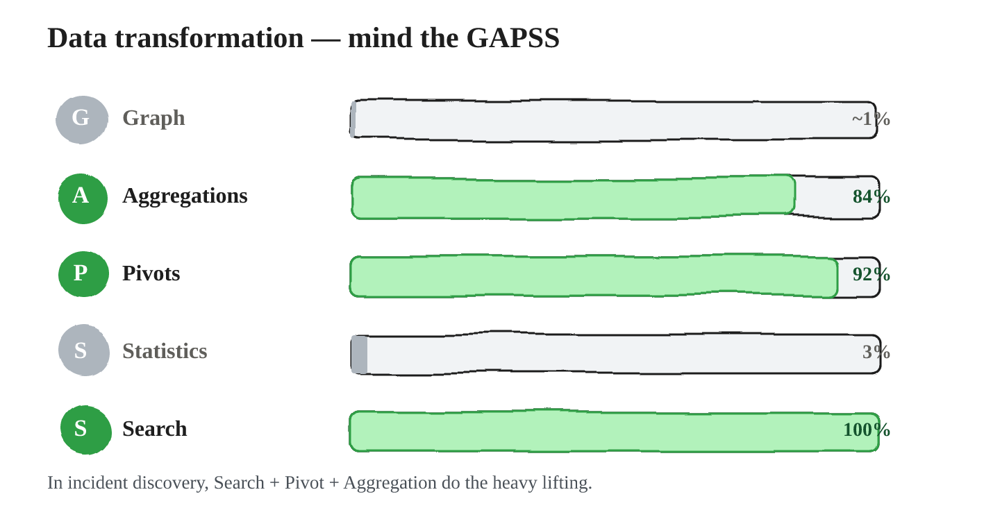

??? info "Sources & further reading"
    - Intel 471 — [*Threat Hunting Tactics & Techniques*](https://www.intel471.com/blog/threat-hunting-tactics-techniques) — the transformation moves described independently of any one platform.
    - SOC Prime — [*Threat Hunting Basics: Getting Manual*](https://socprime.com/blog/threat-hunting-basics-getting-manual) — on manual data work as the thing alerting cannot replace.
    - [OTRF — Threat Hunter Playbook](https://threathunterplaybook.com) — these transformations as real, executable queries rather than descriptions.


### Search — the workhorse

A blank search bar over a mountain of data is the most intimidating thing in hunting. But search is how you find answers to questions, how you *generate* new interesting questions (every answer opens the next one, and that's how you go deep), and how you expose the opportunity to spot an anomaly. You can learn any search syntax; the genuinely hard part is knowing *what* to search for.

Most searches don't return exactly what you need on the first try, so you refine them in two directions. **Expansion** broadens the scope — by time (one day to one week) or by criteria (one host to ten). **Reduction** focuses it — by time (a week down to a day) or by criteria (all ports down to one). Real hunts use both, often in the same investigation.

Take a concrete one. You see a high number of outbound DNS requests from `2.2.2.2` and ask what led to it. Your first search pulls a week of flow for `2.2.2.2` on port 53, just to see whether this is a sudden spike or steady background. Your second search *reduces* the time to a five-minute window around the spike and *expands* the criteria by dropping the port-53 filter — now you can see the other connections, HTTP and otherwise, that happened right alongside the DNS burst. Reduction and expansion, working together.

The refinement can carry a whole hunt. *Has PowerShell malware run on my network?* You're after unknown PowerShell scripts, you expect them in Sysmon EID 1, so you search all EID 1 events that invoke PowerShell. The first pass is a week across all hosts. The second narrows to a day and starts **excluding known-good scripts** — you pull their names from reports and known-good lists and knock them out one by one until only unknowns remain. The third expands the time back out to a week, **reduces by host** (excluding IT workstations, where PowerShell is normal), keeps the known-script exclusions, and **expands the criteria** to include `ps.exe` — a renamed copy of PowerShell. The search evolves; attackers rename their tooling, so you extend further with file hashes and so on. The value isn't any single query — it's the refinement process.

One more distinction, and it's really the hunting/investigation context switch in another guise. When you're **finding anomalies** — hunting, which is exploratory — you generally **start broad and reduce** as needed. When you're **investigating** a specific anomaly you already have, you **start narrow and expand** as needed, because a tight search lands you directly on the specific answer you're chasing. Same person, same tools, opposite opening move, depending on which mode you're in.

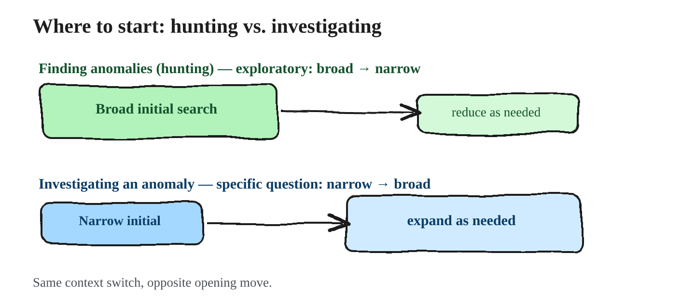

### Getting fluent in your search tool

If you're great at asking questions, you're already most of the way to being great at searching — but a question only becomes an answer once you translate it into the language of a specific tool, and every tool has its own grammar and its own blind spots. Fluency is what closes that gap, and it comes down to understanding four things about whatever platform you're on. **Syntax** is how you express the search you want. **Capabilities** are what the tool can actually do. **Limitations** are what it will never let you find, no matter how you phrase the query. And **nuance** is the quiet layer underneath — the assumptions the tool makes on your behalf, and the places where it behaves counterintuitively and quietly trains bad habits into you. The first three you can look up; the fourth only comes from time in the tool.

It helps to remember that each platform speaks its own dialect: Osquery answers in SQL, Elastic in Lucene, Mandiant's tools in MQL, Endgame in EQL, Splunk in SPL. You don't need all of them — you need the one your stack runs, and you need to know *why* it behaves the way it does. That "why" almost always traces back to the **backend**, because the way a tool stores data dictates the function and features it can offer. A relational database, a graph database of nodes and relationships, flat plain text (simple to search but the least efficient), an inverted index that works like the index at the back of a book, mapping keywords to the documents that contain them — each one changes what your searches can express and how fast they return. Knowing your backend is what lets you predict a tool's syntax, capabilities, and limits instead of discovering them by surprise.

The most common way that surprise shows up is **typed data**. Predefined data types decide not just how a value is stored but how you're allowed to search it, and the classic trap is a number like `500` stored as a *string* versus an *integer*. Search `value = 500` and both match. But search `value > 499` and only the integer succeeds — to a string backend, `500` is just three characters, and "greater than" has no meaning for characters. The flip side is that rich types unlock capabilities you'd otherwise have to fake: an IP type understands CIDR ranges and address blocks, a date type lets you ask what happened on *this* day and not *that* one. Learning the types your backend uses is what turns those capabilities on.

Two more distinctions round out the mental model of how a search actually matches. A **filter** asks a yes-or-no question — *does this data match?* — and returns exact matches: which logs are timestamped between 9 and 10 AM, which flow records came from `10.1.1.50`. A **query** asks a softer question — *how well does this data match?* — and ranks results by relevance, the way a web search does: which executed files contain strings similar to `mimikatz`. Filters are precise; queries are fuzzy and ranked, and knowing which one you're issuing keeps you from being surprised by what comes back.

The rest is grammar, and most tools share the same shape. A simple search is usually `field=value` or `event where condition`, and **compound queries** stitch conditions together with Boolean operators — `src_ip=192.168.1.1 AND port=80`, or `src_ip=192.168.1.1 OR dst_ip=192.168.1.1 AND NOT port=443`. Beyond plain equality, comparison operators let you express ranges and exclusions, and they tend to come in interchangeable spellings across tools:

| Meaning | Common forms |
|---|---|
| Equals | `=`, `==`, `eq` |
| Greater than / or equal | `>`, `gt` · `>=`, `=>`, `ge` |
| Less than / or equal | `<`, `lt` · `<=`, `=<`, `le` |
| Negation | `!`, `!=`, `neq` |

Two last techniques are worth knowing because they show up the moment your hunts get real. A **subsearch** (or nested search) is a search within a search — you run one query, then search inside its results — and in some tools it's simply the efficient way to express a two-stage question. And **escaped characters** matter more than they sound: any character that carries special meaning to the tool or its backend — `+ - = && || > < ! ( ) { } [ ] ^ " ~ * ? : \ /` — has to be escaped when you want it treated as literal text, which happens constantly when you're searching URLs or file paths. You escape by prefixing the escape character (usually `\`) or wrapping the value in quotes, so a literal search for `?abcde=1234` becomes `\?abcde\=1234`.

Pull it together and the lesson is the same one we started with: you can learn any search *syntax* in an afternoon. Real fluency is knowing your tool's backend, its data types, and its quirks well enough that you know what to search for — and that you can trust what it hands back.

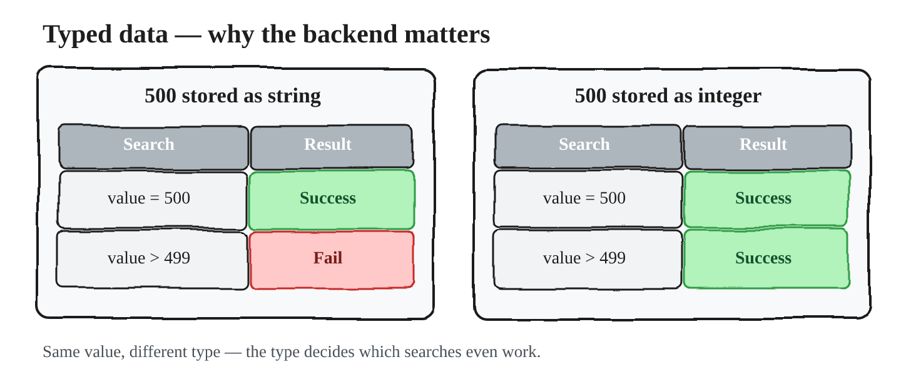

### Matching parts, ranges, and patterns

Very often you don't know the whole value — you know a fragment of it, the front or the back — and matching part of a larger thing is handled a little differently by every tool. Three techniques are close to universal. **Wildcards** stand in for characters you don't know: a single-character wildcard (`sv?host.exe` matches `svchost.exe`, `sv0host.exe`, or `svxhost.exe` — which is exactly the shape of a mimicry hunt) and a multi-character wildcard (`sv*host.exe`, which also catches `svc-host.exe`). A **prefix search** matches a known beginning followed by anything else (`svc-*` matches `svc-backup`, `svc-sql`, `svc-1138`). And a **suffix search** matches a known ending preceded by anything (`*admin` matches `sqladmin`, `bkupadmin`, `1admin`). Between them, they let you hunt when you only hold half the string.

A couple of smaller features round out the everyday toolkit. **Ranges** let you search between two values — `date:[2019-01-01 TO 2019-12-31]`, `port:1-1024` — but whether the endpoints are included is a per-tool assumption (inclusive keeps 1 and 1024, exclusive drops them), and a tool won't always be consistent even across fields of the same type, so it's worth verifying — along with confirming the field name actually exists in your dataset. **Exists searches** return records where a field is simply present, whatever its value (`_exists_:username`, `_exists_:flags`), which is quietly powerful for finding records that are missing a field they should have, or carrying one they shouldn't.

When the built-in features can't express what you need, most modern tools admit as much and fall back to a **regular-expression engine** — usually a third-party one — for genuinely complex patterns, like a domain-shaped match `/^[a-zA-Z0-9][a-zA-Z0-9-]{1,61}[a-zA-Z0-9]\.[a-zA-Z]{2,}$/`. Before you lean on it, pin down three things: how to *invoke* a regex query in your tool (the `/.../` syntax, a `regexp:` operator, whatever it uses), which regex *grammar* the engine speaks (egrep, PCRE, and so on), and the *performance* cost — a poorly written regex can be brutally expensive at scale.

### Output — the search isn't finished when results appear

Most tools simply paint results on the screen, but the output stage is itself a place to transform, and it pays to know your options. Many tools compute statistics inline — mean, median, mode, standard deviation — or aggregate the values in your current result set (Splunk's `stats` is the familiar example), which folds part of the GAPSS toolbox directly into the query. And when you want to take the data elsewhere, format matters: column versus raw, and structured exports as JSON, XML, or CSV, so you can pull results out and extract the insight you're after.

### Where's my data? The shortcuts vendors don't advertise

Search at real scale is a hard engineering problem, and vendors take shortcuts to keep it fast. Two of those shortcuts can quietly change what you find — and they are not the same thing, which is exactly the point worth being clear about.

**Sampling** looks at only a *subset* of the data. It's fast, but it can miss real events outright: if the record you needed wasn't in the sample, you simply never see it. A **Bloom filter** is something different — a memory-efficient, probabilistic check that answers one narrow question about a value like an IP or a hash: is it *definitely not* here, or *probably* here? It has no false negatives but can produce false positives. In practice that means if a Bloom-filter check returns nothing, you can trust the indicator was never logged; if it says "probably," the engine still has to do a deeper index or disk scan to confirm, so performance varies with how saturated or well-tuned the filter is.

So the distinction is this: sampling searches only part of the actual data and can miss events, whereas a Bloom filter doesn't replace the search at all — it just decides whether a block of data is even worth searching, and then a real search confirms the hit. A vendor could chain both: sample to pick a subset of data, use a Bloom filter to decide which blocks to inspect, then run the actual search. Either way, these optimizations affect the *completeness* of your results, which is the whole reason you need to know how your engine works underneath.

One more silent gap lives a layer above the engine, in **field mapping**. SIEMs normalize raw logs, standardizing `src_ip`, `ip_address`, and `SRC` into a single unified field like `source.ip`. If you write a hunt against the standard schema but the mapping logic misses a particular log source or misinterprets a field, the data is ingested and yet your query silently ignores it — the fields simply don't line up. The remedy is ownership: understand how your data is represented, and make your vendor document exactly how the search engine and the mapping behave.

### A framework for mastering any search tool

Step back and all of this becomes a checklist you can apply to any search platform someone hands you. There are five areas. The **backend** — its data storage model, its typed data, and whether you're filtering or querying. The **syntax** — basic structure, compound queries, Boolean operators, subsearch and nested search, escaped characters, and comparison operators. **Partial matching** — wildcards, prefix, suffix, and regular expressions. **Additional features** — ranges and exists searches. And **output** — transformations and formats. Work through those five for any tool and the blank search bar over a mountain of data stops being intimidating.

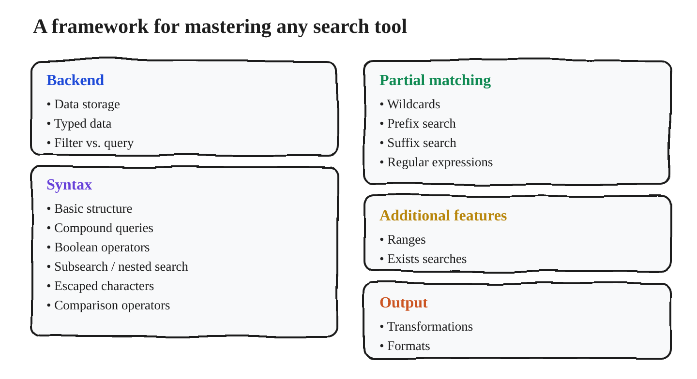
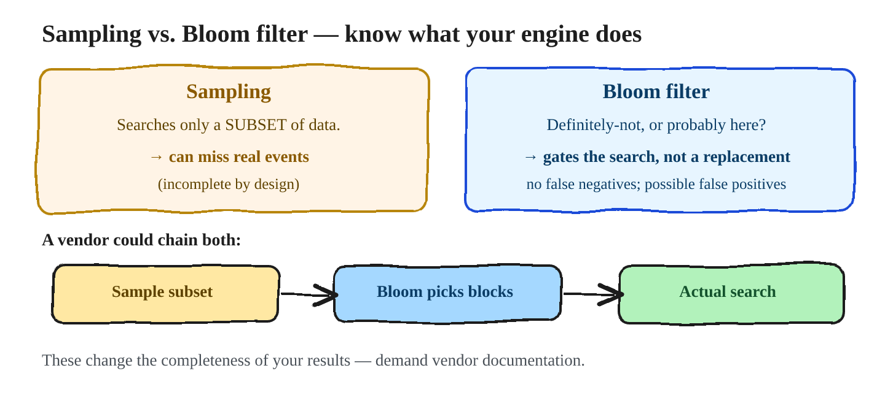

And that is the whole reason this detour into search mattered: fluency in the tool is what finally lets you execute the third question of every hunt — *how do I manipulate the data to see it?* — well enough that the anomaly actually shows itself.

??? info "Sources & further reading"
    - [SigmaHQ/sigma](https://github.com/SigmaHQ/sigma) — the clearest demonstration that each platform speaks a dialect: one rule, compiled out to SPL, KQL, EQL, Lucene and more. Reading the backends is a fast way to see where each tool's expressiveness ends.
    - [OTRF — Threat Hunter Playbook](https://threathunterplaybook.com) — the same hunt expressed as queries you can run, which is the quickest cure for search-bar paralysis.
    - [Zeek](https://zeek.org/) — worth knowing that Zeek logs a connection only when it closes; that is exactly the kind of backend "nuance" this section warns about.
    - Intel 471 — [*How to Threat Hunt: A Beginner's Guide*](https://www.intel471.com/blog/how-to-threat-hunt-a-beginners-guide) — query refinement worked through on real examples.


### Aggregation — taking in the lay of the land

If search is how you pull data, **aggregation** is how you make sense of a lot of it at once. An aggregation groups the unique values within a single field — you'll also hear it called stacking, frequency analysis, long-tail analysis, or distribution — and it usually carries a little math along with it, most often a count of how many times each value appears, and it's almost always paired with sorting. The payoff is perspective: instead of scrolling ten thousand rows, you see the shape of the data in a dozen lines.

The simplest form is a **unique term plus count**. Take a field full of values — `chrome.exe`, `powershell.exe`, `chrome.exe`, `powershell.exe`, `powershell.exe`, `certutil.exe` — group the unique ones, count each, and sort, and you get three `powershell.exe`, two `chrome.exe`, one `certutil.exe`. That's the whole idea, and it scales to millions of rows — at which point the single `certutil.exe` is the row you care about.

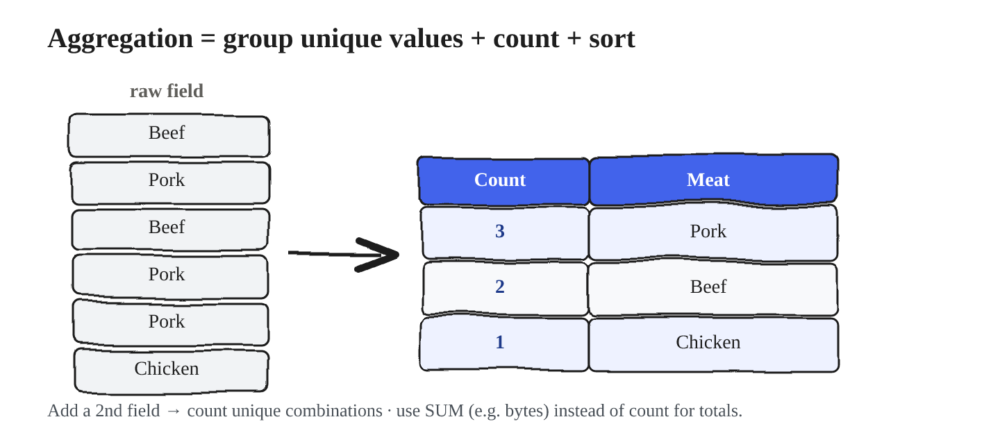

Aggregation isn't limited to one field. Group by a **combination** of fields and you count unique *pairs* — user and process together (two `jdoe`+`powershell.exe`, two `svc-backup`+`chrome.exe`, one `jdoe`+`certutil.exe`), or source IP together with destination IP, and you can keep adding fields as the question demands. The pair is often where the signal is: neither `jdoe` nor `certutil.exe` is remarkable alone. And the math doesn't have to be a count: a **unique term plus sum** lets you total another field per group — sum the bytes transferred and aggregate that by host, and you've built a "top talkers" list in one move.

That last point opens up a choice that matters more than it first appears: **do you sort for the most-frequent values, or the least?** It depends entirely on the purpose of the hunt. Aggregating bytes-per-host and sorting by *most* gives you top talkers — the loudest hosts on a segment. Aggregating service executions and sorting by *least* (least-frequency-of-occurrence, LFO) surfaces the rare binary that ran only once or twice while `winword.exe` ran a hundred times — and rarity, as we've seen, is where a lot of evil hides. Same technique, opposite sort, completely different question answered.

How you actually run an aggregation depends on the tool, but the pattern is everywhere. Learn the one your stack uses — the concept transfers untouched.

=== "Kibana"
    Build a **Data Table**, add a *Terms* aggregation bucket on the field, and order by the count metric.

    ```text title="Terms aggregation"
    Bucket:  Split rows → Terms
    Field:   NewProcessName.keyword
    Order:   metric: Count — ascending for LFO, descending for MFO
    Size:    100
    ```

=== "Linux / macOS"
    ```bash title="Group and rank a column"
    cat ips | sort | uniq -c | sort -nr
    ```

    ```bash title="Carve the field out of a CSV first"
    cut -d "," -f3 ips.csv | sort | uniq -c | sort -nr
    ```

=== "Windows / PowerShell"
    ```powershell title="Group and rank a column"
    Get-Content .\ips | Group-Object
    ```

    ```powershell title="Pull a field out of a delimited line"
    Get-Content .\ips2 | %{ $_.split(',')[2] } | Group-Object
    ```

#### Aggregation lives on top of search

Here's the part that ties it back to everything before it: **aggregation is always downstream of a search.** You can't meaningfully aggregate the entire network at once — you'd drown in it — so you *search first* to scope the data, then aggregate what you've scoped, and the result of that aggregation tells you what to search for next. The two techniques feed each other; transformation never happens in a vacuum.

The clearest way to see this is a real workflow, peeling back one layer at a time. You **search** HTTP data for a single branch office. You **aggregate** the unique MIME types with a count, sorted least-frequent-first, to bring the oddities to the top. You **search** those outlier values to get context on what they are. Some turn out to be normal IT-department activity, so you **add an exclusion** for that to your aggregation and run it again — and with the known-good removed, a new layer of outliers rises into view. You **search** those for context, find another cluster of legitimate processes, and **add exclusions** for them too. Each pass strips away a layer of known-legitimate clutter, and each time, the genuinely anomalous values stand out a little more sharply. That back-and-forth — search, aggregate, exclude, repeat — is the everyday rhythm of hunting.

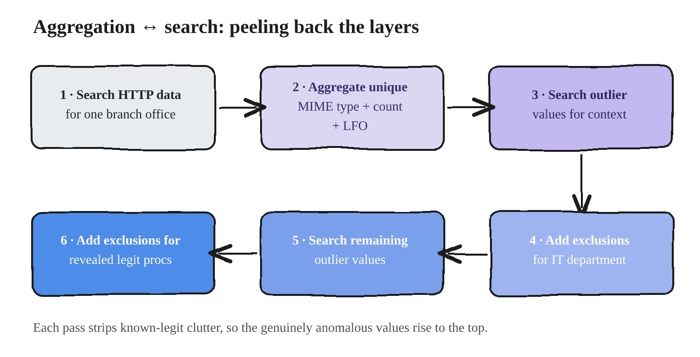

#### Aggregation and the third question

Aggregation is one of the main ways you answer the third question of a hunt — *how do I transform the data to see what I'm looking for?* — and it's worth noticing that what you aggregate is rarely the attack itself. In the credential-theft hunt, you don't see the moment credentials are stolen; you see the **use** of those credentials afterward, by aggregating unique username together with destination host, or username with authentication location, and sorting by most-frequent to spot an account suddenly touching far more places than it should. The manifestation, not the act.

A handful of aggregations come up again and again, split across the two hunting styles:

| Attack-Based (ABH) | Data-Based (DBH) |
|---|---|
| Malicious PowerShell: unique scripts + count + **LFO**; unique scripts & users + count + LFO | Proxy logs: unique user-agent + count + LFO; unique MIME type + count + LFO |
| Credential theft: unique username + auth location + count + **MFO**; username + dest host + count + MFO | Firewall logs: sensitive-server unique outbound connections + **sum of bytes** + MFO |
| | Process-exec logs: unique process + parent process + count + LFO |

(LFO = least-frequency-of-occurrence, for surfacing the rare; MFO = most-frequency, for surfacing the dominant.) Notice too that a source like firewall logs is mostly an *investigation* tool, but it becomes a *hunting* tool the moment you work it segment by segment — which is the same broad-versus-narrow distinction from earlier. Aggregation suits **broad** questions and a broad, lay-of-the-land perspective; investigation narrows to specific ones.

To sum up the technique: aggregations are critical in hunting because they let you take in the lay of the land and gain a high-altitude view of your data, you'll reach for one in nearly every expedition you run, and the three forms worth mastering first are **unique term + count**, **multiple unique terms + count or sum**, and **unique term + sum**.

??? info "Sources & further reading"
    - SOC Prime — [*Threat Hunting Basics: Getting Manual*](https://socprime.com/blog/threat-hunting-basics-getting-manual) — stacking under its many names (stack counting, data stacking, pivot tables), plus the warning that triaging every least-common value is a time sink.
    - Intel 471 — [*Threat Hunting Tactics & Techniques*](https://www.intel471.com/blog/threat-hunting-tactics-techniques) — stack counting as a primary hunting technique, with the user-agent example.
    - [*Threat Hunting with Sysmon 101, part 3*](https://11x256.github.io/threat_hunting/Threat-Hunting-3-command-line-investigation/) — the parent/child aggregation worked in practice, including excluding `chrome.exe → chrome.exe` to clear the noise.
    - [OTRF — Threat Hunter Playbook](https://threathunterplaybook.com) — aggregations written as notebooks, so the exclusion-and-rerun loop is visible step by step.


### Statistics — quantifying what "normal" looks like

Statistics, in this context, is simply any technique that summarizes or interprets a large quantity of data. You've already met the simplest one — **frequency**, the humble count from the last section (*how many times has this process executed? which ran the least?* — a Kibana count of `user:jdoe`, or `cat windows-events.json | jq -r .SubjectUserName | grep jdoe | wc -l` returning 1,378). The rest of this section is about a handful of statistics that each give you a different lens, and they share one purpose above all: **defining what's normal, so that abnormal has something to stand out against.** A quick note before we start — the family is broad (mean/median/mode, frequency, standard deviation, entropy, Levenshtein distance, even machine learning), and we'll focus on the ones you'll actually reach for.

#### Averages: what should I expect here?

The everyday question an average answers is a hunting question in disguise: *what amount of outbound traffic is normal for these hosts? what's a normal number of authentication attempts for this app?* Once you know the expected value, a departure from it becomes a lead. But "average" is really three different measures, and each has a failure mode you have to respect:

- **Mean** — the calculated centre. It's the intuitive average, but it's **skewed by outliers**: a single massive value drags it. An "average `request_body_length` of 60.369" can be quietly inflated by one enormous upload, so the mean alone can lie about what's typical.
- **Median** — the middle *actual* value when you line them up. It shrugs off outliers, but it's **skewed by unevenly distributed data**, over-focusing on the middle and hiding a lopsided spread.
- **Mode** — the most common value. Useful when one value truly dominates, but **skewed by evenly distributed data**: if the top and second-place values are close, or everything's spread thin, the mode barely tells you anything.

So the discipline is to match the measure to the **distribution** of your data, and to actually look at that distribution first. Is authentication spread evenly across every user, or is this an app where a few service accounts do most of the logging in? The shape decides which "average" is honest: in a symmetric distribution the mean and median coincide; in a right-skewed one the median sits left of the mean; in a left-skewed one the mean sits left of the median.

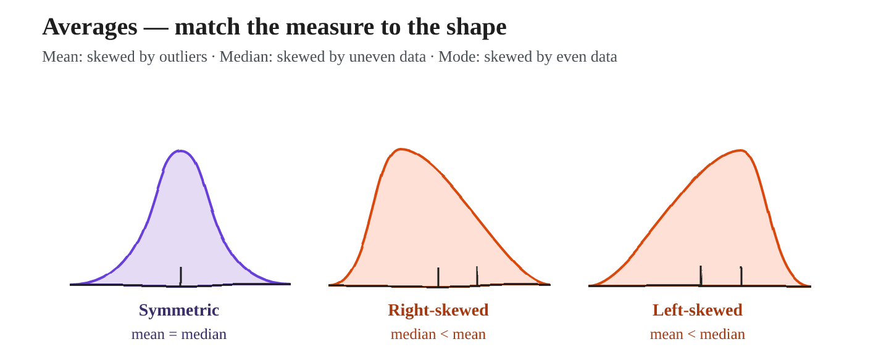

#### Standard deviation: how far is too far?

Knowing the average invites the next question — *how far from it is far enough to care?* That's exactly what **standard deviation** measures: the spread of the data, which lets you say precisely how much of an outlier a given value is. It shines on **normally distributed** data, and a surprising amount of what we hunt is roughly normal — login times, downloaded bytes, the number of unique hosts a user logs into, the number of external IPs a host visits.

The reason it works is the shape of the bell curve: about 68% of all values fall within one standard deviation of the mean, about 95% within two, and about 99.7% within three. Density falls off a cliff as you move out — being one or two σ from the mean is mild and common, but being four, five, or six σ out is genuinely rare, and that rarity is the signal. The workflow is mechanical: take your value, compare it to the average, count how many standard deviations away it sits, and that count *is* the degree of the outlier. (As always: an outlier is a lead, not a verdict — rare is not the same as malicious, so you still dig.)

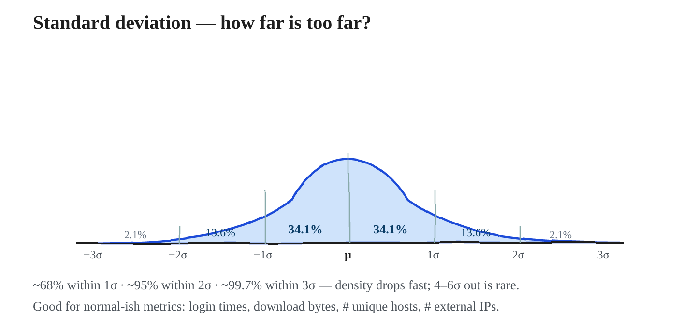

#### Entropy: measuring randomness

**Entropy** describes how random something is, measured in bits per byte (8 is the ceiling). Encrypted data is nearly maximal — its characters are distributed almost perfectly evenly — so entropy is a quick way to ask *which of these is encrypted?* Run the `ent` tool over three files and normal-looking text scores around 4.4 bits per byte while a base64/encrypted blob scores around 6.0; the higher the number, the more random the content.

```console title="ent — the same tool over three files"
$ cat normal | ent   →  Entropy = 4.405857 bits per byte
$ cat 1 | ent        →  Entropy = 5.387240 bits per byte
$ cat 2 | ent        →  Entropy = 5.997090 bits per byte
```

The hunting value isn't the number itself — it's the **mismatch between the entropy you expect and the entropy you find.** High randomness is perfectly normal inside encrypted, HTTPS, or tunneled traffic; the same high randomness showing up where it shouldn't — encoded data riding a cleartext protocol like DNS, or an encoded payload over a channel that's normally plain — is what's interesting. (When something needs a key to be read, its entropy runs high.) But there's a real trap here, and it deserves saying bluntly: don't feed every URI you see to `ent`. Many things are far more or less random than your intuition expects, the margin of error is small, and that combination makes entropy a false-positive machine when applied blindly — which is why IDS rarely leans on it. Use it where it fits: small, uniform data sets — random-looking usernames, filenames, and domains (think DGA), high entropy in cleartext DNS used for exfiltration, encoded data over normally-encrypted channels. There are several approaches; a well-known one is Mark Baggett's Freq, which scores strings with natural-language processing (`github.com/sans-blue-team/freq.py`).

#### Producer:Consumer Ratio: who's sending versus receiving?

We're trained to think of endpoints as client and server, but **producer:consumer** is a more statistical way to look at a host — at any moment it's either a producer (sending data) or a consumer (receiving it). The **PCR** captures that balance in a single number between −1 and +1:

> PCR = (bytes sent − bytes received) / (bytes sent + bytes received)

A value near **+1** means the host is almost purely pushing data out — a file upload, or a beacon; around **+0.4** is a 70/30 export like sending email; **0.0** is a balanced exchange like NTP, ARP, or DHCP; **−0.5** is roughly 3:1 inbound, like normal HTTP browsing; and **−1.0** is a pure pull, a file download. That single ratio classifies a host's role and makes unexpected behavior pop.

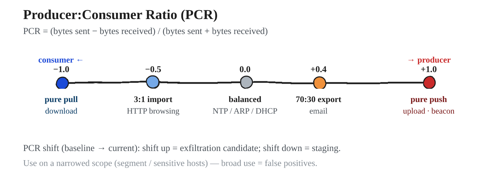

The genuinely powerful use is the **PCR shift**: plot each host's *baseline* PCR (its normal balance) against its *current* PCR. A host that shifts sharply toward producing — up and off the line — is a candidate for **data exfiltration**; one that shifts the other way can indicate **data staging**. Two well-known references develop this: Carter Bullard's FloCon 2014 PCR presentation, and David Bianco's "Detecting Data Staging & Exfil Using the PCR Shift."

!!! danger "The caveat that applies to every statistic in this section"
    **Use them on a narrowed focus, never as a broad sweep.** Run PCR, standard deviation
    or entropy across an entire network and you will drown in false positives.

    The correct order is the one this whole part has argued for: start from an attack-based
    or data-based question, scope to a segment or a set of sensitive hosts, and *then* bring
    the statistics to bear on that slice. The correct order is the one this whole part has argued for — start from an attack-based or data-based question, scope to a segment or a set of sensitive hosts, and *then* bring these statistical techniques to bear on that slice.

#### The role of statistics in hunting

It's worth being precise about what statistics is and isn't for. You *can* use it to summarize data and take in the lay of the land, as a **step-one detection** that surfaces a lead, as a **step-two confirmation** when you've found something odd and need to know *to what extent* it's abnormal compared to everything else, and to inform your decisions. You *cannot* use it to automate the whole process or to make the decision for you. And keep a healthy skepticism about the "advanced statistics" vendors sell: much of it is just a more involved version of the fundamentals in this section, and the cost-versus-benefit of a lot of machine-learning and AI statistical products remains unproven. Master the fundamentals; treat the magic box with caution.

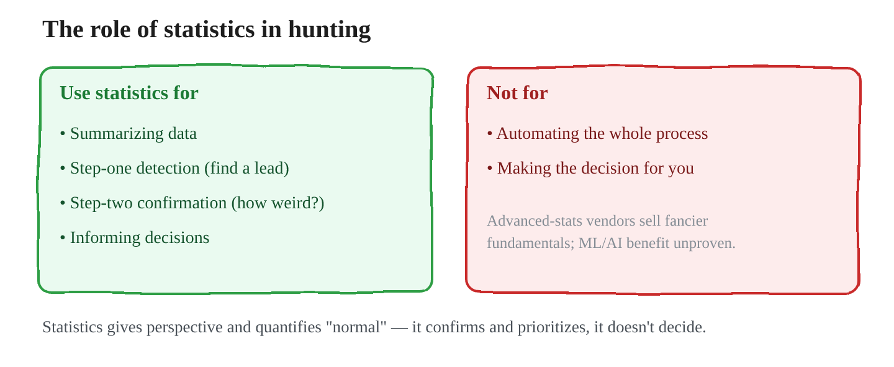

The through-line for the whole technique: statistics gives you a different perspective and, above all, a way to quantify "normal" — so reach for it to confirm and prioritize leads on a narrowed scope, never as an autopilot.

??? info "Sources & further reading"
    - Mark Baggett — [*Detecting Random: Finding Algorithmically Chosen DNS Names (DGA)*](https://isc.sans.edu/diary/19893) (SANS ISC) — **read this before using entropy.** He tested `ent` on hostnames and found malicious names score about the same as normal ones, which is why he moved to character-pair frequency tables instead.
    - [MarkBaggett/freq](https://github.com/MarkBaggett/freq) — the resulting tool, plus `freq_server` for scoring at query time. Build the frequency table from your own traffic, not a generic corpus.
    - [*ent*](https://www.fourmilab.ch/random/) (Fourmilab) — the entropy tool used in the examples above.
    - Carter Bullard — [*Producer–Consumer Ratio*](http://qosient.com/argus/presentations/Argus.FloCon.2014.PCR.Presentation.pdf) (FloCon 2014) — the origin of PCR.
    - David J. Bianco — [*Detecting Data Staging & Exfil Using the PCR Shift*](http://detect-respond.blogspot.com/2016/09/detecting-data-staging-exfil-using-PCR-shift.html) — baseline PCR versus current PCR, which is the technique described here.
    - [activecm/RITA](https://github.com/activecm/rita) · [*Threat Hunting Over the Network With Zeek and RITA*](https://www.activecountermeasures.com/threat-hunting-over-the-network-with-zeek-and-rita/) — statistical beacon scoring (0–1) over Zeek logs: a worked example of statistics applied to a *narrowed* scope.


### Pivots — connecting data sources on a shared value

Pivoting is the simplest idea in the toolbox and one of the most powerful. It's three steps: search a data source, identify a value of interest, and search for that value in a *different* data source. That's the whole move. A flow record hands you a source IP and a timestamp; you carry that IP into your PCAP and now you're looking at the actual packets. You've connected two data sources through a single value of interest and built a bigger, multi-angle picture of what you're investigating.

Of the GAPSS techniques, pivoting leans a little more toward investigation than hunting — and that's the tell for *when* you reach for it. It's the move you make when you cross over from "I found something" to "I need to validate this and be sure of my claim." Pivoting is a confirming step: you have a result, and each hop into a new source either corroborates the theory or knocks it down.

The value you pivot on doesn't have to stay inside your own telemetry, either. Some of the most useful pivots land in *external* databases — OSINT, VirusTotal, domain reputation. A few concrete patterns are worth internalizing because you'll use them constantly. A proxy knows the **username** behind a request, so a username lifted from proxy logs pivots straight into Windows logs, where searching for it — often with an aggregation — surfaces every process that user executed. A **filename** recorded in the registry pivots to the file itself on disk, following the path the registry stored. The basic shapes — PCAP to OSINT on a domain, HTTP proxy to Windows log on a username, registry to file on a filename — are pivoting in miniature.

#### Pivots form long chains, so pick the right path

Real pivoting rarely stops at one hop; it fans out into long chains with many directions, because every new source raises new questions and every question has its own pivot. Picture a real scenario: while hunting, you find a process whose *name* makes you suspicious. You pivot from the Sysmon process logs on its **MD5 hash** into Zeek/Bro file logs. From there a **connection ID** carries you to Bro HTTP logs, and the **domain** you find there pivots onward to DNS logs and OSINT. Meanwhile the **responder IP** branches off to PCAP, flow, and OSINT — and the domains you turn up in *those* pivot again. Each hop is driven by whatever value the current data happens to represent, and the discipline is choosing the right path: a wrong turn simply won't reach the destination, so you keep the question you're actually trying to answer in front of you the whole way.

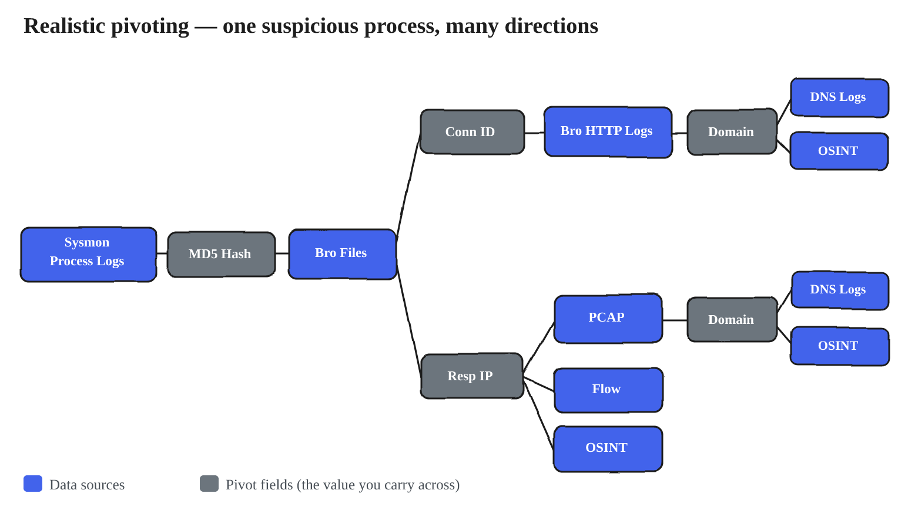

#### The fields that make pivoting work — know these cold

A pivot is only possible when the *same value* is recorded in both data sources, so pivoting is only as strong as the fields that appear across many sources. Four fields do the overwhelming majority of the work in hunting, and it pays to memorize where each one shows up:

- **IP address** — flow, PCAP, proxy, OS events, EDR, DNS. The universal *network* pivot.
- **Username** — OS events, proxy, app auth, VPN auth, the HR database, the registry. The universal *identity* pivot.
- **Domain** — proxy, Zeek, DNS, PCAP, plus external VirusTotal and domain-reputation services.
- **File hash** — Sysmon, Zeek, EDR, plus external VirusTotal, sandbox, and application-whitelisting data.

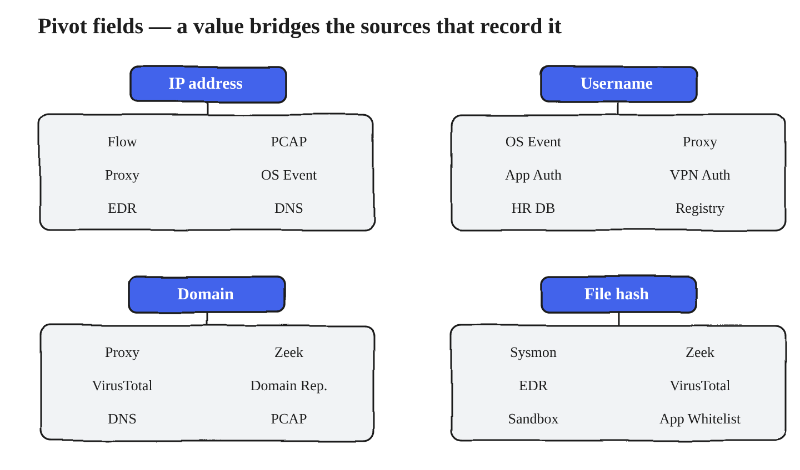

The habit to build is reflexive: whenever you find a value, ask *"which of my data sources also records this?"* — because that set of sources is your pivot map, and cross-source correlation is one of the strongest moves a hunter has.

??? info "Sources & further reading"
    - [Zeek](https://zeek.org/) — the connection UID is the canonical pivot key: it threads one connection across `conn`, `http`, `dns`, `files` and `ssl` logs.
    - [*Threat Hunting with Sysmon 101, part 2*](https://11x256.github.io/threat_hunting/Threat-Hunting-2-sysmon-event-structure/) — why you pivot on process GUID rather than PID, since PIDs get reused and will silently break a chain.
    - [OTRF — Threat Hunter Playbook](https://threathunterplaybook.com) — multi-source pivots written out as joins you can read.
    - Black Hills InfoSec — [*Detecting Malware Beacons With Zeek and RITA*](https://www.blackhillsinfosec.com/detecting-malware-beacons-with-zeek-and-rita/) — a pivot chain run end to end on video.


### The GAPSS toolbox, together

That completes GAPSS — the five ways to transform data until an answer surfaces. **Graph** turns data into a picture; **Aggregations** group and count it to reveal the lay of the land; **Pivots** connect sources on a shared value to build the fuller picture; **Statistics** quantify what's normal so the abnormal stands out; and **Search** is the query underneath all of it. They were never a fixed sequence and they never work in isolation — you search to scope, aggregate to find the outliers, pivot to corroborate, and lean on statistics to confirm, looping between them as the investigation demands. In hunting specifically, Search, Pivots, and Aggregations carry most of the discovery. Whatever the mix, this is the machinery behind the third question of every hunt — *how do I manipulate the data to see it?* — and the moment that answer surfaces, the work turns back into *reading* it. That's where anomaly detection picks up.

??? info "Sources & further reading"
    - Intel 471 — [*Threat Hunting Tactics & Techniques*](https://www.intel471.com/blog/threat-hunting-tactics-techniques) — the closest public equivalent to this toolbox, platform-independent.
    - [OTRF — Threat Hunter Playbook](https://threathunterplaybook.com) — search, aggregation and pivot chained together in a single runnable notebook, which is what this section describes in prose.
    - Splunk — [*Introducing the PEAK Threat Hunting Framework*](https://www.splunk.com/en_us/blog/security/peak-threat-hunting-framework.html) — where these transformations sit inside a full hunt lifecycle.
    - [SigmaHQ/sigma](https://github.com/SigmaHQ/sigma) — once a transformation reliably surfaces the thing, this is how it stops being a manual hunt.

---

## Grounding it in trusted frameworks

The models above stand on their own, but none of them is invented here. Each lines up with
published work worth reading in full — and worth naming, because a hunting programme that can
point at its own frameworks is a great deal easier to defend to the people funding it.

<div class="grid cards" markdown>

-   :material-sync: **The Threat Hunting Loop**

    ---

    Hypothesis → investigate → uncover TTPs → enrich analytics. The outer loop that every
    individual hunt sits inside.

    [:octicons-arrow-right-24: Sqrrl framework whitepaper](https://www.threathunting.net/files/framework-for-threat-hunting-whitepaper.pdf)

-   :material-stairs-up: **Hunting Maturity Model**

    ---

    HMM0–HMM4. Formalises the hunt-once arc: the step from HMM3 to HMM4 *is* turning
    successful hunts into automated detection.

    [:octicons-arrow-right-24: The Cyber Hunting Maturity Model](https://medium.com/@sqrrldata/the-cyber-hunting-maturity-model-6d506faa8ad5)

-   :material-summit: **PEAK**

    ---

    Prepare · Execute · Act with Knowledge, across hypothesis-driven, baseline and
    model-assisted hunt types. *Prepare* is the intelligence section of this post.

    [:octicons-arrow-right-24: Splunk SURGe](https://www.splunk.com/en_us/blog/security/peak-threat-hunting-framework.html)

-   :material-triangle-outline: **The Pyramid of Pain**

    ---

    Hunt behaviours, not brittle atomic indicators — the same lesson as
    signatures-versus-hunting, argued from the cost side.

    [:octicons-arrow-right-24: David J. Bianco](http://detect-respond.blogspot.com/2013/03/the-pyramid-of-pain.html)

-   :material-diamond-stone: **The Diamond Model**

    ---

    Adversary, capability, infrastructure, victim — and the edges between them. The formal
    version of *attacks are about evolving relationships*.

    [:octicons-arrow-right-24: Full paper (DTIC)](https://apps.dtic.mil/sti/pdfs/ADA586960.pdf)

-   :material-link-variant: **Cyber Kill Chain · OODA**

    ---

    Structuring the timeline you reconstruct, and the observe–orient–decide–act cycle that
    every loop in this post descends from.

    [:octicons-arrow-right-24: Lockheed Martin](https://www.lockheedmartin.com/en-us/capabilities/cyber/cyber-kill-chain.html)

</div>

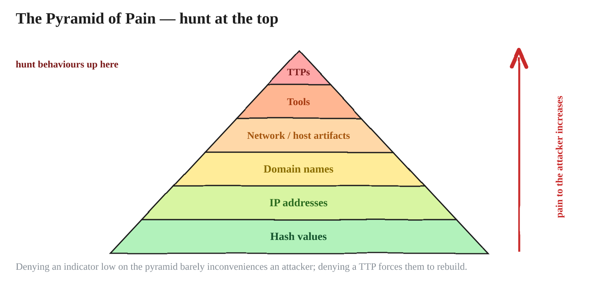

??? info "Sources & further reading"
    - Sqrrl — [*A Framework for Cyber Threat Hunting*](https://www.threathunting.net/files/framework-for-threat-hunting-whitepaper.pdf) · [*The Cyber Hunting Maturity Model*](https://medium.com/@sqrrldata/the-cyber-hunting-maturity-model-6d506faa8ad5) — the hunting loop and HMM0–HMM4.
    - David J. Bianco — [*Things That Make You Go HMM*](https://speakerdeck.com/davidjbianco/things-that-make-you-go-hmm-using-a-simple-hunting-maturity-model-to-establish-and-improve-your-threat-hunting-program) — the maturity model presented by its author.
    - Splunk SURGe — [*Introducing the PEAK Threat Hunting Framework*](https://www.splunk.com/en_us/blog/security/peak-threat-hunting-framework.html) · [hypothesis-driven](https://www.splunk.com/en_us/blog/security/peak-hypothesis-driven-threat-hunting.html) · [baseline](https://www.splunk.com/en_us/blog/security/peak-baseline-hunting) — Prepare / Execute / Act, and the three hunt types.
    - David J. Bianco — [*The Pyramid of Pain*](http://detect-respond.blogspot.com/2013/03/the-pyramid-of-pain.html) · [SANS](https://www.sans.org/tools/the-pyramid-of-pain/).
    - Caltagirone, Pendergast & Betz — [*The Diamond Model of Intrusion Analysis*](https://apps.dtic.mil/sti/pdfs/ADA586960.pdf) (full paper) · [practitioner's guide](https://www.vectra.ai/topics/diamond-model-of-intrusion-analysis).
    - Lockheed Martin — [*Cyber Kill Chain*](https://www.lockheedmartin.com/en-us/capabilities/cyber/cyber-kill-chain.html) · [OODA loop](https://en.wikipedia.org/wiki/OODA_loop).

---

## Wrap-up

!!! success "The three things to carry out of this"
    - **Timeline.** An attack is tangible events in sequence. You insert yourself into a
      timeline that already exists, and your job is to reconstruct the rest of it.
    - **Investigation process.** A loop of questions and answers, moving from an initial
      perception toward reality — and it cannot start without an observation.
    - **Hunting** is the human-centric process of proactively searching for evidence of
      attacks that evade existing monitoring. It exists to **produce those observations**,
      by finding what the other tools miss.

**Models beat randomness.** That is the mindset, and it is what makes everything in Parts 1–3 pay off.


---
## References and further reading

Grouped by what you would reach for them *for*, rather than by publisher. Everything cited
in-line through the post is collected here, plus the few places worth going first if you are
starting from scratch.

=== "The mindset"
    Where the way of thinking in this post comes from.

    - **Chris Sanders — _Practical Threat Hunting_** (Applied Network Defense) — **start here if you want to go deeper.** The ABH/DBH split, the five-step attack dissection and the evidence realms are all taught in full, with your hands on the data: [networkdefense.co/courses/hunting](https://www.networkdefense.co/courses/hunting/)
    - **Chris Sanders** — the standing reference on hunting cognition. *The Mind of a Hunter: A Cognitive, Data-Driven Approach* (SANS Threat Hunting & IR Summit 2017), [*Deconstructing the Analyst Mindset*](https://www.sans.org/presentations/keynote-deconstructing-the-analyst-mindset) (SANS CTI Summit keynote), [*Leveraging Curiosity to Enhance Analytic Technique*](https://www.sans.org/presentations/leveraging-curiosity-to-enhance-analytic-technique), and [*Investigation Theory: A Cognitive Approach*](https://www.slideshare.net/slideshow/art-into-science-2017-investigation-theory-a-cognitive-approach/71384306). His research on analyst cognition is the evidence base for the claim that the investigative skillset is universal across DF/IR/SOC.
    - [*Huntpedia: Your Guide to Expert-Level Threat Hunting*](https://www.slideshare.net/slideshow/huntpedia-249837834/249837834) (Sqrrl) — the essay collection that argues hunting is a discipline rather than a talent.
    - [*Turning the Hunted into the Hunter via Threat Hunting*](https://arxiv.org/pdf/2204.11076) (arXiv) — an academic survey of the hunting lifecycle; the source of the "hunting is scientific in nature" framing.
    - SOC Prime — [*Threat Hunting Basics: Getting Manual*](https://socprime.com/blog/threat-hunting-basics-getting-manual) — on manual data work as the thing alerting cannot replace, **and** its warning that triaging every least-common value is how a day disappears.

=== "Frameworks"
    The published models this post lines up with. Worth naming: a hunting programme that can point at its own frameworks is easier to defend to the people funding it.

    - **David J. Bianco** — [*The Pyramid of Pain*](http://detect-respond.blogspot.com/2013/03/the-pyramid-of-pain.html) · [SANS version](https://www.sans.org/tools/the-pyramid-of-pain/) — behaviours cost the adversary more than atomic indicators.
    - **Sqrrl / David J. Bianco** — [*A Framework for Cyber Threat Hunting*](https://www.threathunting.net/files/framework-for-threat-hunting-whitepaper.pdf) (the hunting loop and the maturity model) · [*The Cyber Hunting Maturity Model*](https://medium.com/@sqrrldata/the-cyber-hunting-maturity-model-6d506faa8ad5) · [*Things That Make You Go HMM*](https://speakerdeck.com/davidjbianco/things-that-make-you-go-hmm-using-a-simple-hunting-maturity-model-to-establish-and-improve-your-threat-hunting-program), the model presented by its author.
    - **Splunk SURGe** — [*Introducing the PEAK Threat Hunting Framework*](https://www.splunk.com/en_us/blog/security/peak-threat-hunting-framework.html) · [hypothesis-driven](https://www.splunk.com/en_us/blog/security/peak-hypothesis-driven-threat-hunting.html) · [baseline](https://www.splunk.com/en_us/blog/security/peak-baseline-hunting) — Prepare / Execute / Act, and the three hunt types.
    - **Caltagirone, Pendergast & Betz** — [*The Diamond Model of Intrusion Analysis*](https://apps.dtic.mil/sti/pdfs/ADA586960.pdf) (the full 61-page paper) · [a practitioner's guide](https://www.vectra.ai/topics/diamond-model-of-intrusion-analysis) if the paper is too much. The *activity thread* chapter is the formal treatment of braided parallel timelines.
    - **Lockheed Martin** — [*Cyber Kill Chain*](https://www.lockheedmartin.com/en-us/capabilities/cyber/cyber-kill-chain.html) · **John Boyd** — [the OODA loop](https://en.wikipedia.org/wiki/OODA_loop), the ancestor of every loop in this post.

=== "Intelligence & ATT&CK"
    For deciding *which* attack to hunt before you dissect anything.

    - **Katie Nickels** — [*Getting Started with ATT&CK: Threat Intelligence*](https://medium.com/mitre-attack/getting-started-with-attack-cti-4eb205be4b2f) — mapping intelligence to ATT&CK so groups can be compared and techniques ranked. The practical starting point.
    - [*Using ATT&CK to Advance Cyber Threat Intelligence — Part 1*](https://medium.com/mitre-attack/using-att-ck-to-advance-cyber-threat-intelligence-part-1-c5ad14d59724) — the group-overlay move worked explicitly: where two tracked groups share techniques, those are the highest-priority ones to detect.
    - **Katie Nickels** — [*MITRE ATT&CK: The Play at Home Edition*](https://i.blackhat.com/USA-19/Wednesday/us-19-Nickels-MITRE-ATTACK-The-Play-At-Home-Edition.pdf) (Black Hat USA 2019) — how different teams use ATT&CK to track threats.
    - [MITRE ATT&CK](https://attack.mitre.org/) · [ATT&CK Groups](https://attack.mitre.org/groups/) — and the techniques worked in this post: [T1021.001 Remote Services: RDP](https://attack.mitre.org/techniques/T1021/001/), [T1572 Protocol Tunneling](https://attack.mitre.org/techniques/T1572/), [T1136 Create Account](https://attack.mitre.org/techniques/T1136/).
    - [mitre-attack/attack-navigator](https://github.com/mitre-attack/attack-navigator) — layers, scoring, layer combination. **Layers being combined must target the same ATT&CK version and domain**, or the overlay means nothing.
    - [rabobank-cdc/DeTT&CT](https://github.com/rabobank-cdc/DeTTECT) — built because Navigator alone has no multi-level scoring and no separation between *visibility* and *detection*. Introduced by its author, [Marcus Bakker](https://marcus-bakker.squarespace.com/blog/2019/5/dettact-mapping-your-blue-team-to-mitre-attack), and walked through by [NVISO](https://blog.nviso.eu/2022/03/09/dettct-mapping-detection-to-mitre-attck/).

=== "Attack analysis"
    For the dissection half: turning a report into a hunt, and seeing what the attack actually leaves behind.

    - **Mandiant** — [*Bypassing Network Restrictions Through RDP Tunneling*](https://cloud.google.com/blog/topics/threat-intelligence/bypassing-network-restrictions-through-rdp-tunneling) — the primary source for the worked example carried through this post.
    - **OTRF** — [Threat Hunter Playbook](https://github.com/OTRF/ThreatHunter-Playbook) · [docs](https://threathunterplaybook.com) — what a finished dissection looks like when it is written down to be re-run: ATT&CK-organised, as executable notebooks.
    - **OTRF** — [Security-Datasets](https://github.com/OTRF/Security-Datasets) — pre-recorded telemetry per technique, for studying a manifestation without detonating anything.
    - **Red Canary** — [Atomic Red Team](https://github.com/redcanaryco/atomic-red-team) · [*Finding false negatives*](https://redcanary.com/blog/testing-and-validation/atomic-red-team/false-negatives/) — the "run it, then measure what you did **not** catch" discipline. Caveat worth carrying: default atomic commands can trip signatures, so you may be measuring the string rather than the behaviour.
    - [Security Onion](https://securityonionsolutions.com/) — for artifact replay: push someone else's pcap through a monitored stack. · [DetectionLab](https://github.com/clong/DetectionLab) — the pre-instrumented lab; check its current maintenance status before building on it.

=== "Data & tooling"
    For the transformation half — and for knowing what your evidence can and cannot tell you.

    - [SigmaHQ/sigma](https://github.com/SigmaHQ/sigma) — the clearest demonstration that every platform speaks a dialect: one rule compiled out to SPL, KQL, EQL and Lucene. Also how a finished hunt stops being manual.
    - [Zeek](https://zeek.org/) — protocol-aware logs that see payload, which flow records never will. This is what makes the `mstshash` tell reachable at all. Note it logs a connection only when the connection *closes*.
    - [activecm/RITA](https://github.com/activecm/rita) · [*Threat Hunting Over the Network With Zeek and RITA*](https://www.activecountermeasures.com/threat-hunting-over-the-network-with-zeek-and-rita/) · [Black Hills InfoSec walkthrough](https://www.blackhillsinfosec.com/detecting-malware-beacons-with-zeek-and-rita/) — statistical beacon scoring over Zeek logs, and a pivot chain run end to end.
    - **Mark Baggett** — [*Detecting Random: Finding Algorithmically Chosen DNS Names (DGA)*](https://isc.sans.edu/diary/19893) (SANS ISC). **Read this before using entropy for anything.** He tested `ent` on hostnames and found malicious names score about the same as normal ones — which is why he moved to character-pair frequency tables. The tool is [MarkBaggett/freq](https://github.com/MarkBaggett/freq); build its table from *your* traffic, not a generic corpus.
    - [*ent*](https://www.fourmilab.ch/random/) (Fourmilab) — the entropy tool used in the examples above.
    - **Carter Bullard** — [*Producer–Consumer Ratio*](http://qosient.com/argus/presentations/Argus.FloCon.2014.PCR.Presentation.pdf) (FloCon 2014), the origin of PCR · **David J. Bianco** — [*Detecting Data Staging & Exfil Using the PCR Shift*](http://detect-respond.blogspot.com/2016/09/detecting-data-staging-exfil-using-PCR-shift.html), baseline PCR against current PCR.
    - [olafhartong/sysmon-modular](https://github.com/olafhartong/sysmon-modular) · [SwiftOnSecurity/sysmon-config](https://github.com/SwiftOnSecurity/sysmon-config) — ATT&CK-annotated endpoint coverage; reading the rule modules is itself a technique → evidence map.
    - [*Threat Hunting with Sysmon 101*](https://11x256.github.io/threat_hunting/Threat-Hunting-2-sysmon-event-structure/) — one data source worked field by field, with the warning to pivot on process **GUID** rather than PID, since PIDs are reused and will silently break a chain. · Splunk — [*Using Sysmon & Event Codes for Threat Hunting*](https://www.splunk.com/en_us/blog/security/a-salacious-soliloquy-on-sysmon.html).
    - **Intel 471** — [*Threat Hunting Tactics & Techniques*](https://www.intel471.com/blog/threat-hunting-tactics-techniques) · [*How to Threat Hunt: A Beginner's Guide*](https://www.intel471.com/blog/how-to-threat-hunt-a-beginners-guide) — stack counting and query refinement on real examples.

=== "Collections"
    Where to go when you want the next hunt rather than the next concept.

    - [The ThreatHunting Project](https://www.threathunting.net/) — a curated index of public hunting procedures.
    - **Malware Archaeology** — [Windows Logging Cheat Sheets](https://www.malwarearchaeology.com/cheat-sheets) — which event IDs exist, and which you have to switch on first. This is the "write down every evidence source you actually have" list.
    - **Rapid7** — [*Threat Hunting: Attack vs. Data*](https://information.rapid7.com/threat-hunting-attack-data.html) · **Qintel** — [*Hypothesis-Driven Threat Hunting*](https://www.qintel.com/article/hypothesis-driven-threat-hunting-turn-intelligence-into-testable-hunts) — the ABH/DBH split and hunt closure criteria, from two other angles.

---

---

## Credits

!!! success "Want to learn this properly? Go to the source"
    If the way of thinking across these two parts was useful to you, learn it from the person
    who teaches it best. **Chris Sanders' _Practical Threat Hunting_** at Applied Network
    Defense is where the **attack-based and data-based** framings, the **five-step attack
    dissection**, the **evidence realms** and the **GAPSS** toolbox are taught in full.

    Sanders is one of the genuinely great teachers in this field, and a course does something
    a blog post cannot: a post can show you the shape of a method, but a course walks you
    through it with your hands on the data.

    [:octicons-arrow-right-24: Practical Threat Hunting — Applied Network Defense](https://www.networkdefense.co/courses/hunting/)

*[ABH]: Attack-Based Hunting
*[DBH]: Data-Based Hunting
*[GAPSS]: Graph, Aggregations, Pivots, Statistics, Search
*[LFO]: Least Frequency of Occurrence
*[MFO]: Most Frequency of Occurrence
*[PCR]: Producer:Consumer Ratio
*[PIR]: Priority Intelligence Requirement
*[PIRs]: Priority Intelligence Requirements
*[DGA]: Domain Generation Algorithm
*[EID]: Event ID
*[EDR]: Endpoint Detection and Response
*[NDR]: Network Detection and Response
*[SIEM]: Security Information and Event Management
*[IDS]: Intrusion Detection System
*[IPS]: Intrusion Prevention System
*[TTPs]: Tactics, Techniques and Procedures
*[CTI]: Cyber Threat Intelligence
*[C2]: Command and Control
*[HMM]: Hunting Maturity Model
*[PEAK]: Prepare, Execute and Act with Knowledge
*[RDP]: Remote Desktop Protocol
*[NLA]: Network Level Authentication
*[UAC]: User Account Control
*[SMB]: Server Message Block
*[DFIR]: Digital Forensics and Incident Response
*[SOC]: Security Operations Centre
*[SPL]: Search Processing Language
*[KQL]: Kusto Query Language
*[EQL]: Event Query Language
*[PCAP]: Packet Capture
