# Scalable Operations — The Threat Hunting Mindset (Part 1)

*Tools and logs do not find attackers. A way of thinking does — and unlike talent, a way of thinking can be taught, repeated and scaled.*

<!-- more -->

!!! info "This is Part 1 of two"
    Part 1 is the thinking: how hunting is structured, what an anomaly is, and how to turn a
    chosen attack into a list of things to go looking for.
    **[Part 2](../../16/hunting-mindset-working-the-data/)** is the doing — the
    transformations that make what you are looking for actually visible.

<div class="grid cards" markdown>

-   :material-numeric-1-circle: **Part 1 — The Mindset**

    ---

    The mental models, what an anomaly actually *is*, and how to pick and dissect the attack
    you are going to hunt.

    **Answers:** *what am I looking for?* · *where will I find it?*

    **You are here.**

-   :material-numeric-2-circle: **Part 2 — Working the Data**

    ---

    The **GAPSS** toolbox — search, aggregation, statistics and pivots — worked until the
    thing you are looking for shows itself.

    **Answers:** *how do I manipulate the data to see it?*

    [:octicons-arrow-right-24: Read Part 2](../../16/hunting-mindset-working-the-data/)

</div>

!!! abstract "At a glance"
    - **This is Part 1 of two.** It covers *what to hunt and why* — the models, the anomaly vocabulary, and how to turn an attack into a hunt
    - **Part 2** covers *how to work the data* — the GAPSS transformations that actually surface the thing
    - **The arc here:** models → what an anomaly looks like → which attack to hunt → how to dissect it
    - **Worked throughout:** RDP tunneling, carried from intel report to the exact anomalies you would hunt
    - **Level:** intermediate · **Audience:** SOC analysts, threat hunters, detection engineers
    - **Prerequisites:** comfort with everyday security telemetry — Windows event logs, process/EDR data, DNS, flow/PCAP

!!! quote ""
    **Models beat randomness.** That is the whole argument, and everything below is the long version of it.

!!! info "Where this sits in the series"
    **Scalable Operations** is about building security operations that hold up at the size
    of a real estate — the tooling, the data engineering, the device management and the
    thinking that have to work together once *a few machines* becomes *all of them*.

    So far: **Part 1** stood up the tooling — Velociraptor, EDR management, Timesketch.
    **Part 2** collected artifacts at scale across Windows (2.1) and Linux (2.2).
    **Part 3** built the log pipeline — Windows Event Forwarding, Linux syslog, Kubernetes
    and the NXLog data-lake — and used the DE-process heatmap to decide what to do with
    everything it ingests.

    That gives us tools, artifacts and logs at scale. **This one is the part that turns all
    of it into findings.** It is the mindset capstone to the series so far, and it stands
    on its own.

Concretely, Part 4 is about **finding the observations that start investigative questions** — and, once you have them, defining the scope you would take into forensics if it comes to that. Hunting produces the lead; the investigation process turns the lead into an accurate picture; the scope tells you how far to dig.

??? abstract "Table of contents — Part 1"
    1. **How to read this part**
    2. **Why a mindset part at all**
    3. **The mental models** — the attack timeline · the investigation process · the universal framework · the context switch · relationships vs. behaviours · **ABH** · **DBH**
    4. **From mindset to analysis: anomaly detection** — subject vs. context, the eye test, the ten common types
    5. **Threat intelligence and attack dissection** — which attack to hunt first, then the five-step dissection, worked on RDP tunneling
    6. **Two more models: your data and your goals** — evidence realms, and the loop back to scale
    7. **Next: Part 2**

---

## How to read this part

This part is built in layers, and it rewards being read top to bottom the first time — after that, each section stands alone as a reference. The arc is deliberate. We start with the **mental models** that give hunting its structure, so the rest has something to hang on. We then get concrete about **doing attack-based hunting**, with the attack-dissection framework that turns a threat-intel report into a hunt. From there we shift to the data side — **knowing and valuing your evidence**, then the **mechanics of transforming that data** (the GAPSS toolbox), which is how you actually execute the third question of every hunt. Finally we turn to **reading what surfaces** — anomaly detection — and close by grounding everything in well-known frameworks. In one line: *models → which attack to hunt → how to hunt it → know your data → transform the data → read the anomalies.*

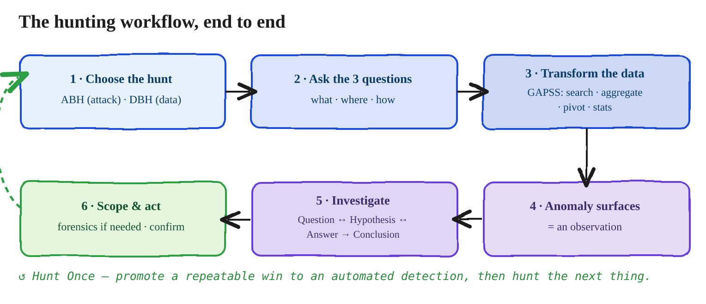

---

## Why a mindset part at all

!!! abstract "The argument, in one box"
    - **The problem:** collection is not hunting — you can forward every event on the estate and still find nothing
    - **A mental model is** a reusable structure for perceiving reality
    - **Without one,** hunting is random: you poke at data, occasionally get lucky, and cannot reproduce it
    - **With one,** the work becomes repeatable, teachable and scalable
    - **The consequence:** ad-hoc genius does not scale. Process does.

Everything in Parts 1–3 is machinery. Machinery is necessary and completely inert without a way of thinking to drive it. You can stand up Velociraptor across ten thousand endpoints, forward every event to a data lake, and still find nothing — because collection is not hunting. Hunting is a human act of structured suspicion, and structure is exactly what separates a repeatable capability from one analyst's good day.

That is the whole argument for this part. A **mental model** is a reusable structure for perceiving reality. Without one, hunting is random: you poke at data, occasionally get lucky, and can't explain or reproduce what you did. With the right models you get a structured way to *see* and to *hunt* — which means the work becomes repeatable, teachable, and, above all, scalable. Ad-hoc genius does not scale. Process does.

So Part 4 is a tour of the models that make hunting a discipline rather than a talent.

??? info "Sources & further reading"
    - [*Huntpedia: Your Guide to Expert-Level Threat Hunting*](https://www.slideshare.net/slideshow/huntpedia-249837834/249837834) (Sqrrl) — the essay collection that argues the case for hunting as a discipline rather than a talent.
    - Chris Sanders — **the standing reference on the hunting mindset.** *The Mind of a Hunter: A Cognitive, Data-Driven Approach* (SANS Threat Hunting & IR Summit 2017) asks the question this whole post is built on: whether hunting genuinely differs from an alert-driven investigation, and what changes in the analyst's head when it does. Follow it with [*Deconstructing the Analyst Mindset*](https://www.sans.org/presentations/keynote-deconstructing-the-analyst-mindset) (SANS CTI Summit keynote), [*Leveraging Curiosity to Enhance Analytic Technique*](https://www.sans.org/presentations/leveraging-curiosity-to-enhance-analytic-technique) (SANS), and [*Investigation Theory: A Cognitive Approach*](https://www.slideshare.net/slideshow/art-into-science-2017-investigation-theory-a-cognitive-approach/71384306) (Art into Science 2017). His research on analyst cognition is the evidence base for the claim that the investigative skillset is universal across DF/IR/SOC — which is what Model 3 asserts.
    - [*Turning the Hunted into the Hunter via Threat Hunting*](https://arxiv.org/pdf/2204.11076) (arXiv) — an academic survey of the hunting lifecycle; useful for the "hunting is scientific in nature" framing.

---

## The mental models

!!! info "What is in this section"
    **Seven models.** The first four describe how an investigation works at all — timeline,
    process, the universal framework, the context switch. The last three describe how
    attacks and hunts are structured — relationships versus behaviours, then the two
    hunting styles, **ABH** and **DBH**.

    Models 8 and 9 come later, after attack dissection has made them concrete.

Seven models, read in order. The first four are about how an investigation works at all; the last three are about how attacks and hunts are structured. Models 8 and 9 come later, after the attack-dissection section that makes them concrete.

### Model 1 — The attack timeline

An attack is not an abstraction. It is a set of **tangible events occurring in sequence** — real actions, in order, each leaving traces.

The reframe that changes everything: when you find evidence of an attack, you are inserting yourself into a timeline that **already exists**. You rarely land at the beginning. You land somewhere in the middle, holding a single event, and your job is to discover the rest — what came before (how they got in) and what came after (what they did next). And real incidents are usually not one clean line but several **parallel timelines** braided together: multiple hosts, multiple sessions, multiple concurrent objectives.

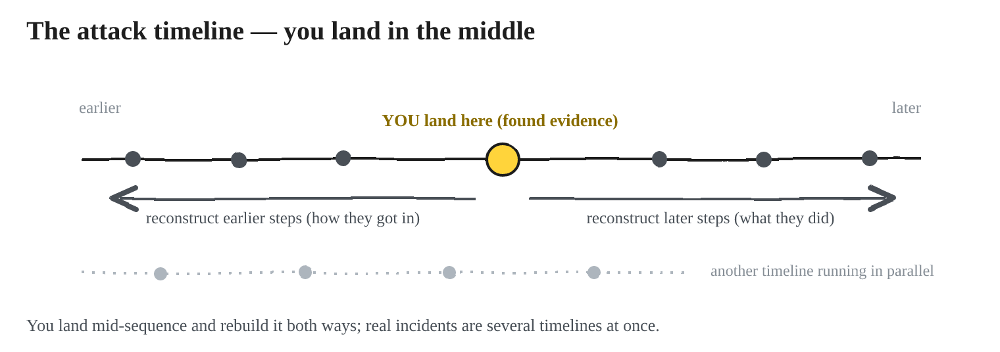

How do you actually walk the timeline? Every event is backed by evidence sitting in a large shared pool — the logs and artifacts from Parts 2 and 3. The working assumption of a good hunter is deliberately optimistic:

!!! quote "The hunter's working assumption"
    Assume the data you need is **already there**. Your task is to ask the right
    investigative question to surface it.

Find one event, ask a question, pull the matching evidence, get an answer, and that answer places the next event on the timeline. Then ask the next question. Hunting is what first inserts you into the timeline; investigation walks it outward from there.

??? info "Sources & further reading"
    - Lockheed Martin — [*Cyber Kill Chain*](https://www.lockheedmartin.com/en-us/capabilities/cyber/cyber-kill-chain.html) — the canonical "attack as an ordered sequence of stages" model.
    - Caltagirone, Pendergast & Betz — [*The Diamond Model of Intrusion Analysis*](https://apps.dtic.mil/sti/pdfs/ADA586960.pdf) (full 61-page paper, DTIC) — see the *activity thread* chapter, which is the formal treatment of braided parallel timelines.
    - [MITRE ATT&CK](https://attack.mitre.org/) — the technique catalogue you walk the timeline against.


---

### Model 2 — The investigation process

The goal of any investigation is to move from an initial, incomplete (often wrong) perception toward an **accurate perception of reality**. You get there by asking and answering questions.

The engine is a small loop: **Observation → Question ↔ Hypothesis ↔ Answer → Conclusion.** You observe something, it raises a question, you form a hypothesis, you gather the answer, you refine, and you repeat until you're confident enough to conclude.

One rule matters more than the rest: **an investigation cannot start without an observation.** No observation, no question, no investigation. That single constraint is why *finding* observations is so valuable — and why proactively producing them is the entire point of hunting.

??? info "Sources & further reading"
    - Chris Sanders — [*Investigation Theory: A Cognitive Approach*](https://www.slideshare.net/slideshow/art-into-science-2017-investigation-theory-a-cognitive-approach/71384306) — the observation → question → hypothesis → answer loop, with the cognitive research behind it.
    - Chris Sanders — [*Leveraging Curiosity to Enhance Analytic Technique*](https://www.sans.org/presentations/leveraging-curiosity-to-enhance-analytic-technique) (SANS) — on question generation as the engine of an investigation.
    - [The OODA loop](https://en.wikipedia.org/wiki/OODA_loop) — Boyd's observe–orient–decide–act cycle, the ancestor of every loop in this section.


---

### Model 3 — The universal investigation framework

Here's the quietly powerful part: that same Observation → Question → Hypothesis → Answer → Conclusion engine underlies **every** defensive discipline. Network security monitoring, incident response, host forensics, malware analysis, and hunting all run the identical loop. The *only* thing that differs is where the initial observation comes from.

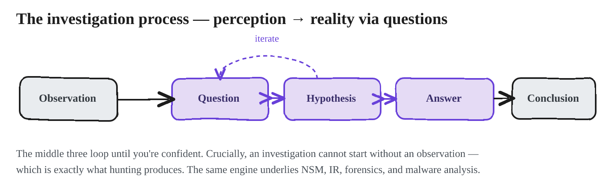

An initial observation is simply any event that launches an investigation, and it can arrive from many places: an IDS alert, a malware sample, a third-party notification, a user-reported anomaly, or — the one we care about — a **hunting observation**. Whatever the source, the rest is the same: ask investigative questions, review evidence, validate hypotheses, reach a conclusion. Observation is where everything starts.

??? info "Sources & further reading"
    - Chris Sanders — [chrissanders.org](https://chrissanders.org) — his doctoral work on the analyst mindset found the investigative skillset to be broadly universal across DF/IR/SOC, which is exactly this model's claim.
    - [*Turning the Hunted into the Hunter via Threat Hunting*](https://arxiv.org/pdf/2204.11076) (arXiv) — places hunting inside the same hypothesis-testing frame as the other defensive disciplines.


---

### Model 4 — The context switch

Hunting and investigation are two different mental modes, and good practitioners switch between them fluidly.

Hunting is **human-based detection**. An IDS alert is automated detection; a hunting observation is a human noticing that something is off. The switch is captured in two questions. In hunting mode you ask *"what looks weird?"* The moment something does, you flip into investigation mode and ask *"how do I confirm it?"*

This is why **a good hunter is usually a good investigator** — you cannot cleanly separate the finding from the confirming, and the two skills sharpen each other.

??? info "Sources & further reading"
    - SOC Prime — [*Threat Hunting Basics: Getting Manual*](https://socprime.com/blog/threat-hunting-basics-getting-manual) — on why alert-driven work and hunting are different modes of attention.
    - Chris Sanders — [*Leveraging Curiosity to Enhance Analytic Technique*](https://www.sans.org/presentations/leveraging-curiosity-to-enhance-analytic-technique) (SANS) — on the questioning stance that distinguishes the two modes.
    - Splunk — [*Hypothesis-Driven Hunting with the PEAK Framework*](https://www.splunk.com/en_us/blog/security/peak-hypothesis-driven-threat-hunting.html) — the ABLE model for making "what looks weird?" into something testable.


---

### Model 5 — Understanding attacks: relationships vs. behaviors

Two sentences that reorganize how you look at evidence:

> **Attacks are about evolving relationships. Detection is about individual behaviors.**

An adversary makes progress by establishing **relationships** — with users, hosts, services, credentials, and the network. Every attack step is a relationship: an authentication (user↔host), a process spawn (parent↔child), a share access (host↔host), a group membership (account↔privilege), a connection (source↔destination). The attack *is* that evolving web of relationships, and detecting the attack means detecting the relationships.

But you can't observe a relationship directly. You observe the **individual behaviors** that represent it. "The attacker now controls a privileged local account" is not a thing you can query; the behaviors that represent it are — an account was created (`4720`), it was added to Administrators (`4732`), and it logged on (`4624`). Detection and hunting operate on those behaviors.

The practical consequence is a method: name the relationships first, and each relationship's set of possible anomalies becomes your "what am I looking for?" list. Naming the relationships is the pivot that turns anomaly-hunting from guesswork into a near-mechanical enumeration.

??? info "Sources & further reading"
    - Caltagirone, Pendergast & Betz — [*The Diamond Model of Intrusion Analysis*](https://apps.dtic.mil/sti/pdfs/ADA586960.pdf) — the formal version of this model: an event is adversary, capability, infrastructure and victim *plus the edges between them*.
    - [*A practitioner's guide to the Diamond Model*](https://www.vectra.ai/topics/diamond-model-of-intrusion-analysis) — a shorter read if the paper is too much.
    - David J. Bianco — [*The Pyramid of Pain*](http://detect-respond.blogspot.com/2013/03/the-pyramid-of-pain.html) · [SANS version](https://www.sans.org/tools/the-pyramid-of-pain/) — the same lesson from the detection side: behaviours cost the adversary more than atomic indicators.


---

### Model 6 — Attack-Based Hunting (ABH)

ABH is where most people start, because it needs generalized attack knowledge but less experience than data-based hunting. It seeks evidence that identifies a **specific** attack: you take what you know about an attack and go looking for evidence of it that other mechanisms can't catch. The best ABH candidates are exactly the things you *can't* cleanly automate — no reliable signature, too many false positives, too much context required. If a signature would catch it dependably, let the signature do it and hunt what's left.

#### One big question, three sub-questions

Frame every hunt as **"Has [specific attack] happened on my network?"** Then decompose — relationships first, then anomalies, then, for each anomaly, three questions:

!!! question "The three questions, asked of every single anomaly"
    1. **What am I looking for?** — the specific anomalous characteristic, driven by your attack knowledge.
    2. **Where am I likely to find it?** — the data source: the exact event ID and the fields that carry the signal.
    3. **How can I manipulate the data to see it?** — the transformation: search, stack and count by least-frequency-of-occurrence, statistical outliers, visualisation, or temporal correlation.

    Every section after this one is an answer to one of these three.

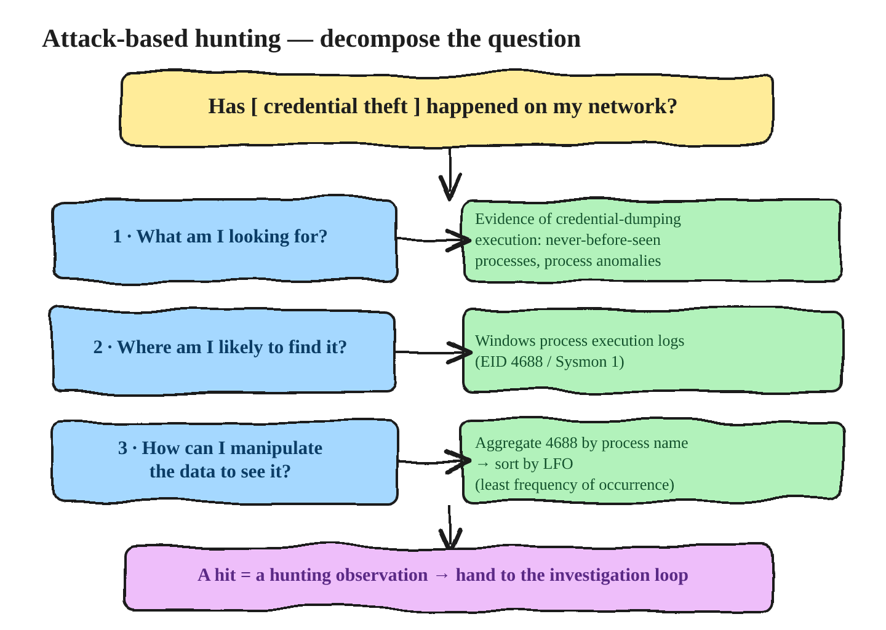

#### Worked example — malicious account creation

Take *"Have malicious accounts been created on my network?"* The mindset trap to avoid: you will **not** flag every new account. Account creation is normal and expected. You flag the anomalous *characteristics* of a creation. Break the objective into relationships — a new account is created; a user-management tool is executed; someone accessed the system to do it — and then hunt the anomalies of each. For the creation itself:

- Created **not following naming conventions** — `4720`, field `TargetUserName`, searched against your standard (attackers reach for names like `support_388945a0`, `svc-backup`, `help`).
- Created **with insecure properties** — `4738`, comparing fields like *password not required*, *account never expires*, and *logon hours* against your environment's standard template; the anomaly is the **deviation from that template**.
- Created **and added to a privileged group** — `4732`/`4728`, found by temporally correlating the group-add with the `4720` that just preceded it.
- Created **at an unexpected time for that user** — `4720` for the creator, joined to that user's logon/logoff history (`4624`/`4634`). Here you must first **build a baseline** of when the creator is normally active, then flag creations that are a standard-deviation outlier against it.
- **Local account on a domain member**, a **creator who has never created an account**, or a **source host that never sources creations** — all `4720`, surfaced by stacking on the relevant field and taking the never-before-seen or least-frequent value.

Notice the same three questions repeating for every anomaly, and notice how many anomalies fall out of a single relationship once you go looking. That expansion is the point.

#### Why not just write a signature?

Because a signature catches *one* attack — "alert when `svch0st.exe` executes" — but attackers rename, recompile, and mistype. You want the whole **family of variations**, so you hunt the manifestation, not the string. Invert the question: instead of *"does this match known-bad?"* ask *"what is abnormally rare across my fleet?"* Stack every executed binary by name and by hash, sort by least-frequency-of-occurrence, and the singletons float up — the dumper that ran on exactly one host betrays itself by its rarity, no matter what it's named.

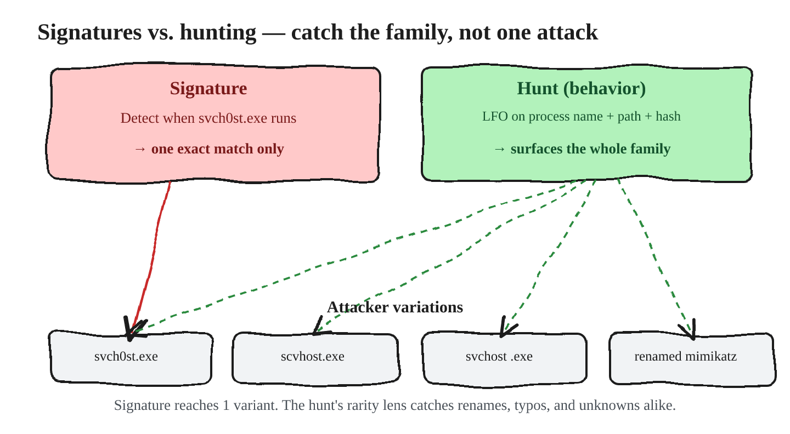

??? info "Sources & further reading"
    - Rapid7 — [*Threat Hunting: Attack vs. Data*](https://information.rapid7.com/threat-hunting-attack-data.html) — a walkthrough of the same ABH/DBH split used here.
    - Qintel — [*Hypothesis-Driven Threat Hunting: Turn Intelligence Into Testable Hunts*](https://www.qintel.com/article/hypothesis-driven-threat-hunting-turn-intelligence-into-testable-hunts) — on anchoring a hunt to a specific technique and defining closure criteria before you query.
    - Splunk — [*Hypothesis-Driven Hunting with the PEAK Framework*](https://www.splunk.com/en_us/blog/security/peak-hypothesis-driven-threat-hunting.html) — PEAK's hypothesis-driven hunt type is ABH under another name.
    - [OTRF — Threat Hunter Playbook](https://github.com/OTRF/ThreatHunter-Playbook) · [docs](https://threathunterplaybook.com) — ABH worked end-to-end, as runnable notebooks organised by ATT&CK tactic.


---

### Model 7 — Data-Based Hunting (DBH)

If ABH starts from an attack and asks where it would show up, DBH flips the telescope: it starts from a **data source** and asks what attacks could manifest inside it. You take the *angle of the data* — look at a source, understand it deeply, and consider how different attacks would appear in even a small slice of its fields.

DBH is easy to begin and hard to master. The first easy wins come quickly; the skill is expanding past them to see the subtle manifestations. It leans on a much deeper knowledge of *how* attacks show up in evidence — which is exactly why **ABH upskills DBH**: every attack you internalize through attack-based hunting becomes manifestation knowledge you can spend here.

The process mirrors ABH with three data-shaped questions. Pick a source and ask: *"Does anything in this data look malicious?"* Then (1) which fields are most likely to hold evidence of attacks? (2) what would be anomalous in those fields? (3) how can I manipulate those fields to surface it? Take HTTP proxy data: the field is the `User-Agent`, the anomaly is a rare user agent, and the manipulation is a frequency analysis sorted by least-frequent occurrence. In a real capture, browser agents sit in the hundreds while a lone `Python-urllib/2.6` shows up twice — a script, not a browser, betrayed purely by its rarity. And when you've worked a source one way, you don't stop; you ask again, *"what other kind of attack could appear here?"* — because you have to consider *all* the attacks that could manifest, not just the one you had in mind.

#### The mirror: data represents behaviors, detection reads the relationships

There's a clean flip of the ABH framing here. In ABH we said attacks are about evolving relationships, and detection works on the individual behaviors that represent them. In DBH the sentence turns around: **data represents individual behaviors, and detection is about understanding the relationships those behaviors represent.** It is the same reality approached from opposite ends — ABH pushes down from the attack toward the data, DBH reasons up from the data toward the attack. Master both and they meet in the middle.

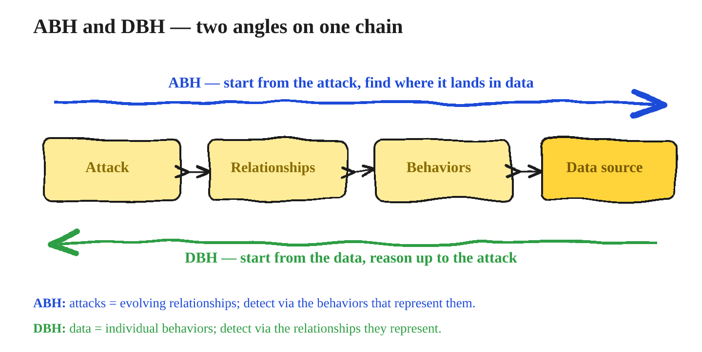

#### A worked source: Windows process creation (EID 4688)

Process-creation logs make the point concretely. Ask *"does anything in EID 4688 look malicious?"* — thinking of malicious binary execution, malicious document opens, and malicious use of legitimate applications — and the same source yields five different lenses, each a field, an anomaly, and a manipulation. On the **process name** you stack unique names by occurrence and read off the generic, mimicking, random, or simply uncommon ones. On the **parent/child** relationship you aggregate child by parent: in a real stack `winword.exe → powershell.exe` appears exactly once against `chrome.exe → chrome.exe` at 212 — Word spawning PowerShell is the outlier, and aggregation is what surfaces it. On the **path** you aggregate a process by its executable path and catch a second `MSASCuiL.exe` running from a user's AppData folder instead of Program Files — the same name, the wrong home. On the **timestamp** you take the standard deviation of execution times and compare against normal. And on **account plus process** you find binaries a user has never run before.

Two of those come with a warning worth publishing, because they're where beginners generate noise. Standard-deviation-on-time hunts have to account for **automated processes, backups, and update windows** — they run off-hours legitimately and will otherwise bury your real outliers. And the "never-before-run-by-this-user" hunt does not scale to the whole fleet — there are too many innocent firsts; you scope it to **sensitive users**, the ones with a history of compromise or with broad access. Similarly, aggregate-by-path is best pointed at a small, high-value segment rather than the entire estate.

??? info "Sources & further reading"
    - Splunk — [*Baseline Hunting with the PEAK Framework*](https://www.splunk.com/en_us/blog/security/peak-baseline-hunting) — PEAK's baseline/EDA hunt is DBH: start from the data, group like systems, then investigate what deviates.
    - Intel 471 — [*How to Threat Hunt: A Beginner's Guide*](https://www.intel471.com/blog/how-to-threat-hunt-a-beginners-guide) — includes the proxy user-agent stacking example used in this section.
    - [*Threat Hunting with Sysmon 101, part 2 — process creation*](https://11x256.github.io/threat_hunting/Threat-Hunting-2-sysmon-event-structure/) · [part 3 — command line](https://11x256.github.io/threat_hunting/Threat-Hunting-3-command-line-investigation/) — a single data source worked the DBH way, field by field. Note its warning to pivot on process **GUID** rather than PID, since PIDs are reused.
    - Splunk — [*Peeping Through Windows (Logs): Using Sysmon & Event Codes for Threat Hunting*](https://www.splunk.com/en_us/blog/security/a-salacious-soliloquy-on-sysmon.html) — what each Sysmon event code is actually good for.

---

## From mindset to analysis: anomaly detection

!!! example "The two buckets everything collapses into"
    - **Subject anomaly** — the actor is wrong *on its own*, by its own properties. `Svch0st.exe`, with a zero where the "o" should be.
    - **Context anomaly** — the actor is normal in isolation and wrong *in relation to the scene*. A second `wininit.exe` on a host that should run exactly one.

    A zebra is not an anomaly. A zebra standing in a downtown street is.

Before any of the machinery, one question has to be answerable: **what does an anomaly actually look like?** The models so far tell you how hunting is structured. This section is the vocabulary for the thing you are structuring it *around* — and every hunt you plan from here, including the dissection in the next section, ends by running its findings through this list. Producing the results is Part 2's job; **reading** them is a different muscle, and this is it.

Anomaly detection is built on **experience and pattern recognition** — a seasoned analyst just *sees* that something is off. You can't pre-define every anomaly you'll ever meet, but there's a set that shows up again and again, and early on you lean on those common types as **scaffolding until your instinct catches up.** Two honest caveats: the list below is not exhaustive, and real findings won't always map cleanly onto exactly one type. Treat them as the main ones, not a taxonomy to force everything into.

The single most important idea: **an anomaly is always relative to the entity and to the timeline you're investigating.** Something can be perfectly benign on its own and still be malicious given where it sits in the sequence you've landed in — which is why anomaly detection depends on a clear perception of *this* investigation's timeline.

### Subject vs. context

Nearly every anomaly falls into one of two categories, and they map to a simple distinction: the threat actor *itself*, versus the threat actor's *relationships*. A **subject anomaly** is unexpected data directly within the evidence describing an action — the actor is wrong *on its own*, by its own properties, considered without any relations. `Svch0st.exe`, with a zero where the "o" should be, is wrong all by itself. A **context anomaly** is unexpected data in relation to the other data surrounding an action — the actor is normal in isolation but wrong in its *relation to the scene*. Two instances of `wininit.exe` is the example: one is normal, and only knowing that makes the second one suspicious. Or, put visually: a zebra isn't an anomaly — a zebra standing in a downtown street is. Subject looks at the actor; context looks at the actor's relationship to everything around it.

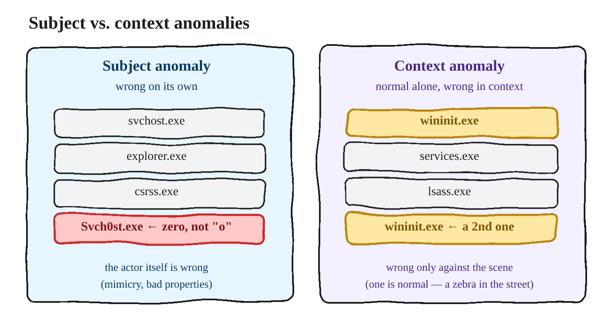

### The eye test

Before any statistics there's the **eye test** — simply, *what doesn't belong?* It draws on your pattern recognition and the heuristics you've built from experience, and it's the fastest way to surface mimicry, odd frequencies, normal-things-in-abnormal-places, unexpected randomness, and generic filler. Scanning a process list is the eye test in miniature: `Svch0st.exe` jumps out as a subject anomaly, while a second `wininit.exe` only registers if you already know a healthy host runs exactly one.

### The common anomaly types

- **Mimicking legitimacy** — hiding by imitating a legitimate entity, which means you have to know what legitimate looks like. It shows up in process and file names, usernames, domains, and email — and **domains are the king of it**, plainly visible in your HTTP, proxy, and DNS logs (`winsvcs.exe`, `rnicrosoft.com` with "rn" for "m").
- **Frequency of occurrences** — events that happen far more or far less often than expected, which means you need the standard sequence and a deviation threshold. Best surfaced by looking at the *frequency of frequencies* in authentications and process executions. Too-few can be legitimate (a backup or service account), so context decides.
- **Generic non-descriptives** — hiding behind broad, generic information. Signatures won't touch generic strings because legitimate things use them too, but hunting can: a document named blandly, files calling themselves `update.exe` in a temp folder, emails titled "Invoice" or "HR Letter."
- **Missing information** — evidence that's missing the data or context you'd expect. A `Staff List.docx` that's only 16 KB is too small to actually hold a staff list — it's a lure. So is a process with no parent, or an authentication log that exists the day before and the day after but not on the day you care about (selective clearing).
- **Content formatting** — anomalies in how data is represented, which very often shows up in translation across languages and character sets: non-ASCII garbage in a request, or a homograph domain (`аpple.com` in Cyrillic) that renders like the real thing and redirects elsewhere. SIEMs are weak here, which makes it good hunting ground.
- **Unexpected obfuscation or encryption** — the unexpected *presence or absence* of it, measured as actual-versus-expected entropy. Obfuscated PowerShell is the obvious case; traffic riding port 443 that isn't actually encrypted is the quieter one.
- **Unexpected one-to-many relationships** — one source reaching many destinations, or the reverse, when that isn't normal: an account authenticating to a dozen hosts, a spam relay, a machine turned into a TOR node, fast-flux DNS. It only means something once you know the entity's normal relationships, so you check its history.
- **Improper timing** — activity outside the normal window, allowing for time zones, shift workers, and support roles. A scheduled task with a 1973 timestamp is timestomped; one left at an odd default time like 4:43 AM quietly reveals when the attacker set it up.
- **Unexpected entity relationships** — interactions that don't fit the entities involved: `psexec` launched from a Sales workstation, a domain controller browsing the web, a service account driving an interactive app. This one leans hard on friendly intel — AD, asset roles, user roles — to know what's expected in the first place.
- **And the rest** — **baseline deviations** (a long-stable behavior that suddenly changes), **normal things in an abnormal context** (`certutil` used to download, `regsvr32` pulling a remote scriptlet), and **general unknowns** (the things you don't understand sitting among the things you do, which you still have to run down).

To put a bow on it: anomaly detection is built on experience and pattern recognition; you can't pre-define every anomaly, but these frequently-seen types — plus the eye test — get you moving until that instinct is automatic. And nearly all of them collapse into just two buckets: **subject**, the actor itself, and **context**, the actor's relation to the scene. Those two, together with the mental models earlier in this post, are the working kit for reasoning about anything weird you turn up in an investigation.

??? info "Sources & further reading"
    - Splunk — [*Baseline Hunting with the PEAK Framework*](https://www.splunk.com/en_us/blog/security/peak-baseline-hunting) — the formal treatment of context anomalies: group like systems, baseline each group separately, then investigate the deviations.
    - Intel 471 — [*Threat Hunting Tactics & Techniques*](https://www.intel471.com/blog/threat-hunting-tactics-techniques) — anomaly categories tied to specific telemetry.
    - Mark Baggett — [*Detecting Random (DGA)*](https://isc.sans.edu/diary/19893) — the *content formatting* and *unexpected randomness* types, with an honest account of their false-positive rate. Note the commenter's point that legitimate CDN hostnames look random too.
    - David J. Bianco — [*The Pyramid of Pain*](http://detect-respond.blogspot.com/2013/03/the-pyramid-of-pain.html) — why the behavioural anomalies in this list are worth more than the atomic ones.

---

## Threat intelligence and attack dissection

!!! abstract "This section in five steps"
    - **First, choose:** which attack to hunt, from the groups you track and your coverage heatmap
    - **Then dissect it:** collect examples → identify entities, relationships and steps → simulate → map to evidence → identify anomaly types
    - **Worked on:** RDP tunneling, from the Mandiant report through to the specific anomalies
    - **The deeper aim:** not learning one attack, but building knowledge you can spend again

We've named the two hunting styles; this section is where attack-based hunting actually gets *done*. The basis for successful hunting is understanding how a large number of attacks work — that understanding feeds attack-based hunting directly and data-based hunting indirectly — and the good news is you can deliberately go out and acquire it. The framework for doing that, for turning an attacker technique (which often arrives as a threat-intelligence report) into a hunt, is **attack dissection**.

### Which attack do you hunt first? Intelligence and the coverage heatmap

Attack dissection tells you how to turn *an* attack into a hunt. It does not tell you *which* attack — and with a finite number of hours, that choice decides whether a hunting programme compounds or just wanders. Choosing is the intelligence function's job, and it sits in front of everything else in this section.

Start from the adversaries you have actually decided to track. Your **Priority Intelligence Requirements** name them: the groups that plausibly target your sector, your geography, your technology stack. That list should be short and defensible, because tracking everything is operationally the same as tracking nothing.

Then map each tracked group to the techniques it is known to use. ATT&CK has already done most of this work — every group page carries the techniques attributed to it — and the **ATT&CK Navigator** lets you load each group as its own layer. The useful move is the **overlay**. Put one tracked group's layer over another's, and the techniques appearing in *both* are the ones to work first: not because they are the most sophisticated, but because a single hunt covers two adversaries you care about. Stack three or four tracked groups and the overlap is a prioritised list that wrote itself.

Now add the second layer: what you can actually *see*. Part 3 built the pipeline and used a DE-process heatmap to decide what to do with everything it ingests — this is that same picture, turned toward hunting. Colour each technique by whether you hold the telemetry at all, whether a detection already exists on top of it, and how much you trust that detection. The distinction matters more than it sounds, which is why tooling exists specifically to keep **visibility** and **detection** as separate scores: "we collect the data" and "we would catch it" are not the same claim, and a single-colour heatmap quietly merges them.

Put the two layers together and the hunting backlog falls out of the intersection:

| Technique is… | …and your coverage is | Then |
|---|---|---|
| used by groups you track | solid, trusted detection | Leave it. The detection has it. |
| used by groups you track | telemetry exists, no detection | **Hunt it.** This is the sweet spot. |
| used by groups you track | no telemetry at all | Not a hunt — a collection gap. Escalate it. |
| not used by groups you track | anything | Park it. Revisit when the intelligence changes. |

That second row is exactly where attack-based hunting lives, and it is the same argument Model 6 made from the other direction: hunt what a signature cannot dependably catch. The heatmap only adds *which of those to do first*.

Two things follow from working this way. Hunts stop being a sequence of whatever caught your attention that week — each one traces back to a tracked adversary and a named gap, which is also the version of the story that gets a hunting programme funded. And the backlog maintains itself: when a group you track picks up a new technique, or a new group enters your PIRs, the overlay changes and the new priority is visible without anyone re-arguing it.

The rest of this section assumes that choice is made. Attack dissection is what you do to the technique the heatmap handed you.

??? info "Sources & further reading"
    - Katie Nickels — [*Getting Started with ATT&CK: Threat Intelligence*](https://medium.com/mitre-attack/getting-started-with-attack-cti-4eb205be4b2f) (MITRE ATT&CK on Medium) — mapping intelligence to ATT&CK so groups can be compared and techniques ranked. The practical starting point for this section.
    - [*Using ATT&CK to Advance Cyber Threat Intelligence — Part 1*](https://medium.com/mitre-attack/using-att-ck-to-advance-cyber-threat-intelligence-part-1-c5ad14d59724) (MITRE ATT&CK on Medium) — the group-overlay move worked explicitly: where two tracked groups share techniques, those are the highest-priority ones to detect.
    - [ATT&CK Groups](https://attack.mitre.org/groups/) — the per-group technique attributions the layers are built from.
    - [mitre-attack/attack-navigator](https://github.com/mitre-attack/attack-navigator) — layers, scoring and layer combination. Note that layers being combined must target the same ATT&CK version and domain, or the overlay is meaningless.
    - [rabobank-cdc/DeTT&CT](https://github.com/rabobank-cdc/DeTTECT) — built precisely because Navigator alone has no multi-level scoring and no separation between *visibility* and *detection*. Exports JSON layers straight into Navigator.
    - Marcus Bakker — [*DeTT&CT: Mapping your Blue Team to MITRE ATT&CK*](https://marcus-bakker.squarespace.com/blog/2019/5/dettact-mapping-your-blue-team-to-mitre-attack) · NVISO — [*DeTT&CT: Mapping detection to MITRE ATT&CK*](https://blog.nviso.eu/2022/03/09/dettct-mapping-detection-to-mitre-attck/) — the author's own introduction, and a walkthrough of putting it into practice.
    - Katie Nickels — [*MITRE ATT&CK: The Play at Home Edition*](https://i.blackhat.com/USA-19/Wednesday/us-19-Nickels-MITRE-ATTACK-The-Play-At-Home-Edition.pdf) (Black Hat USA 2019) — how different teams use ATT&CK to track threats, with the prioritisation argument laid out.
    - Splunk — [*Introducing the PEAK Threat Hunting Framework*](https://www.splunk.com/en_us/blog/security/peak-threat-hunting-framework.html) — PEAK's *Prepare* stage is this section under another name.
    - A caution worth carrying: heatmaps go stale as techniques are added, revised and deprecated, and a wall of coloured boxes with no statement of *what* provides each colour is decoration rather than analysis.


### What you're trying to get out of an attack

Before the mechanics, be clear about the goal, because the goal is what shapes the framework. When you dissect an attack you want four things. First, to **explain it at a functional level** — how it works, what its impact is, and what it requires — simply enough that you could describe it to a non-technical manager. Second, to understand **how the attack (and each of its steps) helps the attacker achieve a goal**, whether that's access to a system or to sensitive information. Third, to understand **how each step manifests in evidence**, and which evidence you'd hunt in — prioritizing what you already collect, and flagging what you'd need to start collecting. And fourth, to **identify the anomalies** that could lead you to it, keeping in mind that some manifestations are clean enough for an IDS signature while others blend into the noise and are far better left to a hunt. The deeper aim underneath all four is retention: you're not learning the attack once, you're building knowledge you can reuse, which is exactly why the process below is repeatable.

### The attack dissection process

The process takes any input — a threat-intel report, a colleague's tip, a stray observation — and runs it through five repeatable steps:

1. **Collect examples** of the attack.
2. **Identify the entities, relationships, and steps** in the intrusion.
3. **Simulate the attack** (optional).
4. **Map the steps to evidence.**
5. **Identify the anomaly types.**

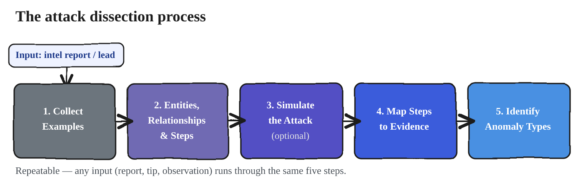

??? info "Sources & further reading"
    - [MITRE ATT&CK](https://attack.mitre.org/) — the entry point for every dissection; the value is in the procedure examples and references, not the technique page itself.
    - Qintel — [*Hypothesis-Driven Threat Hunting*](https://www.qintel.com/article/hypothesis-driven-threat-hunting-turn-intelligence-into-testable-hunts) — turning a report into something with a defined pass/fail.
    - [OTRF — Threat Hunter Playbook](https://github.com/OTRF/ThreatHunter-Playbook) — what a finished dissection looks like when it is written down to be re-run.


### Step 1 — Collect examples

You have to examine a large corpus of material to understand an attack properly, and the best starting point is **MITRE ATT&CK**. Treat it the way a good researcher treats Wikipedia — as a jumping-off point, never the destination. You're not doing real research until you're digging into the references. In practice: determine the ATT&CK technique(s) the report maps to, then follow their procedure examples and references outward to build a knowledge base. Beyond ATT&CK, most of the best material in this field lives on blogs and in direct interaction, and Twitter/X is a surprisingly good way to find it — practitioners share pcaps, Sigma rules, and context that never makes it into a polished write-up, and researching the *author* of a report often surfaces even more. Read the source report first just for context, jot down questions as they occur to you (a question as small as *is plink publicly available?* earns its place in the margin), and accept that you won't extract everything on the first pass — often it's the third read, after you've done the surrounding research, that the attack finally clicks.

??? info "Sources & further reading"
    - [MITRE ATT&CK](https://attack.mitre.org/) — specifically [T1021.001 Remote Services: RDP](https://attack.mitre.org/techniques/T1021/001/), [T1572 Protocol Tunneling](https://attack.mitre.org/techniques/T1572/) and [T1136 Create Account](https://attack.mitre.org/techniques/T1136/), the techniques worked in this post.
    - [The ThreatHunting Project](https://www.threathunting.net/) — a curated index of public hunting procedures to mine for examples.
    - [OTRF — Security-Datasets](https://github.com/OTRF/Security-Datasets) — pre-recorded telemetry for techniques, so you can study the manifestation without running the attack.


### Step 2 — Identify entities, relationships, and steps

When this step is done, you should be able to explain the attack to a non-technical person as a discrete series of steps — and being able to *simplify* it that far is the proof that you genuinely understand it. Three things make up the picture. An **entity** is any actor in the story: a user, a system, a file. A **relationship** is what happens when one entity interacts with another. And the **steps** are the discrete actions that move the attack forward between attacker and victim. The engine that produces all three is a set of questions, and it's this questioning mindset that's worth internalizing — it's exactly how you should read *any* intel report against your own intelligence requirements.

Interrogate the **attacker**:

- What tooling does it need to use — a specific tool, some code?
- Where does it need to be in relation to the victim — interactive access, the same network segment, or anywhere on the internet?
- What does it need to *know* about the victim, whether it knows it outright or has to guess — a software version, a username, a file path, an IP address, a directory?

Interrogate the **victim**:

- What software must it be running, and which name and version? (This is where version-specific, vulnerability-driven steps live.)
- What ports must be open? (SMB, 80…)
- What settings must be enabled or disabled? (Basic Auth on, UAC off…)
- What access will a successful attack provide? (a denial of service, command execution, RDP)
- What information could be disclosed if it succeeds? (RAM, disk, network traffic)

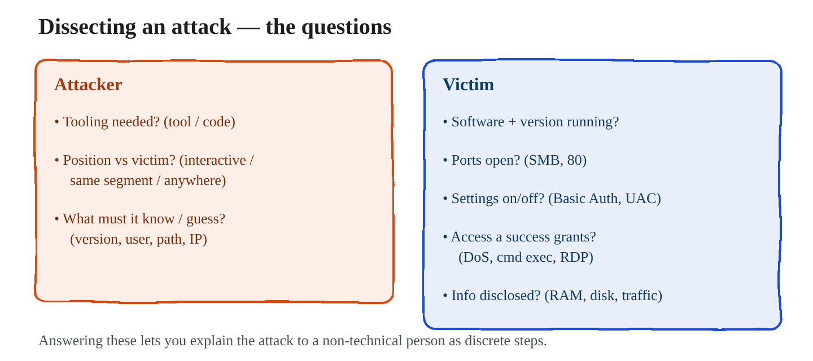

#### Worked example: RDP tunneling

It's worth grounding this in a real technique, because the questions only come alive against a concrete attack. Take RDP tunneling, documented in Mandiant/FireEye's *Bypassing Network Restrictions Through RDP Tunneling* (the technique maps to ATT&CK T1021.001, Remote Services: RDP, and T1572, Protocol Tunneling — note the report predates the renumbering from the old T1076). You read the report, and then you answer the questions.

=== "What the attacker needs"
    - **Tooling** — a "plumbing" utility: **plink** (PuTTY's command-line link), or Windows' own **netsh** port-proxy
    - **Position** — already inside. The attacker has compromised the system by some earlier means; this technique assumes a foothold
    - **Knowledge** — stolen credentials, or a new account created for persistence. Those credentials are what actually logs in over RDP

=== "What the victim must present"
    - **Software** — an already-compromised **Windows** host
    - **Service** — RDP may already be running, but it does not have to be; the attacker can enable it
    - **Ports** — **3389** available locally
    - **Egress** — outbound **internet access**, if the attacker is remote

With the entities and relationships pinned down, the attack collapses into a clean series of steps — the TLDR that proves you've understood it:

1. The attacker compromises the victim system by some means.
2. The attacker enables RDP on the victim if it isn't already running.
3. The attacker configures an **outbound** tunnel from the victim over an allowed egress port — classically TCP/22 (SSH), which firewalls almost always permit outbound — using an ephemeral source port such as 12345. The whole trick is riding a normally-allowed port to smuggle RDP past the perimeter.
4. The attacker connects by RDPing to `127.0.0.1:12345` on the victim itself, and the tunnel forwards that connection back out to the attacker's command-and-control server.
5. The attacker now has interactive RDP access, having bypassed the inbound firewall entirely.

In one breath — **prerequisites:** a foothold and valid credentials on the attacker's side; a Windows host with 3389 and outbound internet on the victim's side. **Result:** interactive RDP that evades the perimeter. Casting an attack as this kind of high-level overview is precisely what makes its nuances visible — and any detail you *can't* resolve from reading is exactly the kind of thing you'd settle by simulating the attack in the next step.

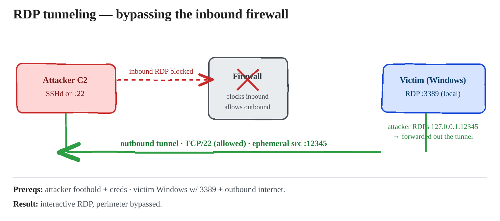

??? info "Sources & further reading"
    - Mandiant — [*Bypassing Network Restrictions Through RDP Tunneling*](https://cloud.google.com/blog/topics/threat-intelligence/bypassing-network-restrictions-through-rdp-tunneling) — the primary source for the worked example in this section.
    - Caltagirone, Pendergast & Betz — [*The Diamond Model of Intrusion Analysis*](https://apps.dtic.mil/sti/pdfs/ADA586960.pdf) — the adversary/victim interrogation here is the Diamond's four vertices asked as questions.


### Step 3 — Simulate the attack (optional)

Reading tells you how an attack *should* work; simulating it shows you what it actually *looks like* in your logs and data. That's the point of this step — to see the real evidence — and it's optional precisely because sometimes the reports and pcaps you gathered already give you enough to understand the manifestation without running anything yourself.

When you do simulate, the golden rule is to execute the attack on a system monitored by tools *similar to your production network*, so the evidence transfers. That means a victim built from your **standard image**, your **standard endpoint monitoring** tools installed, your **enterprise logging policies** applied, and your **sensor-standard packet-capture filters** in place. A practical way to run it: first execute against a lab that mirrors production to see what you'd genuinely catch today, then turn every knob to maximum — EDR sensitivity, verbose logging — run it again, and **record the delta**. As a hunter, that gap between what you collect now and what full instrumentation would reveal is exactly what you care about.

There are two flavors. In a **full simulation** you perform the entire attack yourself on lab systems — Chris Long's *Detection Lab* is a great place to start — with the obvious caution that detonating real malware demands a properly isolated environment. In an **artifact replay** you skip building the attack and instead inject someone else's logs or pcaps into your lab; replaying packet captures through *Security Onion* is a common way to do it. Full simulation is higher fidelity and more work; artifact replay is faster when a good capture already exists.

The framing that keeps a simulation honest is to treat it as a **controlled experiment**, where your lab network and its logging instrumentation are the dependent variable — the thing you're measuring. The procedure is disciplined: clear existing evidence, start the clock, perform the attack, stop the clock, and then stop the evidence-collection processes (the Windows Event Log Service, Linux `rsyslog`, the packet capture). Said another way, the simulated attack is the **stimulus** and the host and network evidence is the **response** you measure — and bounding it with a start-and-stop clock is what lets you isolate *only* the evidence the attack produced. Each run answers one concrete question, such as *"what shows up when the attacker enables RDP on the victim?"*

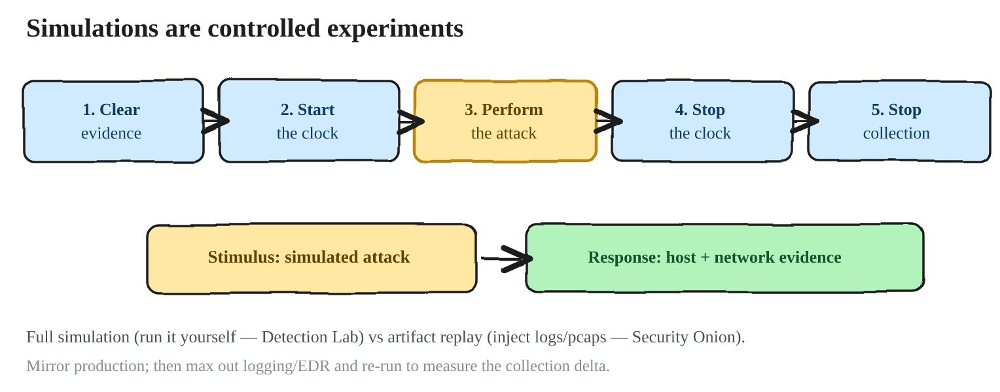

??? info "Sources & further reading"
    - [Atomic Red Team](https://github.com/redcanaryco/atomic-red-team) (Red Canary) — small, ATT&CK-mapped tests; the fastest way to generate real telemetry for one technique.
    - Red Canary — [*Finding false negatives with Atomic Red Team*](https://redcanary.com/blog/testing-and-validation/atomic-red-team/false-negatives/) — the "run it, then measure what you did **not** catch" discipline this step is built on. Note the caveat that default atomic commands can trip signatures, so you may be measuring the string rather than the behaviour.
    - [Security Onion](https://securityonionsolutions.com/) — for the artifact-replay flavour: push someone else's pcap through a monitored stack.
    - [DetectionLab](https://github.com/clong/DetectionLab) (Chris Long) — the pre-instrumented lab referenced above. Check its current maintenance status before building on it.
    - [OTRF — Security-Datasets](https://github.com/OTRF/Security-Datasets) — when you want the evidence without detonating anything.


### Step 4 — Map the steps to evidence

Now you walk each step of the attack and ask, critically, *where would this leave an artifact?* — evaluating primarily against the **disk, network, and memory** realms. Having simulated the attack makes this far easier, because you've already seen the artifacts appear. The concrete discipline is simple: write down **every evidence source you actually have** on your network, then review that list against each step of the attack, one step at a time. And treat each step as having its own **micro-steps** — the decomposition is the whole point, because answering the attacker and victim questions is what breaks the attack into steps, and each step then tells you precisely which evidence to go find.

Mapped out, RDP tunneling turns into a step-by-step evidence plan:

- **Initial compromise** — out of scope here (N/A for this particular hunt).
- **Enable RDP** — Windows **EID 2005** (a firewall rule modified to allow Remote Desktop).
- **Configure the tunnel** — two micro-steps: *downloading* the tunnel app leaves a PCAP/proxy download; *executing* it leaves process-execution evidence (**EID 4688 / Sysmon 1**, plus **ShimCache**, **Amcache**, **Prefetch**) alongside a connection/PCAP record of **outbound traffic to a low port**.
- **Make the RDP connection** — **TerminalServices EID 21/25**; a local authentication as **Windows EID 4624 with a source IP of `127.0.0.1`** (the loopback tell that the session came through a tunnel); and the **RDP `mstshash` cookie appearing over a non-3389 port**.

Notice that this mapping deliberately spans all three evidence realms, which is exactly what "map to evidence" is supposed to force. On **disk/host** you have the Windows event IDs (2005, 4688, 21/25, 4624) and the execution artifacts (ShimCache, Amcache, Prefetch, the registry keys plink and PortProxy leave behind). On the **network** you have the outbound connection to a low port and the `mstshash` cookie in the packet payload. And in **memory** you'd find the live tunnel process itself — plink or the netsh helper — with its revealing command-line arguments, its open network connections, and any named pipes it created, none of which may survive on disk. If a step seems to touch only one realm, that's usually a sign you haven't decomposed it far enough.

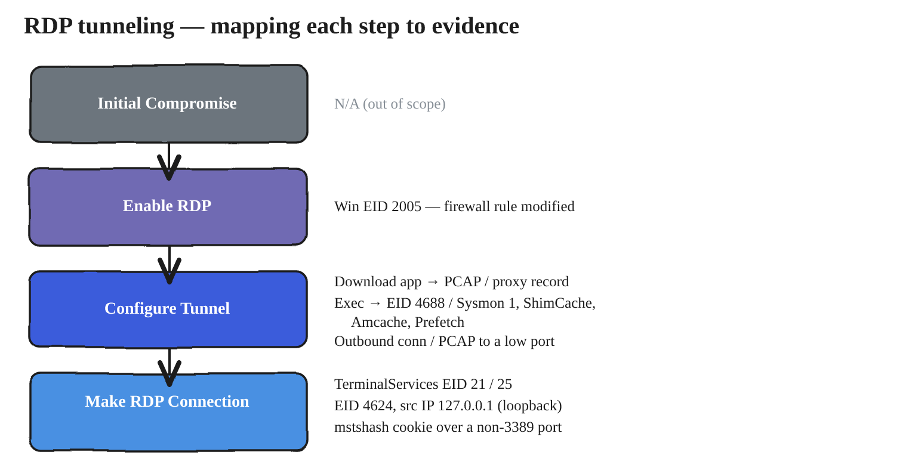

That last tell is worth flagging here and unpacking in the next step, because it shows how much sits inside a single step: the `Cookie: mstshash=` string in RDP's early **X.224 connection-request** phase is readable in cleartext, which is why "traffic logs" in this plan specifically means payload-inspecting telemetry rather than flow records. Step 5 takes it apart properly. (It's the same source/destination artifact picture you would build for any lateral-movement technique — the mapping simply makes each step's evidence explicit.)

??? info "Sources & further reading"
    - Malware Archaeology — [*Windows Logging Cheat Sheets*](https://www.malwarearchaeology.com/cheat-sheets) — which event IDs exist, and which you have to switch on first. This is the "write down every evidence source you actually have" list.
    - [olafhartong/sysmon-modular](https://github.com/olafhartong/sysmon-modular) — an ATT&CK-annotated Sysmon config; reading the rule modules is itself a map of technique → evidence.
    - [SwiftOnSecurity/sysmon-config](https://github.com/SwiftOnSecurity/sysmon-config) — the well-commented baseline config that sysmon-modular builds on.
    - [Zeek](https://zeek.org/) — the network half of the map: protocol logs that see payload, which flow records never will (this is what makes the `mstshash` tell reachable).


### Step 5 — Identify anomaly types

This is the payoff. With each attack step now mapped to the evidence it leaves, you iterate through those manifestations and ask, for each one, *how would this look anomalous against normal activity?* Answering that honestly usually means running a few **searches and aggregations over your current normal traffic first** — you can't call something abnormal until you've established what normal is. Then you frame every candidate with the two categories from the anomaly-detection section — **subject** (wrong on its own) and **context** (wrong relative to its surroundings) — and run it against the ten common anomaly types: mimicking legitimacy, frequency of occurrences, generic non-descriptives, missing information, content formatting, unexpected obfuscation or encryption, unexpected one-to-many relationships, improper timing, unexpected entity relationships, and baseline deviations. Those types are the ones laid out in the previous section; here they serve as the checklist you pass each manifestation through, and which types you lean on depends on the hunting method and the attack in front of you.

Applied to RDP tunneling, each anomaly earns its place by flagging a *specific step* of the attack:

- **Frequency of occurrence** flags the *make RDP connection* step. A system that normally sees few or no RDP connections suddenly showing several is the tell — as is a rarely-executed application (the tunnel tool) running at all.
- **Improper timing** also flags the connection and authentication steps: RDP connections and authentications at abnormal hours for that system's user. There's an important subtlety here — once RDP is tunneled it rides *inside* the encrypted tunnel, so you often can't get clean RDP session logs, but you can still catch the **successful-authentication event (EID 4624)** and reason from its timing.
- **Odd entity relationships** flags the *configure tunnel* step: outbound SSH to a never-before-seen host, or SSH to the internet from a **non-IT user** — a relationship that simply shouldn't exist. It isn't always literally port 22, but traffic-profiling tools like Zeek can identify the tunnel behavior regardless of the port it hides on.
- **Normal in an abnormal context** flags *configure tunnel* and *make connection*: legitimate things used illegitimately — a **tunnel app downloaded by a non-IT user/system**, **specific plink or netsh command-line arguments**, and, sharpest of all, an **RDP cookie appearing on a non-3389 port**.

#### Why those tells are anomalies: ports, loopback, and the RDP cookie

Three of those tells lean on the same underlying intuition about how connections normally look, so it's worth making that intuition explicit — this is the part that turns "I was told it's suspicious" into "I understand *why*."

Start with **normal port traffic.** Ports fall into two ranges. **Low ports (0–1023)** are the well-known, system ports where services *listen* — a web server on 80/443, SSH on 22, DNS on 53, RDP on 3389. **High ports (1024–65535)** are ephemeral: a client machine grabs a temporary high-numbered port to talk back to a server. So the normal shape of any connection is *client's high ephemeral port → server's low well-known port.* Hold that picture, because every RDP-tunneling tell is a deviation from it.

Next, the **RDP cookie, `mstshash`.** The very first message of an RDP connection — the X.224 connection request, which is sent in cleartext *before* the TLS/NLA encryption begins — carries `Cookie: mstshash=<username>`:

```text title="RDP X.224 connection request — sent before encryption begins"
Client → Server
  TCP connection
  X.224 Connection Request
  Cookie: mstshash=user1
```

Because it's in the clear, any payload-inspecting sensor can read it — PCAP/Wireshark, an IDS/IPS like Suricata or Snort, Zeek protocol logs, an NDR sensor (flow records, which never see payload, cannot). That makes `mstshash` a reliable fingerprint that a connection is RDP *no matter what port it's riding on*. Normally you'd only ever see it landing on 3389; seeing it on a **non-3389** port means RDP has been wrapped inside another channel — precisely what a tunnel does. That single observation is two anomalies at once: a **content** anomaly (RDP content where the port says it shouldn't be) and an **odd-entity-relationship** anomaly.

Finally, the **loopback authentication**, which is the weirdest and most decisive tell. A genuine remote RDP logon records the *remote client's* IP as the source of the authentication (EID 4624, logon type 10). But when RDP has been tunneled through a local listener on the victim, the session that reaches the RDP service on 3389 actually arrives from the victim's **own loopback interface** — so the logon shows a source IP of **`127.0.0.1`**. Think about how strange that is: a remote-style interactive logon that appears to originate from the machine talking to *itself*, which can never happen for a legitimate network client. That loopback source is the fingerprint of a local tunnel standing in for — and hiding — the true remote origin. And the tunnel's own outbound leg is its own oddity: the victim reaching *out* to a low service port (like 22) is an unusual **high→low** connection from a host that never normally initiates it.

Every one of these was chosen because it maps to a *specific step* of the dissected attack — the firewall change and process execution that enable and stage the tunnel, the outbound tunnel relationship, and the loopback-sourced RDP connection at the end. That's the entire point of dissecting an attack: the steps hand you the exact anomalies to hunt.

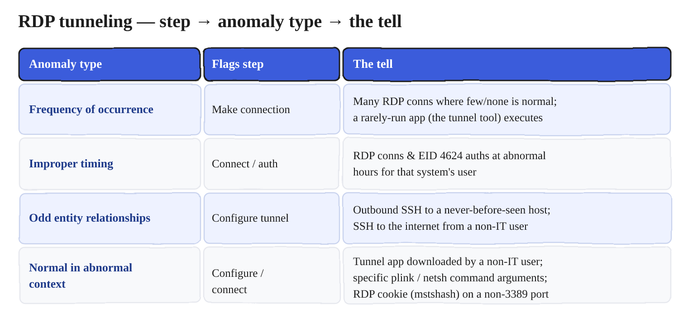
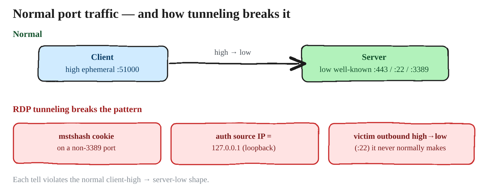

??? info "Sources & further reading"
    - SOC Prime — [*Threat Hunting Basics: Getting Manual*](https://socprime.com/blog/threat-hunting-basics-getting-manual) — on choosing which manifestations are worth a hunt, and its warning that chasing every rare value burns the day on false positives.
    - Intel 471 — [*Threat Hunting Tactics & Techniques*](https://www.intel471.com/blog/threat-hunting-tactics-techniques) — anomaly categories mapped onto concrete telemetry.
    - Splunk — [*Baseline Hunting with the PEAK Framework*](https://www.splunk.com/en_us/blog/security/peak-baseline-hunting) — the formal version of "you cannot call something abnormal until you have measured normal".


### Wrapping up attack dissection

Two things to carry out of this section. First, **every** method of hunting rests on understanding how attacks manifest in evidence — that understanding feeds attack-based hunting directly and data-based hunting indirectly — and the **five-step dissection** (collect examples → identify entities, relationships, and steps → simulate → map to evidence → identify anomaly types) is the repeatable way to build it. Second, two habits are what make it real: work toward being genuinely comfortable **simulating attacks**, and strive to understand an attack well enough to **explain it to non-technical management**. Neither of those arrives on its own; both take deliberate practice — and being able to explain an attack simply is both the proof that you understand it and, in practice, the thing that gets a hunting program understood, trusted, and funded.

??? info "Sources & further reading"
    - David J. Bianco — [*Things That Make You Go HMM*](https://speakerdeck.com/davidjbianco/things-that-make-you-go-hmm-using-a-simple-hunting-maturity-model-to-establish-and-improve-your-threat-hunting-program) — on building a hunting capability that survives the departure of its best hunter.
    - [*Huntpedia*](https://www.slideshare.net/slideshow/huntpedia-249837834/249837834) — several chapters on communicating hunting results upward, which is the "explain it to management" half of this section.

---

## Two more models: your data and your goals

!!! note "Why these two sit here"
    The models so far described how investigation and hunting *work*. These two are about
    what you point them at — **the evidence you hold**, and **what a hunt is ultimately for**.
    They come after attack dissection because dissection is what makes them concrete.

The five models so far were about how investigation and hunting *work*. These last two are about what you point them at — the evidence you hold, and what a hunt is ultimately for. They sit here, after attack dissection, because dissection is what makes them concrete.

### Model 8 — Evidence realms and the value of data

To hunt across a source you first have to understand it, and to plan coverage you need a map of where evidence even lives. Group it into realms — **Network** (connection/flow logs, HTTP transactions, DNS, VPN access), **Disk** (Windows and *nix logs, Sysmon, app-server auth, mail transactions, the registry), **Threat Intel** (passive DNS, reputation, sandbox — what the world knows about the adversary), and **Friendly Intel** (user roles, asset roles, installed apps — "know yourself"), with **Memory** sitting in the center because it corroborates all of them. Today you'd add a fifth working realm, **Cloud** — audit and sign-in logs where a growing share of attacks now manifest.

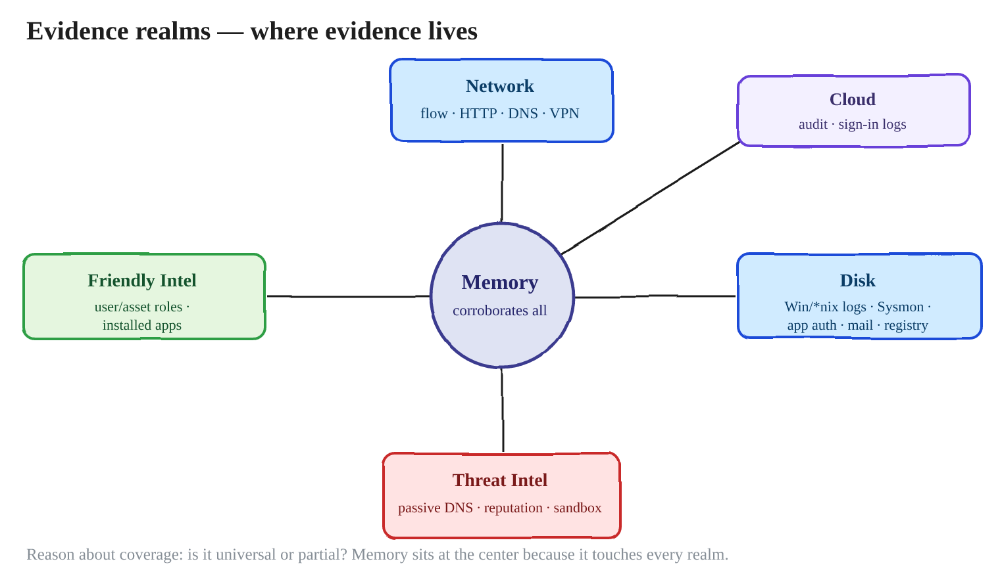

What separates a skilled hunter from a typical analyst is a deeper understanding of the *value* each source represents. When you meet a new data source — or want to go deeper on a familiar one — interrogate it: where does the data come from, what behaviors does it represent, what attack techniques manifest here, what fields exist, and what other sources can I pivot to from here (take one field and chase it across another dataset)? Two questions matter more than they first appear. Is this **intentional evidence** — a log designed to be read — or a byproduct never meant as evidence, like ShimCache, that carries real interpretation caveats? And is coverage **universal** or partial — do you have PCAP for the whole estate or just one subnet? The hunter's discipline is to know the limitations, because **evidence does not always manifest the way you expect, every time.** The way you learn what to expect is to **simulate** the attack against the source and watch what it actually produces.

#### The bridge to Parts 2.1 and 2.2

This is where the mindset snaps onto the rest of the series. Parts 2.1 and 2.2 catalogued Windows and Linux artifacts at scale; DBH is the lens that turns each of those artifacts into a hunt. The plan for those companion posts is a "perfect match": walk every evidence source we collect and ask, for each, *how is this good for hunting?* — which fields carry evidence, what's anomalous, how to surface it. Windows and Linux won't look identical, but it's the **same mindset** applied to different data. The evidence realms are the table of contents; the DBH process is the method applied to each row.

??? info "Sources & further reading"
    - Malware Archaeology — [*Windows Logging Cheat Sheets*](https://www.malwarearchaeology.com/cheat-sheets) — the disk/host realm, including which logs are off by default.
    - [Zeek](https://zeek.org/) — the network realm; protocol-aware logs rather than flow records.
    - [olafhartong/sysmon-modular](https://github.com/olafhartong/sysmon-modular) · [SwiftOnSecurity/sysmon-config](https://github.com/SwiftOnSecurity/sysmon-config) — endpoint coverage, with the trade-off between completeness and volume made explicit in the configs themselves.
    - [OTRF — Security-Datasets](https://github.com/OTRF/Security-Datasets) — the practical way to answer "what does this source actually produce when the attack runs?" without a lab.
    - [Security Onion](https://securityonionsolutions.com/) — a single distribution that demonstrates most of the realms side by side.


---

### Model 9 — Hunting goals, and the loop back to scale

The **fundamental** goal of hunting is to find attacks that nothing else has found — otherwise the tooling would already have caught them. The **aspirational** goal is to turn a successful hunt into automated detection, so you never have to run that exact hunt by hand again. (The "hunt it once, then automate" idea is sometimes called a *Hunt Once* approach, and how far you can take it scales with your resources and maturity.)

This is where Part 4 rejoins the rest of the series. Hunting feeds new detections; detections free humans to hunt the novel; and the machinery from Parts 1–3 is what lets both run across the whole estate. The mindset and the scale are two halves of the same operation.

#### Closing the loop on the heatmap

The heatmap that opened the attack-dissection section is also where a finished hunt goes to be recorded. A hunt that found nothing is not a wasted hunt — it is a technique you have now looked for, with a date and a method attached. Marking it on the layer is what stops the same ground being covered twice, and what turns "we have no coverage of T1021.001" into a claim somebody can check rather than an impression.

A hunt that *did* find something gets recorded twice: once as a new detection — the aspirational goal above — and once as a change of colour on the layer. Over a year, the drift of that heatmap is the most honest report a hunting programme can produce, because it shows coverage accumulating against the adversaries you actually track, instead of counting how many hunts were run.

That is what keeps a hunting programme organised: intelligence decides what matters, the heatmap records what you can see and what you have already looked for, and every completed hunt updates it. The models in this post are how you execute one hunt well. This is how a hundred of them add up to something.


??? info "Sources & further reading"
    - Sqrrl — [*The Cyber Hunting Maturity Model*](https://medium.com/@sqrrldata/the-cyber-hunting-maturity-model-6d506faa8ad5) — HMM0–HMM4; the hunt-then-automate arc is what separates HMM3 from HMM4.
    - Sqrrl — [*A Framework for Cyber Threat Hunting*](https://www.threathunting.net/files/framework-for-threat-hunting-whitepaper.pdf) — the original whitepaper behind the hunting loop and the maturity model.
    - Splunk — [*Introducing the PEAK Threat Hunting Framework*](https://www.splunk.com/en_us/blog/security/peak-threat-hunting-framework.html) — the *Act with Knowledge* stage is this model: a hunt's output is a detection, a baseline, or documented knowledge.
    - [SigmaHQ/sigma](https://github.com/SigmaHQ/sigma) — the usual vehicle for turning a finished hunt into a portable detection.

---

## Next: Part 2 — working the data

Everything to this point is **planning**. You know how hunting is structured, what an anomaly
looks like, which attack is worth your hours, and exactly which manifestations to go after.

What you do not yet have is the move that makes any of it visible. Both hunting models
decompose into three questions, and the third is identical in each: *how can I manipulate the
data to see it?* That question is the whole of Part 2.

!!! tip "Continue"
    **[Part 2 — Working the Data](../../16/hunting-mindset-working-the-data/)** covers the
    **GAPSS** toolbox in full: Search, Aggregations, Statistics and Pivots — how to refine a
    query until it answers, how to stack a field until the rare value floats up, how to
    quantify "normal" so abnormal has something to stand out against, and how to carry one
    value across data sources to confirm it.


---
## References and further reading

Grouped by what you would reach for them *for*, rather than by publisher. Everything cited
in-line through the post is collected here, plus the few places worth going first if you are
starting from scratch.

=== "The mindset"
    Where the way of thinking in this post comes from.

    - **Chris Sanders — _Practical Threat Hunting_** (Applied Network Defense) — **start here if you want to go deeper.** The ABH/DBH split, the five-step attack dissection and the evidence realms are all taught in full, with your hands on the data: [networkdefense.co/courses/hunting](https://www.networkdefense.co/courses/hunting/)
    - **Chris Sanders** — the standing reference on hunting cognition. *The Mind of a Hunter: A Cognitive, Data-Driven Approach* (SANS Threat Hunting & IR Summit 2017), [*Deconstructing the Analyst Mindset*](https://www.sans.org/presentations/keynote-deconstructing-the-analyst-mindset) (SANS CTI Summit keynote), [*Leveraging Curiosity to Enhance Analytic Technique*](https://www.sans.org/presentations/leveraging-curiosity-to-enhance-analytic-technique), and [*Investigation Theory: A Cognitive Approach*](https://www.slideshare.net/slideshow/art-into-science-2017-investigation-theory-a-cognitive-approach/71384306). His research on analyst cognition is the evidence base for the claim that the investigative skillset is universal across DF/IR/SOC.
    - [*Huntpedia: Your Guide to Expert-Level Threat Hunting*](https://www.slideshare.net/slideshow/huntpedia-249837834/249837834) (Sqrrl) — the essay collection that argues hunting is a discipline rather than a talent.
    - [*Turning the Hunted into the Hunter via Threat Hunting*](https://arxiv.org/pdf/2204.11076) (arXiv) — an academic survey of the hunting lifecycle; the source of the "hunting is scientific in nature" framing.
    - SOC Prime — [*Threat Hunting Basics: Getting Manual*](https://socprime.com/blog/threat-hunting-basics-getting-manual) — on manual data work as the thing alerting cannot replace, **and** its warning that triaging every least-common value is how a day disappears.

=== "Frameworks"
    The published models this post lines up with. Worth naming: a hunting programme that can point at its own frameworks is easier to defend to the people funding it.

    - **David J. Bianco** — [*The Pyramid of Pain*](http://detect-respond.blogspot.com/2013/03/the-pyramid-of-pain.html) · [SANS version](https://www.sans.org/tools/the-pyramid-of-pain/) — behaviours cost the adversary more than atomic indicators.
    - **Sqrrl / David J. Bianco** — [*A Framework for Cyber Threat Hunting*](https://www.threathunting.net/files/framework-for-threat-hunting-whitepaper.pdf) (the hunting loop and the maturity model) · [*The Cyber Hunting Maturity Model*](https://medium.com/@sqrrldata/the-cyber-hunting-maturity-model-6d506faa8ad5) · [*Things That Make You Go HMM*](https://speakerdeck.com/davidjbianco/things-that-make-you-go-hmm-using-a-simple-hunting-maturity-model-to-establish-and-improve-your-threat-hunting-program), the model presented by its author.
    - **Splunk SURGe** — [*Introducing the PEAK Threat Hunting Framework*](https://www.splunk.com/en_us/blog/security/peak-threat-hunting-framework.html) · [hypothesis-driven](https://www.splunk.com/en_us/blog/security/peak-hypothesis-driven-threat-hunting.html) · [baseline](https://www.splunk.com/en_us/blog/security/peak-baseline-hunting) — Prepare / Execute / Act, and the three hunt types.
    - **Caltagirone, Pendergast & Betz** — [*The Diamond Model of Intrusion Analysis*](https://apps.dtic.mil/sti/pdfs/ADA586960.pdf) (the full 61-page paper) · [a practitioner's guide](https://www.vectra.ai/topics/diamond-model-of-intrusion-analysis) if the paper is too much. The *activity thread* chapter is the formal treatment of braided parallel timelines.
    - **Lockheed Martin** — [*Cyber Kill Chain*](https://www.lockheedmartin.com/en-us/capabilities/cyber/cyber-kill-chain.html) · **John Boyd** — [the OODA loop](https://en.wikipedia.org/wiki/OODA_loop), the ancestor of every loop in this post.

=== "Intelligence & ATT&CK"
    For deciding *which* attack to hunt before you dissect anything.

    - **Katie Nickels** — [*Getting Started with ATT&CK: Threat Intelligence*](https://medium.com/mitre-attack/getting-started-with-attack-cti-4eb205be4b2f) — mapping intelligence to ATT&CK so groups can be compared and techniques ranked. The practical starting point.
    - [*Using ATT&CK to Advance Cyber Threat Intelligence — Part 1*](https://medium.com/mitre-attack/using-att-ck-to-advance-cyber-threat-intelligence-part-1-c5ad14d59724) — the group-overlay move worked explicitly: where two tracked groups share techniques, those are the highest-priority ones to detect.
    - **Katie Nickels** — [*MITRE ATT&CK: The Play at Home Edition*](https://i.blackhat.com/USA-19/Wednesday/us-19-Nickels-MITRE-ATTACK-The-Play-At-Home-Edition.pdf) (Black Hat USA 2019) — how different teams use ATT&CK to track threats.
    - [MITRE ATT&CK](https://attack.mitre.org/) · [ATT&CK Groups](https://attack.mitre.org/groups/) — and the techniques worked in this post: [T1021.001 Remote Services: RDP](https://attack.mitre.org/techniques/T1021/001/), [T1572 Protocol Tunneling](https://attack.mitre.org/techniques/T1572/), [T1136 Create Account](https://attack.mitre.org/techniques/T1136/).
    - [mitre-attack/attack-navigator](https://github.com/mitre-attack/attack-navigator) — layers, scoring, layer combination. **Layers being combined must target the same ATT&CK version and domain**, or the overlay means nothing.
    - [rabobank-cdc/DeTT&CT](https://github.com/rabobank-cdc/DeTTECT) — built because Navigator alone has no multi-level scoring and no separation between *visibility* and *detection*. Introduced by its author, [Marcus Bakker](https://marcus-bakker.squarespace.com/blog/2019/5/dettact-mapping-your-blue-team-to-mitre-attack), and walked through by [NVISO](https://blog.nviso.eu/2022/03/09/dettct-mapping-detection-to-mitre-attck/).

=== "Attack analysis"
    For the dissection half: turning a report into a hunt, and seeing what the attack actually leaves behind.

    - **Mandiant** — [*Bypassing Network Restrictions Through RDP Tunneling*](https://cloud.google.com/blog/topics/threat-intelligence/bypassing-network-restrictions-through-rdp-tunneling) — the primary source for the worked example carried through this post.
    - **OTRF** — [Threat Hunter Playbook](https://github.com/OTRF/ThreatHunter-Playbook) · [docs](https://threathunterplaybook.com) — what a finished dissection looks like when it is written down to be re-run: ATT&CK-organised, as executable notebooks.
    - **OTRF** — [Security-Datasets](https://github.com/OTRF/Security-Datasets) — pre-recorded telemetry per technique, for studying a manifestation without detonating anything.
    - **Red Canary** — [Atomic Red Team](https://github.com/redcanaryco/atomic-red-team) · [*Finding false negatives*](https://redcanary.com/blog/testing-and-validation/atomic-red-team/false-negatives/) — the "run it, then measure what you did **not** catch" discipline. Caveat worth carrying: default atomic commands can trip signatures, so you may be measuring the string rather than the behaviour.
    - [Security Onion](https://securityonionsolutions.com/) — for artifact replay: push someone else's pcap through a monitored stack. · [DetectionLab](https://github.com/clong/DetectionLab) — the pre-instrumented lab; check its current maintenance status before building on it.

=== "Data & tooling"
    For the transformation half — and for knowing what your evidence can and cannot tell you.

    - [SigmaHQ/sigma](https://github.com/SigmaHQ/sigma) — the clearest demonstration that every platform speaks a dialect: one rule compiled out to SPL, KQL, EQL and Lucene. Also how a finished hunt stops being manual.
    - [Zeek](https://zeek.org/) — protocol-aware logs that see payload, which flow records never will. This is what makes the `mstshash` tell reachable at all. Note it logs a connection only when the connection *closes*.
    - [activecm/RITA](https://github.com/activecm/rita) · [*Threat Hunting Over the Network With Zeek and RITA*](https://www.activecountermeasures.com/threat-hunting-over-the-network-with-zeek-and-rita/) · [Black Hills InfoSec walkthrough](https://www.blackhillsinfosec.com/detecting-malware-beacons-with-zeek-and-rita/) — statistical beacon scoring over Zeek logs, and a pivot chain run end to end.
    - **Mark Baggett** — [*Detecting Random: Finding Algorithmically Chosen DNS Names (DGA)*](https://isc.sans.edu/diary/19893) (SANS ISC). **Read this before using entropy for anything.** He tested `ent` on hostnames and found malicious names score about the same as normal ones — which is why he moved to character-pair frequency tables. The tool is [MarkBaggett/freq](https://github.com/MarkBaggett/freq); build its table from *your* traffic, not a generic corpus.
    - [*ent*](https://www.fourmilab.ch/random/) (Fourmilab) — the entropy tool used in the examples above.
    - **Carter Bullard** — [*Producer–Consumer Ratio*](http://qosient.com/argus/presentations/Argus.FloCon.2014.PCR.Presentation.pdf) (FloCon 2014), the origin of PCR · **David J. Bianco** — [*Detecting Data Staging & Exfil Using the PCR Shift*](http://detect-respond.blogspot.com/2016/09/detecting-data-staging-exfil-using-PCR-shift.html), baseline PCR against current PCR.
    - [olafhartong/sysmon-modular](https://github.com/olafhartong/sysmon-modular) · [SwiftOnSecurity/sysmon-config](https://github.com/SwiftOnSecurity/sysmon-config) — ATT&CK-annotated endpoint coverage; reading the rule modules is itself a technique → evidence map.
    - [*Threat Hunting with Sysmon 101*](https://11x256.github.io/threat_hunting/Threat-Hunting-2-sysmon-event-structure/) — one data source worked field by field, with the warning to pivot on process **GUID** rather than PID, since PIDs are reused and will silently break a chain. · Splunk — [*Using Sysmon & Event Codes for Threat Hunting*](https://www.splunk.com/en_us/blog/security/a-salacious-soliloquy-on-sysmon.html).
    - **Intel 471** — [*Threat Hunting Tactics & Techniques*](https://www.intel471.com/blog/threat-hunting-tactics-techniques) · [*How to Threat Hunt: A Beginner's Guide*](https://www.intel471.com/blog/how-to-threat-hunt-a-beginners-guide) — stack counting and query refinement on real examples.

=== "Collections"
    Where to go when you want the next hunt rather than the next concept.

    - [The ThreatHunting Project](https://www.threathunting.net/) — a curated index of public hunting procedures.
    - **Malware Archaeology** — [Windows Logging Cheat Sheets](https://www.malwarearchaeology.com/cheat-sheets) — which event IDs exist, and which you have to switch on first. This is the "write down every evidence source you actually have" list.
    - **Rapid7** — [*Threat Hunting: Attack vs. Data*](https://information.rapid7.com/threat-hunting-attack-data.html) · **Qintel** — [*Hypothesis-Driven Threat Hunting*](https://www.qintel.com/article/hypothesis-driven-threat-hunting-turn-intelligence-into-testable-hunts) — the ABH/DBH split and hunt closure criteria, from two other angles.

---

*[ABH]: Attack-Based Hunting
*[DBH]: Data-Based Hunting
*[GAPSS]: Graph, Aggregations, Pivots, Statistics, Search
*[LFO]: Least Frequency of Occurrence
*[MFO]: Most Frequency of Occurrence
*[PCR]: Producer:Consumer Ratio
*[PIR]: Priority Intelligence Requirement
*[PIRs]: Priority Intelligence Requirements
*[DGA]: Domain Generation Algorithm
*[EID]: Event ID
*[EDR]: Endpoint Detection and Response
*[NDR]: Network Detection and Response
*[SIEM]: Security Information and Event Management
*[IDS]: Intrusion Detection System
*[IPS]: Intrusion Prevention System
*[TTPs]: Tactics, Techniques and Procedures
*[CTI]: Cyber Threat Intelligence
*[C2]: Command and Control
*[HMM]: Hunting Maturity Model
*[PEAK]: Prepare, Execute and Act with Knowledge
*[RDP]: Remote Desktop Protocol
*[NLA]: Network Level Authentication
*[UAC]: User Account Control
*[SMB]: Server Message Block
*[DFIR]: Digital Forensics and Incident Response
*[SOC]: Security Operations Centre
*[SPL]: Search Processing Language
*[KQL]: Kusto Query Language
*[EQL]: Event Query Language
*[PCAP]: Packet Capture
