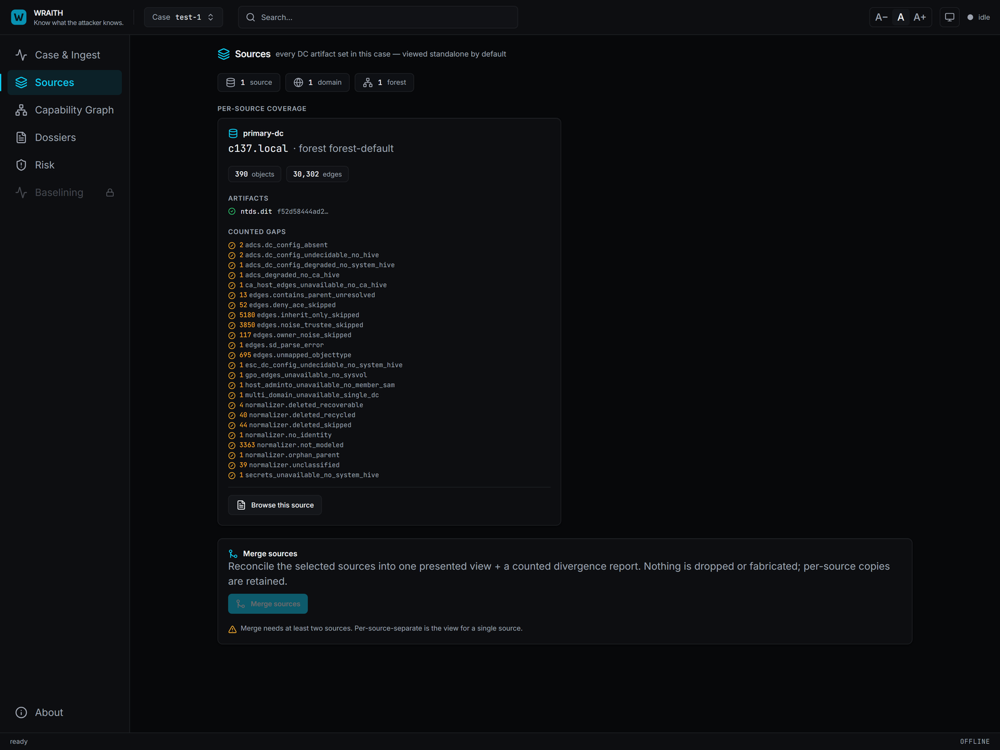
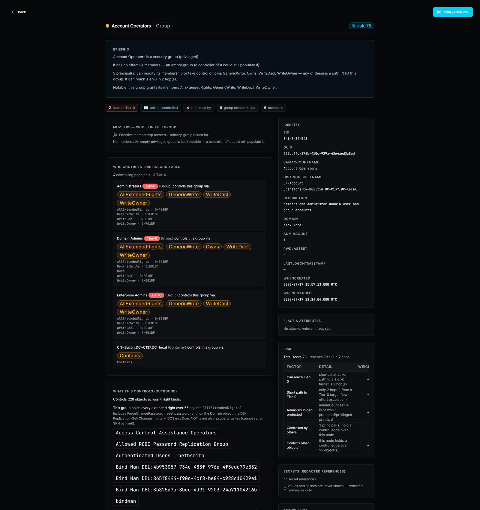

# WRAITH V1.0 Use Cases — Five Different Roles, One Offline Reconstruction

*Worked examples, not a feature tour: five different people asking five different questions of the same offline Active Directory reconstruction — including the hunts that came back empty.*

<!-- more -->

!!! abstract "At a Glance"
    - **What this is:** The engineering post built WRAITH. This one uses it. One dead-disk acquisition, one offline reconstruction, then the same graph interrogated by five different roles — plus an honest account of what it could not answer.

    - **These five are examples, nothing more.** WRAITH is a tool, not a workflow. It answers one question — *who can do what to whom in this directory* — and what you do with that answer is yours to decide. The five below are simply five I can demonstrate end to end on a single case.

    - **The environment:** the [Stolen Szechuan Sauce](https://dfirmadness.com/the-stolen-szechuan-sauce/) case — a real intrusion dataset, not a synthetic lab. One domain, `c137.local`, reconstructed from a single `ntds.dit` lifted off the imaged domain controller.

    - **What came out:** **390 objects, 30,302 relationships, 10 Tier-0 principals** and **92 scored nodes**, from one 20 MB file and no contact with any live system.

    - **The catalog:** all **56 hunts across 8 categories**, each explained individually. On this case **32 fired, 18 returned empty and 6 are structurally unsupported** — and all three of those outcomes are worth reading.

    - **The link:** where the hunting mindset ends and the detection-engineering process begins, and why that handoff needs an environment model to work at all.

    - **Read time:** ~52 minutes

    - **Audience:** Threat hunters, detection engineers, incident responders, AD administrators, penetration testers.

    - **Prerequisites:** None. [The engineering post](../../05/building-wraith/) is useful background but not required.

!!! info "One Case, and What That Means"
    Everything below runs on a single environment. One case cannot establish that a tool is accurate in general — it can only show what the tool does, on real evidence, with its failures left in. Where a claim needs a scored run against an environment that publishes its own ground truth, I say so rather than imply it is settled.

??? abstract "Table of Contents — 9 Parts"

    1. **From Live Host to Dead Disk** *(~3 min)*

        - **1.1** Why Offline at All — The Case BloodHound Cannot Serve
        - **1.2** What Came Off the Domain Controller
        - **1.3** Hashing and Provenance — Before Anything Is Parsed

    2. **How Far to Trust the Reconstruction** *(~3 min)*

        - **2.1** Every Gap Counted, None Guessed
        - **2.2** Independent Validation — The Same Graph in BloodHound CE
        - **2.3** Confidence Is Computed Per Case, Not Declared Once

    3. **The Catalog — All Fifty-Six Hunts, One at a Time** *(~12 min)*

        - **3.1** How to Read a Hunt
        - **3.2** Privileged Access — 21 Hunts
        - **3.3** Credential Exposure — 10 Hunts
        - **3.4** Dangerous ACLs — 6 Hunts
        - **3.5** Delegation — 5 Hunts
        - **3.6** Shadow Admins — 2 Hunts
        - **3.7** Stale and Risk — 4 Hunts
        - **3.8** Topology — 5 Hunts
        - **3.9** AD CS — 3 Hunts

    4. **The Hunter's Question — Which Principals Actually Matter Here?** *(~8 min)*

        - **4.1** The Whole Idea — Where an Environment Model Sits in the Mindset
        - **4.2** Fifty-Six Hunts Fired — Now What?
        - **4.3** From Structure to Hypothesis
        - **4.4** Narrowing Telemetry to the Principals That Count

    5. **The Detection Engineer's Question — What Do I Enrich With?** *(~5 min)*

        - **5.1** The Whole Idea — One Loop, Two Halves
        - **5.2** A Detection Without Tier-0 Has No Severity Model
        - **5.3** Shadow Admins as an Enrichment Set
        - **5.4** Writing the Rule — Before and After Context
        - **5.5** Closing the Loop on the Heatmap

    6. **The Responder's Question — What Could This Account Have Reached?** *(~3 min)*

        - **6.1** Scoping from a Single Compromised Principal
        - **6.2** Dossiers as Defensible Reporting

    7. **The Hardening Question — What Do We Fix First?** *(~3 min)*

        - **7.1** Structural Debt, Not Findings
        - **7.2** Ranking Remediation by Tier-0 Reachability
        - **7.3** AD CS — Topology Today, Templates When the CA Host Lands

    8. **The Offensive Question — Where Would an Attacker Start?** *(~1 min)*

    9. **What Returned Nothing** *(~4 min)*

        - **9.1** The Hunts That Came Back Empty
        - **9.2** The Hunts That Stayed Greyed, and What Would Ungrey Them
        - **9.3** What Offline Acquisition Structurally Cannot Recover

    - **Where the Graph Stops and the Hunt Begins**
    - **Closing**
    - **References and Further Reading**

---

## What This Is

The engineering post answered *how I built WRAITH*. It ended with a promise: move from the engineering perspective to the actual threat-hunting workflow. This post is that move.

I structured it deliberately. Rather than tour a feature list, I acquire **one** environment, reconstruct it **once**, and then ask the same graph five different questions — the questions a hunter, a detection engineer, a responder, a hardening team and a red team each walk in with. Capabilities appear here because a question needed them, not because they were on a list.

<figure markdown>
  [{ loading=lazy }](wraith-practice-diagrams/01-six-questions.png){ title="Open the full-resolution diagram" }
  <figcaption markdown="span">**Five roles, one environment** — the capabilities appear because a question needed them, not because they were on a list.</figcaption>
</figure>

A clean structural result is not a clean environment. That distinction is the easiest thing in the world to forget once a graph is on screen, so it runs through every part below.

!!! info "A Tool, Not a Workflow — and Not Only a Defensive One"
    BloodHound is the obvious precedent. It was written by offensive engineers to find attack paths, and defenders adopted it wholesale once they realised the attacker's map of their estate is also the best map *they* have. Same data, same graph, opposite intent.

    WRAITH works the same way, and the five roles below should be read in that spirit. A penetration tester opens the capability graph to find the shortest route to Domain Admin. A defender opens the identical graph to find the same route and close it. Neither is using it wrongly, and neither is the "real" use case.

    **So treat what follows as five worked examples, not a prescription.** A GRC analyst, an identity team, an M&A due-diligence reviewer or someone hunting something I have not thought of would each ask their own question of the same reconstruction. What transfers is the method — acquire, reconstruct, interrogate — not the specific five.

Three things make this worth writing up rather than demonstrating privately:

1. **The failures are left in.** Of 56 hunts, 32 returned something here and 24 did not. Both halves are reported, because a catalog that only ever shows its hits tells you nothing about what it misses.
2. **The evidence is real, and so are its holes.** This is a genuine intrusion image, acquired the way a responder would acquire it — which means the acquisition is incomplete in exactly the ways real acquisitions are. Those holes are counted on screen rather than smoothed over.
3. **It joins two halves of this blog that have never been joined.** I wrote the mindset posts to be environment-agnostic by design. This is where that method meets a specific environment.

---

## Part 1 — From Live Host to Dead Disk

### 1.1 Why Offline at All — The Case BloodHound Cannot Serve

!!! question "The Problem"
    The evidence here is a disk image of a domain controller from a real intrusion. There is no live directory to point a collector at. That is not an inconvenience to work around — it is the case WRAITH exists for.

BloodHound and SharpHound collect from a live, reachable directory, and they are excellent at it. WRAITH addresses the other case: a dead disk image, an air-gapped lab, or seized evidence, where live collection is impossible, unsafe, or legally off-limits. No component initiates network egress at runtime.

That constraint is why this part exists at all. Most readers have run a collector against a domain. Far fewer have reconstructed one from its artifacts, and the acquisition step is where the difference actually lives.

**Approach — Treat the Image as Evidence, Not as a Target**

The [Stolen Szechuan Sauce](https://dfirmadness.com/the-stolen-szechuan-sauce/) case ships disk images from a compromised environment: a domain controller and a member host, captured during a real intrusion. It is the same image the engineering post used as its real-data fixture, which is deliberate — that post established the reconstruction works on it, and this one asks what you can actually *do* with the result.

I treated it the way I would treat client evidence — pull the artifacts out of the image, hash them, and run everything downstream against those files.

The side effect is a fair test. If the reconstruction is wrong, it is wrong in the way an offline reconstruction of a real estate would be wrong, with no live query available to quietly fill a gap.

---

### 1.2 What Came Off the Domain Controller

WRAITH v1.0 ingests four artifact classes. What each unlocks is worth being precise about, because the absence of any of them changes what the hunts in Part 3 can answer:

| Artifact | What it unlocks | Without it |
|---|---|---|
| `ntds.dit` | The directory itself: objects, attributes, security descriptors, `sIDHistory`, delegation, trusts, and the AD CS objects in the Configuration partition | There is no graph |
| `SYSTEM` hive, from the same DC | The boot key, and through it PEK and the credential material | Objects resolve; secrets do not |
| `SYSVOL` | GPO-pushed local group membership and user-rights assignments — `AdminTo` and its relatives | Host privilege is directory-only; GPO-derived admin rights are missing |
| Local SAM plus that host's `SYSTEM` hive, per member host | Non-GPO local privilege on that machine: `AdminTo`, `CanRDP`, `ExecuteDCOM`, `CanPSRemote` | Host-local admin is invisible, and `set-admin-on-dc` loses its host-SAM half |

This case carries **one of the four**:

| | |
|---|---|
| **Source file** | `ntds.dit` |
| **Size** | 20,987,904 bytes |
| **SHA-256** | `f52d58444ad2968cdf1781ed737a16637e40923732f37327bb2d7e7cc2736886` |
| **Domain** | `c137.local`, one domain, one DC |

That is deliberate, and it is the most useful thing about this run. A minimum-viable acquisition is the honest baseline: it is what you get when someone hands you an image and nothing else, and it is the condition under which a tool's claims about its own coverage are actually tested.

**Engineering consideration — The Host SAM Decision Shapes the Results**

The per-host SAM is the artifact most often skipped, and skipping it shows up in the output rather than silently. `set-admin-on-dc` carries a split confidence for exactly this reason: its GPO-derived half is real as soon as `SYSVOL` is present, while its host-SAM half stays synthetic until member-host images are collected. How many hosts you image is therefore a decision about how much of the catalog can speak — and Part 9 returns to exactly what that cost here.

---

### 1.3 Hashing and Provenance — Before Anything Is Parsed

!!! question "The Problem"
    A graph that cannot name the file a claim came from is an opinion. Once findings leave the tool — into a report, a ticket, a client deliverable — provenance is the only thing that makes them checkable.

Every entity and edge carries `{source file, image SHA-256, source object id, directory timestamp}`, attached at creation rather than reconstructed afterwards. The image hash is taken before parsing begins, so the chain starts at the artifact and not at the first thing the parser happened to understand.

<figure markdown>
  [{ loading=lazy }](wraith-practice-shots/01-sources-and-gaps.png){ title="Open the full-resolution screenshot" }
  <figcaption markdown="span">**The source, and its holes** — one artifact, 390 objects, and every gap that artifact's absence creates named and counted on the same screen.</figcaption>
</figure>

**Output and handoff:**

- A hashed artifact set, and a case workspace where credential material is encrypted at rest and redacted by default.
- Every fact in every part below traceable to that file.

The important distinction is that **provenance is not a reporting feature bolted on at the end — it is what makes the rest of this post auditable rather than merely illustrated.**

---

## Part 2 — How Far to Trust the Reconstruction

### 2.1 Every Gap Counted, None Guessed

!!! question "The Problem"
    One case cannot prove a tool is accurate. What it *can* show is whether the tool is honest about its own limits — and that is the property you actually depend on when the evidence is partial, which it always is.

From one 20 MB file, WRAITH built **390 objects and 30,302 relationships**: 12 users, 2 computers, 77 groups, 291 containers, 3 GPOs, 1 OU, and the domain itself. Ten principals classify as Tier-0.

The more interesting number is the other one. Alongside the graph, the same screen lists what it could *not* do, by name and by count:

| Counted gap | Count | What it means |
|---|---|---|
| `normalizer.not_modeled` | 3,363 | Objects read and deliberately not turned into nodes |
| `edges.inherit_only_skipped` | 5,180 | ACEs that apply to children only, not to the object itself |
| `edges.noise_trustee_skipped` | 3,850 | ACEs held by trustees that carry no attacker value |
| `edges.unmapped_objecttype` | 695 | Rights whose GUID WRAITH does not yet map |
| `edges.deny_ace_skipped` | 52 | DENY entries, which the graph does not subtract |
| `normalizer.deleted_recycled` | 40 | Tombstoned objects, not resurrected into the graph |
| `gpo_edges_unavailable_no_sysvol` | 1 | No `SYSVOL`, so no GPO-derived privilege |
| `host_adminto_unavailable_no_member_sam` | 1 | No member-host SAM, so no host-local admin |
| `secrets_unavailable_no_system_hive` | 1 | No `SYSTEM` hive, so no credential material |
| `adcs.dc_config_absent` | 2 | No CA host registry, so the AD CS picture is partial |

!!! tip "This Table Is the Whole Argument"
    Nothing here is a bug. Every line is a decision the tool made, recorded where a reader can see it. The alternative — a graph that silently omits 5,180 inherit-only ACEs and never says so — looks identical on screen and is worth nothing, because you cannot tell a clean environment from a blind tool.

**Engineering consideration — What This Does Not Establish**

This is one case, on one artifact. It shows that the reconstruction is internally consistent and that its gaps are declared. It does **not** score the output against an independent answer key, because this dataset does not publish one. A lab that declares what it provisions — and can therefore be used as ground truth — is the next test, and it is not in this post.

---

### 2.2 Independent Validation — The Same Graph in BloodHound CE

WRAITH exports the reconstructed graph in BloodHound CE's ingest format, which is the cheapest available cross-check: two independent implementations reading the same directory and rendering the same relationships. Where they disagree, at least one is wrong, and the disagreement is the finding.

!!! warning "Not Run Here"
    I have not included a side-by-side in this post. The export path exists and the comparison is the obvious next piece of work, but reporting it would mean showing it, and I have not done it yet. Treat the reconstruction below as internally consistent and externally unverified.

---

### 2.3 Confidence Is Computed Per Case, Not Declared Once

!!! question "The Problem"
    A hunt that is sound in principle can be unanswerable on *your* evidence. A catalog that advertises one fixed confidence per hunt is lying to half its users.

Every hunt carries a `data_confidence` value — `real`, `synthetic-only`, or `none` — and it is **computed for the case in front of you**, from the artifacts actually present:

| Value | Count on this case | Meaning |
|---|---|---|
| `real` | 46 | Validated against real directory data |
| `synthetic-only` | 4 | Logic validated on fixtures; no real-world parity yet |
| `none` | 6 | Structurally unsupported — the data to answer it is not here |

The four `synthetic-only` hunts on this case are `set-admin-on-dc`, `set-enrollment-rights`, `set-adcs-topology` and `paths-to-adcs-esc`.

!!! tip "The Badge Answers a Question About This Case, Not About the Tool"
    Three of those four are AD CS hunts, badged `synthetic-only` in the catalog itself. The fourth, **`set-admin-on-dc`**, is `real` in the catalog and degrades *here* — because no member-host SAM was acquired, so its host-SAM half has nothing to read. Same tool, same hunt, different evidence, different badge. That is the behaviour the feature exists for, and it is visible on this case precisely because the acquisition is incomplete.

---
## Part 3 — The Catalog: All Fifty-Six Hunts, One at a Time

### 3.1 How to Read a Hunt

!!! question "The Problem"
    A catalog of 56 one-click hunts is useless if the analyst cannot tell what any individual hunt actually asked, or what its number means. A count beside a label looks authoritative whether or not it counts the thing the reader assumes.

<figure markdown>
  [{ loading=lazy }](wraith-practice-diagrams/02-the-catalog.png){ title="Open the full-resolution diagram" }
  <figcaption markdown="span">**The catalog** — 56 hunts across 8 categories. Six are greyed rather than hidden, because a hidden hunt and a clean result look identical.</figcaption>
</figure>

Every hunt in WRAITH is **pure data**: a stable id, a plain-English description, a category, and a resolver. None of them is a free-text query the analyst has to write, and none of them can drift from the rest of the system — the counts come from the *same* resolvers that feed the Risk dashboard, so the hunt list and the risk model cannot disagree.

Four properties decide how to read any entry below.

**`kind` — set or path.** A **set** hunt returns a population: the principals that match a condition. A **path** hunt returns routes: one shortest attacker path per qualifying source or to each qualifying target. The two answer different questions and their counts are not comparable.

**`direction`.** `set` for a population, `to-target` for "everything that can reach this kind of sink", `source-to-target` for "from this population, where can it get".

**`supported`.** Whether the hunt runs on v1 data. **Six are listed and greyed.** I never hide them, because a hidden hunt is indistinguishable from a clean result.

**`data_confidence` — `real`, `synthetic-only`, or `none`.** This one is **computed per case, not fixed in the catalog**, and that distinction matters more than it first appears. The three AD CS hunts carry `synthetic-only` statically: pipeline-wired and tested against synthetic input, never validated against a real AD CS-bearing `ntds.dit`. But a hunt whose spec says `real` can still *degrade* for a particular case when the evidence it needs was not acquired.

!!! tip "The badge answers a question about this case, not about the tool"
    Running the catalog against the Szechuan Sauce reconstruction returns **four** `synthetic-only` hunts, not three. The fourth is **Principals with Admin on a Domain Controller**, which is `real` in the catalog but degrades here because no member-host SAM images were acquired, so its host-SAM half has nothing to stand on.

    That is the honest-coverage design doing its job. The same hunt, same tool, different evidence — and the badge moves rather than the result silently changing.

!!! danger "The count beside a label is not always a result count"
    This is the single most important thing to understand before reading any number in this post. Several hunts show a count of their **target or source population**, not of the findings:

    - **Shortest Paths to Tier Zero** shows the number of Tier-0 principals in the domain, not the number of paths found.
    - **Shortest Paths to AD CS ESC Abuse** shows the number of distinct ESC sinks, not paths.
    - **Every privileged-group hunt** shows its effective member count, not a path count.

    Reading one of those as a finding count will make an environment look far worse, or far better, than it is.

The eight categories and their shape:

| Category | Hunts | Runnable | Confidence |
|---|---:|---:|---|
| Privileged Access | 21 | 20 | `real` |
| Credential Exposure | 10 | 10 | `real` |
| Dangerous ACLs | 6 | 6 | `real` |
| Delegation | 5 | 5 | `real` |
| Topology | 5 | 2 | `real` |
| Stale / Risk | 4 | 2 | `real` |
| AD CS | 3 | 3 | `synthetic-only` |
| Shadow Admins | 2 | 2 | `real` |
| **Total** | **56** | **50** | |

---

### 3.2 Privileged Access — 21 Hunts

!!! question "The Problem"
    "Who is privileged here?" sounds like a question about group membership. It is not. Nested groups, primary-group membership, and paths that end in a privileged group all produce effective privilege that a flat membership read misses entirely.

**Approach — Effective Membership, Not Declared Membership**

Fifteen of these 21 hunts share one resolver. Each targets a well-known group by **RID suffix** and returns its **effective** membership — the transitive closure across nested groups *and* primary-group membership — along with each member's one-hop `MemberOf` neighbourhood. Matching on the RID suffix rather than the group name is what makes them work across domains and locales.

| Group | RID | Why it is in the privileged set |
|---|---|---|
| Domain Admins | `-512` | Full domain control |
| Enterprise Admins | `-519` | Full forest control |
| Schema Admins | `-518` | Schema modification is forest-wide and permanent |
| Builtin Administrators | `-544` | Local administrator on domain controllers |
| Domain Controllers | `-516` | The machines holding the directory itself |
| Account Operators | `-548` | Can modify most non-protected accounts |
| Server Operators | `-549` | Can log on to and manage DCs |
| Backup Operators | `-551` | Can read any file, including the directory database |
| Print Operators | `-550` | Can load drivers on DCs |
| Replicators | `-552` | Legacy replication privilege |
| Group Policy Creator Owners | `-520` | Creates GPOs — a minor privilege, not Tier-0 |
| Cert Publishers | `-517` | Publishes certificates to the directory |
| Key Admins | `-526` | Writes key credentials on accounts |
| Enterprise Key Admins | `-527` | The same, forest-wide |
| Protected Users | `-525` | A *defensive* group, included for visibility only |

The remaining six hunts in this category:

- **Shortest Paths to Tier Zero** (`paths-to-tier0`, path) — one shortest attacker path from every principal that can reach a Tier-0 target: Domain Admins, Enterprise Admins, builtin Administrators, Domain Controllers, or the domain root object. Ranked shortest-first, because a one-hop path is a different problem from a six-hop one. *The count shows Tier-0 principals, not paths.*
- **Shortest Paths from Domain Users to Tier Zero** (`paths-from-domain-users`, path) — the same, sourced from every effective member of Domain Users (`-513`). This is the "any authenticated user" blast radius, and it is usually the first hunt worth looking at in an unfamiliar environment.
- **Tier Zero Principals** (`set-tier0`, set) — the Tier-0 classification and its current effective members, with their one-hop `MemberOf` neighbourhood.
- **All Privileged Principals** (`set-all-privileged`, set) — the union of effective nested membership across every sensitive well-known group above. **Protected Users is deliberately excluded** from this union: it is a defensive control, not a privilege, and including it would inflate the privileged population. This union is also the reference set that the shadow-admin hunt subtracts.
- **DnsAdmins** (`set-dnsadmins`, set) — historically a DLL-load to SYSTEM-on-DC escalation. DnsAdmins has no fixed RID because it is created when the DNS role is installed, so it is matched by `sAMAccountName`. If no such group exists the result is empty **with a counted gap** (`dnsadmins_group_absent`) rather than a silent zero.
- **Shortest Paths from Owned Principals** (`paths-from-owned`, path) — **greyed.** WRAITH stores no analyst "owned" marking in v1. The engine needs no change to support it: a UI-side owned set can be posted to the paths endpoint as source node ids.

!!! tip "Why DnsAdmins proves the design"
    Three outcomes are possible: the group exists and has members, the group exists and is empty, or the group does not exist. A tool that collapses the last two into "0" has told you something false. The counted gap keeps them distinct.

---

### 3.3 Credential Exposure — 10 Hunts

!!! question "The Problem"
    Credential weakness in a directory is mostly a matter of flag bits and attribute presence. It is easy to enumerate and easy to misread, because several of these conditions are legitimate in specific, explainable cases.

All ten run on v1 data. Two are path hunts that take a credential-exposed population and ask where it can get to; the other eight are set hunts reading flags and attributes.

- **Kerberoastable Users** (`set-kerberoastable`, set) — enabled users advertising a `servicePrincipalName`. Any domain user can request a service ticket for them, and that ticket is crackable offline.
- **Shortest Paths from Kerberoastable Users to Tier Zero** (`paths-from-kerberoastable`, path) — the escalation question that makes the set meaningful. A kerberoastable account that reaches nothing is a weak password; one with a path to Tier-0 is a domain compromise waiting for a wordlist.
- **AS-REP Roastable Users** (`set-asrep`, set) — accounts that do not require Kerberos pre-authentication, so an AS-REP can be requested and cracked offline without any credentials at all.
- **Shortest Paths from AS-REP Roastable Users to Tier Zero** (`paths-from-asrep`, path) — the same escalation question for that population.
- **Principals with DCSync Rights to the Domain** (`set-dcsync`, set) — every principal holding a `DCSync` edge to the domain object. These can replicate all domain secrets, which means forging a Golden Ticket. In most environments this list should be short and entirely expected.
- **Accounts with Password-Not-Required** (`set-password-not-required`, set) — `PASSWD_NOTREQD` (`0x20`) set in `userAccountControl`. The account may have an empty password.
- **Accounts with Never-Expiring Passwords** (`set-password-never-expires`, set) — `DONT_EXPIRE_PASSWORD` (`0x10000`). Long-lived credentials, and the ones most likely to appear in an old breach corpus.
- **Accounts with Reversible-Encryption Passwords** (`set-reversible-password`, set) — `ENCRYPTED_TEXT_PWD_ALLOWED` (`0x80`). The password is recoverable to plaintext directly from the directory.
- **Principals carrying sIDHistory** (`set-sid-history`, set) — a non-empty `sIDHistory`. Legitimate after a migration, and a clean way to smuggle privilege when it is not.
- **adminCount-protected Principals** (`set-admincount`, set) — `adminCount` set, meaning the object is or *was* protected by AdminSDHolder. The "was" is the interesting half, and it is what the orphan hunt in Stale / Risk isolates.

!!! warning "These are the hunts most likely to produce defensible false positives"
    A service account with a never-expiring password and an SPN may be entirely intentional. `sIDHistory` after a genuine migration is correct. The value of these hunts is not the raw list — it is the intersection with reachability, which is why the two path variants exist.

---

### 3.4 Dangerous ACLs — 6 Hunts

!!! question "The Problem"
    An access control entry is not a privilege until you know what it was granted *over*. The same right means something entirely different on a user object, a group, an OU and the domain root — and conflating them is how ACL tooling produces noise.

Every hunt here is a set hunt, and every one is scoped by **target type** as well as by right. That scoping is the whole design.

- **Controllers of the Domain Object** (`acl-controllers-of-domain`) — principals holding `GenericAll`, `WriteDacl`, `WriteOwner` or `Owns` over the domain root. Rewriting that object's DACL self-grants DCSync, so this is full domain compromise in one step.
- **Controllers of any Tier-0 Object** (`acl-controllers-of-tier0`) — the same four rights over any Tier-0 classified object, **plus** a bare `GenericWrite` over a Tier-0 account or group, which is enough for member-write, shadow credentials or SPN takeover. `GenericWrite` over the domain object or its containers is deliberately **not** counted, because it is neither DCSync nor container control.
- **Can Reset Other Accounts' Passwords** (`acl-reset-password-holders`) — `ForceChangePassword`, `AllExtendedRights` or `GenericAll`, **restricted to User and Computer targets only**, and explicitly not a bare `GenericWrite`. Control over a group, OU or GPO is not a password reset, and counting it as one is a common source of inflated findings.
- **Can Write SPN** (`acl-writespn-holders`) — `WriteSPN`, `GenericWrite` or `GenericAll` on an account, again User and Computer only, and **not** `AllExtendedRights`. Writing an SPN onto an account makes it targeted-kerberoastable on demand.
- **Can Add Key Credentials** (`acl-shadowcred-holders`) — `AddKeyCredentialLink`, `GenericWrite` or `GenericAll` allowing a write to `msDS-KeyCredentialLink`. The holder can authenticate as the target using a forged certificate, without touching its password.
- **Can Add Members to a Privileged Group** (`acl-addmember-privgroup`) — `AddMember`, `AddSelf`, `GenericWrite`, `GenericAll` or `WriteDacl` where the target is a privileged group. `AddSelf` is the sharp one: the principal adds *itself*, which is direct self-elevation into Tier-0.

The important distinction is that **the right alone is never the finding — the right paired with the target type is.**

---

### 3.5 Delegation — 5 Hunts

!!! question "The Problem"
    Kerberos delegation is a legitimate feature that is indistinguishable from a backdoor unless you can see which hosts hold it and who can reach them.

All five run on v1 data.

- **Systems with Unconstrained Delegation** (`set-unconstrained`, set) — accounts trusted for unconstrained delegation, which cache the TGT of anyone who authenticates to them.
- **Shortest Paths to Unconstrained Delegation Systems** (`paths-to-unconstrained`, path) — every principal that can reach such a host.
- **Constrained-Delegation Principals** (`set-constrained-delegation`, set) — principals with an `AllowedToDelegate` edge to a target SPN host, meaning they can impersonate users to that service.
- **Resource-Based Constrained Delegation, configured** (`set-rbcd-configured`, set) — resources carrying an `AllowedToAct` trust edge, and the principals permitted to act on them.
- **Can Configure RBCD on a Target** (`set-rbcd-writable`, set) — principals that can write `msDS-AllowedToActOnBehalfOfOtherIdentity` on a target. This is the one defenders miss: it is not a delegation *configuration*, it is the ability to create one at will, and it takes over the target.

!!! warning "Domain controllers will always appear in the unconstrained hunts"
    DCs carry `TRUSTED_FOR_DELEGATION` by design and are already Tier-0, so they appear in both unconstrained hunts as expected. I kept them in deliberately, for BloodHound parity and to keep one source of truth with the risk model. **The novel findings are the non-DC hosts** — read those two results with that filter in mind.

---

### 3.6 Shadow Admins — 2 Hunts

!!! question "The Problem"
    The dangerous principal in a mature environment is usually not in any admin group. It is the account that *controls* an admin object through an ACL nobody reviews, and so appears nowhere in a membership audit.

- **Shadow Admins** (`shadow-admins-tier0`, set) — principals holding full control (`GenericAll`, `WriteDacl`, `WriteOwner`, `Owns`) over a Tier-0 object that are **not Tier-0 themselves and not an effective member of any privileged group**. That subtraction — against the All Privileged Principals union from 3.2 — is what isolates the hidden ACL backdoor from the expected administrators.
- **Controls Many Objects** (`controls-many-principals`, set) — principals whose outbound control fan-out reaches **10 or more distinct objects**. The count is de-duplicated and is the same one the risk model uses, so a principal holding four rights over one object counts once, not four times.

These two hunts are small, and they are the ones I would run first in an environment I did not build.

---

### 3.7 Stale and Risk — 4 Hunts

!!! question "The Problem"
    Privilege that nobody uses is still privilege. Residue from past administration is one of the quietest ways an environment accumulates reachable Tier-0.

Two run today; two are greyed.

- **Disabled-but-Privileged Accounts** (`set-disabled-but-privileged`, set) — disabled accounts that remain an effective member of a privileged group. Standing privilege attached to an account nobody is watching, which is exactly what makes a re-enable attractive.
- **adminCount Orphans** (`set-admincount-orphans`, set) — user accounts carrying `adminCount` that are **not** currently an effective member of any privileged group: AdminSDHolder residue from a privilege that was removed. The scoping here matters, and it is deliberately narrow — **User objects only**, excluding `krbtgt` (`-502`) and the built-in Administrator (`-500`), and excluding the protected groups themselves, which also carry `adminCount=1` and are not orphans. Without those exclusions this hunt is mostly noise.
- **Privileged Accounts with an Old Password** (`set-privileged-old-password`) — **greyed.** The hunt needs a snapshot-time reference to compare `pwdLastSet` against, and v1 has no trustworthy one.
- **Computers running an Unsupported OS** (`set-unsupported-os`) — **greyed.** `operatingSystem` is not collected in v1.

---

### 3.8 Topology — 5 Hunts

!!! question "The Problem"
    Trusts and cross-domain reachability are where single-domain tooling quietly stops being correct, and where an attacker with a foothold starts looking next.

This is the category with the most greyed entries, and the honest shape of v1.

- **Domain Trusts** (`set-trusts`, set) — trust relationships around the domain object: same-forest, cross-forest and trust-key edges, oriented in the **attack direction** rather than the administrative one.
- **Principals with Admin on a Domain Controller** (`set-admin-on-dc`, set) — principals with an `AdminTo` edge onto a DC. Confidence here is **split by artifact**: GPO-derived `AdminTo` is real as soon as `SYSVOL` is present, while host-SAM `AdminTo` stays synthetic until member-host images are collected. The hunt reports which half it is standing on.
- **Foreign Security Principals** (`set-foreign-security-principals`) — **greyed.** The FSP reader is not built.
- **Domain Trust Abuse Paths** (`trust-abuse-paths`) — **greyed.** Dedicated cross-domain trust-abuse edges are not modelled in v1. Generic pathfinding still traverses whatever trust edges exist, so this is a missing *specialisation*, not missing traversal.
- **Azure / Entra ID Paths** (`azure-paths`) — **greyed permanently.** Azure and Entra are a project non-goal: WRAITH is on-premises AD only. I list it so the absence is explicit rather than discovered.

!!! tip "A permanent non-goal is still worth listing"
    Leaving Azure off the catalog entirely would let a reader assume it was covered. Listing it greyed, with the reason, converts a silent gap into a stated boundary.

---

### 3.9 AD CS — 3 Hunts

!!! question "The Problem"
    AD CS escalation is the highest-value and least-visible privilege path in a modern domain. It is also the part of WRAITH I can least afford to overstate, because none of it has yet met a real certificate authority.

All three are pipeline-wired and run, and all three are badged **`synthetic-only`**: tested against synthetic input, not yet validated against a real AD CS-bearing `ntds.dit`, with a Certipy parity check still outstanding.

- **Certificate Enrollment Rights** (`set-enrollment-rights`, set) — principals holding an **explicitly granted** `Enroll` or `AutoEnroll` right on a certificate template. These are pure Configuration-partition ACL facts from `ntds.dit`, needing no CA-host artifact. Read it precisely: this is the directly-granted enrollment population, **not** every principal who could obtain a certificate. A `GenericAll` or `AllExtendedRights` holder has template control (ESC4) and is surfaced under the ESC paths instead.
- **AD CS Topology** (`set-adcs-topology`, set) — the PKI shape: certificate authorities, the NTAuth store, and template links, via `PublishedTo`, `EnterpriseCAFor` and `TrustedForNTAuth` edges.
- **Shortest Paths to AD CS ESC Abuse** (`paths-to-adcs-esc`, path) — one shortest path from every principal that can reach an ESC-abuse sink: the target of any inferred ESC-composite edge across ESC1, ESC3, ESC9, ESC10a, ESC10b, ESC13, ESC15, template control (ESC4), `EnrollOnBehalfOf`, and GoldenCert.

!!! danger "The ESC sinks are heterogeneous, and the count is not a path count"
    Reaching one sink is not equivalent to reaching another, and treating this result as a flat list of domain compromises is wrong:

    - **ESC1, ESC3, ESC9, ESC15 and GoldenCert sink at the domain object.** Reaching it *is* domain compromise.
    - **ESC4, ESC10 and ESC13 sink at an intermediate** template, victim or group, and still require the onward certificate step.

    **ESC6, ESC7, ESC11 and ESC16 require the CA-host registry, which v1 does not collect.** They are counted-undecidable and therefore absent from this result. **Absent is not clean.** ESC9 and ESC10 verdicts hold for the imaged DC only.

!!! warning "These Three Hunts Stay `synthetic-only` on This Case"
    There is no certificate authority in `c137.local`, so all three returned
    empty, and none of them met a real CA here. WRAITH's own limitations page
    is blunt about what that means: the AD CS analytics *as a whole* are
    validated on synthetic fixtures, so you should **trust the logic and treat
    the result as provisional until real-PKI parity lands**.

    Several ESC classes are additionally undecidable offline by construction.
    ESC6, ESC7, ESC11 and ESC16 depend on the CA host's own registry — a
    separate artifact. ESC9 and ESC10 depend on the DC's certificate-mapping
    configuration in its `SYSTEM` hive, which this acquisition does not
    include. ESC8 and the other relay attacks require live network coercion
    and are out of scope by definition.

    On this case that surfaces as four counted gaps rather than as silence:
    `adcs.dc_config_absent` (2), `adcs.dc_config_undecidable_no_hive` (2),
    `adcs.dc_config_degraded_no_system_hive` (1) and
    `ca_host_edges_unavailable_no_ca_hive` (1).

---

## Part 4 — The Hunter's Question: Which Principals Actually Matter Here?

### 4.1 The Whole Idea — Where an Environment Model Sits in the Mindset

!!! question "The Problem"
    I wrote the threat hunting mindset posts to be environment-agnostic on purpose: the models work anywhere, which is what makes them teachable. But a hunt does not run anywhere. It runs against one estate, with specific accounts, specific hosts, and a specific idea of what "normal" means — and none of the models tell you what that estate contains.

Here is the whole idea in one paragraph, before I break it apart.

<figure markdown>
  [{ loading=lazy }](wraith-practice-diagrams/03-the-fourth-question.png){ title="Open the full-resolution diagram" }
  <figcaption markdown="span">**The question before the three** — every stage of this chain was already published except one. The graph answers which principals the hunt applies to.</figcaption>
</figure>

**My hunting mindset decomposes an attack downward until it reaches data. WRAITH builds the environment upward until it reaches the same place. They meet at scoping — the step where a hunt stops being a technique and becomes a query against particular principals and particular hosts.** Everything in this part is that sentence, taken apart.

**Approach — Start From the Chain I Already Published, and Find the Missing Link**

In Attack-Based Hunting, I frame every hunt as *"Has [specific attack] happened on my network?"*, decompose it into relationships, decompose those into anomalies, and then ask three questions of every single anomaly:

1. **What am I looking for?** — the specific anomalous characteristic.
2. **Where am I likely to find it?** — the data source: the exact event ID and the fields carrying the signal.
3. **How can I manipulate the data to see it?** — the transformation: search, stack and count by least-frequency-of-occurrence, statistical outliers, visualisation, temporal correlation.

Those three questions are complete as a method and incomplete as an operation, because there is a fourth question hiding underneath them that I never had to name while writing environment-agnostic posts:

!!! tip "The Question That Sits Before the Three"
    **On whom?**

    "Where am I likely to find it" answers *which data source*. It does not answer *which subset of the estate is worth pointing that source at* — and at fleet scale, those are completely different problems.

**This is the Friendly Intel realm, and it is the hardest one to populate.** In Model 8 I grouped evidence into realms — Network, Disk, Threat Intel, Friendly Intel, with Memory at the centre because it corroborates all of them, and Cloud as the fifth working realm. Friendly Intel is "know yourself": user roles, asset roles, installed applications. It is the realm every hunter agrees matters and the one most often reduced to an out-of-date spreadsheet, because unlike the others it is not emitted by anything. Nothing logs your privilege structure. You have to reconstruct it.

That is precisely what WRAITH produces, from evidence, with provenance on every claim.

**Breaking the chain down, end to end:**

| Stage | What decides it | Where it comes from |
|---|---|---|
| Which adversary matters | Priority Intelligence Requirements | The intelligence function |
| Which technique to hunt first | The coverage heatmap overlay — tracked groups against visibility and detection | ATT&CK Navigator layers |
| What that technique looks like in evidence | Attack dissection: relationships, then anomalies | The mindset, Part 1 |
| **On which principals and hosts** | **Effective privilege, control relationships, reachability** | **WRAITH** |
| How to surface it in the data | GAPSS: search, aggregation, statistics, pivots | The mindset, Part 2 |
| What to do with a finding | A new detection, and a heatmap update | Model 9 |

Only one row of that table is new. The rest I have already published. WRAITH fills the row that every environment has to answer for itself.

**Two places in Part 1 where I was already describing this gap without a tool to fill it**

The first is the anomaly type I called **unexpected entity relationships** — `psexec` launched from a Sales workstation, a domain controller browsing the web, a service account driving an interactive application. I wrote at the time that this type *leans hard on friendly intel — AD, asset roles, user roles — to know what's expected in the first place*. That dependency is the whole reason the type is hard to operationalise.

The second is sharper, and it is a warning rather than a category. Discussing the never-before-run-by-this-user hunt in Data-Based Hunting, I noted that it **does not scale to the whole fleet** — too many innocent firsts — and that you scope it to **sensitive users**, the ones with a history of compromise or with broad access.

That instruction is correct and, on its own, unactionable. *Which* users are the sensitive ones? In most environments that set is assembled from memory and group names, which is how service accounts with Tier-0 control end up outside it. The Shadow Admins and Dangerous ACLs categories in Part 3 produce that set **from evidence**, including the principals that belong in it precisely because they are in no admin group at all.

!!! danger "The boundary, stated before it can be blurred"
    WRAITH's hunts are **structural and deterministic** — graph queries over a reconstructed directory. They are not behavioural hunts, and a clean result is not a clean environment.

    My own Attack-Based Hunting rule is to hunt what a signature cannot dependably catch. A static graph query is closer to a signature than to a hunt: it is exactly, reliably automatable, which is an argument for automating it, not for mistaking it for hunting.

    **WRAITH tells you what is possible. The hunt tells you what happened.** Possibility narrows the search space. It never substitutes for evidence.

---

### 4.2 Fifty-Six Hunts Fired — Now What?

!!! question "The Problem"
    A screenshot of populated counts proves nothing at all — a reader will correctly dismiss it. Thirty-two hunts returning rows is not a result; it is a starting position. The question worth asking is a different one.

Not *did it find things*. Instead: **of everything that fired, did the right few surface first, and would the ordering have taken an analyst to the thing that actually matters before it took them anywhere else?**

That is a claim about **discrimination**, and it is the claim a count cannot support.

**Approach — Rank by Reachability, Not by Count**

The ordering I use is the risk model's, and it is rule-based with documented weights rather than learned, so the ranking can be traced back to the specific ACEs that produced it:

| Factor | Weight |
|---|---:|
| Tier-0 principal | 100 |
| DCSync rights | 60 |
| Unconstrained delegation | 30 |
| Can reach Tier-0 | 25 |
| Kerberoastable | 20 |
| AS-REP roastable | 20 |
| Has `sIDHistory` | 20 |
| Short path to Tier-0 (2 hops or fewer) | 15 |
| AdminSDHolder-protected | 10 |
| GPO Creator Owner | 10 |
| Inbound controllers / outbound controlled objects | 1 each, capped at 25 |

The weights encode judgements worth stating out loud. GPO Creator Owners scores 10, not Tier-0, because creating a GPO is not linking one. A short path scores *in addition to* reachability, because two hops is a different operational problem from six.

Of the 56, **32 returned something, 18 returned empty, and 6 are
structurally unsupported** on this evidence. The ones that carried the most
are not the ones with the biggest counts:

| Hunt | Returned | Why it mattered |
|---|---|---|
| Shortest Paths to Unconstrained Delegation Systems | 18 paths | One unconstrained-delegation host, reachable 18 ways |
| All Privileged Principals (union, nested) | 15 | The roster everything else is scored against |
| Shortest Paths to Tier Zero | 14 paths | Every route into Tier-0, shortest first |
| adminCount-protected Principals | 14 | Who is, or once was, privileged |
| Can Add Members to a Privileged Group | 13 | The cheapest escalation in any domain |
| Tier Zero Principals | 10 | The crown-jewel roster itself |
| Controllers of any Tier-0 Object | 10 | Who can rewrite that roster |
| Controls Many Objects (>= 10) | 8 | Concentration of control, regardless of title |

!!! tip "The Ranking Is Where to Look, Not What to Conclude"
    WRAITH's risk score is a transparent rule-based sum of named factor
    weights — not a model, and not a verdict. Every score opens to the exact
    factors that fired. On this case the top of the list is unsurprising
    (`Enterprise Admins`, `Administrators` and `Domain Admins` all at 197),
    and that is the point: a ranking that put something strange on top would
    be the finding, and a ranking you cannot audit is worth nothing either
    way.

---

### 4.3 From Structure to Hypothesis

!!! question "The Problem"
    A structural finding is not a hunt. Turning "this principal can reach Domain Admins in two hops" into something I can look for in telemetry requires a step that the graph cannot take for me.

**Approach — Treat Each Structural Finding as the Relationship Layer of an Attack Dissection**

In attack dissection I break an attack into entities, relationships and steps, then map each step to evidence, then identify the anomaly types. A WRAITH finding enters that process already carrying the relationship layer: it *is* a concrete, named relationship between real principals in this environment.

Working the malicious-account-creation example from Part 1 against a real privilege structure shows the difference. The generic version of the hunt flags accounts created and then added to a privileged group, correlating `4728`/`4732` with the preceding `4720`. The scoped version asks which groups in *this* domain are worth correlating against — and the All Privileged Principals union, minus Protected Users, is that list, with nested and primary-group membership already resolved. An account added to a group three levels of nesting below Domain Admins is the finding a flat membership list misses.

**Output and handoff:**

- A hypothesis naming specific principals, specific groups and a specific expected manifestation.
- Which realm the corroborating evidence should come from, and which event IDs and fields within it.

Here is one finding carried as far as this evidence allows.

**The structural result.** `paths-to-unconstrained` returned 18 paths to a
single host: `CITADEL-DC01$`, which carries unconstrained delegation and
scores 137. Eighteen routes to one machine that will cache any Kerberos TGT
presented to it.

**The hypothesis it generates.** *If an attacker coerced authentication from
a Tier-0 principal to `CITADEL-DC01$`, a TGT for that principal would be
recoverable from its memory.* That is a claim about behaviour, and it is
testable — but not here.

**Where it sends you.** Authentication telemetry for that host: Kerberos
service tickets, `EID 4769` with unusual service names, and any coercion
primitive reaching it.

!!! warning "The Hypothesis Half Is Not Testable on This Evidence"
    This case is a directory snapshot, not a telemetry set. The structural
    half is real and reproducible; the behavioural half would need the
    endpoint and network logs from the same estate, which this dataset does
    not pair with the `ntds.dit`.

    I am leaving it visibly unfinished rather than inventing a result,
    because **this is precisely the handoff the whole post is about** — the
    graph tells you which principal is worth a hunt, and the telemetry tells
    you whether anything happened. Showing only the half I can evidence is
    the honest version of that argument.

---

### 4.4 Narrowing Telemetry to the Principals That Count

!!! question "The Problem"
    Several of the most productive hunts I know do not survive contact with a full fleet. They are not wrong; they are unscoped.

In Part 2 I made the point that hunting works by **narrowed focus, never a broad sweep** — statistics quantify what normal looks like within a scope, and the scope is what makes the deviation meaningful. Three specific hunts from Part 1 carry that warning explicitly:

- **Never-before-run-by-this-user** — too many innocent firsts across a fleet; scope to sensitive users.
- **Aggregate-by-path** — best pointed at a small, high-value segment rather than the whole estate.
- **Standard-deviation-on-time** — has to account for automated processes, backups and update windows, or legitimate off-hours activity buries the real outliers.

Each one needs an answer to *which subset*. The graph supplies three different subsets, and they are not interchangeable:

| Scope | Hunt that produces it | Use it for |
|---|---|---|
| **Effective Tier-0** | Tier Zero Principals | The smallest, highest-value set. Anomaly thresholds can be aggressive here |
| **All privileged, nested** | All Privileged Principals | The defensible "sensitive users" population, including nested membership |
| **Structurally dangerous** | Shadow Admins · Controllers of Tier-0 · Can Add Members to a Privileged Group | Principals with Tier-0 *capability* and no Tier-0 *membership* — the set a group-based scope cannot produce |

The third row is the one that justifies the whole exercise. A sensitive-user list built from group names will never contain a shadow admin, because a shadow admin is defined by not being in any of those groups. That principal is simultaneously the most valuable account for an attacker and the least likely to be inside a hunt's scope.

The important distinction is that **the graph does not tell me what to hunt for — it tells me where to stop looking**, and at fleet scale that is the more expensive half of the problem.

---

## Part 5 — The Detection Engineer's Question: What Do I Enrich With?

### 5.1 The Whole Idea — One Loop, Two Halves

!!! question "The Problem"
    Hunting and detection engineering are usually described as separate functions with a handoff between them. That framing hides the dependency that actually matters: both of them need the same environment model, and neither produces it.

In Model 9 I separated two goals. The **fundamental** goal of hunting is to find attacks that nothing else has found — otherwise the tooling would already have caught them. The **aspirational** goal is to turn a successful hunt into automated detection, so that exact hunt never has to be run by hand again. Hunting feeds detections; detections free humans to hunt the novel.

The whole idea of this part, stated once before I break it down:

<figure markdown>
  [{ loading=lazy }](wraith-practice-diagrams/04-one-loop-two-halves.png){ title="Open the full-resolution diagram" }
  <figcaption markdown="span">**One loop, two halves** — the handoff transfers the technique. The environment knowledge behind it has to be written down or it is lost.</figcaption>
</figure>

**That loop transfers a technique from a human to a machine. What it cannot transfer is the environment knowledge the human applied while running it — the scoping, the severity judgement, the sense of which account mattered. Written down, that knowledge is exactly what WRAITH produces; left in the analyst's head, it is what makes an automated detection noisier than the hunt it came from.**

That is the common failure of the hunt-to-detection handoff. The hunt worked because an experienced analyst silently scoped it to accounts that mattered and silently rated findings by who was involved. The detection inherits the logic and none of the scoping, fires fleet-wide at a single severity, and gets tuned down until it is useless.

**Breaking it down — where the environment model enters the detection-engineering process:**

| DE stage | Without an environment model | With one |
|---|---|---|
| Scope | Fleet-wide, or a hand-maintained asset list | Effective privilege sets, resolved from evidence |
| Severity | Static, one value per rule | A function of the principals involved |
| Enrichment | Account name and host name | Tier-0 membership, control relationships, reachability |
| Triage | The analyst reconstructs context per alert | Context arrives with the alert |
| Coverage claim | "We have a rule for that" | Rule, plus the scope it is valid over |

The last row is the one that connects back to the heatmap, and I come back to it in 5.5.

---

### 5.2 A Detection Without Tier-0 Has No Severity Model

!!! question "The Problem"
    Most detection severity is assigned at authoring time and never changes: this rule is High, that rule is Medium. But the severity of nearly every identity-related detection depends on *who* it fired for, which is not knowable at authoring time.

Consider a password reset. Written as a rule, it is a Medium at best — password resets are routine, a help desk performs dozens a day, and a rule that alerts on all of them is turned off within a week.

Now add the structure:

- A password reset occurred.
- The principal that performed it holds `ForceChangePassword` over a User object and is **not** in any privileged group.
- That principal appears in **Shadow Admins**, holding `WriteDacl` over a Tier-0 object.
- Its shortest path to Domain Admins is **two hops**, so it carries the short-path factor on top of reachability.

Nothing about the event changed. Everything about its severity did, and every one of those four facts is a hunt in Part 3 rather than an analyst's recollection.

**Approach — Let the Factor Weights Be the Severity Model**

The risk weights in 4.2 are already a documented, traceable severity function, and they are more defensible than a hand-assigned rule severity because each contribution names the ACE it came from. A detection that emits a principal identifier can be joined against that score and inherit a severity that moves with the environment: when a service account is added to a group three levels below Domain Admins, every detection touching it escalates without anyone editing a rule.

!!! warning "The enrichment must be versioned with the evidence it came from"
    A capability graph is a **snapshot**, with the acquisition timestamp and image hash attached. Enriching today's alert with a six-month-old privilege structure produces confident, wrong severity — the exact failure mode the provenance model exists to prevent. The snapshot's date belongs in the enrichment record, not just in the case file.

---

### 5.3 Shadow Admins as an Enrichment Set

The two Shadow Admin hunts produce something a detection pipeline cannot derive from group membership, because both are defined by the *absence* of membership:

- **Shadow Admins** — full control over a Tier-0 object, while in no privileged group.
- **Controls Many Objects** — outbound control fan-out of 10 or more distinct objects, de-duplicated.

These are small sets and they are exactly the accounts whose anomalous behaviour matters most. As a watchlist they are cheap to carry, stable between acquisitions, and impossible to assemble from a directory group query — which is how they survive in environments that review group membership diligently every quarter.

The second set is worth a detection of its own. A principal controlling many objects has an outsized blast radius by definition; a **change** in that fan-out between two acquisitions is a structural anomaly in its own right, and it is the kind of thing nothing in a SIEM will surface.

---

### 5.4 Writing the Rule — Before and After Context

Take a rule that fires on a password reset — `EID 4724`. Written without an
environment model, it can only say that *someone* reset *someone's* password.

**Before — no environment model:**

```text
EVENT 4724 (password reset)
  severity: medium (always)
  scope:    every account in the domain
  context:  none
```

**After — the same rule, enriched from this reconstruction:**

```text
EVENT 4724 (password reset)
  severity: CRITICAL if TargetUserName in TIER0_PRINCIPALS
            HIGH     if SubjectUserName in CAN_REACH_TIER0
            medium   otherwise
  scope:    every account in the domain
  context:  tier, risk score, paths-to-Tier-0 count, controlling principals
```

The two sets substituted in are real outputs of this case:

| Set | Size here | Where it comes from |
|---|---|---|
| `TIER0_PRINCIPALS` | 10 | `set-tier0` |
| `CAN_REACH_TIER0` | 4 | the risk model's Tier-0-reachable count |

!!! tip "What Actually Changed for the Analyst"
    A reset against `krbtgt` and a reset against a service desk account are
    the same event ID and the same rule. Only the environment model separates
    them, and it separates them *before* an analyst spends attention rather
    than after. On this case that is the difference between 10 accounts whose
    reset is critical and 390 objects' worth of noise.

---

### 5.5 Closing the Loop on the Heatmap

!!! question "The Problem"
    A coverage heatmap records which techniques I can see and which I have already hunted. It does not record the scope a claim is valid over — and "we have a detection for that" is a different statement from "we have a detection for that, everywhere it matters".

In Part 1 I argued for keeping **visibility** and **detection** as separate scores, because "we collect the data" and "we would catch it" are not the same claim, and a single-colour heatmap quietly merges them. Running this exercise against a real structure exposes a third score hiding behind the second.

A detection scoped to a hand-maintained sensitive-user list is a detection whose coverage is **the accuracy of that list**. If the list was assembled from group names, it excludes every shadow admin by construction — so the technique is green on the heatmap and uncovered for precisely the accounts an attacker would use.

**Approach — Record the Scope Alongside the Claim**

The heatmap entry for a scoped detection should carry the basis of its scope, not just its existence: which privilege set, derived from which acquisition, on which date. That turns a colour into a claim somebody can check, which is the same argument I made for recording hunts that found nothing.

The important distinction is that **a detection's coverage is bounded by the quality of its scope, and an unstated scope reads as universal.**

---

## Part 6 — The Responder's Question: What Could This Account Have Reached?

### 6.1 Scoping from a Single Compromised Principal

!!! question "The Problem"
    Early in an incident the known facts are usually one account and one host. The question that decides the shape of the whole response — how far could this have gone — is a question about structure, and it is normally answered from institutional memory under time pressure.

This is the question WRAITH is most directly built to answer, because it is the same question the attacker asks, run in the same direction.

**Input:**

- One compromised principal, and the reconstructed graph.

**Approach — Walk Outbound Control, Then Reachability**

A per-entity dossier gives the full inbound and outbound control picture for any principal: effective group membership, who controls it and through which specific rights, what it controls, and its shortest paths to Tier-0. That is the containment scope and the investigation scope at once — outbound control says what else needs isolating, inbound control says how the account may have been reached in the first place.

!!! tip "The direction that is easy to forget"
    Inbound control matters as much as outbound. If the compromised account is controlled by five other principals, the intrusion may not have started where the alert did, and those five are an immediate investigative population rather than a later question.

The obvious choice is a Domain Admin, and it proves nothing — of course a
Domain Admin can reach everything. The useful walk starts somewhere
non-obvious.

**`Account Operators`** scores 78 and is **not** Tier-0. It is also **empty**
— zero members. On a findings-based read it would not appear at all.

<figure markdown>
  [{ loading=lazy }](wraith-practice-shots/02-dossier-account-operators.png){ title="Open the full-resolution screenshot" }
  <figcaption markdown="span">**An empty group with a blast radius** — no members, 220 object-rights, and Tier-0 two hops away.</figcaption>
</figure>

What the dossier puts in scope:

- **It holds every extended right over 55 objects**, and 220 object-rights in total across four right kinds. On the Domain object those extended rights include `DS-Replication-Get-Changes` — which is DCSync.
- **It reaches Tier-0 in two hops.**
- **Four principals can take control of it**, three of them Tier-0, via `GenericWrite`, `Owns`, `WriteDacl` and `WriteOwner`.
- **It has no members** — and WRAITH says why that is the interesting part rather than the dull part: *an empty privileged group is itself notable, a controller of it could still populate it.*

!!! tip "This Is What a Structural Model Buys You"
    Ask a responder "was Account Operators involved?" and the honest answer
    from telemetry alone is usually "no — it has no members". The graph gives
    the other answer: anyone who could write to that group inherits DCSync
    over the domain, and nothing has to be a member for that to be true.

**Engineering consideration — A Snapshot Is Not a Timeline**

The graph reflects the directory **as of the acquisition**. If the attacker modified group membership or an ACL, the reconstruction shows the post-modification state, and that is a finding rather than a flaw — but only if it is read that way. The directory timestamps carried in provenance are what let a responder tell "this was always like this" from "this changed recently" — every dossier above carries `whenCreated` and `whenChanged` for exactly that comparison. What they cannot do on their own is tell you *why* something changed; that still takes the timeline, and on a multi-DC estate it takes a second DC to compare against.

---

### 6.2 Dossiers as Defensible Reporting

A finding that leaves the tool has to survive a reader who was not there. Every dossier carries, for every claim, the source file, the image SHA-256, the source object id and the directory timestamp — and exports to PDF with that provenance intact.

That is the difference between "this account could reach Domain Admins" and the same sentence with the specific ACEs, the artifact they were parsed from, and the hash of the image. In client delivery, in a legal context, or in a handover to a team that will act on it, the second is the only version that is worth anything.

<figure markdown>
  [{ loading=lazy }](wraith-practice-shots/03-dossier-print.png){ title="Open the full-resolution screenshot" }
  <figcaption markdown="span">**The same dossier, export-shaped** — what leaves the tool carries the provenance with it, not just the conclusion.</figcaption>
</figure>

---

## Part 7 — The Hardening Question: What Do We Fix First?

### 7.1 Structural Debt, Not Findings

!!! question "The Problem"
    Everything in Part 3 looks like a finding, and almost none of it is. Reading structural weakness as evidence of intrusion is the fastest way to lose the trust of the team that has to act on it.

A hunt result that says 14 principals can reach Tier-0 is not telling me an attacker used any of those paths. It is telling me the paths exist. That is **structural debt** — accumulated misconfiguration, delegation that outlived its purpose, residue from administration that happened years ago.

The distinction is operational, not semantic:

| | Structural debt | Intrusion finding |
|---|---|---|
| Produced by | A graph query over directory state | Evidence of an action having occurred |
| Means | This is possible | This happened |
| Goes to | A remediation backlog | An incident |
| Urgency from | Reachability and blast radius | Confirmed adversary activity |

Keeping them separate is also what protects Part 4. If a clean hardening result is allowed to read as a clean environment, the entire argument that possibility never substitutes for evidence collapses.

---

### 7.2 Ranking Remediation by Tier-0 Reachability

!!! question "The Problem"
    A list of several hundred structural weaknesses, ranked by nothing, does not get fixed. It gets filed.

**Approach — Rank by Blast Radius, and Make the Ranking Arguable**

The same documented factor weights that order the hunter's triage work here, because reachability is precisely what makes a misconfiguration expensive. But the ranking's real value to a hardening team is not the ordering — it is that every position in it can be **traced to the specific ACEs that produced it**. A ranked list that cannot be argued with is a list that gets overridden by whoever is loudest in the remediation meeting.

A few categories from Part 3 map almost directly onto remediation work with a good effort-to-benefit ratio:

- **adminCount Orphans** — AdminSDHolder residue from privileges that were already removed. Cheap to clear, and it shrinks the privileged population that everything else is measured against.
- **Disabled-but-Privileged Accounts** — standing privilege on accounts nobody is watching.
- **Can Configure RBCD on a Target** — rarely intentional, and a complete takeover primitive when it is not.
- **Accounts with Reversible-Encryption Passwords** — almost never deliberate in a modern estate.
- **Shadow Admins** — the highest-value entries, and the ones least likely to already be on anyone's list.

The risk model scored 92 nodes. The top of the ranking, with the factors
that produced it:

| Score | Principal | Kind | Top factors |
|---|---|---|---|
| 197 | `Enterprise Admins` | Group | Tier-0 principal +100, DCSync rights +60, AdminSDHolder-protected +10 |
| 197 | `Administrators` | Group | Tier-0 principal +100, DCSync rights +60, AdminSDHolder-protected +10 |
| 197 | `Domain Admins` | Group | Tier-0 principal +100, DCSync rights +60, AdminSDHolder-protected +10 |
| 138 | `Schema Admins` | Group | Tier-0 principal +100, AdminSDHolder-protected +10, Controlled by others +3 |
| 137 | `CITADEL-DC01$` | Computer | Tier-0 principal +100, Unconstrained delegation +30, Controlled by others +4 |
| 123 | `Administrator` | User | Tier-0 principal +100, AdminSDHolder-protected +10, GPO Creator Owner +10 |
| 78 | `Account Operators` | Group | Can reach Tier-0 +25, Short path to Tier-0 +15, AdminSDHolder-protected +10 |

!!! tip "Read the Ranking Downward, Not From the Top"
    The first six rows are the groups everyone already knows are dangerous.
    The row worth acting on is the seventh: `Account Operators`, which is not
    Tier-0, has no members, and still carries DCSync over the domain through
    extended rights. That is structural debt — nobody decided it, it
    accumulated — and it is exactly the kind of thing a findings list sorted
    by severity would bury.

**One entry, traced to the ACE that created it.** `Account Operators` holds
`AllExtendedRights` on the Domain object. That single ACE is what grants
`DS-Replication-Get-Changes`, which is what makes an empty group a DCSync
path. Remediating it is one ACL edit, and knowing *which* edit is the entire
value of carrying provenance down to the ACE.

---

### 7.3 AD CS — From Topology to Template Fixes

AD CS is where structural debt is most expensive and least visible, which is why the three hunts in 3.9 matter out of proportion to their number.

The remediation path runs from topology to templates: **AD CS Topology** establishes which CAs exist, what the NTAuth store trusts and which templates are published where; **Certificate Enrollment Rights** shows who holds an explicitly granted `Enroll` or `AutoEnroll`; **Shortest Paths to AD CS ESC Abuse** shows which principals can reach an escalation sink.

!!! danger "What a quiet AD CS result does and does not mean"
    ESC6, ESC7, ESC11 and ESC16 require the CA-host registry, which v1 does not collect. They are **counted-undecidable**, not assessed-clean, and a hardening team reading a quiet AD CS result as a clean PKI would be drawing exactly the wrong conclusion.

    ESC9 and ESC10 verdicts hold **for the imaged DC only**.

    If a hardening decision depends on those four classes, the CA host has to be imaged. The honest output is a stated boundary, not a reassuring number.

!!! warning "Topology Only, and Not Validated Here"
    `c137.local` has no certificate authority, so these three hunts returned
    empty and the `synthetic-only` badge stays on. Nothing in this post moves
    AD CS from provisional to proven.

    That is worth stating plainly rather than omitting: a badge that stays on
    is a result. The gate for taking it off is a reconstruction from a
    directory that actually carries a CA, together with the CA host's registry
    for the ESC classes that depend on it — and that run has not happened.

---

## Part 8 — The Offensive Question: Where Would an Attacker Start?

The capability graph is built from the attacker's perspective, so reading it offensively needs no translation — which is the point, and also the reason this part is short.

On a time-boxed engagement the expensive phase is orientation: working out which of several hundred accounts is worth attacking. The graph collapses that. **Shortest Paths from Domain Users to Tier Zero** answers the first question any attacker with a foothold asks — what can any authenticated user reach — and **Shortest Paths from Kerberoastable Users to Tier Zero** turns a long list of crackable accounts into a short list of crackable accounts that lead somewhere.

The deliberate gap is worth naming. **Shortest Paths from Owned Principals** is the hunt a red team would use most, and it is greyed: WRAITH stores no analyst "owned" marking in v1. The engine needs no change to support it, since a UI-side owned set can be posted to the paths endpoint as source node ids, but until that exists the "I have these three accounts, now what" workflow is not served.

!!! tip "Why this belongs in a defensive post"
    Hunting and red teaming ask the same structural question from opposite ends. If the hardening team has fixed what Part 7 ranked, the red team's shortest paths get longer — and that is a far better measure of whether remediation worked than counting closed tickets.

---

## Part 9 — What Returned Nothing

### 9.1 The Hunts That Came Back Empty

!!! question "The Problem"
    Nothing makes a section easier to drop than a list of things that found nothing, and dropping it is what turns a demonstration into a brochure.

**Honest by construction** is the claim I make for the catalog: a quiet result means *checked*, not *missing*. That claim is only worth something if I publish the quiet results.

**Eighteen of the 50 runnable hunts returned zero.** Listed plainly, with
what the zero actually means:

=== "Credential Exposure — 6 empty"

    - **Kerberoastable Users** — 0. No service accounts carry an SPN here.
    - **AS-REP Roastable Users** — 0. No account has pre-authentication disabled.
    - **Shortest Paths from Kerberoastable Users to Tier Zero** — 0, necessarily: there are no kerberoastable users to start from.
    - **Shortest Paths from AS-REP Roastable Users to Tier Zero** — 0, for the same reason.
    - **Accounts with Reversible-Encryption Passwords** — 0.
    - **Principals carrying sIDHistory** — 0.

=== "Privileged Access — 2 empty"

    - **Key Admins (effective, nested)** — 0.
    - **Enterprise Key Admins (effective, nested)** — 0.

    Both groups arrived with Windows Server 2016. This domain runs at
    functional level 6 — Server 2012 R2 — so there is nothing for these two
    to find.

=== "Delegation and Shadow Admins — 3 empty"

    - **Constrained-Delegation Principals** — 0.
    - **Resource-Based Constrained Delegation (configured)** — 0.
    - **Shadow Admins (control Tier-0, not in a privileged group)** — 0. No principal outside the privileged roster holds control over a Tier-0 object.

=== "Stale, Topology and AD CS — 7 empty"

    - **Disabled-but-Privileged Accounts** — 0.
    - **adminCount Orphans** — 0.
    - **Domain Trusts** — 0. One domain, one forest; there is nothing to trust.
    - **Principals with Admin on a Domain Controller** — 0, **and this one is not an environment fact.** It needs `SYSVOL` and a member-host SAM, neither of which was acquired. This is the hunt that degrades to `synthetic-only` on this case.
    - **Certificate Enrollment Rights**, **AD CS Topology**, **Shortest Paths to AD CS ESC Abuse** — 0. No CA in this domain.

!!! tip "Seventeen Environment Facts and One Acquisition Gap"
    The distinction matters more than the count. Seventeen of these zeros
    describe the domain: it genuinely has no kerberoastable accounts, no
    trusts, no CA. One of them — `set-admin-on-dc` — describes **my
    acquisition**, not the environment, and WRAITH says so by degrading its
    confidence badge rather than returning a confident zero.

    A tool that reported all eighteen the same way would be hiding the only
    one that is actually about me.

---

### 9.2 The Hunts That Stayed Greyed, and What Would Ungrey Them

Six hunts are listed and greyed because they need data v1 does not collect. Listing them is deliberate: a hidden hunt and a clean result are indistinguishable to the reader, and that ambiguity is the thing I most wanted to design out.

| Hunt | Category | Why it is greyed | What would ungrey it |
|---|---|---|---|
| Shortest Paths from Owned Principals | Privileged Access | No analyst "owned" marking in v1 | A UI-side owned set posted as source node ids — no engine change |
| Privileged Accounts with an Old Password | Stale / Risk | Needs a snapshot-time reference to compare `pwdLastSet` against | A trustworthy acquisition-time reference |
| Computers running an Unsupported OS | Stale / Risk | `operatingSystem` is not collected | Collecting the attribute |
| Foreign Security Principals | Topology | The FSP reader is not built | Building it |
| Domain Trust Abuse Paths | Topology | Dedicated cross-domain trust-abuse edges are not modelled in v1 | Modelling those edges. Generic pathfinding already traverses existing trust edges |
| Azure / Entra ID Paths | Topology | A permanent project non-goal: on-premises AD only | Nothing. This one stays greyed by design |

Five of those six are work. The sixth is a boundary, and listing it greyed is how a reader learns the boundary exists instead of assuming coverage.

---

### 9.3 What Offline Acquisition Structurally Cannot Recover

Some gaps are not missing features. They are consequences of reconstructing a live system from dead artifacts, and no amount of engineering removes them.

- **Resultant Set of Policy.** Group Policy is resolved by the client at apply time. An offline reconstruction reads what the policy files declare, not what any particular host actually computed — so GPO-derived facts describe intent, not confirmed state.
- **Host-local privilege without host images.** `AdminTo`, `CanRDP`, `ExecuteDCOM` and `CanPSRemote` outside GPO live in each member host's SAM. Without those images, that half of the picture is absent — which is why `set-admin-on-dc` reports which half it is standing on rather than presenting a single confident answer.
- **The CA-host registry.** ESC6, ESC7, ESC11 and ESC16 are undecidable without it, as 7.3 sets out.
- **Anything that is not in the directory.** Behaviour, process execution, network activity, authentication events. The graph has no opinion on any of it, and this is the structural reason the handoff in the next section exists rather than being optional.

This acquisition carried **one of four artifact classes**: the `ntds.dit`,
and nothing else. Stated in terms of named hunts, here is what that cost:

| Missing artifact | Counted gap | What went dark |
|---|---|---|
| `SYSVOL` | `gpo_edges_unavailable_no_sysvol` | GPO-derived local admin — the GPO half of `set-admin-on-dc` |
| Member-host SAM | `host_adminto_unavailable_no_member_sam` | Host-local admin, `CanRDP`, `ExecuteDCOM`, `CanPSRemote` |
| DC `SYSTEM` hive | `secrets_unavailable_no_system_hive` | All credential material; the boot key and PEK |
| CA host registry | `ca_host_edges_unavailable_no_ca_hive` | ESC6, ESC7, ESC11, ESC16 |
| DC `SYSTEM` hive (again) | `esc_dc_config_undecidable_no_system_hive` | ESC9 and ESC10, which need the certificate-mapping config |

Three further limits are structural rather than acquisition-dependent, and no
amount of imaging fixes them:

- **It is a snapshot.** Everything is the directory as of capture. WRAITH cannot replay a DC's transaction logs offline, so uncommitted changes are not applied — and are reported rather than silently dropped.
- **Group Policy is inferred, not resolved.** WMI filters, security filtering, block-inheritance and link precedence cannot be evaluated dead-disk, so the parsed policy set is deliberately over-stated within its scope.
- **Access is as-imaged, not effective.** Control edges report what the ACL grants, reading ALLOW entries without subtracting DENY — the same way an attacker enumerates them. On this case that is 52 counted `edges.deny_ace_skipped`.

The important distinction is that **a counted gap is a result. A silent zero is a wrong answer wearing the clothes of a right one.**

The important distinction is that **a counted gap is a result. A silent zero is a wrong answer wearing the clothes of a right one.**

---

## Where the Graph Stops and the Hunt Begins

Everything above describes the environment. None of it describes what happened in that environment, and the distance between those two statements is the entire reason the mindset posts exist.

The handoff, stated as plainly as I can:

| The graph gives me | The hunt has to supply |
|---|---|
| Which principals hold effective privilege | Whether any of them did anything |
| Which paths to Tier-0 exist | Whether a path was walked |
| Which accounts have an outsized blast radius | Whether that radius was used |
| Which hosts hold delegation | Whether a ticket was ever cached there |
| What is possible | What happened |

The right column is GAPSS territory — search, aggregation, statistics and pivots applied to the realms that actually record behaviour. Structure narrows where to point those transformations; it never answers for them. Every anomaly still has to be read through subject and context, and a structural result cannot tell me which of the two a finding belongs to.

And the loop closes where Model 9 said it would. A hunt that found something becomes a detection, enriched with the structure that made it meaningful, and a change of colour on the heatmap. A hunt that found nothing is still a technique I have now looked for, with a date, a method, **and now a recorded scope** — which is the one thing this exercise adds to the way I was already working.

---

## Closing

One case does not prove a tool. What this one shows is narrower and, I
think, more useful than a win: given a minimum-viable acquisition — a single
20 MB file, one of the four artifact classes WRAITH can read — the
reconstruction still answered five different roles' questions, and it was
specific about everything it could not answer.

Three things I would take from it.

**The negative results carried more than the positive ones.** Thirty-two
hunts returned data and that was the expected half. The eighteen zeros were
where the method was actually tested, because seventeen of them describe the
domain and one describes my acquisition — and a catalog that reported those
identically would be hiding the only one that was about me.

**Structural debt does not look like a finding.** The most interesting thing
in `c137.local` is an empty group. `Account Operators` has no members, is not
Tier-0, and holds extended rights over the Domain object that amount to
DCSync. No alert fires on a group that nobody is in. No findings list sorts it
to the top. It is visible only because the graph models control rather than
membership.

**The handoff is the whole point, and I could only show half of it.** The
graph tells you which principals are worth a hunt; the telemetry tells you
whether anything happened. This dataset pairs a directory snapshot with no
authentication logs, so the hypothesis in 4.3 is left visibly unfinished. That
is the honest shape of the argument rather than a gap I would rather not have
mentioned.

What would sharpen the next run: a reconstruction scored against an
environment that publishes its own ground truth, a side-by-side against
BloodHound CE on the same artifacts, and a directory with a real certificate
authority, so the three AD CS hunts can finally lose — or keep — their
`synthetic-only` badge on evidence rather than on fixtures.

---

## References and Further Reading

Every source behind this post is collected here, grouped by what it was used for. Every URL was verified before publication.

=== "The Environment"
    The case this post runs against.

    - **The Stolen Szechuan Sauce** (DFIR Madness) — the full-disk images used throughout: a domain controller and a member host from a real intrusion, published as a training case. The `c137.local` reconstruction in every part above comes from the `ntds.dit` lifted out of the DC image: [the case](https://dfirmadness.com/the-stolen-szechuan-sauce/) · [dfirmadness.com](https://dfirmadness.com/)
    - It is the same image the engineering post used as its real-data fixture, which is why this post can pick up where that one stopped rather than re-establishing the reconstruction first: [the engineering post](../../05/building-wraith/)

=== "Reference Implementation"
    Studied for concepts and used for independent validation, never for code.

    - **BloodHound CE / SharpHound** (SpecterOps) — the reference for the attacker-lens graph and the edge model, and the second opinion Part 2.2 points to: [github.com/SpecterOps/BloodHound](https://github.com/SpecterOps/BloodHound) · **GPL-3.0**, which is why the mapper was written from scratch against the public facts
    - **BloodHound documentation** — [bloodhound.specterops.io](https://bloodhound.specterops.io/)
    - **Certipy** — Oliver Lyak, the de-facto AD CS tooling reference and the parity gate still pending for the three `synthetic-only` hunts: [github.com/ly4k/Certipy](https://github.com/ly4k/Certipy)

=== "Offensive Research"
    Why the relationships in the catalog matter to an attacker. These are the sources behind the individual hunts in Part 3.

    - **Certified Pre-Owned** — Will Schroeder & Lee Christensen (SpecterOps), the foundational AD CS escalation research behind every ESC class named in 3.9 and 7.3: [whitepaper (PDF)](https://specterops.io/wp-content/uploads/sites/3/2022/06/Certified_Pre-Owned.pdf)
    - **An ACE Up the Sleeve** — ACL abuse, and how individual permissions become attack paths. The research behind the whole Dangerous ACLs category: [whitepaper (PDF)](https://specterops.io/wp-content/uploads/sites/3/2022/06/an_ace_up_the_sleeve.pdf)
    - **Shadow Credentials: Abusing Key Trust Account Mapping for Takeover** — Elad Shamir, behind the `msDS-KeyCredentialLink` hunt in 3.4: [posts.specterops.io](https://posts.specterops.io/shadow-credentials-abusing-key-trust-account-mapping-for-takeover-8ee1a53566ab)
    - **Wagging the Dog** — Elad Shamir, the resource-based constrained delegation research behind the two RBCD hunts in 3.5: [eladshamir.com](https://eladshamir.com/2019/01/28/Wagging-the-Dog.html)
    - **Hunting in Active Directory: Unconstrained Delegation & Forest Trusts** (SpecterOps) — delegation misconfiguration read as a hunting scenario rather than a finding: [specterops.io](https://specterops.io/blog/2018/11/28/hunting-in-active-directory-unconstrained-delegation-forests-trusts/)
    - **A Guide to Attacking Domain Trusts** (SpecterOps) — the background to the Topology category and its greyed entries: [specterops.io](https://specterops.io/blog/2017/10/30/a-guide-to-attacking-domain-trusts/)

=== "Windows & AD Behaviour"
    The primary documentation behind the flags, attributes and classifications the hunts read.

    - **`userAccountControl` flags** — `PASSWD_NOTREQD` (`0x20`), `ENCRYPTED_TEXT_PWD_ALLOWED` (`0x80`), `DONT_EXPIRE_PASSWORD` (`0x10000`) and the pre-authentication and delegation bits behind the Credential Exposure and Delegation categories: [learn.microsoft.com](https://learn.microsoft.com/en-us/troubleshoot/windows-server/active-directory/useraccountcontrol-manipulate-account-properties)
    - **Security identifiers and well-known SIDs** — the RID suffixes the 15 privileged-group hunts match on: [learn.microsoft.com](https://learn.microsoft.com/en-us/windows-server/identity/ad-ds/manage/understand-security-identifiers)
    - **Appendix C — protected accounts and groups in Active Directory** — AdminSDHolder, `adminCount`, and which groups are protected. The basis of the orphan hunt's exclusions in 3.7: [learn.microsoft.com](https://learn.microsoft.com/en-us/windows-server/identity/ad-ds/plan/security-best-practices/appendix-c--protected-accounts-and-groups-in-active-directory)
    - **`SID-History` attribute** — the attribute behind the `sIDHistory` hunt: [schema reference](https://learn.microsoft.com/en-us/windows/win32/adschema/a-sidhistory) · [why it is a risk](https://learn.microsoft.com/en-us/defender-for-identity/security-assessment-unsecure-sid-history-attribute)
    - `[MS-ADTS]` **Active Directory Technical Specification** and `[MS-DTYP]` **Windows Data Types** — the directory semantics and the security-descriptor and ACE binary format every ACL hunt depends on: [MS-ADTS](https://learn.microsoft.com/en-us/openspecs/windows_protocols/ms-adts/) · [MS-DTYP](https://learn.microsoft.com/en-us/openspecs/windows_protocols/ms-dtyp/)

=== "Techniques & Frameworks"
    Where the hunts and detections in Parts 4 and 5 map to.

    - **MITRE ATT&CK** — [attack.mitre.org](https://attack.mitre.org/)
    - **ATT&CK Navigator** — the layer overlay used to build the hunting backlog described in 4.1: [mitre-attack.github.io](https://mitre-attack.github.io/attack-navigator/)
    - Techniques referenced directly: [T1003.006 DCSync](https://attack.mitre.org/techniques/T1003/006/) · [T1558.003 Kerberoasting](https://attack.mitre.org/techniques/T1558/003/) · [T1558.004 AS-REP Roasting](https://attack.mitre.org/techniques/T1558/004/) · [T1649 Steal or Forge Authentication Certificates](https://attack.mitre.org/techniques/T1649/) · [T1134.005 SID-History Injection](https://attack.mitre.org/techniques/T1134/005/) · [T1098 Account Manipulation](https://attack.mitre.org/techniques/T1098/)
